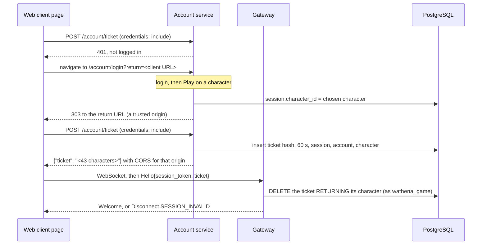

# 0004: Account Service, Login Sessions, and Game Tickets

- Status: accepted.
- Date: 2026-10-01.
- Code: [server/account](../../server/account), [migration 00002](../../server/store/migrations/00002_account_service.sql).

## Decision

- The account service is a Go package, `server/account`, with plain HTML pages under `/account/`: signup, login, logout, and a character list with character creation and Play. `waserver` serves it in the same process for now.
- Passwords are hashed with Argon2id. Login sessions are random 256-bit tokens in a cookie, and the database keeps only their SHA-256.
- The web client never sees a password or the login cookie's value. It gets a **game ticket**: a random 256-bit value that opens one game connection, once, within 60 seconds. It sends the ticket in `Hello.session_token`.
- The account service connects as its own PostgreSQL role, `wathena_account`. The game role cannot read passwords or sessions.
- `--dev` sessions stay for development, and only on a loopback address.

## Tables and roles

| Table | Holds | `wathena_account` | `wathena_game` |
|---|---|---|---|
| `accounts` | Name, dev flag. | Read, insert. | Read, insert (dev accounts). |
| `account_passwords` | Argon2id hash as a PHC string. | Read, insert, update. | None. |
| `account_sessions` | Token hash, account, times, user agent, IP, chosen character, revoked time. | Read, insert, update, delete. | None. |
| `game_tickets` | Ticket hash, session, account, character, expiry. | Read, insert, delete. | Read, delete. |
| `characters` | As in migration 00001. | Read, insert. | Read, insert, update. |
| `inventory` | As in migration 00001. | Insert (start items). | Read and write. |

- Neither role can change the schema or delete characters.
- Password hashes sit in their own table so that a role can read accounts without reading hashes. Two-factor secrets and passkeys will get tables of their own next to it, with the same rights.
- Account names from the signup page are 4 to 24 ASCII letters, digits and underscores, starting with a letter. The `accounts_name_rules` CHECK enforces it. Dev accounts keep the looser rule. Names stay unique without regard to case.
- Character names from the account page are 4 to 24 ASCII letters and digits, with single spaces between words. The rule is narrow until the name filter of strategy section 7.10 exists.

## Passwords

- Argon2id through `golang.org/x/crypto/argon2`, with a 16-byte random salt per hash and a 32-byte key.
- Parameters: 64 MiB, 3 passes, 4 threads (RFC 9106's second recommendation). One hash took 53 ms on the development machine (Apple M-series, 8 cores). Other measurements on the same machine: 20 ms with 1 pass, 35 ms with 2 passes, and 47 ms with 1 pass and 1 thread.
- The hash is stored as a PHC string, `$argon2id$v=19$m=65536,t=3,p=4$<salt>$<key>`, so it names its parameters. A successful login with other parameters stores a new hash. The update only replaces the hash that was checked.
- The parser for stored hashes rejects other algorithms and versions, and limits memory to 1 GiB and passes to 64, so a bad row cannot exhaust the server. It is fuzzed.
- At most 4 hashes run at once, so logins use at most 256 MiB for hashing. A request that waits more than 10 seconds fails with "try again later".
- New passwords are 8 to 256 bytes, not the account name, and not on a built-in list of about 90 common passwords.
- A login for a name without an account still runs one hash, so the time taken does not tell whether the account exists.
- Keys are compared in constant time. Passwords and tokens are never logged.

## Login sessions

- `Set-Cookie: wa_session=<token>; Path=/; HttpOnly; SameSite=Strict`, plus `Secure` and the `__Host-` prefix when the public URL is https. The prefix stops a neighbouring subdomain from setting the cookie.
- A session ends after 30 days, after 7 days unused, or at logout. Logout revokes it and deletes its unused tickets in one transaction.
- Every 10 minutes, expired and revoked sessions and expired tickets are deleted. The IP address goes with the session, well inside the 90 days of strategy section 7.10.
- A login ends the session the browser came with, so an old cookie cannot be fixed on a player.

## Forms and pages

- **CSRF.** Every form carries a token: an HMAC-SHA256, under a key made at startup, of a random CSRF cookie and the session cookie. A token from before a login stops working after it. A post is also refused when `Sec-Fetch-Site` is sent and is not `same-origin`, or when `Origin` is sent and is not the service's own. Tokens are compared in constant time. A restart makes open forms fail once.
- **Headers.** `Content-Security-Policy: default-src 'none'; script-src 'none'; frame-src 'none'; connect-src 'none'; style-src 'self'; img-src 'self'; form-action 'self' <client origins>; frame-ancestors 'none'; base-uri 'none'`, and `X-Content-Type-Options: nosniff`, `X-Frame-Options: DENY`, `Referrer-Policy: no-referrer`, `Cross-Origin-Opener-Policy: same-origin`, `Cache-Control: no-store`, and `Strict-Transport-Security` over https. The pages have no scripts. A captcha provider adds its own origins to the policy.
- **Messages.** A wrong name and a wrong password give the same message. Signup does say "That account name is taken", since the player needs to pick another name. Anyone can learn whether a name exists that way, as on most sites. The signup rate limit slows collecting names in bulk.
- Form bodies are limited to 16 KB.

## Rate limits and captcha

| Limit | Default |
|---|---|
| Login attempts per address | 10 at once, then 1 every 6 seconds. |
| Signups per address | 3 at once, then 1 every 10 minutes. |
| Ticket requests per address | 20 at once, then 1 every 3 seconds. |
| Captcha | After 3 failed logins for a name, or 10 from an address. |
| Wait per name | From 5 failures: 1 s, then doubled per failure, up to 15 minutes. It applies to the right password too. |
| Forgetting | 1 hour after the last failure. A successful login resets its name. |

- An address is an IPv4 address or an IPv6 /64. Behind a proxy, `--trusted-proxies` names the proxies whose `X-Forwarded-For` is believed.
- The counts apply to every name, taken or not, so they reveal nothing.
- The per-name wait lets an attacker delay a player's login by up to 15 minutes. The captcha and the address limits make that costly. A player with two-factor login could later skip the wait.
- **In memory, not in the database.** A failed login writes nothing, so a flood of guesses cannot become a flood of writes, and only the owner can restart the server to reset the counts. Each process keeps its own counts, so several account service processes multiply the limits. They move to shared storage when the account service runs as more than one process. The tables hold at most 100,000 entries each. When full, new names are refused rather than let through uncounted.
- **Captcha.** `account.Captcha` has three methods: the form field's HTML, the check of a submitted form, and extra CSP origins. `NoCaptcha` asks nothing. `DevCaptcha` is a checkbox that shows the flow in development and stops no script. A real provider is out of scope for now.

## Game handoff

1. **Play** records the chosen character on the login session and sends the player to the client. The return URL must be on a trusted client origin, or the `--play-url` is used.
2. The client asks `POST /account/ticket` with `credentials: "include"`. The service answers only when `Origin` is a trusted client origin or its own, and returns CORS headers for that origin only. A post from any other origin is refused before anything happens.
3. The answer is 200 with the ticket, 401 when there is no live session (the client goes to the login page), or 409 when no character is chosen (the client goes to the character list). It is never cached.
4. The client sends the ticket as the text of `Hello.session_token`. The gateway hashes it and runs one statement as the game role: `DELETE ... RETURNING` the ticket, joined to its character. Two connections with the same ticket cannot both get it. An expired ticket is deleted and refused. The character must still belong to the ticket's account.
5. Loading, one session per character, and saving then work as decision 0003 describes.

Why this shape:

- **No token in a URL.** URLs end up in access logs, browser history, and `Referer` headers. The ticket travels in a response body and a WebSocket message only.
- **The login cookie stays on the account service.** The client never holds it and cannot read it (`HttpOnly`). A leaked ticket opens one connection within 60 seconds and nothing else.
- **Reload works.** A page reload fetches a new ticket for the same chosen character, as long as the login session lives.
- **Logout ends pending tickets.** Revoking a session deletes its tickets in the same transaction.
- **The game role stays small.** It can read and delete tickets, which are hashes of values that are useless once used, and nothing else about logins.

Same-site requirement:

- The session cookie is `SameSite=Strict` (strategy section 7.6), so the browser only sends it with the ticket request when the client page and the account service are on the same site: the same scheme and registrable domain, such as `play.example.com` and `account.example.com`, or `localhost` on two ports.
- A trusted fork on another site cannot get tickets this way. It needs a different handoff, such as a popup on the account service that hands the ticket to the opener with `postMessage` to an allowed origin. That is left for later.

## waserver

- With `WATHENA_DATABASE_URL` (the game role) and `WATHENA_ACCOUNT_DATABASE_URL` (the account role), `waserver` serves the account pages and accepts only game tickets.
- `--origins` lists the trusted client origins, as `scheme://host[:port]`. They may fetch tickets, Play may send players to them, and the gateway accepts WebSocket connections from them. Pages on the server's own host are accepted too. A connection without an `Origin` header is not a browser page and is accepted: the ticket is what lets it in.
- `--account-url` is the public URL. Its scheme decides `Secure` cookies and HSTS. `--play-url` is where Play goes without a return URL. `--captcha none|dev` picks the provider.
- `--dev` takes any name as a session token. It refuses to start unless `--addr` is a loopback address, since anyone who reaches it can play any character. There is no flag to override that.

## Two-factor login and passkeys

Both come in a later step. They fit this way:

- Tables `account_totp` and `account_passkeys` next to `account_passwords`, with the same role rights.
- After the password passes, an account with a second factor gets a short pending login (a hashed token, a few minutes) and the second factor's page. `startSession` runs only after that factor passes. The hook is marked in `postLogin`.
- Passkeys use the account service's domain as the relying party ID, from `--account-url`, so a fork on another domain cannot use them.
- Game tickets and the gateway do not change.

## Alternatives

| Option | Why not |
|---|---|
| Ticket in the client URL, or a URL fragment | URLs reach history and logs. A fragment does not reach servers, but stays in history and can leak through scripts on the page. |
| The WebSocket sends the login cookie | The gateway and the account service would share a cookie scope, and a WebSocket from any page on the site would carry it. The origin check would be the only guard. |
| `SameSite=None` so any trusted fork can fetch tickets | Weakens CSRF protection on every page, and browsers are dropping third-party cookies. |
| Rate limit counts in PostgreSQL | Every failed guess would write a row. Kept for when there is more than one account service process. |
| A long-lived session token in the client | The client, or a fork, could then act as the player on the account pages. |

## Left for later

- A logout or password change does not yet close a game connection that is already open. It ends when the player leaves. `LISTEN`/`NOTIFY` from the account service to the gateway can close it.
- Password change, email, account recovery, and the player's list of their own sessions.
- Two-factor login and passkeys, as above.
- A real captcha provider.
- Rate limit counts shared between processes.
- A handoff for trusted forks on other sites.
- Reserved names and the name filter.
