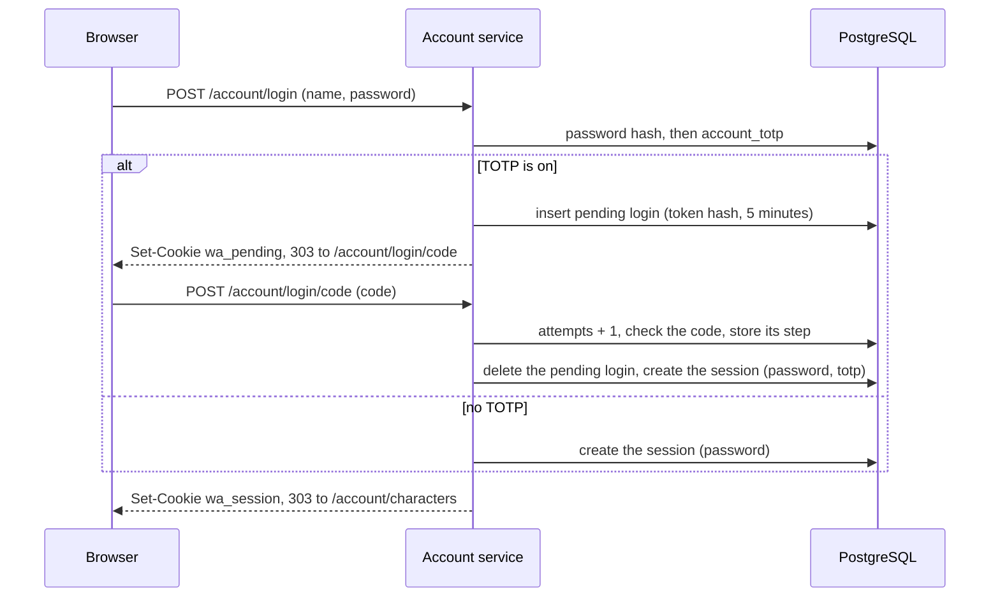

# 0005: Two-Factor Login, Passkeys, and Logout Closing the Game

- Status: accepted.
- Date: 2026-10-01.
- Code: [server/account](../../server/account), [migration 00003](../../server/store/migrations/00003_two_factor.sql), [server/gateway](../../server/gateway).
- Builds on [decision 0004](0004-account-service-and-game-tickets.md).

## Decision

- Players can turn on TOTP codes (`github.com/pquerna/otp`) and add passkeys (`github.com/go-webauthn/webauthn`) on a new page, `/account/settings`. Both are optional.
- TOTP secrets are encrypted in the database with AES-256-GCM, under a key from `WATHENA_ACCOUNT_SECRET_KEY`.
- A login with a password and TOTP takes two steps. Between them the browser holds a short pending login, not a session.
- A passkey login that verified the user counts as both factors.
- Pages that change login methods need a login, or a new proof, from the last 10 minutes.
- Each login session records the factors that opened it.
- Revoking a login session closes the game connections it opened, with the new `DISCONNECT_REASON_LOGGED_OUT`.
- Only `wathena_account` has rights on the new tables. `wathena_game` has none.

## Tables and roles

| Table | Holds | `wathena_account` | `wathena_game` |
|---|---|---|---|
| `account_totp` | The sealed secret, when it was turned on, and the last accepted time step. | Read, insert, update, delete. | None. |
| `account_recovery_codes` | SHA-256 of each recovery code, and when it was used. | Read, insert, update, delete. | None. |
| `account_pending_logins` | Token hash, account, the first factor, expiry, attempts. | Read, insert, update, delete. | None. |
| `account_webauthn_users` | The random 32-byte WebAuthn user handle of an account. | Read, insert. | None. |
| `account_passkeys` | Credential ID, public key, RP ID, counter, clone warning, flags, transports, AAGUID, name, created and last used times. | Read, insert, update, delete. | None. |
| `account_webauthn_ceremonies` | Token hash, kind, session, go-webauthn's session data, expiry. | Read, insert, delete. | None. |
| `account_sessions` | New columns: `factors` and `authenticated_at`. | As before. | None. |

- `factors` is a text array of `password`, `totp`, `recovery_code` and `passkey`. A CHECK allows only these.
- Cleanup deletes expired pending logins and ceremonies with the expired sessions and tickets.

## TOTP

- RFC 6238 with the settings every app expects: SHA-1, 6 digits, 30-second steps, 20-byte secrets.
- Setup:
  1. The player presses "Turn on two-factor login". A new secret is stored sealed, with `enabled_at` empty.
  2. The page shows a QR code and the key in groups of 4. The QR code is SVG drawn on the server from the `otpauth://` URI, inside the page. No other service sees the secret, and the page needs no script.
  3. The player enters a code. When it is right, TOTP is on, and 10 recovery codes are shown once.
- A code is accepted for the current step and one step either side.
- **Replay.** The last accepted step is stored. A code is only accepted for a later step. The check and the update are one `UPDATE ... WHERE last_step < step`, so two requests with the same code cannot both pass. The first code from setup counts too.
- All candidate codes are compared in constant time.
- **Rate limits.** Code attempts use the login limits of decision 0004: the address bucket, and the per-name failure counts with the doubling wait. The per-name count is only reset when the whole login passes.
- **Turning it off** needs the password and a current code or a recovery code, in the same form. It deletes the secret and the recovery codes.

## Recovery codes

- 10 codes of 80 random bits, written as 16 base32 characters in groups of 4, such as `abcd-efgh-2345-67ab`.
- The database keeps only their SHA-256. They are random and long, so a plain hash is enough, as for session tokens.
- Each works once. The code form accepts them in any case, with or without dashes and spaces.
- The settings page shows how many are left, and can make new ones. New codes replace all old ones.

## Encryption of TOTP secrets

- `WATHENA_ACCOUNT_SECRET_KEY` holds 32 random bytes in base64, such as from `openssl rand -base64 32`.
- A sealed value is a version byte, an 8-byte key ID, a 12-byte random nonce, then the AES-256-GCM ciphertext and tag.
- The key ID is an HMAC of a fixed text under the key, so it names the key without revealing it.
- The account ID is bound in as additional data. A sealed secret copied to another account's row does not open.
- Without the key, `waserver` starts, and TOTP setup is off. Accounts that already have TOTP cannot use app codes until the key is back. Their recovery codes, and passkeys that verify the user, still work.

Key changes:

1. Put the new key in `WATHENA_ACCOUNT_SECRET_KEY`, and the old one in `WATHENA_ACCOUNT_OLD_SECRET_KEYS` (comma-separated).
2. New secrets are sealed under the new key. Old secrets still open.
3. A secret is sealed again under the new key when its player next uses a code.

Limits:

- Secrets of players who do not log in stay under the old key. Remove an old key only when no row uses it. A row names its key in bytes 2 to 9 of `account_totp.secret`.
- A secret whose key is lost cannot be opened. The player logs in with a recovery code or a passkey and sets TOTP up again, or the server owner deletes the row.
- The key protects a copy of the database, such as a backup. It does not protect against someone who can read both the database and the server's environment.

Why encrypt, and not store the secret plain:

- A TOTP secret is a live credential. A leaked backup with plain secrets gives an attacker the second factor of every player.
- The cost is one environment variable, which `waserver` already needs for database URLs.

## Login flow

The pending login:

- It is a random 256-bit token in the `wa_pending` cookie (`HttpOnly`, `SameSite=Strict`, `__Host-` over https). The database keeps its SHA-256.
- It lasts 5 minutes and allows 5 codes. Each post uses one attempt, right or wrong.
- It only opens the code form. It cannot fetch tickets or open any other page.
- It is bound to the browser by its cookie. A code posted from another browser has no pending login.

## Passkeys

- The relying party ID is the host of `--account-url`. A passkey only works on the account service's domain, so a client fork on another domain cannot ask for it. Without `--account-url`, or with an IP address in it, passkeys are off.
- Passkeys are discoverable (resident key required), so the login page has one "Log in with a passkey" button and needs no name.
- User verification is preferred. Attestation is not asked for.
- The WebAuthn user handle is a random 32-byte value per account, not the account ID.
- An account may have 10 passkeys.
- Each ceremony's state (the challenge and its options) is stored under the hash of a random token in the `wa_webauthn` cookie, for 5 minutes. It is deleted when the answer arrives, so each challenge can be answered once. Register and reauth ceremonies are tied to the login session that started them.
- **Counter.** The signature counter must go up. When it does not, and either value is not 0, the passkey gets a clone warning and is refused from then on. The player removes it and adds it again. Synced passkeys always report 0, so they never trigger this.
- The flags, counter and last use are stored after each login.
- **Both factors.** A passkey login whose authenticator verified the user (a PIN, fingerprint or face) counts as both factors: something the player has and something they know or are. The session records `{passkey}`.
- A passkey login without user verification counts as one factor. When TOTP is on, it goes to the code step, and the session records `{passkey,totp}`.
- A passkey login skips the per-name wait after failed passwords. It is not guessable, and the wait exists for passwords.
- Passkeys are an extra way in. They do not make a password login need a code. TOTP does that.

## The one script

WebAuthn needs `navigator.credentials`, so the account service now has one script:

- `/account/passkey.js`, a static file embedded in the binary and served by the account service.
- Only the login, reauth and settings pages load it. Their `Content-Security-Policy` has `script-src 'self'` and `connect-src 'self'`, with no `'unsafe-inline'` and no `'unsafe-eval'`. Every other page keeps `script-src 'none'`.
- The script only converts between the server's JSON and the browser's WebAuthn objects. It holds no state.
- Its requests carry the page's CSRF token in `X-CSRF-Token`. The server checks it as it checks form tokens, with `Sec-Fetch-Site` and `Origin`.
- Without JavaScript, the pages work as before. The passkey buttons stay hidden.

## Recent login

- These actions need the session to have logged in, or proven itself again, within 10 minutes:
  - Starting and confirming TOTP setup.
  - Making new recovery codes.
  - Adding and removing passkeys.
  - Later, changing the password.
- Otherwise the player goes to `/account/reauth`. It asks for the password, and the code when TOTP is on, or a passkey. Passing it sets the session's `authenticated_at`.
- Turning TOTP off asks for the password and a code in its own form, so it needs no separate reauth.
- The reauth page uses the login rate limits. Its `next` must be a path under `/account/`.

Why: a stolen session cookie alone must not be enough to add the thief's own passkey or turn off the second factor.

## Revocation closes the game

- A game ticket records its login session. `RedeemTicket` returns the session ID, and the gateway tracks which connections each login session opened.
- When the account service revokes a session, at logout or when a new login in the same browser replaces it, it calls `Config.Ended.EndLoginSessions` after the transaction commits.
- The gateway sends `Disconnect` with `DISCONNECT_REASON_LOGGED_OUT` ("You logged out. Log in again to play.") and closes the connection. The zone saves the character as at any logout.
- The gateway remembers ended sessions for 5 minutes. A connection whose ticket was used just before the logout, and that registers just after, is closed at once.
- The web client shows the message, then goes back to the account pages, which send the player to the login page.

In one process (`waserver`), the account service calls the gateway directly. For separate processes, a bridge can implement `account.SessionEnder`:

1. The account service runs `NOTIFY` with the session IDs in the revoking transaction, so the notice is sent only if the revoke commits.
2. Each gateway process holds a connection with `LISTEN` and calls `EndLoginSessions`.
3. After a reconnect the gateway would miss notices. It then needs a way to check its open sessions, such as read access to `account_sessions.revoked_at`.

## Parameters

| Parameter | Value |
|---|---|
| TOTP | SHA-1, 6 digits, 30 s steps, 20-byte secrets, 1 step either side. |
| Recovery codes | 10, of 80 bits each. |
| Pending login | 5 minutes, 5 attempts. |
| Recent login | 10 minutes. |
| Passkey ceremony | 5 minutes, answered once. |
| Passkeys per account | 10. |
| Ended sessions remembered by the gateway | 5 minutes. |
| Sealing | AES-256-GCM, 12-byte random nonce, account ID as additional data. |

## Alternatives

| Option | Why not |
|---|---|
| TOTP secrets stored plain, protected by the role only | A database backup would give every second factor away. |
| Pending login in memory | It would be lost on restart and not shared between processes. The table is small and cleaned every 10 minutes. |
| QR codes from an outside service, or as a `data:` image | An outside service would see the secret. A `data:` image needs `img-src data:`. Inline SVG needs neither. |
| Inline script for passkeys | It needs `'unsafe-inline'` or nonces on every page. One same-origin file keeps the policy simple. |
| Passkeys after entering the name | Anyone could learn which credential IDs an account has. Discoverable passkeys need no name. |
| Ending the game only when the player leaves | A player who logs out on a shared computer would stay in the game. |

## Left for later

- Password change, which must revoke all sessions and close their games, and ask for a recent login.
- A list of the player's own sessions, with their factors, and a way to end each.
- Sessions that expire, rather than being revoked, do not close an open game connection yet.
- The `LISTEN`/`NOTIFY` bridge, for when the gateway and the account service run as separate processes.
- Staff accounts that must use TOTP or a passkey before GM commands work (strategy 7.3).
- Rate limit counts shared between processes, as in decision 0004.
