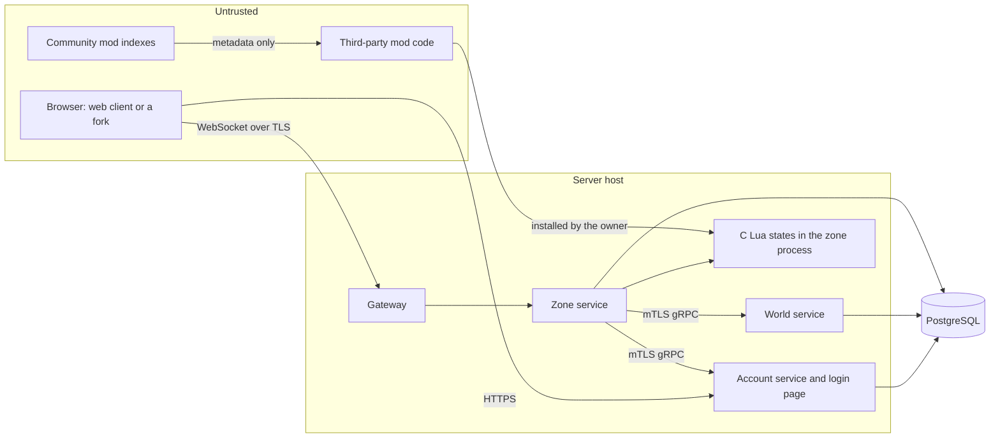

# Threat Model

This document lists what wAthena protects, who attacks it, and how each threat is handled. It extends strategy section 7.1. Update it when a design proposal changes a trust boundary, and review it in full before the public beta.

Status values:

- **Done.** Built and tested.
- **Decided.** Chosen in the strategy, a decision, or a proposal, but not built yet.
- **Open.** Not decided yet.

## Assets

| Asset | Why it matters |
|---|---|
| Account credentials and session tokens | Control of an account means control of its items and characters. |
| Items and zeny | The economy. Duplication or theft ruins it for everyone. |
| The world secret and secret seed branches | They decide spawns, loot, and quest answers in procedural worlds. |
| Player private data | Email, IP addresses, chat logs, and reports. |
| Server availability | Players cannot play during an outage, and rollbacks lose progress. |
| Staff powers | GM commands can create items, read private data, and ban players. |
| The server host | Code running on it can reach the database and every secret. |
| Build and release artifacts | A tampered release reaches every server that installs it. |

## Trust boundaries

The boundaries are:

1. **Browser to gateway and account service.** Everything the client sends is untrusted. The client is open source and easy to modify.
2. **Mod code to the zone.** Mod scripts are untrusted code that runs inside the zone process, in C Lua states.
3. **Services to each other.** Services authenticate each other with mutual TLS. A compromised service must not gain more database rights than its own role.
4. **Staff to the admin API.** Staff are trusted with their role, but every action is logged.
5. **Build to release.** Third-party code and tools enter through Go modules, GitHub Actions, and downloaded compilers.

## Attackers

| Attacker | Goal | Main entry points |
|---|---|---|
| Cheating player | Items, zeny, speed, or information they should not have. | Modified client, bots, injected or replayed messages, predicting random outcomes. |
| Account attacker | Take over accounts to steal items. | Reused passwords, brute force, phishing, stolen session tokens. |
| Malicious mod author | Steal data, add backdoors, break the economy, or take over the host. | Published mods, hooks, permissions, bugs in the Lua runtime. |
| Malicious client fork | Steal passwords or sessions. | Forked web clients hosted by third parties. |
| Rogue staff member | Give items or read private data. | GM commands, the admin tools, database access. |
| Network attacker | Take servers offline, or read traffic. | Connection floods, large or expensive messages, traffic analysis. |
| Web attacker | Run code in players' browsers or act as them. | Chat, names, guild emblems, cross-site requests. |
| Supply chain attacker | Put code into wAthena releases or dependencies. | Go modules, Actions, compilers, the Lua source. |

## Threats and mitigations

### Client and protocol

| Threat | Mitigation | Status | Reference |
|---|---|---|---|
| Crafted messages crash the server. | Generated Protocol Buffers decoders. Size limits before decoding. A decode error closes that connection only. Fuzz tests on client messages. | Decided. The fuzz test exists. | Proposal 0001, strategy 7.4 |
| Session token leaks through logs. | The game ticket is sent in `Hello`, not in the URL, and the client gets it in a response body. Logs never contain passwords, tokens or tickets. | Done. | Proposal 0001, decision 0004, strategy 7.8 |
| A game ticket is stolen or replayed. | Tickets are 256-bit random values, stored as SHA-256 hashes, used up by one `DELETE ... RETURNING`, and expire after 60 seconds. Logout deletes a session's unused tickets. | Done. | Decision 0004 |
| Traffic analysis of compressed frames reveals whispers. | WebSocket compression is off. | Decided. | Proposal 0001 |
| Tracking players across sessions by ID. | Entity IDs are per connection. Database IDs are never sent. | Decided. | Proposal 0001 |
| Speed hacks and teleporting. | The server checks every move against walk speed and path. | Decided. | Strategy 7.5 |
| Attacking faster than allowed. | Server-side cooldowns, cast times, and delays. Client timing is ignored. | Decided. | Strategy 7.5 |
| Seeing hidden players or monsters out of range. | The server sends only what the player can see. Other players' HP is a fraction. | Decided. | Strategy 7.5, proposal 0001 |
| Replaying a command, such as a trade confirmation. | TLS stops replay from outside the connection. Commands that move items or zeny run in database transactions and check current state, so repeating one does nothing. | Decided. | Strategy 4.1 |
| Expensive commands exhaust CPU, such as long path searches. | Path length is capped, as in rAthena's `MAX_WALKPATH`. Per-command rate limits. | Decided. | Strategy 7.4 |
| Walking into new regions forces map generation. | Generation runs in a worker pool with a queue limit. Generated maps are cached. Players cannot pick seeds. | Open. Limits need numbers. | Strategy 8.5 |

### Accounts

| Threat | Mitigation | Status | Reference |
|---|---|---|---|
| Password reuse and brute force. | Argon2id hashes (64 MiB, 3 passes, 4 threads, about 50 ms), rehashed on login when the parameters change. Common passwords are refused. Rate limits per address and per account name, with waits that double up to 15 minutes. A captcha hook after 3 failures for a name or 10 from an address. Optional TOTP and passkeys. | Done, except TOTP, passkeys and a real captcha provider, which are decided. The limits are per process. | Strategy 7.3, decision 0004 |
| Learning which accounts exist. | Login gives one message for a wrong name or password, and hashes once for unknown names, so timing matches. Signup says a name is taken, which cannot be avoided, and is rate limited. | Done. | Decision 0004 |
| Locking a player out with failed logins. | The per-name wait is capped at 15 minutes and forgotten after an hour. The captcha and address limits make many failures costly. | Done. Accepted risk. | Decision 0004 |
| A client fork collects passwords. | Login happens on the account service's own page. The client receives a one-time game ticket, never the password or the login cookie. Tickets go only to trusted client origins, through CORS. Passkeys are bound to the account service's domain. | Done for the login page and tickets. Passkeys are decided. | Strategy 7.6, decision 0004 |
| Stolen session tokens. | 256-bit random tokens in an `HttpOnly`, `SameSite=Strict` cookie, `Secure` with the `__Host-` prefix over https. The database stores only hashes. Sessions end after 30 days, 7 days unused, or logout. A login replaces the browser's older session. Password change revokes all sessions. | Done, except password change, which does not exist yet. An open game connection is not closed at logout yet. | Strategy 7.3, decision 0004 |
| Staff account takeover. | Staff must use TOTP or a passkey before GM commands or admin tools work. | Decided. | Strategy 7.3, 10.6 |

### Game integrity

| Threat | Mitigation | Status | Reference |
|---|---|---|---|
| Item duplication. | Transactions for trades, storage, mail, and vending. Serial numbers on every item, with a job that flags duplicates. Database constraints on amounts. | Done for saving: every inventory row has a UUIDv7 serial as its primary key, one stack per slot, amounts of 1 to 30000, and a character and its inventory are saved in one transaction. Trades, the item log, and the duplicate job are decided. | Strategy 3.5, 7.5, decision 0003 |
| Zeny overflow. | Checked math, and database constraints that reject negative or overflowing amounts. | Database constraints done: zeny is 0 to 2147483647, exp and points are 0 or more. Checked math is decided. | Strategy 7.5, decision 0003 |
| A stale session overwrites newer progress, such as after a second login. | One session per character: a second login kicks the first and waits for its last save. A save version on each character rejects saves from an older session, and the zone then disconnects that session's player. | Done. | Decision 0003 |
| SQL injection. | Game code only runs queries that sqlc generates, which bind every parameter. A CI check rejects `fmt.Sprintf` and raw query calls in database code. | Done. | Strategy 7.2, decision 0003 |
| Predicting drops and critical hits. | Gameplay randomness uses ChaCha8 per zone, seeded from `crypto/rand`. | Decided. | Strategy 8.3 |
| Predicting secret generation, such as loot or quest answers. | The world secret never leaves the server. Child keys come from HMAC-SHA256, so public seeds reveal nothing about secret branches. Secret branches use ChaCha8. | Done for the seed tree, with test vectors. | [rng-v1](../specs/rng-v1.md) |
| Leaking the world secret through logs. | `rng.Node` prints as redacted. Keys are only readable through `Key()`. | Done. | `shared/rng` |

### Mods and the Lua runtime

| Threat | Mitigation | Status | Reference |
|---|---|---|---|
| A mod script escapes the Lua sandbox through a memory bug in C Lua or the binding. | Scripts cannot load bytecode, which is the easiest way to break C Lua. No `io`, `os`, `debug`, or `package` libraries, and no C modules. The binding stays small and is fuzzed. The Lua version is pinned, and new Lua releases are reviewed for security fixes. | Decided. | Decision 0002, strategy 6.6 |
| A mod uses all CPU or memory. | A per-call CPU budget from an instruction count hook. A memory limit from the binding's allocator. Mods that fail too often are disabled in that zone. | Done in the benchmark binding. | Decision 0002 |
| One mod reads or changes another mod's data. | Separate environments and read-only shared tables. No permission for other mods' data. | Decided. | Strategy 6.6 |
| A mod calls internal services over the network. | `net.http` is a flagged permission. Only hosts listed in the manifest are allowed, never private IP ranges. | Decided. | Strategy 7.7 |
| A malicious or changed mod package. | Signed releases and checksums, checked by `wactl`. The server owner reviews permissions. Indexes hold metadata, not code. | Decided. | Strategy 6.10 |
| A mod quietly gives items or zeny. | These actions need a permission the owner approves. Item and zeny creation is logged by serial. | Decided. | Strategy 6.6, 7.5 |

### Staff and operations

| Threat | Mitigation | Status | Reference |
|---|---|---|---|
| A staff member creates items or reads data without cause. | Role-based permissions per command. An audit log of every action. A reason is required for item and zeny creation. | Decided. | Strategy 7.8, 10.6 |
| A compromised service reaches all data. | One PostgreSQL role per service, with only the tables and rights it needs. Mutual TLS between services. | Done for the game and account roles: `wathena_game` has no DDL rights, cannot delete accounts or characters, and cannot read passwords or sessions. `wathena_account` alone reads passwords, and cannot change or delete characters. Migrations run as `wathena_migrator`. Other services' roles and mutual TLS are decided. | Strategy 7.8, decisions 0003 and 0004 |
| The database password leaks through process lists or logs. | `waserver` and `wactl migrate` read the database URL from an environment variable. The URL is never logged, and parse errors do not quote it. | Done. | Decision 0003 |
| Secrets committed to the repository. | Secrets come from environment variables or a secret manager. | Decided. | Strategy 7.8 |
| Lost data. | Encrypted backups and scheduled restore tests. | Decided. | Strategy 7.8 |

### Web

| Threat | Mitigation | Status | Reference |
|---|---|---|---|
| Script injection through chat, names, or NPC text. | Text is shown with `textContent`, never `innerHTML`. A strict Content Security Policy. | Decided. | Strategy 7.6 |
| Malicious guild emblem files. | Size limits, decoding, checks, and re-encoding. The original file is never served. | Decided. | Strategy 7.6 |
| Cross-site requests. | `SameSite=Strict` cookies. Every account form has a CSRF token bound to the session, and posts with a foreign `Origin` or `Sec-Fetch-Site` are refused. The ticket endpoint answers only trusted origins. The gateway checks the WebSocket `Origin` against the trusted client origins, with the scheme. | Done. | Strategy 7.4, 7.6, decision 0004 |
| Script injection or framing on the account pages. | The pages have no scripts. `Content-Security-Policy` allows no scripts, no frames, and no framing, and forms only post to the service. Templates escape every value. | Done. | Decision 0004 |
| Anyone plays any character on a development server. | `waserver --dev` refuses a listen address other than loopback. | Done. | Decision 0004 |

### Asset build and serving

| Threat | Mitigation | Status | Reference |
|---|---|---|---|
| A crafted GRF, art pack, or mod pack exploits a parser. | Length checks before every read, fuzz tests, and the build runs offline as its own command, not in the game server. The client's compiled Lua tables are never run: an evaluator reads only table-building instructions, with a step limit. | Decided. | Strategy 10.1 |
| A crafted asset name escapes the build's output folder. | Names are checked against the rules in [assets-v1](../specs/assets-v1.md) before use. Output files are named by content hash, not by asset name. | Decided. | assets-v1 |
| Path traversal or wrong content types on the asset server. | Files are served only by valid content hash, with a fixed content type per extension and `nosniff`. No directory listing. | Decided. | Strategy 10.1 |
| Hotlinking and bandwidth abuse. | Optional signed cookie from the account service. A CDN absorbs traffic. | Decided. | Strategy 10.1 |
| A stale or poisoned cache in players' browsers. | Names are content hashes, so a cached file always matches its name. The client checks the hash of each file it downloads. | Decided. | Strategy 10.1 |

### Availability

| Threat | Mitigation | Status | Reference |
|---|---|---|---|
| Connection floods. | A proxy or load balancer in front. Connection limits per IP. Internal ports are not public. | Decided. | Strategy 7.4 |
| Message floods. | Rate limits per connection and per message type. | Decided. | Strategy 7.4 |
| A crash in one connection stops the server. | Each connection goroutine recovers from panics. | Decided. | Strategy 7.4 |
| A crash in C Lua stops the zone process. | A C crash cannot be recovered in Go. The binding checks inputs, and scripts cannot reach raw memory. A supervisor restarts the process. | Open. The restart and state recovery plan is not written. | Decision 0002 |

### Supply chain

| Threat | Mitigation | Status | Reference |
|---|---|---|---|
| A compromised GitHub Action. | Actions are pinned by commit hash. Workflows have read-only permissions. | Done. | `.github/workflows` |
| A compromised download: Lua, TinyGo, wasmtime, or wasi-sdk. | Each download is checked against a pinned SHA-256. | Done. | `.github/workflows/ci.yml`, `tools/luabench/wasm/build.sh` |
| A vulnerable Go module. | `go.sum` pins modules. `govulncheck` and `gosec` run on every push. | Done. | Strategy 7.9 |
| A tampered release. | Signed release binaries and a software bill of materials. | Decided. | Strategy 7.9 |

## Findings from phase 0b

These came up while writing this document.

1. **Per-mod memory limits need separate Lua states.** Strategy section 6.6 puts every mod in the same zone Lua state, with separate environment tables. The binding's memory limit applies to a whole state, so it cannot enforce the 16 MB per mod in strategy section 3.8. The fix is one Lua state per mod per zone. That fits `require`, since each mod then has its own module cache. The cost is about 1 ms and 0.2 MB per mod state (decision 0002). This belongs to the Lua API redesign.
2. **Third-party mods could run in WebAssembly.** The binding's C code also builds to WebAssembly, where a memory bug cannot reach the host. Mods the owner does not fully trust could run there, and the core mod through cgo. Decision 0002 measured WebAssembly as slower, mostly on errors and coroutine yields. This is an option to measure again, not a decision.
3. **C Lua crashes need a recovery plan.** A zone process that crashes loses unsaved state since the last save. The persistence plan saves changed data at intervals (strategy section 4.1, item 5), so the loss is bounded, but the interval and the restart behavior need numbers.

## Out of scope

- Attacks on the player's own device or browser.
- Attacks on the hosting provider.
- Whether an operator has the right to serve the game assets they supply.
