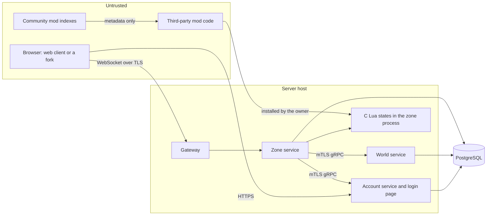

# Threat Model

This document lists what wAthena protects, who attacks it, and how each threat is handled. It extends strategy section 7.1. Update it when a design proposal changes a trust boundary, and review it in full before the public beta.

Status values:

- **Done.** Built and tested.
- **Decided.** Chosen in the strategy, a decision, or a proposal, but not built yet.
- **Open.** Not decided yet.

## Assets

| Asset | Why it matters |
|---|---|
| Account credentials and session tokens | Control of an account means control of its items and characters. |
| Items and zeny | The economy. Duplication or theft ruins it for everyone. |
| The world secret and secret seed branches | They decide spawns, loot, and quest answers in procedural worlds. The game role holds only the public branch and the derived keys of rotations and seasons (decision 0045). |
| Player private data | Email, IP addresses, chat logs, and reports. |
| Server availability | Players cannot play during an outage, and rollbacks lose progress. |
| Staff powers | GM commands can create items, read private data, and ban players. |
| The server host | Code running on it can reach the database and every secret. |
| Build and release artifacts | A tampered release reaches every server that installs it. |

## Trust boundaries

The boundaries are:

1. **Browser to gateway and account service.** Everything the client sends is untrusted. The client is open source and easy to modify.
2. **Mod code to the zone.** Mod scripts are untrusted code that runs inside the zone process, in C Lua states. A mod's art and client data tables are untrusted input to the build tools, the server's checks, and every player's client ([decision 0033](../decisions/0033-mod-assets.md)).
3. **Services to each other.** Services authenticate each other with mutual TLS. A compromised service must not gain more database rights than its own role.
4. **Staff to the admin API.** Staff are trusted with their role, but every action is logged. The admin API runs on the account service's origin and pool, and reaches the world through one interface, `admin.World` ([decision 0028](../decisions/0028-staff-roles-and-audit.md)).
5. **Build to release.** Third-party code and tools enter through Go modules, GitHub Actions, and downloaded compilers.

## Attackers

| Attacker | Goal | Main entry points |
|---|---|---|
| Cheating player | Items, zeny, speed, or information they should not have. | Modified client, bots, injected or replayed messages, predicting random outcomes. |
| Account attacker | Take over accounts to steal items. | Reused passwords, brute force, phishing, stolen session tokens. |
| Malicious mod author | Steal data, add backdoors, break the economy, or take over the host. | Published mods, hooks, permissions, bugs in the Lua runtime. |
| Malicious client fork | Steal passwords or sessions. | Forked web clients hosted by third parties. |
| Rogue staff member | Give items or read private data. | GM commands, the admin tools, database access. |
| Network attacker | Take servers offline, or read traffic. | Connection floods, large or expensive messages, traffic analysis. |
| Web attacker | Run code in players' browsers or act as them. | Chat, names, guild emblems, cross-site requests. |
| Supply chain attacker | Put code into wAthena releases or dependencies. | Go modules, Actions, compilers, the Lua source. |

## Threats and mitigations

### Client and protocol

| Threat | Mitigation | Status | Reference |
|---|---|---|---|
| Crafted messages crash the server. | Generated Protocol Buffers decoders. Size limits before decoding. A decode error closes that connection only. Fuzz tests on client messages. The zone recovers a panic in a command handler, ends that player's session, and logs the stack. | Decided. The fuzz test exists. Panic recovery in the zone is done. | Proposal 0001, strategy 7.4, [review 2026-10](review-2026-10.md) |
| Session token leaks through logs. | The game ticket is sent in `Hello`, not in the URL, and the client gets it in a response body. Logs never contain passwords, tokens or tickets. | Done. | Proposal 0001, decision 0004, strategy 7.8 |
| A game ticket is stolen or replayed. | Tickets are 256-bit random values, stored as SHA-256 hashes, used up by one `DELETE ... RETURNING`, and expire after 60 seconds. Logout deletes a session's unused tickets. | Done. | Decision 0004 |
| Traffic analysis of compressed frames reveals whispers. | WebSocket compression is off. | Decided. | Proposal 0001 |
| Tracking players across sessions by ID. | Entity IDs are per connection. Database IDs are never sent. | Decided. | Proposal 0001 |
| Speed hacks and teleporting. | The server checks every move against walk speed and path. | Decided. | Strategy 7.5 |
| Attacking faster than allowed. | Server-side cooldowns, cast times, and delays. Client timing is ignored. | Decided. | Strategy 7.5 |
| Seeing hidden players or monsters out of range. | The server sends only what the player can see. Other players' HP is a fraction. A player or a monster under Hiding, Cloaking or Chase Walk, or a GM under `@hide`, is not sent to viewers who cannot see it. The unit itself, its allies and detectors still see it. | Done. A monster under the same statuses is sent only to viewers it is not an enemy of, and to detectors. | Strategy 7.5, proposal 0001, [review 2026-10](review-2026-10.md) |
| Replaying a command, such as a trade confirmation. | TLS stops replay from outside the connection. Commands that move items or zeny run in database transactions and check current state, so repeating one does nothing. | Decided. | Strategy 4.1 |
| Expensive commands exhaust CPU, such as long path searches. | Path length is capped, as in rAthena's `MAX_WALKPATH`. Per-command rate limits in the gateway: 30 messages a second per connection, with lower rates for walks, NPC clicks, social commands and store searches. | Done. | Strategy 7.4, [review 2026-10](review-2026-10.md) |
| One connection floods the zone's command queue, so the zone refuses and disconnects other players. | Each player may have at most 64 commands in its zone's queue of 1024. A command over the share or over the rates is dropped, and a connection that keeps sending over them is disconnected with `DISCONNECT_REASON_RATE_LIMITED`. | Done. | Strategy 7.4, [review 2026-10](review-2026-10.md) |
| A player attacks another player outside PvP with a modified client. | The Attack command and each attack check that the target is an enemy, as rAthena's `battle_check_target`. Players are not enemies, since PvP maps are not ported. | Done. | [review 2026-10](review-2026-10.md) |
| Ranged attacks through walls, for safe farming. | A target 2 or more cells away needs a clear shot, as `battle_check_range` with `path_search_long`. A unit that keeps attacking walks around the obstacle. A player's attack range is a circle, as rAthena's default build. | Done. | [review 2026-10](review-2026-10.md) |
| Ground items flood a map, so players in view get frames over the message limit and are disconnected. | A player may have 50 dropped items on the ground, a map 2000 for a player to drop more, and a player drops at most 10 at once, then one every 200 ms. A tick's events that pass 64 KiB go out in several frames of the same tick. | Done. | [review 2026-10](review-2026-10.md) |
| Trade or friend requests fill another player's frames. | An asker sends at most one trade request and one friend request a second, and a player with the asker's request open gets no second dialog. | Done. | [review 2026-10](review-2026-10.md) |
| Walking into new regions forces map generation. | Generation runs in a worker pool with a queue limit. Generated maps are cached. Players cannot pick seeds. | Open. Limits need numbers. | Strategy 8.5 |

### Accounts

| Threat | Mitigation | Status | Reference |
|---|---|---|---|
| Password reuse and brute force. | Argon2id hashes (64 MiB, 3 passes, 4 threads, about 50 ms), rehashed on login when the parameters change. A list of about 65,000 common passwords from SecLists is refused. Rate limits per address and per account name, with waits that double up to 15 minutes. The per-name limit counts attempts in flight under the same lock as the check, so guesses sent together for one name get at most 5 through before the first failure, then one at a time. The same holds for TOTP codes across all pending logins of a name. A captcha hook on every signup, and on logins after 3 failures for a name or 10 from an address. Optional TOTP codes, with replay protection and the same rate limits, and passkeys. | Done, except a real captcha provider. The limits are per process. The password list is of common passwords, not a full breach list. A passkey without user verification proves possession only, so it is not a second factor for staff (review decision 54). | Strategy 7.3, decisions 0004 and 0005, [review 2026-10](review-2026-10.md) |
| Learning which accounts exist. | Login gives one message for a wrong name or password, and hashes once for unknown names, so timing matches. Signup says a name is taken, which cannot be avoided, and is rate limited. | Done. | Decision 0004 |
| Locking a player out with failed logins. | The per-name wait is capped at 15 minutes and forgotten after an hour. The captcha and address limits make many failures costly. The tables of counts are bounded. When one is full, a new name or address pushes out the entry used least recently of a sample, so a flood of made-up names cannot lock out the names it did not touch. | Done. Accepted risk: a large flood can push out a name's own count early, which the per-address buckets still limit. | Decision 0004, [review 2026-10](review-2026-10.md) |
| A client fork collects passwords. | Login happens on the account service's own page. The client receives a one-time game ticket, never the password or the login cookie. Tickets go only to trusted client origins, through CORS. Passkeys are bound to the account service's domain, the host of `--account-url`. | Done. | Strategy 7.6, decisions 0004 and 0005 |
| Stolen session tokens. | 256-bit random tokens in an `HttpOnly`, `SameSite=Strict` cookie, `Secure` with the `__Host-` prefix over https. The database stores only hashes. Sessions end after 30 days, 7 days unused, or logout. A login replaces the browser's older session. Revoking a session closes the game connections it opened. Changing login methods needs a login from the last 10 minutes. The settings page shows how many other sessions are logged in, with a "Log out everywhere else" button that needs a login from the last 10 minutes and ends them with their game connections. Changing the password, turning TOTP on or off, new recovery codes and adding or removing a passkey end the other sessions too. | Done. A session that expires does not close its open game connection yet. The page shows a count of sessions, not a list with devices. | Strategy 7.3, decisions 0004 and 0005, [review 2026-10](review-2026-10.md) |
| A stolen session cookie adds the thief's passkey or turns off TOTP. | Adding or removing passkeys, starting TOTP and new recovery codes need a login from the last 10 minutes, or a new proof with the password (and code) or a passkey. Turning TOTP off needs the password and a code in the same form. | Done. | Decision 0005 |
| A TOTP code is phished or seen, then used again. | A code is accepted once: its time step is stored in the same statement that checks it is newer. Codes are 6 digits, one step of skew either side, and rate limited like passwords. A pending login allows 5 codes in 5 minutes. | Done. A phished code can still be used once, within its minute, before the player uses it. Passkeys resist phishing. | Decision 0005 |
| TOTP secrets leak from a database copy or backup. | Secrets are sealed with AES-256-GCM under a key from the environment, bound to their account. Recovery codes are stored as SHA-256 of 80 random bits. Only `wathena_account` can read these tables. | Done. Someone who reads both the database and the environment gets the secrets. | Decision 0005 |
| A cloned passkey. | The signature counter must go up. A passkey whose counter does not is blocked. | Done. Synced passkeys report no counter, so this cannot detect their copies. | Decision 0005 |
| Script injection on the account pages. | Only three pages load a script: one same-origin file, with `script-src 'self'` and no inline scripts or eval. Other pages allow no script. | Done. | Decision 0005 |
| Staff account takeover. | A staff role counts only for a session that logged in with a TOTP code, a recovery code or a passkey that verified its user (the UV flag: a PIN or a fingerprint), on an account that still has TOTP or a passkey on. The session records the factor `passkey_verified` for such a passkey (migration 00041). The admin API checks this on every call. In the game, the game ticket records it for the session. A stolen password alone gets no role. | Done for the admin API, the Lua calls and the GM commands. A game session keeps its ticket's answer until the next login, so turning TOTP off during play applies then. A reauth with a passkey without user verification still refreshes the 10-minute window when TOTP is off, as a password does. | Strategy 7.3, 10.6, [decision 0028](../decisions/0028-staff-roles-and-audit.md), [decision 0030](../decisions/0030-moderation-and-gm-commands.md), [review 2026-10](review-2026-10.md) |
| A stolen staff session cookie bans players. | A ban, and lifting one, needs a login from the last 10 minutes, as role changes do. A permanent ban, and a ban longer than a year, need `moderation.ban_permanent`, which only admins have by default, to give and to lift. Every ban writes an audit row with its reason. In the game, `@item`, `@mute`, `@jail` and `@kick` need a game ticket made within 10 minutes of a login or a reauth, which a stolen cookie cannot get. | Done. Mutes, jails and kicks need no recent login on the admin screens: they end on their own or at once. | Decision 0030, [review 2026-10](review-2026-10.md) |
| A banned player keeps playing or comes back. | A ban closes every game connection of the account at once. The gateway checks the ban at each game login, after it claims the character, so a ban during a login closes it too. The account service refuses the login once the password is right, and refuses game tickets. Only the game role writes bans. The account role reads only the columns the check needs. | Done. A ban also ends the account's web sessions (decision 0036). IP bans are left for later. | Decisions 0030 and 0036 |
| A stolen session cookie downloads a player's data. | The export needs a login, or a proof on the reauth page, from the last 10 minutes, and works once a day. It holds the account's own login records and data, and no password hash, TOTP secret, recovery code, passkey key, session or ticket token. A test checks the file for each in text, hex and base64. | Done. A thief who knows the password gets the export. | [Decision 0032](../decisions/0032-account-page.md) |
| A stolen session cookie deletes an account. | A request needs a login from the last 10 minutes and the account name typed again. The deletion waits 14 days. The characters stop playing at once, so the player notices, and a login shows the date and a Cancel button. | Done. A thief with the password can also cancel and ask again, but cannot shorten the wait. The database enforces the wait too: the account role asks through `request_account_deletion`, which sets both times from the database clock. | Decision 0032, [review 2026-10](review-2026-10.md) |
| A deleted owner's name is taken by a new account, which becomes an owner. | `wactl world new` records the first account's ID as the world's owner, and the owner role follows that ID, not a name (review decision 54). The owner account cannot ask for deletion, and a foreign key keeps the database from deleting it. An account that `staff.owners` names cannot ask for deletion either. Roles given on the admin screens are rows of the account, deleted with it, so a new account of the same name gets none. | Done for new worlds. `staff.owners` by name still works for worlds made before migration 00040, with a warning at start. A listed name with no account can still be taken at signup. | Decision 0032, [review 2026-10](review-2026-10.md) |
| The game role deletes accounts or characters. | The game role has no right to delete accounts or characters, or the account service's tables. It runs one function, `delete_account`, that deletes only an account whose player asked for it, once the request's time has come on the database clock, after a wait of at least 14 days. The account role writes requests only through `request_account_deletion`, which sets the times itself, so neither role can write a request that is due at once. | Done. A compromised account role can still ask for many deletions, which the 14 days and the refused game logins make visible. It could already make accounts and characters. | Decision 0032, [review 2026-10](review-2026-10.md) |
| A deletion keeps personal data, or breaks what other players need. | One transaction deletes the account, its login records, two-factor settings, sessions, characters and their chat lines. Logs, reports and mails that others need keep the character IDs, and the account's storage lines name storage 0. Parties, guilds, friend lists and mails in memory let the characters go first. A test fills every table and checks each. | Done. Logs keep character IDs and names in reports, which strategy section 7.10 allows. | Decision 0032 |
| The account page's unblocks and requests flood the server. | A rate limit of its own, 10 changes at once then 1 every 6 seconds per address, on top of the session and CSRF checks. | Done. The limits are per process. | Decision 0032 |
| A stolen staff session cookie changes roles. | Giving and removing roles needs a login, or a proof on the reauth page, from the last 10 minutes, as login method changes do. | Done. | Decision 0028 |

### Game integrity

| Threat | Mitigation | Status | Reference |
|---|---|---|---|
| Item duplication. | Transactions for trades, storage, mail, and vending. Serial numbers on every item, with a job that flags duplicates. Database constraints on amounts. | Done for saving: every inventory row has a UUIDv7 serial as its primary key, one stack per slot, amounts of 1 to 30000, and a character and its inventory are saved in one transaction. Trades, the item log, and the duplicate job are decided. | Strategy 3.5, 7.5, decision 0003 |
| A modified client uses a storage from afar, or a store past its limits. | A walk or an attack closes an open storage, and a dead player moves nothing in or out of one. A buying store sale counts each store line across all its slots. | Done. | [Review 2026-10](review-2026-10.md) |
| Zeny overflow. | Checked math, and database constraints that reject negative or overflowing amounts. | Database constraints done: zeny is 0 to 2147483647, exp and points are 0 or more. Checked math is decided. | Strategy 7.5, decision 0003 |
| A stale session overwrites newer progress, such as after a second login. | One session per character: a second login kicks the first and waits for its last save. A save version on each character rejects saves from an older session, and the zone then disconnects that session's player. | Done. Known issue: an old session that outlasts the 10-second wait can still commit a trade, sale or mail, which writes only the other party's side ([review 2026-10](review-2026-10.md)). | Decision 0003 |
| SQL injection. | Game code only runs queries that sqlc generates, which bind every parameter. A CI check rejects `fmt.Sprintf` and raw query calls in database code. | Done. | Strategy 7.2, decision 0003 |
| Predicting drops and critical hits. | Gameplay randomness uses ChaCha8 per zone, seeded from `crypto/rand`. A zone that replaces another of the same map, such as after a season change, gets its own stream. | Decided. The stream per zone instance is done. | Strategy 8.3 |
| Predicting secret generation, such as loot or quest answers. | The world secret never leaves the server. Child keys come from HMAC-SHA256, so public seeds reveal nothing about secret branches. Secret branches use ChaCha8. | Done for the seed tree, with test vectors. The `spawn_table` hooks draw from ChaCha8. `node:hash` on a generation layer's secret node is HMAC-SHA256 keyed by the node, so its values do not reveal the node (review decision 54). Accepted risks: future seasons' terrain can be computed from a field's public node and the few biomes, but not their spawns. `/gen/maps` lists every map's name, band and places, also those mods' layers drew from secret nodes. These are visible in play and public by decision 0044. Spawns and loot are not in it (review decision 54). | [rng-v1](../specs/rng-v1.md), [review 2026-10](review-2026-10.md) |
| Leaking the world secret through logs. | `rng.Node` prints as redacted. Keys are only readable through `Key()`. | Done. | `shared/rng` |
| The game role's derived keys leak, through the database or a compromised game server. | The game role never reads `world.seed`. `wactl world new` gives it one key per rotating dungeon, `child(child(secret, "rotation"), dungeon)`, and one for seasons, `child(secret, "season")`. HMAC-SHA256 makes them one-way: a leaked key reveals the future spawns of that dungeon's floors, or of the regions' future seasons, and nothing of the other maps' spawns, the quests, the layers' nodes or the root. The game role cannot change the keys. Accepted risk: someone with a key and the public branch can compute the next rotations' and seasons' monsters, and plan farming for rare and boss spawns ahead. A key does not change once made, so a leak lasts until the world is made again. | Done. | Review decision 47, [decision 0045](../decisions/0045-rotation.md), migration 00035 |
| A forced rotation or world change used to grief players. | Only `events.control` forces one, with the two-factor rule of every staff role, an audit row written before the change is planned, and the 10 minute countdown with warnings to the players on the maps. Players and points move to the nearest town; no item is lost. A dungeon already ahead of its schedule cannot be forced again until real time reaches its date. | Done. A region can still be forced to a new season after each countdown; the audit log shows who did. | [Decision 0045](../decisions/0045-rotation.md) |

### Mods and the Lua runtime

| Threat | Mitigation | Status | Reference |
|---|---|---|---|
| A mod script escapes the Lua sandbox through a memory bug in C Lua or the binding. | Scripts cannot load bytecode, which is the easiest way to break C Lua. No `io`, `os`, `debug`, or `package` libraries, and no C modules. Mods have no `load`, and see no memory addresses: `tostring` numbers objects and `string.format` refuses `%p`. The binding stays small and is fuzzed. The Lua version is pinned, and new Lua releases are reviewed for security fixes. | Done for the sandbox. The order of `pairs` over tables with table keys still depends on addresses. | Decision 0002, strategy 6.6, [review 2026-10](review-2026-10.md) |
| A mod uses all CPU or memory. | A per-call CPU budget from an instruction count hook, and a time limit. Each mod owns the memory its code makes, with its own limit in the binding's allocator, 16 MB by default. Each mod has a CPU budget per tick: over it, its handlers, hooks and timers wait for the next tick. Owners set the defaults and the most a manifest may ask for. Mods that fail too often are disabled in that zone. | Done. Player actions, such as item and NPC scripts, still run over the CPU budget, within the per-call limits. An object one mod keeps that another mod made counts for the mod that made it. | Decision 0002, [review 2026-10](review-2026-10.md) |
| One mod reads or changes another mod's data. | Separate environments and read-only shared tables. No permission for other mods' data. A mod reaches only its own extra storages. A hook's `next` stops working once the hook returns, so a mod cannot run code in another mod's context through a kept `next`. Changing the prices, drops or exp of records other mods added, core's too, needs the flagged `data.core_override`, and `wactl mod install` lists such changes. | Done. | Strategy 6.6, [review 2026-10](review-2026-10.md) |
| A mod calls internal services over the network. | `net.http` is a flagged permission. Only hosts listed in the manifest are allowed, never private IP ranges. | Decided. | Strategy 7.7 |
| A malicious or changed mod package. | Signed releases and checksums, checked by `wactl`. The server owner reviews permissions. Indexes hold metadata, not code. The server checks the size of a mod's files before it reads them. | Partial. `wactl mod install` checks a `--sha256` or a minisign signature when given, but installs an unsigned `.zip` with a note, and a `.sha256` next to the file proves little. Required signatures are phase 9 work. | Strategy 6.10, [review 2026-10](review-2026-10.md) |
| A mod quietly gives items or zeny. | These actions need a permission the owner approves. Item and zeny creation is logged by serial. Data overlays that change other mods' prices, drops or exp need `data.core_override`. An item's sell price is at most 75/124 of its buy price, as rAthena's `itemdb.cpp`. | Done for the permissions and the price rule. A mod's shop can still sell its own item for less than the item's sell price; rAthena only warns about that. | Strategy 6.6, 7.5, [review 2026-10](review-2026-10.md) |
| A mod passes for a player or staff, or reads private chat. | Whispers and announcements from a mod's script carry the mod's ID in the protocol, and the client shows it, with a mod's whisper as a server line it cannot answer. The `chat` event delivers whispers, party and guild lines only to a mod with `rules.override`, which the chat hook needs. `player.status` is enforced on players. | Done. | [Review 2026-10](review-2026-10.md) |
| A mod fills the database or the zone's memory through variables or statuses. | A mod declares at most 256 variables and 256 statuses. Its values take at most 1 MiB per player and 1 MiB of server variables. | Done. | [Review 2026-10](review-2026-10.md) |
| A mod misbehaves on a live server, such as a quest that gives too much. | Staff with `mods.disable` turn it off in one zone or every zone without a restart. Its code stops there: handlers, timers, hooks, schedules, NPC clicks, and item, skill and monster AI scripts. Its data stays. The switch is saved and applies at each start until staff turn it on. `GET /mods` counts each mod's script errors by zone. Core cannot be turned off. | Done. Monsters it spawned stay on the map, and bonuses it gave stay until they end. | [Decision 0031](../decisions/0031-world-events-and-mods-tools.md) |

### Staff and operations

| Threat | Mitigation | Status | Reference |
|---|---|---|---|
| A staff member creates items or reads data without cause. | Role-based permissions from a fixed list, checked on every admin API call. An audit log of every action, written in the transaction of the change. A reason is required for item and zeny creation, and such rows are marked for review, by a database check. Player detail views, IP and serial searches, report details (which show whispers), character item and zeny logs, and item histories write audit rows. | Done for roles, the admin API, player search and details, item restores, sanctions, reports and GM commands, with their audit rows. The rows of `@recall` and `@renametown` are written with the change, so a logout does not lose them. `@item` needs `items.create` and a reason, and its row is marked for review. A log search writes one row for its first page, not one per page. | Strategy 7.8, 10.6, decisions 0028, 0029 and 0030, [review 2026-10](review-2026-10.md) |
| A player uses GM commands, or a staff member one their role does not allow. | Commands are parsed and checked on the server, against the role that counts for the login, with the two-factor rule. A command without the permission answers "Unknown command.", as one that does not exist, so a player cannot tell which commands exist. Command lines never go out as chat or reach the chat log. | Done. | Decision 0030 |
| A staff member abuses `@hide` to watch players unseen. | `@hide` needs `commands.hide`, and each use writes an audit row. As rAthena, other staff do not see a hidden staff member either. | Done. The row says when hiding started and ended, not what the staff member saw. | Decision 0030 |
| A staff member sanctions a player without cause, or lifts their own sanction. | Each sanction needs its kind's permission and a reason the player sees, and writes an audit row. No one sanctions their own account or lifts its sanctions. A sanction or a lift of an owner needs an owner. A sanction or a lift of a staff account needs a role that has every permission of its role, as role changes do, from the admin screens and the GM commands. A lift needs a reason and writes a row too. Reports close with an outcome and a note, and a sanctioned report links its sanction. | Done. A game master cannot ban an admin or an owner. Staff of the same role can still sanction each other, and a friend of that rank can still lift a ban. The audit log shows who did. | Decision 0030, [review 2026-10](review-2026-10.md) |
| A staff member or a stolen staff session restarts the server to disrupt play. | `world.restart` is only the default `admin` role's. Planning and cancelling need a login from the last 10 minutes, and write audit rows with the reason. Players get announcements from 30 minutes before, and the plan is at least 1 minute ahead. | Done. An admin can still plan a restart every few minutes; the audit log shows who did. | Decision 0031 |
| A staff member turns a mod off, or changes or starts world events, for a friend's gain, such as a boss at a time only the friend knows. | `mods.disable` is only `admin`'s by default, and `events.control` is `admin`'s and `game_master`'s. Every switch, change, start, stop and reset writes an audit row. The events and mods screens show who made each change and when, and a reset goes back to the config. Typed events announce their starts to every player. | Done. A start of a script event is not announced unless its script does. | Decision 0031 |
| Fake staff messages through announcements. | `POST /announce` needs `world.announce`, keeps the text to one line of 255 characters, and writes an audit row with the text. Clients show it with `textContent`. | Done. | Decision 0031 |
| The world view shows where players are. | `GET /world` needs `world.read`, which `admin` and `game_master` have by default, as they have `players.read`. It shows names, maps and cells, no account or IP data. | Done. Reading the world view writes no audit row, unlike a player's detail view. | Decision 0031 |
| A staff member restores items to a friend, or makes items or zeny. | `items.restore` only moves serials that exist. A copy of a gone serial and any zeny need `items.create`, which only admins have by default. Every restore needs a reason and a login from the last 10 minutes, writes an audit row marked for review in its own transaction, and logs each move with the staff account as the end of copies and zeny. Another staff member reviews the row with ok or flag. No one reviews their own row, which the database checks too. `@item` in the game also makes items, so it needs a game ticket made within 10 minutes of a login or a reauth. No one restores to a character of their own account. | Done. A reviewer cannot undo a restore: a flag only marks it. Two staff members who agree can still restore and review for each other. | Decision 0029, [review 2026-10](review-2026-10.md) |
| A restore duplicates a serial, such as one the holder trades or carries out at logout. | Each serial moves through the transfers, which check that its slot still holds it. An online holder's items move on its zone's goroutine, which cancels the holder's trade. An offline holder's characters are held in the store, so no login reads them until the restore's commit is queued. Storages that are open are left alone. The mail, the holders, the log lines and the audit row are one commit, so one transaction writes them. | Done. Unit tests, store tests and an end-to-end duplication test with bots that trade, use storages and carts, and lose their connections while restores run. | Decision 0029 |
| A staff member tracks players through their IP addresses. | The IP search needs `players.read_ip`, which only admins have by default. Each IP search writes an audit row with the range. Login records with IP addresses are kept 90 days, then the account service deletes them. The search results show only the logins that matched. | Done. Search results are not limited to wide or narrow ranges: an admin can search a single address. | Strategy 7.10, decision 0029 |
| The admin API's account role reads game data. | Game data comes through `admin.World` from the world service, which reads it with the game role. The account role reads only accounts, characters, login records and the audit log. The account page asks the game side through `account.Game` the same way, for the account's own characters only. | Done for the all-in-one build. | Decisions 0029 and 0032 |
| A staff member gives themselves or a friend more power. | Owners come only from the world row and the config. No one changes their own role or an owner's. A caller gives or takes only roles whose permissions it holds all of. Every change writes an audit row. | Done. With the default roles, an admin holds every permission, so admins can make other admins. | Decision 0028 |
| A staff member or a compromised service hides their tracks in the audit log. | `wathena_game` and `wathena_account` can only add audit rows: neither can update, delete or truncate them, by database rights. The retention job deletes old rows as the game role, through `delete_old_staff_audit`, which refuses a cutoff less than 30 days ago and keeps a row marked for review until its review is 30 days old. The account role, which writes the reviews, cannot run it. The database gives each review its own time, and refuses a review of a row not marked for review or by the row's own actor. Reviews go in their own table, so a review never changes a row. Rows keep the account's name and have no foreign keys, so they outlive accounts. | Done. The table's owner, `wathena_migrator`, can still change rows. A compromised game role can delete rows older than 30 days whose review is 30 days old, before `audit_days`. A compromised account role can review rows in the name of another account, but not of the row's actor. A compromised game role can drop item and zeny log months older than 30 days, before `item_log_days`, through `drop_old_log_partitions`. | Decisions 0028 and 0049, [review 2026-10](review-2026-10.md) |
| A cross-site page calls the admin API as a staff member. | `SameSite=Strict` session cookie. Every change needs the CSRF token of `/me` in the `X-CSRF-Token` header, an HMAC of the CSRF and session cookies. A `Sec-Fetch-Site` or `Origin` header, when the browser sends one, must name the service's own origin. The API sends no CORS headers, so other origins cannot read its answers. | Done. | Decision 0028 |
| Players download or probe the admin tools. | The admin screens are a separate bundle that the `/admin` page loads only after `/me` returns a role. The game page never loads it. Every call checks the permission on the server, so the bundle holds no secret. Calls are rate limited per address. | Done. | Strategy 10.6, decision 0028 |
| The world misses a role change and keeps a removed role. | The admin API tells the world through `admin.World` after the commit. In the all-in-one build that is a call in the same process. The database is the source the world loads at start. | Done for the all-in-one build. A network form for the distributed build is open. | Decision 0028 |
| A compromised service reaches all data. | One PostgreSQL role per service, with only the tables and rights it needs. Mutual TLS between services. | Done for the game and account roles: `wathena_game` has no DDL rights, cannot delete accounts or characters, and cannot read passwords or sessions. `wathena_account` alone reads passwords, cannot change or delete characters, asks for account deletions only through `request_account_deletion`, and cannot delete audit rows. Migrations run as `wathena_migrator`. SECURITY DEFINER functions search `pg_temp` last, so a role with `TEMP` cannot shadow their tables, and `ensure_log_partitions` refuses a day more than 45 days from now. The Compose backup service connects as `wathena_backup`, which only reads. `waserver` refuses a database role that is a superuser, owns tables or has other admin rights, and a game role that reads passwords. Known issue: `wathena_account` can insert characters and inventory rows with any values and no item log. Database traffic inside the Compose network is not encrypted. Other services' roles and mutual TLS are decided. | Strategy 7.8, decisions 0003 and 0004 |
| The database password leaks through process lists or logs. | `waserver` and `wactl migrate` read the database URL from an environment variable. The URL is never logged, and parse errors do not quote it. | Done. | Decision 0003 |
| Secrets committed to the repository. | Secrets come from environment variables or a secret manager. | Decided. | Strategy 7.8 |
| Other users of the host read the secrets. | Compose's `secrets.sh` refuses a `secrets/` folder that is not the user's with mode 0700. The systemd example keeps `secrets.env` at mode 600 and sandboxes the service. Caddy runs as 65532 and PostgreSQL with no capabilities. | Done. The files in the folder are mode 644, since Compose without Swarm ignores a secret's mode. | deploy/README.md, [review 2026-10](review-2026-10.md) |
| Lost data. | Encrypted backups and scheduled restore tests. | Done (decision 0048). Known issue: backups and manifests are not signed, so someone who can write the backups folder can forge one. | Strategy 7.8, decision 0048, [review 2026-10](review-2026-10.md) |

### Web

| Threat | Mitigation | Status | Reference |
|---|---|---|---|
| Script injection through chat, names, or NPC text. | Text is shown with `textContent`, never `innerHTML`. A strict Content Security Policy. | Decided. | Strategy 7.6 |
| Malicious guild emblem files. | Size limits, decoding, checks, and re-encoding. The original file is never served. | Decided. | Strategy 7.6 |
| Cross-site requests. | `SameSite=Strict` cookies. Every account form has a CSRF token bound to the session, and posts with a foreign `Origin` or `Sec-Fetch-Site` are refused. The ticket endpoint answers only trusted origins. The gateway checks the WebSocket `Origin` against the trusted client origins, with the scheme, and a page on the server's own host only on a loopback host, so DNS rebinding fails. The debug address answers only a loopback `Host`, and no request with another page's `Origin` or a cross-site `Sec-Fetch-Site`. Guild emblem uploads are rate limited per address and once a minute per guild. | Done. | Strategy 7.4, 7.6, decision 0004 |
| Script injection on the admin screens through names, reasons or audit arguments. | The screens set text with `textContent` only. They load from the client's origin under its Content Security Policy, which allows no inline scripts. | Done. | Decision 0028 |
| Script injection or framing on the account pages. | The pages have no scripts. `Content-Security-Policy` allows no scripts, no frames, and no framing, and forms only post to the service. Templates escape every value. | Done. | Decision 0004 |
| Anyone plays any character on a development server. | `waserver --dev` refuses a listen address other than loopback, `trusted_proxies`, and a `public_url` on another host. | Done. A proxy on the same host with neither setting still makes it public. | Decision 0004 |

### Asset build and serving

| Threat | Mitigation | Status | Reference |
|---|---|---|---|
| A crafted GRF, art pack, or mod pack exploits a parser. | Length checks before every read, fuzz tests, and the build runs offline as its own command, not in the game server. In Compose it runs in the `offline` service, with no network and no secrets. The client's compiled Lua tables are never run: an evaluator reads only table-building instructions, with a step limit. | Decided. | Strategy 10.1 |
| A crafted asset name escapes the build's output folder. | Names are checked against the rules in [assets-v1](../specs/assets-v1.md) before use. Output files are named by content hash, not by asset name. | Decided. | assets-v1 |
| Path traversal or wrong content types on the asset server. | Files are served only by valid content hash, with a fixed content type per extension and `nosniff`. No directory listing. | Decided. | Strategy 10.1 |
| Hotlinking and bandwidth abuse. | Optional signed cookie from the account service. A CDN absorbs traffic. | Decided. | Strategy 10.1 |
| A stale or poisoned cache in players' browsers. | Names are content hashes, so a cached file always matches its name. The client checks the hash of each file it downloads. | Decided. | Strategy 10.1 |
| A mod's art is crafted to exploit a converter or the client's decoders. | Mod art is untrusted input. `wactl mod build-art` and `wactl mod pack` run the same importers as the server's build, with length checks and fuzz tests, including the new pack sprite and frame file parsers. The server converts nothing at startup: it checks every file of a mod's build against its hash and size, decodes it within the asset limits, and refuses to start with a broken build. The client checks each file's hash and size before it decodes it. | Done. | [Decision 0033](../decisions/0033-mod-assets.md) |
| A mod's art replaces core's or another mod's art. | A mod's build may hold only names under `mod/<its mod id>/`. The server refuses a build with any other name. A record that uses another mod's art names it in a field, which `wactl mod validate` shows. | Done. | Decision 0033 |
| A mod's art fills the server's disk or memory, or players' bandwidth. | Each mod's build is limited to `mods.max_asset_mb`, 200 MiB by default, checked before any file is read. Files are served from the mod's folder or `.zip` file, and a file of a `.zip` that cannot seek is read into memory up to 64 MiB, the largest asset type's limit. Client data tables are at most 4 MiB each, and YAML aliases are refused. | Done. | Decision 0033 |
| A mod's art leaves its folder or its `.zip` file. | Builds are read through `os.Root` or the zip's file system, by content hash paths that the server checks. A mod's sources are read through `os.Root`, and symbolic links in `art/` are refused. | Done. | Decision 0033 |
| A mod's art breaks a license. | `art/pack.yaml` must name a license, which the build checks. The owner reviews mods before installing them. | Done for the license field. Checking the art itself is the owner's. | Decision 0033 |

### Availability

| Threat | Mitigation | Status | Reference |
|---|---|---|---|
| Connection floods. | A proxy or load balancer in front. Each client address, found through `trusted_proxies`, holds at most 32 game connections and opens 20 at once, then one every 3 seconds, which limits `Hello` too. Loopback is not limited. Internal ports are not public. | Done in the gateway. The proxy in front is the owner's. | Strategy 7.4, [review 2026-10](review-2026-10.md) |
| Message floods. | Rate limits per connection and per message type, and a share of the zone's command queue per player. | Done. | Strategy 7.4, [review 2026-10](review-2026-10.md) |
| A crash in one connection stops the server. | Each connection goroutine recovers from panics. The zone recovers panics in its own goroutine: a command handler's panic ends the sender's session, and a panic it cannot contain stops that zone only, with its players disconnected. | Done. | Strategy 7.4, [review 2026-10](review-2026-10.md) |
| A panic halfway through a change saves duplicated items. | After a command's panic, nothing the command queued for the next commit is written, and the players its transfers changed end their sessions with their last saved copy. A panic inside a transfer, or one that touched storages, mail, shop stock or stores, stops the zone the same way for every player. | Done. A half-changed storage, guild storage or mailbox that a player in another zone also holds keeps its state in memory. | [review 2026-10](review-2026-10.md) |
| A crash in C Lua stops the zone process. | A C crash cannot be recovered in Go. The binding checks inputs, and scripts cannot reach raw memory. A supervisor restarts the process. | Partial. Compose's `restart: unless-stopped` and the systemd unit of deploy/README.md start `waserver` again after a crash or a planned restart. The state recovery plan is not written. | Decision 0002, decision 0031 |
| A planned restart loses progress, or players lose the game without warning. | Players get announcements before it, and no one new joins in the last minute. At the time, every character is saved and the chat log and party changes are written before the exit, as on SIGTERM. | Done. A crash before the time drops the plan without a warning. | Decision 0031 |

### Supply chain

| Threat | Mitigation | Status | Reference |
|---|---|---|---|
| A compromised GitHub Action. | The repository has no workflows. | Not applicable. | [Decision 0026](../decisions/0026-local-checks.md) |
| A compromised download: Lua, zig, TinyGo, wasmtime, wasi-sdk, or pnpm. | The Dockerfile and the build scripts check each download against a pinned SHA-256, pnpm too. Developers install the local tools themselves, and the header of `scripts/check.sh` lists the pinned versions and hashes to check them against. | Partial. | `Dockerfile`, `scripts/check.sh`, `tools/luabench/wasm/build.sh` |
| A vulnerable Go module or npm package. | `go.sum` and `pnpm-lock.yaml` pin dependencies. `govulncheck`, `gosec` and `pnpm audit` run in `scripts/check.sh` before every push. `trivy` scanned the images in the 2026-10 review. | Done. | Strategy 7.9 |
| A tampered release. | Signed release binaries and a software bill of materials. | Decided. | Strategy 7.9 |

## Findings from phase 0b

These came up while writing this document.

1. **Per-mod memory limits need separate Lua states.** Strategy section 6.6 puts every mod in the same zone Lua state, with separate environment tables. The binding's memory limit applied to a whole state, so it could not enforce the 16 MB per mod in strategy section 3.8. Resolved in phase 8 step 5 without separate states: the allocator tags each block with the mod that made it or last made it grow, and each mod has its own limit ([review 2026-10](review-2026-10.md)).
2. **Third-party mods could run in WebAssembly.** The binding's C code also builds to WebAssembly, where a memory bug cannot reach the host. Mods the owner does not fully trust could run there, and the core mod through cgo. Decision 0002 measured WebAssembly as slower, mostly on errors and coroutine yields. This is an option to measure again, not a decision.
3. **C Lua crashes need a recovery plan.** A zone process that crashes loses unsaved state since the last save. The persistence plan saves changed data at intervals (strategy section 4.1, item 5), so the loss is bounded, but the interval and the restart behavior need numbers.

## Out of scope

- Attacks on the player's own device or browser.
- Attacks on the hosting provider.
- Whether an operator has the right to serve the game assets they supply.
