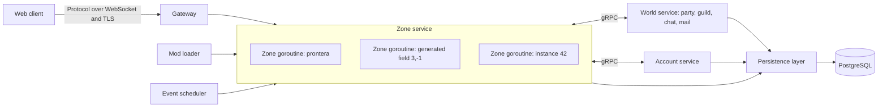

# wAthena Strategy: Go Server, Lua Scripting, Web Client, and Community Modding

This document is the plan for wAthena, a rebuild of rAthena on a new stack. The plan has these parts:

- A new server core in Go.
- PostgreSQL as the only database.
- Lua 5.4 instead of the custom NPC and item script language.
- A browser-based game client written in TypeScript. It is the only supported client.
- Renewal and pre-Renewal rules as feature flags that server owners can mix.
- A modding system that lets the community build and share content safely.
- Fixes for the security problems in the current design.
- A procedural world mode where fields, dungeons, and towns are generated from a seed.

Each phase has exit criteria that can be tested. Section 2.3 lists the decisions already made.

## Where work stands (2026-10-18)

Work paused on 2026-10-05 and resumed on 2026-10-12 with the phase 5 review. Phase 6 started the same day, and all 8 steps are built: phase 6 is done. The phase 6 review followed on 2026-10-15, and its changes are built. Phase 7 started on 2026-10-16, and all 8 steps are built: phase 7 is done. Phase 8 started on 2026-10-18 with step 1, guild towns and the release build. Step 2, encrypted backups, step 3, retention jobs and the Compose config, step 4, the load tests, and step 5, the security review, were built the same day. Step 6 part A, classic mode's NPCs, touch areas, bosses and Kafras, was built on 2026-10-19, and part B, touch dialogs, Niflheim's Kafras, gzipped extracts, the kRO checks and the release notes list, the same day. The `skill` command of review decision 57, `player:give_skill`, followed the same day, with the checks that part B deferred. On 2026-10-20, decision 0054 explained and fixed the extra Jellopy of the restore duplication test, closed L34, and made the Lua wall-clock limit a 30-second backstop.

Done:

- Phases 0a to 4. The Lua API is 1.0.
- Phase 5, all 8 steps (section 15, "Phase 5 in full"). The 30-minute exit check passed: bots traded, stored, mailed, vended and bought at the same time, with disconnects and a restart, and every item, zeny, currency and serial total held.
- Test speed work (decision 0022). The full `scripts/check.sh` run takes about 12 minutes plus e2e.
- The phase 5 review. Review decision 32 accepted the details to review of next steps 11 to 17, and next step 18 built the API it added ([decision 0027](decisions/0027-rule-reading-and-limits.md)):
  - `rules.is`, `rules.get` and `rules.get_limit`.
  - `player:expand` with the permission `player.expand_limits`, saved with the character or the account, and `PlayerLimits` for the client.
  - `party_join` and `guild_join` with the reason `"create"` for a player who makes a party or guild from the client.
  - The ruleset rule `block_list_refuses_trade`, on by default.
  - The `wa.testing` helpers of phase 5 are stable.
  - The converter reads the rule of `basicskillcheck` and the flags of `checkre(1)` to `checkre(5)`.
- Phase 6 step 1, staff roles and the GM audit log ([decision 0028](decisions/0028-staff-roles-and-audit.md)):
  - `staff.owners` and `staff.roles`, with a fixed permission list, and the two-factor rule for every role.
  - The admin API at `/admin/api/v1/` with `/me`, `/staff` and `/audit`, and the GM audit log, which the game and account roles can only add to.
  - The admin screens at `/admin`, a bundle that players never load.
  - `player:get_staff_role()` and `player:has_staff_permission(name)`.
- Phase 6 step 2, player search, item history, restores and audit reviews ([decision 0029](decisions/0029-player-search-and-item-history.md)):
  - `GET /players` by name, ID, item serial or IP range, `GET /characters/{id}` from the zone or the database, and the character's item and zeny log.
  - `GET /items/{serial}/history`, which follows splits and merges both ways.
  - `POST /restore`, which moves serials back by mail from any holder, online or offline, or makes copies with `items.create`, in one transaction.
  - The review queue and `POST /audit/{id}/review`.
  - Login records kept 90 days for the IP search, and the admin screens for all of it.
- Phase 6 step 3, moderation and GM commands ([decision 0030](decisions/0030-moderation-and-gm-commands.md)):
  - The report queue with the chat around each report, the target's earlier reports and sanctions, and closing with an outcome that links its sanction.
  - Mutes, jails, kicks and account bans from the admin API, with lifts and a list per target. A ban closes the account's connections and refuses its logins and game tickets, with the reason and the end time.
  - `@warp`, `@jumpto`, `@recall`, `@hide`, `@kick`, `@mute`, `@jail` and `@item`, parsed on the server with the role's permissions and the two-factor rule, each with an audit row, never shown as chat. Others get "Unknown command.".
  - The admin screens for reports, sanctions and bans, and guild emblem reports from the guild window.
- Phase 6 step 4, the world, events and mods tools ([decision 0031](decisions/0031-world-events-and-mods-tools.md)):
  - `GET /world` with each zone's players, monsters and last minute of tick times, the process, and the players online. `POST /announce` to the world or a map.
  - Planned restarts with announcements from 30 minutes before, no new logins in the last minute, and a save, a disconnect with the reason and exit status 75 at the time. The plan lives in memory.
  - The events tool: every event with its state, next run, run that lasts and latest results, staff starts and stops, and changes saved over the config that apply at once, with a reset.
  - The mods tool: version, signature status, permissions, and Lua error counts by zone, and turning a mod off and on by zone, saved across restarts. Core cannot be turned off.
  - The world event `restart_planned`, and the admin screens for all of it.
- Phase 6 step 5, the account page ([decision 0032](decisions/0032-account-page.md)):
  - Each character's block list with unblock, online or not, the reports the characters filed with only "Action taken" or "No action" once closed, and the sanctions on the account and its characters.
  - A JSON data export with a format version, which needs a login from the last 10 minutes, works once a day, and holds no secrets.
  - Account deletion after 14 days, with the account name typed again. Play is blocked meanwhile, and a login shows the date and a Cancel button. An hourly job deletes the personal data and the characters, and keeps the logs other players need with the character IDs.
  - The privacy notice at `/account/privacy`, with the owner's contact and text from the config and the retention periods in effect.
- Phase 6 step 6, mod assets ([decision 0033](decisions/0033-mod-assets.md)):
  - A mod's `art/` holds the pack format and loose RO files. `wactl mod build-art` and `wactl mod pack` build it under `mod/<mod id>/`, and `wactl assets build` gains the sources `pack:` and `ro:`.
  - The server checks each mod's build at start and serves it at `/assets/mods/<mod id>/<version>/`, limited to 200 MiB by default. `/client-data.json` tells the client each record's art by ID and sends the client data tables merged with the mods' `client/*.yml`.
  - Art fields on items, monsters, NPCs, jobs, skills, companions and mounts, checked by `wactl mod validate`, and `wactl client-data validate` with `docs/client-data.md`.
  - The client loads core's manifest, then each mod's, and draws mod item icons, dropped items, monster and NPC sprites and job bodies, with placeholders for missing art.
  - The lantern sample mod with original art.
- Phase 6 step 7, touch input ([decision 0034](decisions/0034-touch-input.md)):
  - Gestures chosen by pointer type: tap, hold to walk, a long press for the player menu, pinch to zoom and two fingers to turn. The mouse and keyboard work as before.
  - A joystick that walks by cells 4 ahead, at most 4 walks a second, and that the options can hide. A larger hotkey bar, a chat button with Send, and a Cancel skill button.
  - Long-press drags into every window that takes items or skills, through the mouse's drop handlers. Title bars move windows with any pointer, and windows are full-width panels below 600 pixels.
  - No double-tap zoom, pull-to-refresh or selection in the game view, the chat above the on-screen keyboard, and account pages and admin screens that fit 375 pixels.
  - `pnpm check:browsers` plays a scripted touch run on iPhone, Android, tablet and landscape profiles, a mouse run, and prints frame times with CPU throttling.

- Phase 6 step 8, the phase 6 exit check ([decision 0035](decisions/0035-phase-6-exit-check.md)):
  - `/client-data.json` format version 2 names mods' items, monsters, skills and jobs, with items' descriptions. The client shows the names, and draws skill icons and effects, monster sounds, worn item sprites and mod jobs' bodies.
  - A player without any command permission says `@` lines as chat. Lifting a permanent ban needs `moderation.ban_permanent`.
  - `scripts/check.sh browsers` plays the exit check against `waserver` and PostgreSQL: three players through the basic game and every tier 1 system, an admin run with TOTP, and the lantern mod's records. Since phase 7 step 8 they play on desktops; touch input is frozen as built in decision 0034, and the touch and phone checks run only with `CHECKS=touch,phone`.
- The phase 6 review. Review decision 41 accepted the details to review of next steps 18 to 26, and next step 27 built its changes ([decision 0036](decisions/0036-phase-6-review-changes.md)):
  - `accounts.staff` is gone. `wactl world new --admin` prints the `staff.owners` lines for its account.
  - `@hide` is saved with the character and lasts across logins while the role may still use it, and a hidden staff member's local chat reaches players in range, as in rAthena.
  - A ban also ends the account's sessions on the account pages, its logins that wait for a code, and its unused game tickets.
  - `wa.testing` has `world:plan_restart(minutes, reason)`, which fires `restart_planned`. The Town Crier sample uses it.
  - The data export holds the mods' variables of the account and its characters, in format version 1.
  - Looks carry the record IDs of the companion and the mount, and `weapon_view`, so the client draws companions and mounts of art and the worn sprites of weapons and shields. The lantern sample gains a shield and a companion of art, and the exit check's mod run checks both.
- Reliable browser checks ([decision 0037](decisions/0037-reliable-browser-checks.md)):
  - A monster that a skill command killed between ticks lost its vanish when its drop took its slot, and the client kept it. The zone now frees slots at the end of a tick.
  - The client reads touch gesture times from the events, so a long frame no longer turns a tap into a press or splits a double tap.
  - The checks wait for a still view (`viewer.settled()`) and still units, the checks' Lantern Ghosts do not wander, and the steps no longer retry a click that missed.
  - The zone tests' Lua states have no wall-clock limit, which failed `TestFoodRaisesStr` when the machine paused the test.
- Phase 7 step 1, the generator core ([decision 0038](decisions/0038-generator-core.md), [generator-v1](specs/generator-v1.md)):
  - `shared/gen` with a registry of generator versions, the grid and its SHA-256 checksum, and generator version 1, a small grid on the seed tree. `TestGuard` fails on floating point, map types and clock imports in `shared/gen` and `shared/rng`.
  - The build tag `procedural`. Builds without it run only classic worlds.
  - `wactl world new --mode classic|procedural`, and the world row's mode, generator version and rng version. `waserver` refuses a world it cannot run. `Welcome.world` tells the client, which loads `gen.wasm` only for a procedural world.
  - `gen.wasm`, built with TinyGo and checked in as `path.wasm` is. The golden maps give the same checksums in Go on arm64 and on amd64 under Rosetta, in TinyGo, in Node, and in Chromium, Firefox and WebKit. `scripts/check.sh` has the step `gen`, and runs vet, unit tests and lint with and without the tag.
- Phase 7 step 2, generated fields ([decision 0039](decisions/0039-generated-fields.md), [generator-v2](specs/generator-v2.md)):
  - Generator version 2 makes fields from a table of six biomes: warped fractal noise, terraces, water by share, rivers, portal areas on each edge, cliffs, thickets, roads that connect every portal and large area, props by Poisson-disk sampling, and materials. Version 1 stays.
  - Each field is validated: every portal connected and the walkable share in the biome's range. A failed attempt runs again from `attempt(n)`, and after 8 the field is an error.
  - The generator writes the field's WMAP with integer math, so the bytes match everywhere. The WMAP names tilesets, and the server's tileset table maps them to assets, with new placeholder ground textures and prop models by default.
  - The game role reads the key of the seed tree's public branch, which `wactl world new` stores (migration 00030), never the seed. `waserver` generates `--fields` at start, and serves each field's public node and checksum, its WMAP and the tileset table under `/gen/`.
  - The client generates each field with `gen.wasm` in a Web Worker, compares the checksum, and downloads the WMAP when they differ or it cannot generate it. `waserver --dev --fields 0:0,1:0` runs a procedural world to walk in.
  - A 400 × 400 field takes about 60 ms in Go, 75 to 111 ms in Chromium, WebKit and Node, and 690 to 735 ms in Firefox, within section 8.5's budget of about a second in a worker. Firefox reaches a second on a busy machine. The golden fields match in Go on arm64 and amd64 under Rosetta, in TinyGo, in Node, and in the three browsers, WMAP bytes included.
  - The browser check `field` walks a generated field and checks the download. The exit check's Lantern Ghosts stand on fixed cells, so none hides the Training Dummy (decision 0037).
- Phase 7 step 3, dungeons, towns and named places ([decision 0040](decisions/0040-dungeons-towns-places.md), [generator-v3](specs/generator-v3.md)), as review decision 42 approved them:
  - Generator version 3 makes dungeon floors, caves by cellular automata and rooms joined by a minimum spanning tree with loops, with an exit in the room farthest from the entrance and a boss room on the last floor, and towns, with a plateau, main roads from each gate to the square, side roads, lots, buildings, walls, gates, decorations and the named places at the buildings' doors. Its fields are version 2's with places.
  - Dungeon floors and towns stand on blocks of 2 × 2 cells, so walls stand up with the WMAP's side tiles. Validation with 8 attempts, as for fields.
  - Dungeon styles and town templates are records of `data/dungeon_styles.yml` and `data/town_templates.yml`, with core's defaults and mods' records. The server sends a floor's or a town's params with its node, so the client generates a mod's town too.
  - Every generated map records its named places. `wa.places` finds them by scope and tag, and `places.nearest` goes by the map graph, then distance. NPC records with `place` stand at every match. Classic worlds have no places.
  - `waserver --dev --towns <n> --dungeons <style>:<floors>` runs towns and dungeons beside the fields, linked to the fields' free portals until step 4's map graph. Buildings show placeholder houses of their footprints, and the tileset table maps them to art.
  - Test worlds of a `wactl` built with the tag have a field, a town per template and a dungeon per style. The Market Town sample adds a template, a style and NPCs placed by tag, with tests.
  - The golden dungeon floors and towns match in Go on arm64 and amd64 under Rosetta, in TinyGo, in Node, and in the three browsers, WMAP and places included. A town of 192 cells takes about 40 ms in Chromium and WebKit and 262 ms in Firefox, and one of 256 cells 485 ms in Firefox, within section 8.5's budget.
  - The browser check `places` walks from a field into a town, talks to an NPC placed by tag, and walks into a dungeon floor.
- Phase 7 step 4, the world layout ([decision 0041](decisions/0041-world-layout.md), [generator-v3](specs/generator-v3.md), "World layout", [map-folder-v1](specs/map-folder-v1.md)), as review decision 43 approved it:
  - `wactl world new --mode procedural --config waserver.yml` builds the layout from the public branch and the mods' records, and the database keeps it: 6 × 4 fields, 5 towns and 6 dungeons by default, links on shared borders, towns on 2 to 4 fields, dungeon entrances in fields, and retries until every map is reachable from the home area. Towns and floors keep their params.
  - Town names from naming styles, records of `data/naming_styles.yml`, one per biome, with the chat filter and retries. Other maps take names from the nearest town. `@renametown` with the new permission `world.rename`.
  - Bands rise with the warps from the home area, and floors build on their entrance field.
  - The home area is the first town, or a mod's map folder tagged `home`, which links to the first town. New characters start there. `wactl map validate` checks map folders.
  - Warps from the layout's links, saved entered maps, the `WorldMap` message and the client's World Map window, `/memo` with `nomemo`, the server's teleport service at each town's `teleport` place, `@go`, and `@warp` by display name.
  - `wa.towns`, `player:has_visited`, `maps.get_display_name` and `place:get_band`.
  - `--fields`, `--towns` and `--dungeons` stay as a dev shortcut through the layout's code, and `--layout` builds a whole dev layout.
  - The golden layouts match in Go on arm64 and amd64 under Rosetta. The e2e test `TestWorldLayout` plays a made world with PostgreSQL, and the browser check `layout` walks from the home map into a town and opens the world map. The Home Village sample has a home map and a naming style.
- Phase 7 step 6a, quests ([decision 0043](decisions/0043-quests.md)), as review decision 45 approved them. Quests were a tier 1 system of section 11.3 that phases 5 and 6 did not build; this step closes that gap, in classic and procedural worlds:
  - Core's `data/quests.yml` is rAthena's `quest_db.yml` of the mode, converted when the server starts from a new extract, `quests.json` (fork commit `60bed4ccf`): titles, time limits, up to 3 hunt objectives with rAthena's filters, and item drops. Mods add quests and change core's by ID.
  - Each character's quest log saves with it (migration 00033) and joins the data export. Kills count as `quest_update_objective`, for the killer or for the party members within 14 cells, and roll the quests' drops.
  - Lua: the player's quest calls, `npc:show_quest_icon`, and the events `quest_add`, `quest_progress` and `quest_complete`. The Hunting Board sample mod.
  - The client's quest window with timers and objectives, the active toggle, and quest icons over NPCs, with the mouse and touch.
  - The converter's quest commands: fully converted script NPCs went from 927 to 1,023 in renewal and from 754 to 790 in pre-renewal, and job change NPCs from 80 to 175 and from 63 to 99.
  - The e2e test `TestQuestFromCoreNPC` takes core's converted Dancer Kim's quest, hunts it across a relog, and turns it in, with PostgreSQL. The browser check `quests` plays the quest window and an NPC icon on a desktop and a phone.
- Phase 7 step 6b, procedural content ([decision 0044](decisions/0044-procedural-content.md)), as review decision 46 approved it:
  - Core's NPCs of procedural worlds stand at named places of towns: a Kafra with storage at `F_KafStor`'s rules and a fee by band, an inn with the save point, a refiner ported from `refinemain` with `refine.yml`'s costs (a new part of the `refine_db.json` extract), and tool, weapon and armor dealers whose shops follow the town's band. Classic worlds have none.
  - Quest templates are records of `data/quest_templates.yml`. `wactl world new` gives each town 6 quest board quests of nearby monsters, items and towns, chosen with the secret branch, with rewards by band, and stores them with migration 00034. `waserver` makes a quest record of each, with IDs from 900,000. Each town's quest board offers them.
  - One job guild per class family, in the low towns, with hunt and collect tests and a talk that changes a Novice into a first job and a first job into a second job, by rAthena's job and skill point rules. Reborn players change without a test. The Valkyrie stands in the largest town of the highest band.
  - `wa.generation` with `generation.on("map")`, nodes with `child`, `stream` and `hash`, `generation.quest_template` and the permission `world.generate`. Layers add places, objects, which clients draw, and bosses. The Wayside Shrines sample mod.
  - The golden worlds of `TestGoldenContent`, the e2e test `TestProceduralContent`, in which a new Novice completes a board quest and the Swordman test with PostgreSQL, and the browser check `content`, which walks to a Kafra and a quest board.

- Phase 7 step 7, rotation ([decision 0045](decisions/0045-rotation.md), [generator-v3](specs/generator-v3.md), "Rotations and seasons"), as review decision 47 approved it:
  - One dungeon per world rotates, daily or weekly by its style, with floors that carry the date in their map IDs and the `nomemo` flag. The next floors are built before their time. At the time, the entrance leads to the new floors and the old ones go.
  - With `procedural.seasons.days`, a season end gives the next region's fields a new biome, with the same IDs and bands. Seasons are off by default.
  - The removal procedure of section 8.10: warnings at 10, 5 and 1 minutes and 30 seconds, players moved to the nearest town by the map graph, save and memo points moved in memory and in the database, and portals changed in the same step. A change due while the server was stopped, or one a stop cut short, happens at the start.
  - `wactl world new` gives the game role a derived key per rotating dungeon and one for seasons (migration 00035), so `waserver` picks their spawns with the same selection code and still never reads the seed.
  - Lua: `dungeon_rotated`, `region_changed`, `world:rotate` and `world:change_region`. The events screen lists rotations and seasons, and staff force one with `events.control` and an audit row.
  - The e2e test `TestRotation` proves the exit criteria with PostgreSQL: the dungeon changes on schedule as the server clock moves, the player inside goes to the nearest town, and an offline player's save and memo points there follow. The browser check `rotation` loads the new floors after a rotation. A startup that failed with a database no longer stalls (`TestStartFailsAtOnce`).

- Phase 7 step 8, the economy simulator and the phase 7 exit check ([decision 0046](decisions/0046-economy-and-phase-7-exit.md)):
  - `server/economy` simulates a field's exp, zeny and supplies per hour for a model player of its band, with the server's battle formulas, and keeps targets per band from rAthena's renewal classic fields.
  - `wactl world new` keeps every field within 30% of its band's target base exp and zeny, with fitting monster levels, by balancing counts and drawing species again from the secret branch. `wactl sim economy` prints a new world's rates by field.
  - Rolled drops get one more draw for each full 30 levels of the map's band, and the best stays.
  - `scripts/check.sh economy` plays bot runs of the model player in a real `waserver` and compares them with the simulator within 20%.
  - The public seed test covers spawns and loot. `TestLevelPath` walks the level path from 1 to 99. Decision 0046 maps every phase 7 exit criterion to its proof.
  - Touch input is frozen as built in decision 0034, and its browser checks run only on demand.
  - A monster's Cloaking or Maximize Power no longer loops its status timer forever, which hung a zone.

- Phase 8 step 1, guild towns and the release build ([decision 0047](decisions/0047-guild-towns-and-release-build.md)):
  - Every class family's guild stands in a town of a band that starts at level 20 or lower, so a Novice reaches every first job without crossing harder fields. The second job tests stay with their guild. `TestLevelPath` checks every guild. The change is in the content that `wactl world new` stores, so made worlds keep their guilds and there is no generator version 4.
  - `scripts/release.sh` builds `waserver` and `wactl` with the `procedural` tag for linux/amd64, linux/arm64, darwin/arm64 and windows/amd64, stamped with `git describe`, into `dist/<version>/` with `SHA256SUMS`. Two runs gave the same checksums.
  - `wactl version` is new, and both version commands print the build's world modes. The Dockerfile builds both binaries with the `procedural` tag and the version stamp.
  - A binary with the `procedural` tag runs classic worlds: the e2e test `TestClassicWorldProceduralBuild`.

- Phase 8 step 2, encrypted backups ([decision 0048](decisions/0048-encrypted-backups.md)):
  - `wactl world backup` encrypts the `pg_dump` stream with age (`filippo.io/age`) to the owner's recipients, and refuses to run without one unless `--plain`. `wactl world backup-key new` makes the key. The identity stays offline.
  - `--dir` names backups by UTC time, with a plain manifest of the release, the migration, the size, the SHA-256 and the counts of accounts, characters, item serials and zeny. The counts and the dump share one snapshot. Files get their names only when complete.
  - `--every` runs as a long-lived process and prunes to the newest backup of each of the last 7 days and 4 ISO weeks by default.
  - `wactl world verify-backup` restores a backup into a temporary database as a role with only `CREATEDB`, checks it against the manifest, and drops it. `wactl world restore` decrypts, and plain backups still restore.
  - Compose has a `backup` service and an opt-in `backup-verify` service, which puts the identity on the server.

- Phase 8 step 3, retention jobs and the Compose config ([decision 0049](decisions/0049-retention.md)):
  - The `retention` block of `waserver.yml` sets the days for login IP addresses (90), chat lines (30), the item and zeny logs (180) and the GM audit log (730), each 1 to 3650. A period above its default warns at start and on the admin World screen. `chat.log_days` still works, with a warning.
  - One job in `waserver`, at start and every 24 hours, behind a PostgreSQL advisory lock, deletes each kind and logs the counts. Item and zeny log months are dropped whole through the `SECURITY DEFINER` function `drop_old_log_partitions`, and audit rows through `delete_old_staff_audit`, which keeps rows that wait for a review. The chat and login cleanups moved into it.
  - `GET /admin/api/v1/retention` (`world.read`) and the World screen show the periods, the last run and the counts. The debug address serves Prometheus metrics of the job.
  - The privacy page shows the periods in effect, the backups row and the note that item logs may be kept up to 31 days longer.
  - `maps` and `start_map` moved into a `classic:` block that procedural worlds ignore, so the default Compose config runs both world modes. The old keys still work, with a warning.

- Phase 8 step 4, the load tests ([decision 0050](decisions/0050-load-tests.md)):
  - The release build ran a procedural world of 52 maps with PostgreSQL, with bots from 250 to 1,500 in the five scenarios of phase 2 and two new ones: `fields`, fights on 8 fields of every band, and `graph`, walks through the map graph's portals. Classic mode ran Town on the kRO Prontera.
  - The documented capacity is 250 players, on the shared 8 GB Apple M2: every run of every scenario but Crowd met section 3.8 there. At 500 the zone's work fits, with a thread CPU time p99 under 6 ms, but 3 of 10 runs had just over 1% of their ticks over 10 ms, from the machine's memory pressure. Spread over many maps, 1,500 bots met the budgets.
  - A fix: zones kept every player that left in memory, through the block index of a sleeping zone and each player's IDs for what it saw. Tests with weak pointers check that the players are freed.
  - `wabots` ships in the release. It places bots on generated fields and towns through the database, and walks routes to portals. The deploy guide tells owners how to measure their own hardware against a test world.
  - One large slowdown is reported, not fixed: 1,000 players in one town are over the tick budget in the zone's own work.

- Phase 8 step 5, the security review (review decisions 51 to 53, [review 2026-10](security/review-2026-10.md)):
  - Eight areas reviewed against the threat model by read-only reviewers, then checked with tests. 6 high, 19 medium and 39 low findings.
  - Every high finding is fixed, and every medium one but the public map info, which is a known issue for a decision. Most low findings are fixed. The rest are known issues or accepted risks, listed in the review.
  - New since the fix commits: connection limits per address with a `Hello` rate, a guarded debug address, a WebSocket `Origin` check with the scheme, hidden monsters sent only to who may see them, friend request limits, a circle for players' attack range, a common password list of about 65,000, a read-only backup role, non-root Caddy and capability-free PostgreSQL in Compose, and migration 00039.
  - Tools: `govulncheck`, `gosec`, the fuzz tests, `pnpm audit` and `trivy`. See the review's "Tools". The fuzz tests ran 10 seconds each. The hour-long runs are left for before the release.
  - SECURITY.md has the supported versions of the first release.

- Phase 8 step 6 part A, classic mode ([decision 0051](decisions/0051-classic-mode-npcs.md), review decision 55):
  - The extract keeps rAthena's `quests`, `warps` and `events` NPC folders, in part files of `npcs.json` below 2 MB each. renewal places 4,587 NPCs of 15,337 lines, up from 2,367, and pre-renewal 2,805 of 8,390, up from 1,216.
  - Touch areas: the record field `touch`, and the events `touch` and `untouch`, checked per step and on arrival as rAthena does. `OnTouch` and `OnTouch_` convert, but a touch label with a dialog does not, since a touch has no conversation.
  - Bosses keep rAthena's boss flag, variance and fixed cell. The MVP player gets its prize line, as `clif_mvp_item`.
  - Kafra pushcart rental converts. Niflheim's negative `percentheal` still needs an API call.
  - A pre-renewal classic world warns at start that it is experimental.
  - Part B followed the same day ([decision 0052](decisions/0052-classic-mode-part-b.md), review decision 56): touch handlers with a conversation, negative `player:heal_percent`, gzipped extracts in the release binaries, the kRO end-to-end run and browser check, and the release notes list in docs/generated/classic-coverage.md.
  - The `skill` command followed ([decision 0053](decisions/0053-skill-command.md), review decision 57): `player:give_skill` with the flagged permission `player.skills`, and the converter's `skill` and `addtoskill`. renewal places 264 of 710 job change NPCs, up from 259, with the first job changers of Swordman, Mage, Archer, Acolyte and Merchant. The record also has the checks that commit aee8533 deferred.
- Phase 8 follow-up, restores, logins and Lua time limits ([decision 0054](decisions/0054-restores-logins-and-lua-time-limits.md)):
  - The extra Jellopy of 2026-10-19: a restore whose request ended while its zone worked on it let go of its offline holder, and the zone moved the items afterwards. Zone calls from other goroutines are now all or nothing. A stress test with stalls and requests that give up failed 3 of 6 runs before the fix.
  - L34 is fixed: a login waits until the older session's last save is written, up to 30 seconds.
  - The Lua wall-clock limit is a 30-second backstop. The CPU budgets measure the work, so a stalled machine no longer ends zones' Lua states.

Open review items:

- Next step 27's details to review, in proposal 0002, "Next steps".
- Next step 28's details to review, and the review items of decision 0040: a `wa.testing` way to pick a test world's template, mods' own tilesets and props, a floor's level band in Lua, and whether an NPC placed by tag without a match is a warning.
- Next step 29's details to review, and the review items of decision 0041: a Lua way to read graph distances or teleport prices, a record field for server services on NPCs, a `wa.testing` way to start on a mod's home map, the band formula in small worlds, longer names for `@renametown`, and entered maps and memo points in the data export.
- Next step 31's details to review, and the review items of decision 0043: a Lua way to list a player's quests or read a quest record, a minimap mark for `showevent`, `questinfo`, `setquestinfo` and `open_quest_ui`, options for the quest events, and quest calls for another character.
- Next step 32's details to review, and the review items of decision 0044: a public exp reward call, a Lua way to read a world's quests, player fields for skill points and weight, a layer's read of map cells, a places scope of fields, objects of a mod's own art, board quest limits and repeats, and whether `world.generate` should be flagged.
- Next step 33's details to review, and the review items of decision 0045: the hooks and generation layers on rotating floors and changed fields, a Lua way to read a rotating dungeon's date or a region's season, forced changes across a restart and a cancel, new level bands with a world change, more than one rotating dungeon, and locale text and a banner for the warnings.
- Decision 0046's review items: the model player and the targets, the economy checks and the `spawn_table` hooks, and a Lua way to read a field's simulated rates.
- Decision 0050's review items: whether to document 500 players, the slowdown of 1,000 players in one town, and a way to place load test bots without a database URL.
- The security review's items, in proposal 0002, next step 37: review decision 54 settled and built the four first items. Left: a reauth with a passkey without user verification, and when to remove `staff.owners` by name.
- The converter review of review decision 32: the script commands that need new API, listed in next steps 11 to 16, ordered by how many core scripts each blocks.

Known issues:

- Go is 1.27.2, which fixes 13 standard library bugs that govulncheck found in 1.27.1. gosec is built from `tools/gosec`, which asks for a newer golang.org/x/tools than gosec's own go.mod. Drop that module once a gosec release reads Go 1.27.2's export data.
- The disk was nearly full on 2026-10-05, and builds failed with "no space left on device". Keep at least 10 GB free. Test PostgreSQL containers that are killed leave unnamed Docker volumes behind. `docker volume prune` removes them.
- The kRO client is extracted at `data/kro/client` (gitignored), and the original zip is deleted. It is the only copy. Build assets with `wactl assets build` and the source `grf:data/kro/client`.
- `scripts/check.sh` removes its PostgreSQL container with `docker rm -f`, without `-v`, so each run that starts one leaves an unnamed volume.
- The repository has no CI ([decision 0026](decisions/0026-local-checks.md)). Run `scripts/check.sh quick` before each commit and `scripts/check.sh` before a push.

Next:

1. The review of phase 7's open items: next steps 27 to 33 of proposal 0002 and decision 0046's review items.
2. Phase 8, the first public release (section 15, "Phase 8"), built with the `procedural` tag.

The converter review of review decision 32 stays open, and so do the items review decision 41 left for later: signature checks with trusted keys (phase 9), Ogg and MP3 sounds, pack map folders and zones that run mods' maps, and the inventory expansion voucher window.

## 1. Current state

rAthena runs as four C++ processes.

| Process | Role |
|---|---|
| `login` | Account authentication. |
| `char` | Character select. Also the database proxy for guilds, parties, storage, mail, and similar (`src/char/int_*.cpp`). |
| `map` | All gameplay. |
| `web` | Small HTTP service for emblems, party booking, and user config. |

The map server holds most of the code.

| File | Lines | Content |
|---|---|---|
| `src/map/script.cpp` | 28.6k | Custom script language parser and interpreter. 676 built-in commands. |
| `src/map/clif.cpp` | 25.9k | Client packet encoding and decoding, mixed with game logic. |
| `src/map/status.cpp` | 16.5k | Stat and status effect calculation. |
| `src/map/skill.cpp` | 16.3k | Skill logic. |
| `src/map/pc.cpp` | 16.2k | Player logic. |
| `src/map/battle.cpp` | 9.2k | Damage formulas. |

Game content is large:

- 1138 NPC script files with about 808k lines, in `npc/`.
- Item, mob, skill, and other data in YAML files, in `db/`.

Main structural problems:

- The map server runs one thread with one event loop. Most state is global and mutable.
- `map_session_data` is a single class that holds almost all player state.
- Client version (`PACKETVER`) and ruleset are chosen at compile time. There are 682 preprocessor checks for `RENEWAL` or its sub-flags in 132 files under `src/map`. Each ruleset needs its own build.
- MySQL queries block the main thread.
- Servers talk to each other with hand-written binary packets (`chrif`, `intif`, `char_mapif`).
- Timers are function pointers with an untyped `intptr` argument. Nothing ties a timer to the lifetime of the entity it uses.
- Every status recalculation reruns the script of every equipped item and card, even when nothing the script reads has changed.
- Clock and random number generation are global. Formulas cannot be tested in isolation.
- There are almost no automated tests.
- Customization works by editing core files or copying scripts from forums. There is no mod format, no versioned API, and no isolation between custom scripts.

Security problems in the current design:

- Passwords are stored in plain text by default. `use_MD5_passwords: no` in `conf/login_athena.conf`, and `login.user_pass` is `varchar(32)`. The MD5 option is unsalted and fast to crack.
- The char and map servers log in to the login server with a default account, `s1` / `p1` (`conf/char_athena.conf`, `conf/map_athena.conf`, and the seed row in `sql-files/main.sql`).
- Many queries are built with `printf`-style formatting and manual escaping instead of bound parameters. One missed escape is an SQL injection.
- The `query_sql` script command lets NPC scripts run any SQL. A script that puts player `input` into a query string is an SQL injection.
- The game protocol has no encryption. Packet obfuscation (`clif_obfuscation.hpp`) hides packet IDs but does not protect data.
- C++ packet parsing has no automatic bounds checks. A missed length check can read or write outside a buffer.

One refactor is already going the right way. Skills are moving from large `switch` blocks to `SkillImpl` classes in `src/map/skills/` (1244 files).

## 2. Goals, non-goals, and decisions

### 2.1 Goals

- Reproduce rAthena gameplay results for each `core` ruleset mod. Same inputs give the same damage, status, drop, and exp results as rAthena in that mode.
- Let server owners mix Renewal and pre-Renewal features through feature flags (section 3.6).
- Replace the custom script language with Lua and convert existing NPC and item scripts automatically.
- Use more than one CPU core by running maps in parallel.
- Support 5,000 concurrent players per world (section 3.7).
- Make game logic testable without a network or database.
- Let the community build, test, share, and install mods without editing the server source.
- Ship the base game content as a mod that uses the same public API as community mods.
- Fix every security problem listed in section 1.
- Offer a procedural world mode where every part of the world is generated (section 8).

### 2.2 Non-goals

- Support for the official Ragnarok Online client.
- Including Gravity's assets in the repository, or hosting them on the project's own infrastructure. Server operators supply and serve them for their own servers (section 10.1).
- Mobile-native apps. The web client has touch input as decision 0034 built it, and it is frozen there (2026-10-17).
- Published binaries, images or signatures. Releases are source tags, and owners build with the setup guide (2026-10-20).
- Browsers other than Chromium. The web client supports Chromium-based browsers, such as Chrome and Edge, and is tested only in Chromium. Firefox and Safari are not tested or supported (2026-10-18).
- Running a game server, a beta, or a world of the project's own. wAthena is server software, as rAthena is: server owners run their own worlds (2026-10-18).
- Art packs. Server owners supply the art, such as their own GRF files through the GRF importer. The project ships the asset contract, the importer and placeholders only (2026-10-18).
- Importing accounts, characters, or items from existing rAthena servers.

### 2.3 Decisions

| Topic | Decision |
|---|---|
| Server language | Go. |
| Scripting | Lua 5.4. |
| Database | PostgreSQL 18 or later (section 3.5). |
| Ruleset | Feature flags with a Renewal or pre-Renewal base. Rulesets are mods, so modders define their own mixes. `core` ships one ruleset mod per mode (section 3.6). |
| Default ruleset | `core.ruleset.renewal` is the default choice when creating a world. |
| Clients | Only the web client. The official client is not supported. |
| Assets | wAthena ships the runtime and an asset contract ([assets-v1](specs/assets-v1.md)), not art. Operators fill the contract from any sources: their `data.grf` through the GRF importer, original art, and mods. The server streams the built assets to players. |
| Capacity target | 5,000 concurrent players per world. |
| Login | Username and password at signup. Players can turn on TOTP and passkeys later. |
| Client customization | The web client is open source. The community changes it by forking or with plugins. |
| Procedural mode | Generates every part of the world: fields, dungeons, towns, spawns, and quests. Included in a build with the `procedural` build tag (section 8.1). |
| Default world mode | `procedural` in builds that include it. `classic` otherwise. |
| Launch order | The first release ships both world modes, with procedural as the default (section 14.2). |
| Mod index | Run by the community. The core team defines the index format and the `wactl` support. |
| Data import | No import from existing rAthena servers. New worlds start empty. |
| Rotating content | Depends on the automatic event system (section 8.8). |
| Mod content | Mods can add NPCs, monsters, items, skills, jobs, and pre-made maps. They change `core` content only through overlays and hooks. |
| Mod IDs | Fixed numeric ranges above all IDs used by `core` (section 6.5). |
| Repository | A new repository, separate from rAthena. |
| License | GPL-3.0-or-later with a mod exception (section 2.4). |
| Project name | wAthena ("web Athena"), following the jAthena, eAthena, and rAthena naming pattern (section 2.4). |
| Client data tables | The project ships minimum tables for sprites and effects, plus a guide and template for replacing them (section 10.5). |
| Map format | One project map format for generated maps, pre-made mod maps, and classic maps converted from player files (section 8.12). |
| Admin tools | Built into the web client, shown only to staff accounts (section 10.6). |
| Time zone | Events use the server's configured time zone (section 8.8). |
| Team | One developer. The roadmap is sized and ordered for that (section 14). |

### 2.4 License and naming

License: **GPL-3.0-or-later** for the server, the shared WebAssembly package, the web client, and `wactl`.

- The project converts rAthena's NPC scripts and game data and ports its formulas. rAthena is GPL v3 (`LICENSE`), so this work is a derived work and must use a GPL v3 compatible license.
- The web client includes the shared WebAssembly package, which contains ported rAthena logic such as pathfinding. The client therefore uses the same license. Forks that are published on the web must offer their source, which keeps community improvements available to everyone.
- roBrowser and roBrowserLegacy code can be reused only if its license is GPL v3 compatible. Check each file's header before copying.
- AGPL v3 was considered. It would force server owners to publish their server changes. Many server owners keep custom changes private, so AGPL would slow adoption. GPL v3 matches what the rAthena community already accepts.

Mod exception:

- A written exception states that mods which use only the public Lua API, YAML data, and assets are not derived works of the server. Mod authors choose any license for their mods.
- Mods that include converted rAthena scripts or data stay under GPL v3, because that content is GPL v3.
- The mod template repository (section 6.10) uses the 0BSD license, so mods can start from it with no conditions.

Other content:

- Documentation uses CC BY-SA 4.0.
- Data converted from rAthena's `db/` stays GPL v3. Each converted file keeps a header naming its source.

Naming:

- The project is named **wAthena**, for "web Athena". It follows the naming pattern of jAthena, eAthena, and rAthena. "Athena" is a Greek goddess, not a Gravity name.
- Tools and namespaces: `waserver` for the server binary, `wactl` for the command-line tool, and `wa` for the Lua API modules, such as `require "wa.events"`.
- The name must not suggest that the rAthena team endorses the project. The project tells the rAthena team about wAthena as a courtesy, since it converts their GPL code and data.
- The name avoids `goAthena` and `pAthena`, which other projects already use.
- The project name, domains, logo, and client branding do not use "Ragnarok", "Ragnarok Online", "RO", "Gravity", or names of Gravity characters and places.
- Documentation may say the project is compatible with game files from Ragnarok Online. It must not suggest any link with Gravity.
- Converted content keeps rAthena's internal names, such as `AegisName` values, because the player's game files need them. Player-facing names in `core` locale files can be changed later if needed.

## 3. Technology decisions

### 3.1 Server language: Go

Go was chosen over C#. The deciding points:

- **Builds.** `GOOS` and `GOARCH` cross-compile binaries for Linux, Windows, macOS, and ARM from any machine. With `zig cc` for the cgo part, Linux builds stay static. No runtime install is needed on the server.
- **Scripting.** C Lua 5.4 runs through a small cgo binding (section 3.2). Release builds use `zig cc` as the C compiler, so cross-compiling still works from one machine.
- **Concurrency.** A goroutine per zone with a channel inbox fits the zone model in section 4.
- **Shared code with the browser.** TinyGo compiles Go packages to small WebAssembly modules, so the map generator runs in the web client too (section 3.3).
- **Operations.** One binary per service, built-in profiling (`pprof`), and a low-pause garbage collector.
- **Community.** Go is easy to learn, which lowers the barrier for contributors.

Go weaknesses and how to handle them:

| Weakness | Mitigation |
|---|---|
| No enums or sum types. | Typed integer constants with `stringer` codegen. The `exhaustive` linter fails the build on `switch` statements that miss a case. |
| Verbose error handling. | Game logic returns errors only at system boundaries (network, database, scripts). Rule code works on validated data and does not return errors. |
| Garbage collector pauses in hot paths. | Set `GOMEMLIMIT`. Reuse message buffers with `sync.Pool`. Preallocate per-zone slices. Track tick time p99 in load tests. |

### 3.2 Lua runtime

wAthena runs **C Lua 5.4 through a small cgo binding of its own** ([docs/decisions/0002-lua-runtime-c-lua.md](decisions/0002-lua-runtime-c-lua.md)).

- Native 64-bit integers, which zeny, exp, and IDs need.
- Coroutines, which NPC dialogs need.
- A memory limit per state, from the binding's allocator.
- A CPU limit per call, from a count hook that charges a budget. Coroutines inherit it.
- Item and proc calls cost 250 to 320 ns with limits on. An NPC dialog of 4 steps costs about 2.5 µs.

The phase 0b benchmark compared five options. The others:

- **arnodel/golua** (pure Go) was 3 to 7 times slower, and its memory limit panics when a coroutine is resumed in a later call.
- **C Lua on wazero** (WebAssembly, pure Go) passed every check, but WebAssembly exceptions made protected calls and yields slow. The same C binding builds for it, so it can be measured again later.
- **yuin/gopher-lua** implements Lua 5.1 with float numbers, has no memory limit, and its time limit does not follow coroutines across calls.
- **aarzilli/golua**, an existing C Lua binding, gives Go functions the wrong state inside coroutines.

Costs of cgo, and how they are handled, are listed in decision 0002.

All server code talks to Lua through one binding layer (`internal/script`). Game systems never call the Lua library directly. This keeps the runtime replaceable.

### 3.3 Sharing logic with the web client

The client and server must agree on:

- Message formats.
- Pathfinding and cell walk timing.
- Map cell data (walkable, water, cliff).
- Distance and area checks.
- Generated map layouts in procedural mode.

Damage, status, drops, AI, and scripts stay on the server only. The client displays values the server sends.

Approach:

- Messages and ID tables are defined in schema files. Codegen produces Go and TypeScript code.
- The procedural map generator is written once in Go and compiled to WebAssembly with TinyGo. Generated maps must match on both sides bit for bit, and a second implementation would drift.
- Pathfinding, cell checks, and distance checks live in the same TinyGo package. The web client calls them instead of keeping its own copy.
- Shared test vectors, stored as JSON files, check the Go build and the WebAssembly build against each other.

### 3.4 Stack summary

| Area | Choice |
|---|---|
| Server language | Go, current stable release. |
| Networking | `coder/websocket` behind TLS. There is no raw TCP game port. |
| Database | PostgreSQL 18 or later (section 3.5). `jackc/pgx` driver and `pgxpool`. `sqlc` generates typed query code. |
| Schema migrations | `goose`, with SQL migration files in the repository ([decision 0003](decisions/0003-database-migrations-and-queries.md)). |
| Inter-service messages | gRPC (`grpc-go`) or ConnectRPC. |
| Scripting | C Lua 5.4 through our own cgo binding (section 3.2). |
| Game data | YAML files read with `goccy/go-yaml`, validated with JSON Schema. Same layout as `db/*.yml` where possible. |
| Protocol definition | One schema file set. Codegen produces Go and TypeScript encoders and decoders. |
| Shared client logic | Go package compiled to WebAssembly with TinyGo. |
| Metrics and profiling | Prometheus client and `pprof`. |
| Linting | `golangci-lint` with the `exhaustive` linter enabled. |
| Release builds | `goreleaser`, static binaries for every target. |
| Web client | TypeScript, WebGL2 (WebGPU later), DOM-based UI. Chromium-based browsers only (section 2.2). |
| Mod tooling | `wactl` command-line tool written in Go (section 6.9). |
| Password hashing | Argon2id (`golang.org/x/crypto/argon2`). |
| Two-factor login | TOTP (`pquerna/otp`) and passkeys (`go-webauthn/webauthn`). |
| Security checks in CI | `govulncheck`, `gosec`, the race detector, and fuzz tests. |

### 3.5 Database: PostgreSQL

PostgreSQL replaces MySQL. The new server supports only PostgreSQL. Supporting two databases doubles the query and test work.

Reasons:

- **Constraints that protect the economy.** `CHECK` constraints such as `zeny BETWEEN 0 AND 2147483647` and `amount > 0`, plus foreign keys, stop overflow and duplication bugs at the database even if the server has a bug.
- **Transactional schema changes.** A failed migration rolls back completely. MySQL commits most schema changes immediately, which can leave a half-migrated database.
- **JSONB.** Mod storage (section 6.7) keeps structured data per mod without a new table for each mod. GIN indexes make it searchable.
- **Row locking for queues.** `SELECT ... FOR UPDATE SKIP LOCKED` gives the persistence workers a simple job queue in the database.
- **`LISTEN` and `NOTIFY`.** Services can react to changes, such as a ban from the web panel reaching the account service at once.
- **Partitioning.** Logs such as item, chat, and zeny logs are partitioned by month. Old months are dropped or archived without slow deletes.
- **Go support.** `pgx` is fast and well maintained. `sqlc` supports PostgreSQL best.
- **Row-level security.** Web panels and reporting tools can get database roles that only see allowed rows and columns.

Minimum version: **PostgreSQL 18.**

- PostgreSQL supports each major version for 5 years. Version 18 was released in September 2025, so it is supported until late 2030. Version 14 reaches end of life in November 2026, and version 19 is in beta.
- Version 18 adds a built-in `uuidv7()` function. Time-ordered IDs for sessions, item serials, and log rows then need no extension.
- Version 18 adds asynchronous I/O, which speeds up the large log scans used by reports.
- CI tests against the minimum version and the newest release. The minimum moves up when a version has less than 2 years of support left.

Schema rules:

- Use `bigint` for IDs, zeny, and exp. Use `timestamptz` for times.
- Every table has a primary key. References use foreign keys.
- Every item instance or stack has a unique serial number. Logs record the serial on every move and every stack split or merge, so duplicated items can be traced.
- Trades, storage moves, mail attachments, and vending run in one transaction. They use `SELECT ... FOR UPDATE` on both sides, locked in a fixed order to avoid deadlocks.
- Game code uses only queries generated by `sqlc`, which always use bound parameters.

Costs:

- Tools built for rAthena's MySQL schema, such as FluxCP, will not work. The web service offers a documented HTTP API for control panels instead.
- Server owners who know MySQL must learn PostgreSQL basics. The admin guide covers backups (`pg_dump` and point-in-time recovery), connection limits, and `pgbouncer`.

### 3.6 Ruleset feature flags

Renewal and pre-Renewal differ in 682 code locations and in most data files. Some differences can be mixed freely. Others depend on data tuned for one formula and cannot be separated.

The ruleset is therefore built from two layers:

1. **A base.** It decides the core combat formulas and the main data set. Server owners pick `renewal` or `pre_renewal`.
2. **Independent flags.** Each one changes one feature and can be set on either base, within the listed dependencies.

#### Base (cannot be mixed)

The base includes these features, because items, mobs, and skills are tuned to them:

| Feature | Renewal | Pre-Renewal | Main rAthena code |
|---|---|---|---|
| ATK model | Status, weapon, equipment, and mastery ATK are separate parts. | One base ATK value. | `battle.cpp` 3422 to 3880, `status.cpp` 2428 to 2498 |
| MATK model | Weapons carry MATK. | MATK comes from INT, with a minimum and maximum. | `status.cpp` 2510, 6240, 7443 |
| DEF model | Flat DEF reduction, values in the hundreds. | Percentage DEF with a cap (`max_def`). | `battle.cpp` 4800 to 4844, `status.cpp` 7860 to 8004 |
| HIT, FLEE, and critical formulas | Renewal stat formulas. | Pre-Renewal stat formulas. | `status.cpp` 2617 to 2725 |
| Card bonus order | Renewal order and rounding. | Pre-Renewal order and rounding. | `battle.cpp` 708 to 1076 |
| Refining | Up to +20, armor levels, enchant grades. | Up to +10. | `status.hpp` 33, `status.cpp` 3932 to 4016 |
| Level cap and classes | Level 200 or 275, third and fourth classes, expanded classes. | Level 99, up to transcendent classes. | `pc.cpp` 1808, `char.cpp` 2825 |
| Data sets | `db/re`, `npc/re` | `db/pre-re`, `npc/pre-re` | |

Why these cannot be mixed:

- Item weapon ATK and MATK values mean different things under each ATK model. The same weapon gives very different damage.
- `mob_db` stats are rebalanced for each model. `Attack2` is MATK in Renewal and maximum ATK in pre-Renewal. A Poring has 1 ATK and gives 150 base exp in Renewal, and has 7 to 10 ATK and gives 2 base exp in pre-Renewal.
- Renewal DEF values are flat reductions in the hundreds. Pre-Renewal DEF is a capped percentage. Every item and mob is tuned to one of them.
- Refine tables, item levels, and the +20 refine limit form one system.
- Level cap, exp tables, job stat tables, and the level damage modifier form one system.
- Card percentages stack differently in each order, so card values are tuned per mode.

#### Independent flags

| Flag | Values | What it changes | Depends on |
|---|---|---|---|
| `cast_time` | `renewal`, `pre_renewal` | Variable plus fixed cast time, or DEX-only cast time. | Pre-Renewal base with `renewal` uses a default fixed cast of 20% when `skill_db` has no `FixedCastTime`. |
| `skill_cooldown` | `on`, `off` | Per-skill cooldowns for players, homunculi, and guild skills. | Cooldowns come from the `skill_db` of the flag's mode, applied as a data overlay. `off` keeps pre-Renewal's cooldowns, which rAthena's pre-Renewal `skill_db` has for 175 skills. |
| `aspd` | `renewal`, `pre_renewal` | ASPD formula, shield penalty, and bonus stacking. | Ships with both `job_aspd` tables. |
| `stat_point_cost` | `renewal`, `pre_renewal` | Status point cost formula (`RENEWAL_STAT`). The two agree below 100. | None. The points per level of `statpoint.yml` stay with the base. |
| `level_penalty_exp` | `on`, `off` | Exp modifier by level gap between player and monster. | None. |
| `level_penalty_drop` | `on`, `off` | Drop rate modifier by level gap. | None. |
| `level_damage_mod` | `on`, `off` | Skill damage scales with base level. | Only useful with a level cap above 99. |
| `element_table` | `renewal`, `pre_renewal` | Element damage table (`attr_fix.yml`). For example, Neutral against Ghost is 90% or 25%. | None. |
| `size_table` | `renewal`, `pre_renewal` | Size penalties for knuckles and whips (`size_fix.yml`). | None. |
| `status_resist` | `renewal`, `pre_renewal` | Status effect resistance and duration formulas. | None. |
| `heal_formula` | `renewal`, `pre_renewal` | Heal skill and healing item formulas. | None. |
| `boss_protection` | `renewal`, `pre_renewal` | Boss endure, trap immunity, and stun length. | None. |
| `ensemble_songs` | `renewal`, `pre_renewal` | Songs as self buffs and ensemble fatigue. | The songs take their `skill_db` records from the flag's mode. |
| `homunculus` | `renewal`, `pre_renewal` | Homunculus ASPD, exp share, and stat growth. | Ships with both homunculus tables. Nothing reads it until homunculi exist. |
| `busy_restrictions` | `on`, `off` | Blocks NPC, item, skill, and cart actions while busy. | None. |
| `fourth_job_traits` | `on`, `off` | POW, STA, and other trait stats, plus RES and MRES. | Renewal base only. |
| `item_rolls` | `on`, `off` | Items with roll ranges get random values when created. With `off`, every roll uses its default value, which matches rAthena (section 5.4). | None. |
| `skill_rebalance.<skill>` | `renewal`, `pre_renewal` | Ratio and effect of one skill that changed between modes, such as Basilica or Magnum Break, with its own status. | Base ATK model for damage skills. The skill takes its `skill_db` record from the flag's mode. Songs follow `ensemble_songs`. |

#### Ruleset mods

Rulesets are mods. There is no ruleset built into the server.

- `core` ships two ruleset mods: `core.ruleset.renewal` and `core.ruleset.pre_renewal`. Each sets every flag to its own mode's value.
- Modders publish their own ruleset mods that mix features from both modes.
- A server owner picks one ruleset mod when creating a world. A world cannot change its ruleset later, because items, stats, and levels depend on it.
- `wactl world new` offers `core.ruleset.renewal` as the default choice. Its data set is much larger (29,356 items and 2,675 monsters, against 6,169 items and 1,004 monsters in pre-Renewal), and procedural worlds need a large pool of content to draw from.

A ruleset mod can:

1. **Pick a base and set flags.** This covers every combination in the tables above.

   ```yaml
   # mod.yaml
   id: example.classic-plus
   provides:
     ruleset:
       extends: core.ruleset.pre_renewal
       flags:
         cast_time: renewal
         level_penalty_drop: on
         skill_cooldown: on
   ```

2. **Ship data overlays that rebalance the base.** Features in the base cannot be mixed because data is tuned to one formula. A ruleset mod that also rebalances that data can mix them anyway. For example, a mod can use the Renewal ATK model on the pre-Renewal item and monster lists if it supplies Renewal-style ATK values for those items and monsters.

3. **Replace single formulas with hooks.** With the `rules.override` permission, a ruleset mod can replace a formula such as the HIT calculation or the refine success rate (section 6.8). This covers ideas that neither mode has.

Rules:

- The loader checks flag dependencies for every ruleset mod. A ruleset that uses a base feature with the other mode's data must declare the data overlays that fix it, or loading fails.
- Content mods declare which rulesets they support, by base or by flag (section 6.3). The loader refuses to load a content mod on a ruleset it does not support.
- Scripts in any mod can read the active flags, so one content mod can support several rulesets.
- `wactl mod test` runs a ruleset mod's tests against both `core` parity reference sets, so authors can see how far their mix moves from each mode.

Implementation:

- In Go, `rules.Rules` holds one value per flag. Each place where rAthena checks `RENEWAL` reads the flag of its feature (decision 0019 lists what each flag changes).
- Each flag declares the data files it needs. The data loader picks each file from the Renewal or pre-Renewal set to match.
- The loader rejects combinations that break a dependency, with an error naming the flag.
- Scripts check flags with `rules.is("cast_time", "renewal")`, from `require "wa.rules"`. This replaces rAthena's `checkre()`.
- Settings in `conf/battle` whose defaults depend on the mode today, such as `default_fixed_castrate` and `max_def`, become settings of the matching flag.

Testing:

- Both `core` ruleset mods must match rAthena in the parity harness.
- Each flag has unit tests for both values.
- CI runs a sample of mixed combinations to check that the loader and formulas work together.

### 3.7 Capacity target

Public data on private server population is limited. RateMyServer lists servers but does not show player counts. Nostalgic.gg shows online members of each server's Discord, which is a proxy for players online. In September 2026 it showed about 2,000 to 7,000 online for the five largest servers, and tens to a few hundred for most others ([Nostalgic.gg server list](https://nostalgic.gg/en/ragnarok-online)).

Targets:

- One world supports 5,000 concurrent players. This covers every server except the very largest.
- Load tests run at 7,500 players to keep 50% headroom.
- One zone supports 500 players in view of each other, such as a town during an event.
- Larger worlds spread zones across more processes or machines (section 4.1, item 1).

### 3.8 Performance budgets

Server:

| Budget | Target | Reason |
|---|---|---|
| Zone tick | 50 ms (20 ticks per second) | RO movement is timed per cell. Default walk speed is 150 ms per cell (`DEFAULT_WALK_SPEED` in `src/common/mmo.hpp`), and the fastest is 20 ms. rAthena's timer loop runs at least every 20 ms (`TIMER_MIN_INTERVAL`). A 50 ms tick with per-cell timestamps keeps movement exact without running every 20 ms. |
| Tick work | p99 under 10 ms, maximum 25 ms | Leaves 60% of the tick free for bursts. A zone over budget for 10 ticks in a row logs a warning with a profile. |
| View range | 14 cells | Same as rAthena's `area_size` default (`conf/battle/client.conf`). Updates are only sent for entities in range. |
| Memory per online player | Under 256 KB | 5,000 players then use about 1.3 GB, leaving room for maps and Lua. |
| Lua memory | 16 MB per mod per zone | Enforced by the binding: each mod owns the memory its code makes (review decision 52). Owners set the default and a ceiling. |
| Lua CPU per call | 5 ms for events, 50 ms for generation layers | A call over the limit is stopped (section 6.6). |
| Database query | p99 under 20 ms | Zones never wait on queries, but slow queries delay saves. |
| Login to in-game | Under 2 seconds on the server side | Excludes asset loading in the client. |
| World startup | Under 30 seconds | Zones start in parallel. Generated maps load from the disk cache. |

Network, per player:

| Budget | Target |
|---|---|
| Server to client, busy town | Average under 8 KB/s, peaks under 32 KB/s |
| Server to client, field | Average under 2 KB/s |
| Client to server | Average under 1 KB/s. The rate limits in section 7.4 start at 4 KB/s. |
| Largest message | 64 KB. Larger data, such as map files, uses HTTP downloads. |
| Messages per tick | One batched message per player per tick. |

Data loss after a crash:

| Data | Largest loss |
|---|---|
| Trades, vending, buying stores, mail, storage moves, guild storage, cash points | None. Each is written in a transaction before the player sees the result. |
| Character position, exp, zeny from monsters, item drops | 30 seconds. Changed data is written every 30 seconds and at logout and map change. rAthena's default is 300 seconds (`autosave_time` in `conf/map_athena.conf`). |

Web client:

| Budget | Target |
|---|---|
| Frame rate | 60 FPS in a busy town on a mid-range laptop. 30 FPS on mid-range phones. |
| Map ready after warp | Under 1.5 seconds when cached. |
| First start after assets are cached | Under 10 seconds. |
| Browser memory | Under 1.5 GB. |

CI runs the server budgets in load tests (section 12). A change that breaks a budget fails the nightly run.

#### Load test results

##### Phase 8

The load tests of phase 8 step 4, on 2026-10-18, as review decision 50 set them ([decision 0050](decisions/0050-load-tests.md)). How to run them is in server/README.md, "Load tests and metrics", and owners can run them on their own machine (deploy/README.md, "Measure your own hardware").

Setup:

- The release binaries of `scripts/release.sh` for darwin/arm64, with the fix below. `waserver all` with `--dev` on a loopback address, and PostgreSQL 18 in Docker.
- A procedural world that `wactl world new` made with its defaults: 30 fields of 300 × 300 cells, 5 towns, 6 dungeons with 17 floors, 52 maps in all, and 8,236 monsters. Each zone runs in its own goroutine, and a zone without players does not tick.
- Classic mode: one Town run on the kRO Prontera, in a classic world in PostgreSQL. The full kRO asset build did not fit on the disk, so the build held the placeholder pack and Prontera's map files from the kRO client.
- `wabots` from the release, in its own process at `nice 15` with `GOMAXPROCS=4`.
- The machine: an Apple M2 (4 performance and 4 efficiency cores) with 8 GB. It was shared with desktop apps (a browser, an editor and a chat app) and with Colima's Docker VM, which holds 5 GB and ran other projects' containers too. 6.3 to 9.3 GB of swap were in use, and the kernel decompressed a median of 14,700 memory pages a second (about 230 MB/s) through the runs.
- Steps of 250, 500, 750 and 1,000 bots, and 1,250 and 1,500 for Fields and Graph. Bots join at 50 a second and play for 15 seconds (60 for Spread and Graph) before 3 minutes of measurement. Every step ran once, and some at 500 again.

Scenarios. The phase 2 scenarios run in the procedural world's start town and its lowest field. Every bot's character is loaded from and saved to PostgreSQL.

| Scenario | Maps | What the bots do |
|---|---|---|
| Town | `gen:town:t1`, the start town | As in phase 2. The characters are new, so all of them start at the start cell. |
| Town with PostgreSQL | `gen:town:t1` | As Town, with the characters of an earlier run, which start where they were saved, spread over the town. |
| Crowd | `gen:town:t1` | As in phase 2. |
| Spread | `gen:town:t1` and its fields | As in phase 2. Most bots stay in the town, since its gates are far from the start cell. |
| Fight | `gen:field:4:0`, the lowest field (levels 1 to 10) | Every bot is the economy simulator's model player of level 5, as `--place fields --fields 1` sets it, and fights as in phase 2. |
| Fields | 8 fields, from levels 1 to 10 up to 90 to 99 | The bots spread evenly over the fields, each as its band's model player, and fight. |
| Graph | Every map | The bots start in the 5 towns as the model player of level 99 and walk routes to portals, map after map. |

Tick work per zone, in ms, for the zone with the most ticks over 10 ms. Quantiles are rounded up to their bucket, which is at most 12.5% wide, so a p99 of 10.5 ms can be under 10 ms. The ticks over 10 ms are exact: p99 is under 10 ms when fewer than 1% of the ticks are over it. "Any zone" is the highest maximum of every zone, and the ticks over 25 ms of every zone with players.

| Scenario | Bots | Zone (players) | p50 | p99 | p99.9 | Max | Ticks over 10 ms | Ticks over 25 ms | Any zone: max, ticks over 25 ms | Server CPU | p99 under 10 ms |
|---|---:|---|---:|---:|---:|---:|---:|---:|---:|---:|---|
| Town | 250 | `t1` (250) | 1.6 | 10.5 | 54.5 | 96.4 | 35 of 3,596 | 9 | 96.4, 9 | 0.12 cores | yes |
| | 500 | `t1` (499) | 2.1 | 12.6 | 83.9 | 203 | 42 of 3,594 | 18 | 203, 18 | 0.20 cores | no |
| | 500, second run | `t1` (498) | 2.4 | 6.3 | 10.5 | 15.0 | 5 of 3,600 | 0 | 15.0, 0 | 0.21 cores | yes |
| | 750 | `t1` (749) | 2.9 | 25.2 | 117 | 681 | 105 of 3,577 | 35 | 681, 35 | 0.28 cores | no |
| | 1,000 | `t1` (1,000) | 5.2 | 92.3 | 403 | 643 | 654 of 3,517 | 223 | 643, 223 | 0.44 cores | no |
| Town with PostgreSQL | 250 | `t1` (244) | 1.2 | 2.1 | 3.4 | 5.7 | 0 of 3,600 | 0 | 5.7, 0 | 0.10 cores | yes |
| | 500 | `t1` (494) | 2.6 | 4.7 | 10.5 | 17.8 | 3 of 3,600 | 0 | 17.8, 0 | 0.19 cores | yes |
| | 750 | `t1` (739) | 1.7 | 2.9 | 6.8 | 7.2 | 0 of 3,600 | 0 | 7.2, 0 | 0.20 cores | yes |
| | 1,000 | `t1` (983) | 2.0 | 2.9 | 8.4 | 15.0 | 2 of 3,600 | 0 | 15.0, 0 | 0.23 cores | yes |
| Crowd | 250 | `t1` (250) | 3.7 | 16.8 | 168 | 236 | 75 of 3,586 | 23 | 236, 23 | 0.24 cores | no |
| | 500 | `t1` (500) | 6.3 | 151 | 537 | 748 | 600 of 3,431 | 219 | 748, 219 | 0.42 cores | no |
| | 750 | `t1` (750) | 14.7 | 336 | 671 | 1,390 | 2,838 of 3,022 | 747 | 1,390, 747 | 0.81 cores | no |
| | 1,000 | `t1` (244 at the end) | 3.1 | 185 | 470 | 917 | 639 of 3,386 | 524 | 917, 524 | 0.49 cores | no, 756 bots lost |
| Spread | 250 | `t1` (226) | 1.8 | 6.3 | 14.7 | 22.6 | 12 of 3,600 | 0 | 22.6, 0 | 0.14 cores | yes |
| | 500 | `t1` (443) | 1.8 | 7.9 | 83.9 | 159 | 28 of 3,595 | 12 | 159, 15 | 0.20 cores | yes |
| | 750 | `t1` (675) | 1.8 | 18.9 | 92.3 | 188 | 65 of 3,597 | 27 | 188, 38 | 0.22 cores | no |
| | 1,000 | `t1` (894) | 2.6 | 14.7 | 83.9 | 118 | 61 of 3,597 | 14 | 118, 19 | 0.30 cores | no |
| Fight | 250 | `field:4:0` (230) | 3.4 | 6.8 | 25.2 | 105 | 12 of 3,592 | 3 | 105, 6 | 0.15 cores | yes |
| | 500 | `field:4:0` (473) | 2.6 | 10.5 | 29.4 | 56.1 | 32 of 3,599 | 5 | 56.1, 5 | 0.18 cores | yes |
| | 500, second run | `field:4:0` (472) | 2.6 | 9.4 | 46.1 | 59.1 | 22 of 3,600 | 7 | 59.1, 8 | 0.18 cores | yes |
| | 500, third run | `field:4:0` (484) | 2.6 | 10.5 | 75.5 | 174 | 39 of 3,597 | 5 | 174, 5 | 0.17 cores | no |
| | 750 | `field:4:0` (719) | 2.6 | 15.7 | 151 | 229 | 59 of 3,590 | 20 | 229, 20 | 0.20 cores | no |
| | 1,000 | `field:4:0` (959) | 3.4 | 12.6 | 41.9 | 319 | 50 of 3,595 | 13 | 319, 14 | 0.26 cores | no |
| Fields | 250 | `field:4:2` (32) | 0.9 | 3.4 | 12.6 | 20.0 | 7 of 3,600 | 0 | 20.0, 0 | 0.22 cores | yes |
| | 500 | `field:0:3` (62) | 0.7 | 3.7 | 12.6 | 20.3 | 7 of 3,600 | 0 | 44.1, 8 | 0.26 cores | yes |
| | 750 | `field:0:1` (93) | 1.3 | 4.7 | 18.9 | 35.7 | 6 of 3,599 | 3 | 35.7, 7 | 0.23 cores | yes |
| | 1,000 | `field:0:1` (125) | 1.4 | 6.3 | 50.3 | 91.1 | 20 of 3,599 | 7 | 91.1, 41 | 0.21 cores | yes |
| | 1,250 | `field:0:1` (156) | 1.4 | 18.9 | 151 | 493 | 87 of 3,571 | 30 | 671, 167 | 0.28 cores | no |
| | 1,500 | `field:4:2` (188) | 0.9 | 4.7 | 27.3 | 62.3 | 16 of 3,599 | 4 | 117, 30 | 0.29 cores | yes |
| Graph | 250 | `field:0:2` (6) | 0.3 | 2.6 | 12.6 | 35.8 | 5 of 3,600 | 1 | 60.9, 9 | 0.29 cores | yes |
| | 500 | `field:1:3` (26) | 0.2 | 1.7 | 14.7 | 44.9 | 7 of 3,597 | 1 | 147, 25 | 0.26 cores | yes |
| | 750 | `field:1:2` (34) | 0.4 | 3.7 | 37.7 | 124 | 14 of 3,597 | 5 | 157, 77 | 0.26 cores | yes |
| | 1,000 | `field:1:2` (45) | 0.4 | 3.1 | 18.9 | 108 | 13 of 3,598 | 2 | 108, 57 | 0.25 cores | yes |
| | 1,250 | `field:2:2` (78) | 0.3 | 2.9 | 23.1 | 28.0 | 8 of 3,601 | 2 | 77.2, 24 | 0.29 cores | yes |
| | 1,500 | `field:0:3` (21) | 0.2 | 3.7 | 62.9 | 639 | 17 of 3,579 | 6 | 1,158, 126 | 0.37 cores | yes |
| Classic Town, `prontera` | 250 | `prontera` (250) | 2.6 | 6.8 | 25.2 | 125 | 18 of 3,596 | 3 | 125, 3 | 0.15 cores | yes |
| | 500 | `prontera` (500) | 1.8 | 10.5 | 75.5 | 221 | 38 of 3,595 | 13 | 221, 13 | 0.20 cores | no |

The second Town run at 500 and the third Fight run at 500 ran on a diagnostic build, not kept in the code, that pins each zone goroutine to its thread and also reads the thread's CPU time per tick, as in phase 2:

| Run | Wall time p50, p99, p99.9, max | Thread CPU time p50, p99, p99.9, max |
|---|---:|---:|
| Town, 500 | 2.4, 6.3, 10.5, 15.0 ms | 2.4, 4.7, 5.8, 7.5 ms |
| Fight, 500 | 2.6, 10.5, 75.5, 174 ms | 2.6, 5.8, 9.4, 13.4 ms |
| Town, 1,000 | 4.2, 37.7, 109, 288 ms | 4.2, 14.7, 21.0, 23.5 ms |

Bandwidth per bot, in KB/s, counted as WebSocket bytes without TCP, IP or TLS headers:

| Scenario | Bots | Server to client, average (mean, max) | Busiest second (mean, max) | Client to server, average (max) | Frames per second |
|---|---:|---:|---:|---:|---:|
| Town | 250 | 0.57, 0.92 | 2.6, 4.3 | 0.01 | 9.4 |
| | 500 | 1.07, 1.72 | 4.9, 8.4 | 0.01 | 12.9 |
| | 1,000 | 1.88, 3.18 | 8.3, 16.4 | 0.01 | 15.3 |
| Town with PostgreSQL | 1,000 | 0.63, 0.97 | 1.6, 3.3 | 0.01 | 11.1 |
| Crowd | 250 | 4.47, 4.61 | 7.9, 9.7 | 0.01 | 19.9 |
| | 500 | 8.07, 8.43 | 18.9, 24.2 | 0.01 | 18.9 |
| | 750 | 11.36, 11.89 | 45.8, 60.2 | 0.01 | 16.4 |
| Spread | 500 | 0.51, 0.83 | 1.7, 3.7 | 0.01 | 8.8 |
| Fight | 500 | 0.47, 0.77 | 1.6, 3.2 | 0.01 | 7.3 |
| | 1,000 | 0.80, 1.30 | 2.7, 5.5 | 0.01 | 9.9 |
| Fields | 1,000 | 0.16, 0.95 | 0.6, 3.1 | 0.01 | 3.4 |
| Graph | 1,000 | 0.25, 0.65 | 1.8, 6.4 | 0.01 | 4.6 |
| Classic Town | 500 | 1.24, 1.99 | 5.0, 8.1 | 0.01 | 13.9 |

Memory. The live heap is read after a forced garbage collection 10 seconds before each measurement ended, with every bot online. "Per player" is that heap less the heap of the idle world before the scenario's steps, divided by the bots.

| Scenario | Bots | Live heap | Per player | Go memory | Largest RSS | GC pause p99, max | Allocation |
|---|---:|---:|---:|---:|---:|---:|---:|
| Idle procedural world | 0 | 368 MB | | 580 to 620 MB | | | |
| Town with PostgreSQL | 250 | 386 MB | 74 KB | 700 MB | 614 MB | 1.8, 1.8 ms | 2 MB/s |
| | 1,000 | 436 MB | 69 KB | 992 MB | 814 MB | 1.3, 1.3 ms | 17 MB/s |
| Town | 1,000 | 556 MB | 91 KB | 1,316 MB | 747 MB | 10.5, 10.5 ms | 32 MB/s |
| Fight | 500 | 422 MB | 91 KB | 992 MB | 726 MB | 3.1, 3.1 ms | 7 MB/s |
| | 1,000 | 482 MB | 106 KB | 1,077 MB | 876 MB | 1.3, 1.3 ms | 20 MB/s |
| Fields | 1,000 | 476 MB | 78 KB | 1,078 MB | 762 MB | 0.8, 0.8 ms | 11 MB/s |
| | 1,500 | 576 MB | 120 KB | 1,316 MB | 851 MB | 0.8, 0.8 ms | 17 MB/s |
| Graph | 1,000 | 504 MB | 71 KB | 1,148 MB | 779 MB | 0.8, 0.8 ms | 17 MB/s |
| | 1,500 | 585 MB | 102 KB | 1,329 MB | 1,008 MB | 10.5, 10.5 ms | 25 MB/s |
| Idle classic world, `prontera` | 0 | 121 MB | | | | | |
| Classic Town | 500 | 158 MB | 72 KB | 426 MB | 366 MB | 2.1, 2.1 ms | 12 MB/s |

Go memory is all the memory the Go runtime mapped, and never goes down within a process. RSS is low, since the kernel kept most of the server's pages compressed or in swap.

Soak: Fight at 250 bots for 30 minutes, at the documented count, in a server started for it. A sampler read the server's measurements every minute and started them again, and read the live heap after a forced garbage collection every 5 minutes. Quantiles per minute, for `gen:field:4:0`:

| Minutes | Players on the field | p50 | p99 | Max | Ticks over 10 ms | Ticks over 25 ms | Live heap | Go memory | Swap in use | Server CPU |
|---|---:|---:|---:|---:|---:|---:|---:|---:|---:|---:|
| 0 to 5 | 242 to 232 | 1.3 to 3.4 | 11.5 to 21.0 | 235 | 83 of 6,001 (1.38%) | 32 | 393 MB | 838 MB | 8.1 to 8.4 GB | 0.09 to 0.14 cores |
| 5 to 10 | 229 to 227 | 1.4 to 3.9 | 8.4 to 11.5 | 172 | 50 of 6,007 (0.83%) | 6 | 393 MB | 867 MB | 8.1 to 8.5 GB | 0.10 to 0.16 cores |
| 10 to 15 | 224 to 209 | 2.9 to 3.9 | 6.3 to 9.4 | 23 | 20 of 6,009 (0.33%) | 0 | 393 MB | 868 MB | 8.0 to 8.1 GB | 0.13 to 0.17 cores |
| 15 to 20 | 210 | 1.8 to 3.4 | 9.4 to 23.1 | 342 | 83 of 6,001 (1.38%) | 25 | 395 MB | 868 MB | 7.8 to 9.1 GB | 0.11 to 0.16 cores |
| 20 to 25 | 209 to 206 | 3.1 to 3.7 | 7.3 to 10.5 | 29 | 35 of 6,011 (0.58%) | 2 | 394 MB | 868 MB | 8.1 to 8.5 GB | 0.15 to 0.17 cores |
| 25 to 30 | 203 to 200 | 2.0 to 3.4 | 9.4 to 10.5 | 502 | 38 of 4,798 (0.79%) | 7 | | 868 MB | 7.9 to 8.2 GB | 0.12 to 0.17 cores |

- Memory stayed flat: the live heap was 393 to 395 MB at every 5-minute mark, Go memory stopped growing at 868 MB after 12 minutes, and the goroutines stayed at 894. The idle world before the soak held 368 MB.
- Tick times stayed flat, without a trend: 0.89% of the 30 minutes' ticks were over 10 ms, so the p99 of the whole run was under 10 ms. 12 of the 29 one-minute windows had 1% or more, in bursts that followed the swap in use, as in minutes 15 to 20, when it rose to 9.1 GB.
- Bots killed 66,623 monsters. Players on the field fell from 242 to 200, as bots walked into the field's warps and played on the next maps. No bot lost its connection.

Against the budgets:

- The documented capacity is 250 players on this machine: every run of every scenario but Crowd met section 3.8 at 250. At 500, each scenario met the budgets in at least one run, but a Town run, a Fight run and the classic Town run had 1.06% to 1.17% of their ticks over 10 ms. Decision 0050 explains the choice.
- The zone's own work fits the budget at 500. The diagnostic build measured a thread CPU time p99 of 4.7 ms in Town and 5.8 ms in Fight, with maxima of 7.5 and 13.4 ms. The long ticks are waits: in the Fight run, ticks of up to 174 ms took at most 13.4 ms of CPU. Outside Crowd, the server process used at most 0.44 cores. The machine's memory, not the server's CPU, set the limit.
- At 1,000 in one town, the zone's own work is over the budget: a thread CPU time p99 of 14.7 ms in Town. A town of 1,000 players near one cell is a crowd. The send phase grows with the players in view of each other (decision 0050, "Large slowdowns").
- Players spread over many maps hold up better. Graph met the budgets at every step up to 1,500. Fields met them at every step but 1,250, where one zone had 2.4% of its ticks over 10 ms. Town with PostgreSQL, whose players are spread over the town, met them at 1,000.
- The maximum of 25 ms is broken by rare ticks in most runs, as in phase 2. The diagnostic runs show that they are waits, not work.
- Crowd is a stress test. It breaks the budgets from 250, and at 1,000 the server closed 756 connections that fell behind, as in phase 2 before its fixes. Its average from the server passes 8 KB/s at 500.
- Bandwidth is within the budgets in every scenario but Crowd. A town of 1,000 bots near the start cell averages 1.9 KB/s, with 16.4 KB/s in the busiest second. Fields average 0.16 KB/s, within the 2 KB/s field budget.
- Memory per online player: 70 to 120 KB of live heap above the idle world. With Go's default `GOGC=100`, the heap grows to about twice the live heap, so about 140 to 240 KB, within the 256 KB budget. The idle procedural world itself holds 368 MB of live heap: its generated maps, its zones and the game data.
- Joining, from opening the WebSocket to the first frame, took about 50 ms at p50 and at most 2.2 seconds, in the Crowd run of 1,000. The budget is 2 seconds.
- A first pass of these runs found that the server kept every player that left in memory. The fix is below. The tables are from the code with the fix.

##### Phase 2

The 500-bot tests of phase 2, on 2026-10-01. How to run them is in server/README.md, "Load tests and metrics".

Setup:

- One `waserver` with `--dev` sessions and the kRO asset build. There is no database, except in the PostgreSQL run. Each zone runs in its own goroutine in that process.
- `tools/wabots` in a separate process, at `nice 15` with `GOMAXPROCS=4`, so the bots' CPU does not count as tick work.
- An Apple M2 (4 performance and 4 efficiency cores) with 8 GB, shared with a browser and Docker Desktop. Memory was tight: 6 to 9 GB of swap were in use, and the kernel was compressing memory throughout.
- 500 bots join at 50 a second and play for 15 seconds (60 for Spread) before 3 minutes of measurement.

Scenarios and rates, from the busy town estimate in `schema/protocol_test.go`:

| Scenario | Map | What each bot does |
|---|---|---|
| Town | `prontera` | A walk to a cell within 8 every 3 s on average. 2 chat lines a second in the whole town. |
| Crowd | `prontera` | Stays within 10 cells of the start cell, so most bots see each other. A walk every 2 s. 10 chat lines a second in total. |
| Spread | 8 maps around Prontera | As Town, but a third of the walks go to a warp portal in view. Most bots end up in `prt_in` and `prontera`, with about 32 map changes a second. |
| Fight | `prt_fild08`, `--build melee` | Attacks the nearest monster in view until it dies, then walks on. 0.5 chat lines a second in total. |
| Town with PostgreSQL | `prontera` | As Town, with characters loaded from and saved to PostgreSQL 18 in Docker every 30 seconds. They start where an earlier run saved them, so they are more spread out. |

Tick work per zone, in ms. Quantiles are rounded up to their bucket, which is at most 12.5% wide.

| Scenario | p50 | p99 | p99.9 | Max | Ticks over 10 ms | Ticks over 25 ms | Server CPU |
|---|---:|---:|---:|---:|---:|---:|---:|
| Town | 1.3 | 3.4 | 6.3 | 33.5 | 2 of 3,600 | 1 | 0.17 cores |
| Town, second run | 1.2 | 5.8 | 33.6 | 70.1 | 13 of 3,600 | 7 | 0.16 cores |
| Crowd | 2.9 | 10.5 | 75.5 | 234 | 36 of 3,590 | 16 | 0.28 cores |
| Spread, `prontera` (216 bots) | 0.4 | 2.6 | 9.4 | 11.7 | 1 of 3,600 | 0 | 0.16 cores |
| Spread, `prt_in` (282 bots) | 0.6 | 3.9 | 11.5 | 35.6 | 5 of 3,600 | 1 | (same process) |
| Fight | 1.6 | 9.4 | 37.8 | 63.9 | 26 of 3,600 | 5 | 0.15 cores |
| Town with PostgreSQL | 0.7 | 3.4 | 50.3 | 109 | 14 of 3,599 | 6 | 0.11 cores |

Bandwidth per bot, in KB/s, counted as WebSocket bytes without TCP, IP or TLS headers. TLS adds about 22 bytes per message, so 0.2 to 0.45 KB/s at these frame rates.

| Scenario | Server to client, average (mean, max) | Busiest second (mean, max) | Client to server, average (max) | Frames per second |
|---|---:|---:|---:|---:|
| Town | 1.20, 1.95 | 4.7, 8.1 | 0.01 | 13.9 |
| Crowd | 8.51, 8.92 | 15.0, 18.5 | 0.01 | 19.9 |
| Spread | 0.82, 1.46 | 3.9, 7.6 | 0.01 | 13.8 |
| Fight | 1.00, 2.14 | 4.0, 8.5 | 0.02 | 10.7 |
| Town with PostgreSQL | 0.35, 0.72 | 1.0, 2.4 | 0.01 | 7.4 |

Process:

| Scenario | Heap | Total memory | GC pause p99, max | GC cycles in 3 min | Allocation |
|---|---:|---:|---:|---:|---:|
| Town | 43 MB | 96 MB | 1.8, 1.8 ms | 69 | 12 MB/s |
| Crowd | 41 MB | 105 MB | 1.6, 4.2 ms | 261 | 45 MB/s |
| Spread | 49 MB | 129 MB | 1.8, 10.5 ms | 66 | 11 MB/s |
| Fight | 71 MB | 165 MB | 7.3, 7.3 ms | 41 | 11 MB/s |
| Town with PostgreSQL | 43 MB | 96 MB | 34, 34 ms | 31 | 5 MB/s |

Against the budgets:

- Tick work p99 is within 10 ms in every scenario. Crowd is at the limit: its p99 bucket ends at 10.5 ms.
- The maximum of 25 ms is broken by rare ticks, at most 16 of 3,600 in a run. They come from the machine, not from the zone's work. A diagnostic build, not kept in the code, pinned each zone goroutine to its thread and read the thread's CPU time per tick:

  | Scenario | Wall time p99, max | Thread CPU time p99, max |
  |---|---:|---:|
  | Town | 2.6 to 10.5, 28.3 ms | 2.6 to 3.4, 4.4 ms |
  | Crowd | 7.3 to 13.6, 78.7 ms | 5.2 to 6.3, 10.3 ms |
  | Fight | 5.8 to 8.4, 158 ms | 3.4 to 4.2, 10.0 ms |

  The ranges are over 30-second windows. In the long ticks, the zone thread waited for a core. In one 30-second window of a Fight run, the thread's own CPU time rose to 51 ms per tick, together with a 42 ms GC pause, which fits the kernel decompressing memory on page faults. Runs at a lower priority (`nice 5`, by mistake) had GC pauses up to 100 ms and ticks over 100 ms in the same code. The maximum needs nightly runs on a dedicated Linux machine to confirm.
- Bandwidth is within budget in every scenario but Crowd. There, the average from the server, 8.5 KB/s, is just over the 8 KB/s budget for a busy town. Crowd puts up to 500 players in view, more than the town peak estimate of 300, and its busiest second, 18.5 KB/s, is within the 32 KB/s peak budget. Fight is a field: its average, 1.0 KB/s, is within the 2 KB/s field budget, though the busiest bots reach 2.14 KB/s.
- Memory per online player is about 200 KB of total process memory in Town, under the 256 KB budget.
- Joining, from opening the WebSocket to the first frame, took about 30 ms at p50 and at most 245 ms, also with PostgreSQL, where it makes a dev account and character. The budget is 2 seconds.
- With PostgreSQL, every character was saved every 30 seconds: 3,995 rows were updated in the 3.5 minutes the bots played, 500 loads and about 3,500 autosaves. The zone only makes the snapshots, and the `act` part of a tick stayed at 0.04 ms on average.
- Setting `GOGC=400` did not help on this machine. In one Crowd run, memory rose to 221 MB and the tick work p99 was 38 ms.

Fixes made to reach these numbers, with the same bots and machine. "Before" is the code before the fixes, with only the measurements added.

| Scenario | Before: p50, p99, max | After: p50, p99, max | Before: bots disconnected |
|---|---|---|---:|
| Town | 10.5, 21.0, 113 ms | 1.3, 3.4, 33.5 ms | 0 |
| Crowd | 9.4, 168, 565 ms | 2.9, 10.5, 234 ms | 349 |
| Fight | 31.5, 185, 2,083 ms | 1.6, 9.4, 63.9 ms | 447 |

Before the fixes, the Crowd and Fight zones fell so far behind that their command queues filled, and the gateway closed most connections with "Too many actions at once". The fixes, each with tests that check the old behavior is kept:

1. Entities and each connection's IDs for them were maps. They are now slices indexed by a slot per entity.
2. The zone goroutine woke each connection's goroutine with its own channel send. Each wake can enter the kernel, and a trace showed the zone goroutine stalled for up to 9 ms between two sends. A tick now hands all of its messages to a sender goroutine in one batch.
3. Each player's view checked every entity in the zone. After many kills, a field holds thousands of dropped items. The zone now builds an index of 8 × 8 cell blocks once per tick, as rAthena's `BLOCK_SIZE`, and each player checks only the blocks its view touches and the entities it already knows. `TestViewsMatchFullScan` runs a random game with walks, fights, deaths, warps and logouts in two zones, one with a full scan, and checks that every frame is the same.
4. Walk steps are packed once per tick and shared by every viewer's move event.

One tick of 500 players in `BenchmarkLoadTick`, with the bots' commands and the draining of their messages:

| Case | Before | After |
|---|---:|---:|
| Crowd: 500 players within 20 cells | 6.0 ms | 1.4 ms |
| Town: spread over 120 × 120 cells | 5.1 ms | 0.3 ms |
| Field: spread over the map with 5,000 still entities | 53 ms | 0.7 ms |

CI's `loadtest` job runs 50 bots for 20 seconds on the placeholder map on every pull request (server/README.md, "CI").

### 3.9 Deployment modes

| Mode | For | Setup |
|---|---|---|
| All-in-one | Most servers. The phase 8 load test measured 250 players on an Apple M2 with 8 GB shared with desktop apps (section 3.8, "Load test results"). | One binary, `waserver all`, runs the gateway, account, world, and zone services in one process. PostgreSQL runs next to it. |
| Distributed | Large worlds | Each service runs as its own process. Zones spread across several machines. Services use mutual TLS (section 7.2). |

All-in-one details:

- The repository ships a Docker Compose file with `waserver`, PostgreSQL 18, and a TLS proxy (Caddy) that gets certificates automatically.
- The same Compose file serves the web client build as static files.
- `wactl world new` creates the database, the first admin account, and the world seed. `wactl world backup` and `wactl world restore` wrap `pg_dump` and `pg_restore`. Backups are encrypted with age to the owner's key, and a Compose service makes one each day and removes old ones. `wactl world verify-backup` restores a backup into a temporary database and checks it against its manifest (decision 0048).
- Service calls inside one process skip the network but use the same interfaces as the distributed mode. Tests run both.

Measured capacity: the all-in-one release build met the budgets of section 3.8 with 250 players on an Apple M2 (4 performance and 4 efficiency cores) with 8 GB, shared with desktop apps and Docker (phase 8, 2026-10-18, decision 0050). The server used under half a core. The machine's memory set the limit. The docs claim no larger count.

Minimum hardware for all-in-one with 250 players: 4 CPU cores, 8 GB RAM, and 50 GB SSD, as measured. More players need a measurement on the owner's machine. Owners run the same load test against a test world before they open one (deploy/README.md, "Measure your own hardware").

Updates:

- Releases are single binaries plus database migrations. `waserver` refuses to start if migrations are pending, and `wactl migrate` applies them.
- A restart announces a countdown to players, saves all data, and stops zones cleanly.
- Restarts without downtime are a later goal for the distributed mode.

## 4. Target server architecture



### 4.1 Changes to make from the start

1. **Zone goroutines.**
   - Each map or instance runs in its own goroutine. It owns all state for that zone and reads commands from one inbox channel.
   - A ticker drives the zone tick. Code inside a zone runs on one goroutine and needs no locks.
   - Actions that cross zones, such as warps, party updates, and whispers, are sent as messages to the other zone's inbox.
   - Each zone has its own Lua state.
   - Zones can be spread across processes or machines.

2. **Entity model.**
   - Split player, mob, NPC, pet, homunculus, and mercenary state into components. Examples are `Position`, `Stats`, `Inventory`, `StatusEffects`, and `Cooldowns`.
   - Stats are totals of modifiers. Each modifier source (equipment, card, buff, passive skill) adds and removes its own modifiers (section 5.3).
   - Final values such as ATK, HIT, and ASPD are recomputed only when a total they depend on changes.

3. **Ruleset at runtime.**
   - The ruleset is built from a base and independent flags (section 3.6).
   - No build tags or compile-time switches for game rules. The only build tag is `procedural`, which includes or leaves out a whole feature (section 8.1).

4. **Protocol layer.**
   - One protocol, designed for the web client. Messages are Protocol Buffers, and code is generated from the schema ([proposal 0001](proposals/0001-protocol.md)).
   - The protocol has an explicit version. The client sends its version at login, and the server rejects versions it does not support.
   - Related updates are grouped into one message per tick to reduce message count.
   - The gateway translates messages into typed game commands and translates game events back into messages. It contains no game logic.

5. **Persistence.**
   - A pool of worker goroutines handles all database access. A zone never waits on the database during a tick.
   - Entities track which fields changed. Saves write only changed data, at intervals and at checkpoints such as logout and map change.
   - Trades, storage moves, mail attachments, and vending use database transactions to prevent item duplication.
   - PostgreSQL constraints reject negative or overflowing zeny and item amounts (section 3.5).

6. **Services.**
   - Merge `login` and `char` into one account service.
   - Guild, party, clan, chat channels, and mail move to a world service.
   - Services talk over gRPC with versioned contracts.

7. **Scheduling.**
   - Timers are typed and registered on an owner (entity, modifier set, or mod).
   - When the owner is removed, all its timers and event listeners are removed.
   - World-wide scheduled events run through the event scheduler (section 8.8).

8. **Determinism and tests.**
   - Clock and random number generator are passed to every system as interfaces.
   - Damage, status, and drop formulas are pure functions over their inputs.
   - A test run with a fixed seed gives the same results every time.

9. **Request validation.**
   - Every client command passes one validation layer before reaching game logic.
   - It checks range, entity state, cooldowns, weight, zeny overflow, and rate limits.
   - The web client is open source and easy to modify, so the server trusts nothing it sends.

10. **Data.**
    - Keep YAML game data files.
    - Validate them against a schema at load time.
    - Support reloading data files without a restart.

11. **Mods from the start.**
    - The mod loader, public Lua API, and data overlays exist before any content is ported.
    - The base game content is packaged as the `core` mod. If `core` cannot do something through the public API, the API is missing a feature.

## 5. Lua scripting

### 5.1 Public API shape

The API is specified in [proposal 0002](proposals/0002-lua-api.md). In short:

- There are no globals. Scripts get every part of the API with `require`, such as `require "wa.events"`. Constants are read-only modules with readable names, such as `statuses.stun` and `races.demi_human`.
- Entry scripts, the files wAthena loads itself, return a setup function. The runtime calls it once per instance, such as each placed NPC or each equipped copy of an item, with a hidden context. Helper modules a mod requires can return any value.
- The context owns everything the setup function creates: event handlers, timers, bonuses, and spawned monsters. They are removed when the context ends. Scripts read it with `context:get_instance()` from `wa.context`. The context never holds a player.
- Events and hooks are registered by name, with `events.on("click", handler)`. The name is checked when the handler is registered.
- Entities (players, monsters, NPCs, items) are handles holding an entity ID. Each access looks the entity up again. A player who logs out during a conversation causes a Lua error, not a crash.
- Fields are read-only. Every change is a method, such as `player:pay_zeny(500)`, which can return failure and checks permissions.
- Names are readable full words, except the stat abbreviations players know, such as `str`, `luk`, `atk`, and `aspd` ([0002a](proposals/0002a-bonus-names.md)). rAthena's names, such as `bFlee2` and `SC_STUN`, appear only in the converter's table and the API reference.

### 5.2 NPC scripts

NPC conversations pause while they wait for the player. Each conversation runs as a Lua coroutine.

- `say`, `wait_for_next`, `choose`, `ask_number`, `ask_text`, and `wait` pause the coroutine.
- The zone resumes the coroutine when the matching client response arrives.
- If the player disconnects, the coroutine is closed.

Example:

```lua
local events = require "wa.events"
local text = require "wa.text"

return function()
  events.on("click", function(player, conversation)
    conversation:say("[Healer]", text "healer.greeting")
    if conversation:choose(text "common.yes", text "common.no") == 1 then
      if not player:pay_zeny(500) then
        conversation:say(text "common.not_enough_zeny")
        return conversation:close()
      end
      player:heal_fully()
    end
    conversation:close()
  end)
end
```

NPC placement lives in the mod's data (`data/npcs.yml`), which names the script. In procedural mode, NPCs are placed at named places instead of fixed coordinates (section 8.6).

Other rules:

- **Events.** Scripts register handlers such as `"login"`, `"death"`, and `"map_enter"` with `events.on`. Timers come from `wa.timers`. These replace label names like `OnPCLoginEvent:` and `OnTimer5000:`.
- **Variables.** Variables are declared with a scope and a type, such as `variables.character_integer "quest_step"` from `wa.variables`. They replace the `@`, `#`, `##`, `$`, and `.@` prefixes. Per-NPC and per-call state are Lua locals. Each mod's variables are stored under its own namespace (section 6.7).
- **Reloading.** Each script file can be reloaded alone. Running coroutines finish on the old version.

### 5.3 Item scripts

Item and card scripts are event-driven. An equip script's setup function runs when a copy is equipped. Its context is that copy, and the bonuses, handlers, and timers it adds belong to the copy. Unequipping the item ends the context, which removes all of them at once.

Static bonus. Runs once, on equip.

```lua
-- Poring Card
local bonuses = require "wa.bonuses"

return function()
  bonuses.add("luk", 2)
  bonuses.add("perfect_dodge", 1)
end
```

Computed bonus. The function reruns only when a value it read changes.

```lua
local bonuses = require "wa.bonuses"
local context = require "wa.context"

return function()
  local equipped = context:get_instance()
  local player = equipped.wearer
  bonuses.add("atk", function()
    local level = player.base_level
    return level > 70 and (level - 70) // 10 * 10 or 0
  end)
  bonuses.add("aspd", function() return 4 + equipped.refine end, { percent = true })
  bonuses.add("atk", function() return player.base_luk >= 90 and 20 or 0 end)
end
```

While a computed function runs, the handles record which fields it reads. A level up recomputes only the bonuses that read `base_level`.

Proc on being hit.

```lua
local bonuses = require "wa.bonuses"
local events = require "wa.events"
local random = require "wa.random"
local timers = require "wa.timers"
local effects = require "wa.effects"
local sizes = require "wa.sizes"
local context = require "wa.context"

return function()
  local player = context:get_instance().wearer
  bonuses.add("damage_taken", -15, { from = { size = sizes.all } })
  events.on("damage", function(hit)
    if not hit.wearer_is_source and (hit.kind == "physical" or hit.kind == "magic")
        and random.chance(3, 1000) then
      timers.with_bonuses(10000, function() bonuses.add("perfect_dodge", 30) end)
      player:show_effect(effects.wind)
    end
  end)
end
```

Consumable.

```lua
local events = require "wa.events"

return function()
  events.on("use", function(player)
    player:item_heal { hp = { 45, 65 } }
  end)
end
```

Rules:

1. **Conditions read base stats only.** This matches rAthena. `readparam(bLuk)` returns `sd->status.luk`, the allocated points without bonuses (`src/map/pc.cpp`, `pc_readparam`). Item conditions cannot form cycles.
2. **Every value a script can read sends a change event.** This includes base and job level, base stats, job class, refine, enchants, grade, map and map flags, other equipped items, learned skill levels, active status effects, and time of day.
3. **Computed functions have no side effects.** They only return a value. The runtime blocks calls that change game state while a computed function runs.
4. **Results do not depend on equip order.** The final formula applies bonuses in a fixed order. Six bonuses keep a single value, such as `attack_element`, because rAthena overwrites them. By default the last one wins in rAthena's own fixed order: equipment by slot, then combos, then cards, then timed bonuses by start time. So the result still does not depend on when an item was equipped. A mod can pick the winner with `{ stacking = "priority", priority = n }` ([0002a](proposals/0002a-bonus-names.md), "Stacking").
5. **Scripts using only constants become static tables.** The converter detects them, and the server applies them without calling Lua.

Every bonus name, the options of `"damage"` and `"damage_taken"`, and the `"damage"` event are listed in [proposal 0002a](proposals/0002a-bonus-names.md).

A debug mode used in tests runs a full recalculation after every change and compares it with the event-driven totals. A mismatch fails the test and names the item.

### 5.4 Rolled item values

Items can have values that are rolled when the item is created. The item's data declares each roll, and its script reads the rolled value.

The Abysmal Knight Card gives +25% damage against bosses in rAthena (`bonus2 bAddClass,Class_Boss,25;`). With a roll, each card gets a value from 15% to 35%:

```yaml
- AegisName: Knight_Of_Abyss_Card
  Rolls:
    boss_damage:
      Min: 15
      Max: 35
      Default: 25
      Distribution: triangular
```

```lua
local bonuses = require "wa.bonuses"
local classes = require "wa.monster_classes"
local context = require "wa.context"

return function()
  local equipped = context:get_instance()
  bonuses.add("damage", equipped.rolls.boss_damage,
    { kind = "physical", against = { class = classes.boss } })
end
```

When values are rolled:

- On monster drops, crafting, and quest rewards.
- Scripts choose per call, for example `player:give_item(id, 1, { roll = "random" })` or `{ roll = "default" }`.
- NPC shops sell items with default values unless the shop's data says otherwise.
- With the `item_rolls` flag set to `off`, every roll uses `Default`. This keeps parity with rAthena (section 3.6).

Distributions:

| Distribution | Result |
|---|---|
| `uniform` | Every value from `Min` to `Max` is equally likely. |
| `triangular` | Values near `Default` are common. `Min` and `Max` are rare. |
| `weighted` | A table of values or ranges with weights, for tiers such as common, rare, and perfect. |

A roll can use a Lua function instead of fixed `Min` and `Max`. The function receives the source of the item, such as the monster's level or, in procedural mode, the region's level band. Higher regions can then give better ranges.

Rules:

- **Server only.** Values are rolled on the server from the zone's secret random stream (section 8.3). The client never sends roll values.
- **Integers only.** Percentages use whole numbers or basis points.
- **Up to 8 rolls per item.** This keeps item messages and storage small.
- **Stored per item instance.** The item instance row has a `rolls` `JSONB` column, such as `{"boss_damage": 31}`. The server checks every value against the item's declared range when loading. Values outside the range are clamped and logged.
- **Cards keep their rolls in slots.** A slot entry stores the card ID and the card's rolls.
- **Stacking.** Stackable items with rolls stack when their rolls are equal.
  - The stack key is the item ID plus a canonical form of its rolls (keys sorted, integer values). Other stack rules, such as bound or unbound, still apply.
  - Two Abysmal Knight Cards with 31% stack together. A card with 31% and a card with 29% form two stacks.
  - Stacks with rolls count toward the inventory slot limit like any other stack. A `weighted` distribution with a few tiers keeps the number of stacks low.
  - Each stack has one serial number. Splitting a stack creates a new serial and logs which stack it came from, so duplication tracking still works.
  - Unidentified items with hidden rolls never stack. If they did, stacking would reveal which hidden values are equal before identification.
  - Trading, vending, and storage move amounts from a stack without changing its rolls.
- **Display.** The client shows the value and the range, for example "Damage against bosses +31% (15 to 35)". Item links in chat show rolls. Vending and buying store searches can filter by roll range.
- **Hidden rolls.** An item can set `RollHidden: true`. Its value is rolled at creation but shown only after identification with a Magnifier, the same as RO's unidentified items. Identifying cannot change the value.
- **Logs.** Item logs record the rolls with the item serial number.
- **Rerolling** is not in `core`. Mods can add reroll services with the `items.modify_rolls` permission.

rAthena's random options (`db/re/item_randomopt_db.yml` with 249 options, `item_randomopt_group.yml`, and the `option_id0` and `option_val0` columns) become extra rolled lines on the same storage.

### 5.5 Integer rules

- `/` always returns a float. Use `//` for integer division.
- `//` rounds toward negative infinity. C truncates toward zero. The results differ for negative numbers. The converter emits `integers.divide_truncated(a, b)` from `wa.integers` wherever an operand can be negative.
- Integers are 64-bit and wrap on overflow.
- Scripts use `random.integer` and `random.chance` from `wa.random`, not `math.random`, so tests with a fixed seed are repeatable.

### 5.6 Converting existing scripts

808k lines cannot be rewritten by hand.

1. Write a converter from rAthena script to Lua. Base its grammar on the parser in `src/map/script.cpp`.
2. Map each of the 676 built-in commands to a Lua API call. Mark commands that have no mapping yet.
3. Convert item scripts to the event-driven format in section 5.3.
4. Convert `checkre()` calls to ruleset flag checks (section 3.6).
5. Convert all of `npc/` into the `core` mod and record which files convert cleanly.
6. Fix remaining files by hand, starting with the most-used towns and quests.
7. Ship the converter as `wactl convert` so community members can migrate their own scripts (section 6.11).

In procedural mode, only scripts that do not depend on fixed maps are used (section 11.4). Converting all of `npc/` still matters for classic mode and for reusing shops, services, and dialogs.

### 5.7 Porting skill code

The skill code is the largest single task. `src/map/skills/` has 1244 files, and `skill.cpp`, `battle.cpp`, and `status.cpp` hold about 42k more lines with skill logic.

Method:

1. **Inventory.** A script lists every skill with its `SkillImpl` class, the functions it overrides, the `#ifdef RENEWAL` branches it contains, and the status effects it uses. The list becomes a tracking table in `docs/skills.md`.
2. **Golden tests first.** The parity harness records, for each skill and level, the damage, status effects, durations, and cooldowns for a fixed set of casters and targets. These are recorded before the skill is ported.
3. **Group by pattern.** Most skills follow a few shapes: single-target damage, area damage, buff, debuff, ground effect, and summon. Each shape gets a Go base type, like rAthena's `WeaponSkillImpl` and `StatusSkillImpl`. Skills that fit a shape become mostly data.
4. **Translate per skill.** A tool turns each `SkillImpl` file into a Go file draft. It handles the common mechanical parts: renamed types, `#ifdef RENEWAL` branches turned into ruleset flag checks, and rAthena helper calls mapped to the new API. AI-assisted translation can speed this step. Every draft is reviewed by hand.
5. **Test.** A skill is done when its golden tests pass on both rulesets.
6. **Order.** First classes, then second classes, then transcendent classes, then monster-only skills used by `core` monsters. Third and later classes follow the first release.

Rules:

- A skill is not merged without golden tests.
- Skill damage uses the ruleset helpers, so mixed rulesets work without special cases.
- Skills defined by mods use the same Go base types through the Lua API (section 6.2).

## 6. Community modding

### 6.1 Principles

- Mods use only the public API. There is no access to Go internals.
- The base game is the `core` mod. It is built with the same API as community mods.
- A broken mod must not crash a zone or corrupt another mod's data.
- Server owners decide what runs on their server. Mods declare what they need, and the owner approves it.
- Installing, testing, and publishing a mod needs one tool (`wactl`) and no C or Go toolchain.

### 6.2 What mods can add

| Content | How |
|---|---|
| NPCs | Lua scripts (section 5.2). |
| Monsters | YAML records plus optional Lua AI hooks. Sprites come from the mod's assets or reuse existing sprites. |
| Items | YAML records plus Lua item scripts (section 5.3). |
| Skills | YAML records for targeting, range, cast, and cooldown, plus Lua handlers for effects. Damage uses ruleset helpers such as `battle.weapon_damage` from `wa.battle`, so custom skills follow the server's flags. |
| Jobs | YAML records for stats, HP and SP tables, ASPD, skill tree, and sprite references, plus a Lua job change script. |
| Pre-made maps | Map files in the mod's `maps/` folder, such as a starting town or home area. In procedural mode they are placed into the generated world (section 8.6). |
| Generation layers | Lua layers for procedural mode (section 8.7). |
| Automatic events | Event definitions for the scheduler (section 8.8). |
| Rulesets | A base, flag values, rebalancing data overlays, and formula hooks (section 3.6). |

Mods cannot replace `core` content. They change it only through data overlays (section 6.4) and hooks (section 6.8).

### 6.3 Mod package format

A mod is a folder or a `.zip` file.

```text
halloween-event/
  mod.yaml
  data/
    items.yml
    mobs.yml
    skills.yml
    jobs.yml
    spawns.yml
    events.yml
  scripts/
    npc/pumpkin_king.lua
    items/pumpkin_hat.lua
    skills/pumpkin_bomb.lua
  maps/                 # optional pre-made maps
  assets/               # optional original sprites, textures, and sounds
  locales/
    en.yml
    pt-BR.yml
  tests/
    pumpkin_king_test.lua
```

Manifest example:

```yaml
id: example.halloween-event
name: Halloween Event
version: 1.2.0
api: ">=1.0 <2.0"
authors:
  - name: Example Author
license: MIT
depends:
  - id: core
    version: ">=1.0"
load_after:
  - example.seasonal-lib
supports:
  rulesets:
    base: [renewal, pre_renewal]
    flags:
      skill_cooldown: on
permissions:
  - player.give_items
  - player.give_zeny
  - storage.mod
```

The `supports.rulesets` field lists the bases the mod works with and any flag values it needs. The loader refuses to load a mod on a ruleset that does not match. A ruleset mod uses `provides.ruleset` instead (section 3.6).

### 6.4 Data overlays

Mods add or change game data by overlaying YAML records.

- Records are keyed by a string name, such as `AegisName` for items.
- A mod can add records or change fields of existing records. It cannot delete `core` records.
- If two mods change the same field, the later mod in load order wins, and the loader logs a warning. A strict mode turns the warning into an error.
- `wactl mod validate` shows the final merged value of every record and which mod set each field.

### 6.5 IDs

The database stores items, mobs, skills, jobs, quests, and achievements by numeric ID. Companions and mounts have IDs too, but characters save them by name. IDs must never change once assigned.

The `core` mod keeps rAthena's IDs. Assets converted from the operator's game files are found by these IDs. The data is treated as complete, so `core` does not add IDs from future official updates.

Highest IDs in `core` today, taken from `db/re` and `db/pre-re`:

| Kind | Highest `core` ID | Lowest free ID | Mod range starts at |
|---|---|---|---|
| Items | 1,270,141 | 1,270,142 | 2,000,000 |
| Monsters | 22,668 | 22,669 | 100,000 |
| Skills | 10,019 | 10,020 | 20,000 |
| Jobs | 4,350 (`JOB_SECOND_JOB_END`) | 4,351 | 10,000 |
| Companions | 1 (the falcon) | 2 | 10,000 |
| Mounts | 6 (the Madogear) | 7 | 10,000 |
| Quests | 62,238 | 62,239 | 1,000,000 |
| Achievements | 240,020 | 240,021 | 1,000,000 |

- The "lowest free ID" column is the minimum that avoids conflicts. The mod ranges start higher, so fixes to `core` data have room.
- IDs are stored as 32-bit unsigned integers, so every range has room for millions of entries.
- Maps are identified by namespaced names, not numbers. Numeric map indexes exist only in memory.

Assignment:

- Mods name new records with namespaced strings, such as `example.halloween-event:Pumpkin_Hat`.
- The server assigns the next free ID in the mod range on first load.
- Assigned IDs are saved in the world's database, in the `mod_ids` table ([decision 0006](decisions/0006-mod-loader.md)). The server never reuses an ID.
- If a mod is removed, its items stay in the database, hidden from players. They return if the mod is installed again.

### 6.6 Sandbox and permissions

- Each mod runs in its own Lua environment table inside the zone's Lua state. Mods cannot read or change each other's globals.
- The API modules, such as `wa.events` and the constants modules, are read-only.
- The standard libraries `io`, `os`, `debug`, `package`, and bytecode loading are removed.
- Each call into a mod has CPU and memory limits. A call that exceeds them is stopped and logged.
- If a mod's handler fails too often, it is disabled in that zone and the server owner is alerted. A failed dialog closes cleanly for the player.

Permissions:

| Permission | Default | Allows |
|---|---|---|
| `game.read` | Granted | Read game state. |
| `npc.create`, `event.listen` | Granted | Add NPCs and listen to events. |
| `player.give_items`, `player.give_zeny`, `player.give_exp` | Needs approval | Change a player's economy state. |
| `player.warp`, `player.status` | Needs approval | Move players and apply status effects. |
| `storage.mod` | Granted | Read and write the mod's own saved data. |
| `world.announce` | Needs approval | Send a line to every player of the world. Announcements to one map need no permission. |
| `events.schedule` | Needs approval | Add world events to the scheduler. |
| `rules.override` | Needs approval, flagged | Replace formulas such as damage or drop rates. |
| `admin.commands` | Needs approval, flagged | Add GM commands. |
| `net.http` | Needs approval, flagged | Call external HTTP services, limited to hosts listed in the manifest. |
| `items.modify_rolls` | Needs approval, flagged | Reroll or change the rolled values of existing items (section 5.4). |

There is no permission for raw SQL, the file system, or other mods' data.

### 6.7 Mod data storage

- `wa.storage` gives each mod key-value and table storage under its own namespace. Values are stored as PostgreSQL `JSONB` rows keyed by mod ID.
- Player and account variables set by a mod are stored under that mod's namespace.
- Each mod has a storage size limit set by the server owner.
- A mod can ship migration scripts that run when its version changes.
- Uninstalling a mod keeps its data unless the owner runs `wactl mod purge`.

### 6.8 Extending the game

Mods change behavior through events and hooks, not by replacing internal functions.

- **Events** notify mods about something that happened, such as `mob_kill`, `level_up`, or `item_use`. Many mods can listen.
- **Hooks** let a mod change a result, such as the drop rate or the damage of one skill. Hooks run in a chain ordered by priority. Each hook calls `next()` to get the result of the rest of the chain.

```lua
local hooks = require "wa.hooks"

return function()
  hooks.on("drop_rate", function(drop, next)
    local rate = next(drop)
    if drop.map.flags.event_zone then
      return rate * 2
    end
    return rate
  end)
end
```

- **Exports** let one mod offer functions to other mods. A mod offers them with `exports.provide(name, function)` and reads them with `exports.get("example.seasonal-lib", name)`, from `wa.exports`. The dependency must be listed in `depends`.

Planned work to give mods more control than rAthena's scripts have:

- **Wider auto-cast.** rAthena's auto-cast bonuses (`bAutoSpell` and its variants) cast a skill on the attacker, the target, or the wearer. Mods should be able to choose other targets:
  - party members, such as the lowest-HP member in range;
  - a random enemy in range;
  - a random cell in range, for ground skills;
  - a target chosen by a Lua function.
  This becomes a `target` option on the `cast` bonus ([0002a](proposals/0002a-bonus-names.md)). The default stays rAthena's behaviour.
- **More events and hooks.** Today's events report what happened, and hooks change a few results such as drop rates. More of the game should be open to change through hooks, each with rAthena's behaviour as the default. Examples:
  - skill casting: cast time, delay, cost, range, and whether a cast may start;
  - status effects: chance, duration, and whether one may start or end;
  - movement and warps: whether a move or a map change may happen;
  - experience, drops, and zeny from kills;
  - healing, regeneration, and item use;
  - monster AI decisions, such as target choice.
  Each new event or hook goes through the API review in proposal 0002 before it is built.
- **World events.** Events such as `cast`, `skill_used`, `use` and `damage` belong to one item, skill or NPC today. The same events should also work for the whole world, so a mod can react to any interaction, not only its own item or skill. Examples:
  - any entity casts or uses a skill, uses an item, attacks, or takes damage;
  - any player picks up, drops, trades or equips an item;
  - any player talks to an NPC, warps, or enters an area;
  - any monster spawns, changes target, or uses a skill.

  Each event takes filters, so a handler runs only for what it needs: the source, the target, their kinds, a skill or an item, a map, or an area. A world event that can change the result is a hook. The scoped events stay as they are. Each new event goes through the API review in proposal 0002 before it is built.
- **Entity queries.** Mods and skills need to find entities by place, not only by name. A query takes an area and filters, and returns entity handles:
  - areas: a radius around a cell or an entity, a rectangle, a line between two cells with a width, or a list of cells;
  - filters: entity kind, alive, enemies or allies of an entity, line of sight, and handles to leave out;
  - order and count: nearest first, lowest HP first, or random from the zone's secret stream, with a limit.
  The default area shape follows rAthena's square range. Skills in Go use the same query. A sample skill shows it: chain lightning hits its target, then jumps to the nearest enemy it has not hit, a set number of times. This is built in phase 4 step 3.
- **Fewer hard-coded limits.** rAthena fixes many limits at compile time. wAthena makes them settings with rAthena's values as defaults, so server owners and ruleset mods can raise them. Examples, with rAthena's value and source:
  - card slots per item: 4 (`MAX_SLOTS`);
  - storage size: 600 (`MAX_STORAGE`), and guild storage;
  - inventory size: 100 usable slots of 200 (`MAX_INVENTORY`), and cart size;
  - stack size: 30,000 (`MAX_AMOUNT`), and the zeny cap: 2,147,483,647 (`MAX_ZENY`);
  - party size: 12 (`MAX_PARTY`), and guild size;
  - base and job level caps, and stat caps;
  - hotkey, skill, and status effect counts the protocol or database stores.
  Rules:
  - A limit comes from the world's ruleset, so every zone and the database agree on it.
  - The database schema and the protocol store values that fit the highest limit allowed, not rAthena's. For example, card slots are a list, not four columns.
  - Lowering a limit deletes nothing: a list over the limit keeps its entries and cannot grow, and cards over the slot limit stay but give no bonus (proposal 0002, review decision 27, which replaced refusing to start).
  - Each limit has a base, what a player or guild starts with, and a max, where expansions stop. The engine has a ceiling per limit, and a ruleset whose max is above it fails to load. Phase 5 step 4 added `party_members`, `friends` and `block_list` ([decision 0020](decisions/0020-parties-and-friends.md)). Step 5 added `guild_members`, `guild_positions`, `guild_allies`, `guild_enemies` and `guild_storage` ([decision 0021](decisions/0021-guilds.md)). Step 6 added the ranges, the ceilings from a benchmark, `inventory_slots`, `storage_slots` and `cart_slots` ([decision 0023](decisions/0023-storage-cart-trade.md)). Step 7 added `mail_items` and `mailbox` ([decision 0024](decisions/0024-mail-vending-shops.md)).
  - The client reads the limits at login and sizes its windows from them.

### 6.9 Tooling

The `wactl` tool covers the mod workflow.

| Command | Purpose |
|---|---|
| `wactl mod new <id>` | Create a mod from a template. |
| `wactl mod validate` | Check the manifest, data schemas, IDs, ruleset support, and permissions. |
| `wactl mod test` | Run the mod's tests in a headless server with fake players and a fixed random seed. |
| `wactl dev` | Start a local server that reloads the mod when files change. |
| `wactl mod pack` | Build a versioned `.zip` with checksums. |
| `wactl mod install <source>` | Install from a Git URL, a `.zip` file, or a mod index (section 6.10). |
| `wactl convert <file>` | Convert rAthena scripts into a mod (section 6.11). |

Editor support:

- The binding layer generates type definitions for the Lua Language Server (`---@class` annotations). Editors then show autocomplete and type warnings for every `wa.*` module.
- The API reference website is generated from the same definitions, so it always matches the code.

Test example:

```lua
local testing = require "wa.testing"
local items = require "wa.items"

local PUMPKIN_HAT = items.id "example.halloween-event:Pumpkin_Hat"

testing.case("pumpkin king gives a hat once", function()
  local player = testing.new_player { map = "prontera", x = 150, y = 150 }
  testing.talk(player, "Pumpkin King", { 1 })
  testing.expect(player:count_item(PUMPKIN_HAT)).to_be(1)
  testing.talk(player, "Pumpkin King", { 1 })
  testing.expect(player:count_item(PUMPKIN_HAT)).to_be(1)
end)
```

### 6.10 Distribution

A mod index is a catalog of published mods. Each entry lists the mod ID, versions, download URL, checksum, supported API range, and requested permissions. `wactl` reads the index to find and install mods by name. The index does not host the mods themselves.

Plan:

1. **At first there is no central index.** Mods are installed from a Git URL or a `.zip` file. Server owners review the manifest and permissions before installing.
2. **Community indexes.** The community creates and moderates indexes. The core team does not run one. The core team provides:
   - The index file format and its JSON Schema.
   - `wactl` support for adding an index by URL and installing from it.
   - A template repository with CI that runs `wactl mod validate` and `wactl mod test` on each pull request and shows the requested permissions to reviewers.
3. Server owners choose which indexes they trust. Several indexes can be added at once.

For all sources:

- Releases are signed. `wactl` checks signatures and checksums before installing.
- Approval by an index does not replace the server owner's review of permissions.

### 6.11 Migrating existing community scripts

The rAthena community has many custom scripts on forums and in private repositories.

- `wactl convert` turns rAthena script files into a mod folder with a generated manifest.
- The converter reports commands it could not map and the permissions the result needs.
- The converter guide lists common manual fixes.

### 6.12 API stability

- The public API has a version number. The manifest's `api` field declares which versions a mod supports.
- Stable API follows semantic versioning. Breaking changes only happen in a new major version.
- New API starts under `wa.experimental`. It can change in any release.
- Deprecated functions log a warning for at least one minor release before removal.
- Every release has a changelog entry for API changes.

### 6.13 Localization

- Mods store player-facing text in `locales/<language>.yml`.
- Scripts use `text "key"` from `wa.text`. The server picks the player's language, with English as the fallback.
- The converter moves literal strings from `mes` commands into the English locale file.

### 6.14 Mod assets

- Mods can ship original sprites, textures, models, and sounds in `assets/`.
- A mod's assets are a pack in the format from [assets-v1](specs/assets-v1.md). The asset build applies mod packs after the operator's sources, so mods can add or replace names. The web client downloads them from the server when needed and caches them.
- Mods must only ship assets they have the right to share.
- Content from mods that reuses existing sprites refers to them by name. Those files come from the operator's converted game files (section 10.1).

## 7. Security

### 7.1 Threat model

The full threat model, with assets, trust boundaries, and the status of each mitigation, is in [docs/security/threat-model.md](security/threat-model.md).

| Attacker | Goal | Main entry points |
|---|---|---|
| Cheating player | Items, zeny, speed, or information they should not have. | Modified web client, bots, injected messages, replayed messages, predicting random outcomes. |
| Account attacker | Take over accounts to steal items. | Password reuse from other breaches, brute force, phishing, stolen session tokens. |
| Malicious mod author | Steal data, add backdoors, or break the economy. | Published mods, hooks, permissions. |
| Malicious client fork | Steal passwords or sessions from players who use it. | Forked web clients hosted by third parties. |
| Rogue staff member | Give items or read private data. | GM commands, web panel, database access. |
| Network attacker | Take servers offline. | Connection floods, large messages. |
| Web attacker | Run code in players' browsers or act as them. | Chat messages, names, guild emblems, cross-site requests. |

### 7.2 Fixes for current rAthena problems

| Problem in rAthena | Fix in the new server |
|---|---|
| Plain-text or unsalted MD5 passwords. | Argon2id hashes with a per-account salt. |
| Default `s1` / `p1` server account. | No shared passwords between services. Services use mutual TLS with certificates from a private certificate authority. There is no game account for services. |
| SQL built with string formatting. | Only `sqlc`-generated queries with bound parameters. A CI check rejects `fmt.Sprintf` next to query calls. |
| `query_sql` script command. | Not provided. Mods use `wa.storage` (section 6.7). The converter reports `query_sql` uses for manual rewrite. |
| No protocol encryption. | All traffic uses TLS. The web client is the only client, so no unencrypted game traffic remains. |
| Unchecked packet parsing. | Go bounds checks on every slice access. Generated decoders check lengths before reading. Fuzz tests for every decoder. |

### 7.3 Accounts and authentication

- Players sign up with a username and password. Passwords are hashed with Argon2id. Parameters are set so one hash takes about 50 ms on production hardware.
- Players can turn on TOTP codes and passkeys (WebAuthn) in their account settings. Both are optional for players.
- Staff accounts with GM permissions must turn on at least one of them before GM commands work.
- Login attempts are rate limited per account and per IP address. After repeated failures, the login form asks for a captcha.
- Session tokens are random 256-bit values. The database stores only a hash of each token. Tokens expire and are bound to the account.
- Changing the password or email revokes all sessions and sends a notice to the old email.
- Email changes need confirmation from the old address.

### 7.4 Network and protocol

- The gateway sets a maximum message size, a per-connection message rate, and a per-message-type rate. Messages over a rate are dropped, and a client that keeps exceeding them is disconnected. Chat has its own rate: lines over it are dropped, and only a sustained flood disconnects (0001-protocol.md). Each player also has a share of its zone's command queue, so one client cannot fill the queue for everyone. The numbers are in `server/gateway/limits.go` and docs/security/review-2026-10.md.
- Connections per IP address are limited, which replaces rAthena's `ddos_*` settings in `conf/packet_athena.conf`. An address may hold 32 game connections and open 20 at once, then one every 3 seconds, which also limits `Hello`. The address comes through `trusted_proxies`, as the account service's. Loopback addresses are not limited (`server/gateway/connlimit.go`).
- Decoders never panic on bad input. A decode error closes that one connection. Each connection goroutine also recovers from panics, so one bad client cannot stop the server. Each zone recovers panics in its own goroutine too: a command's panic ends that player's session, and a panic the zone cannot contain stops that zone only.
- The gateway checks the WebSocket `Origin` header with its scheme. Server owners list the client domains they allow, including community forks they trust. A page on the server's own host counts only on a loopback host, so a DNS rebinding page fails.
- The game endpoint sits behind a load balancer or proxy that can absorb connection floods. Internal service ports are not public.

### 7.5 Game integrity

- The request validation layer (section 4.1, item 9) checks every client command against server state before it runs.
- Movement is checked against walk speed and path. A player who moves faster than allowed is moved back.
- Attack and skill timing is checked against server-side cooldowns, cast times, and animation delays. The server ignores the client's timing.
- The server sends only what the player can see. Hidden players, mob positions out of range, and secret loot tables are never sent.
- Zeny and item amounts use checked math. An operation that would overflow fails and is logged.
- Every item instance has a serial number. Logs record each move by serial. A job flags serial numbers that appear in two places.
- Gameplay randomness uses a secret stream per zone (section 8.3). Players cannot predict drops or critical hits from what they see.
- Behavior signals for bots, such as exact repeat timing and long sessions with no chat, are logged for staff review. The server does not ban automatically on these signals.

### 7.6 Web client and web services

- Chat, player names, guild names, and NPC text are shown with `textContent`, never `innerHTML`.
- A strict Content Security Policy only allows scripts from the web client's own origin.
- Cookies are `HttpOnly`, `Secure`, and `SameSite=Strict`. Requests that change state need a CSRF token.
- Login happens on the account service's own page. A forked client receives a session token, never the password. Passkeys are bound to the account service's domain, so a fork on another domain cannot use them.
- Guild emblem uploads are size limited, decoded, checked, and re-encoded before storage. The original file is never served.
- The control panel API uses scoped tokens, such as read-only rankings or account self-service. Each token only allows its scope.

### 7.7 Mods

Section 6.6 covers the sandbox and permissions. Additional Lua rules:

- `load` and `loadstring` are removed for mods. Mods cannot run code built from strings.
- Mods see no memory addresses: `tostring` numbers tables, functions and coroutines, and `string.format` refuses `%p` (review decision 52).
- Each mod has its own memory limit and CPU budget per tick in each zone, on top of the limits of each call (review decision 52, mods/README.md "Budgets").
- Shared tables are read-only proxies. Their metatables are locked with `__metatable`.
- Memory limits stop large string builds such as `string.rep` with a huge count. CPU limits stop slow pattern matches.
- Mod errors that reach players show a generic message. Stack traces go only to server logs.
- `net.http` calls only go to hosts listed in the manifest, never to private IP ranges. This blocks mods from reaching internal services.

### 7.8 Staff and operations

- GM permissions are role-based and set per command. Every GM command is written to an audit log with the account, target, and arguments.
- Commands that create items or zeny need a reason field, and their audit log entries can be reviewed.
- Each service uses its own PostgreSQL role with only the tables and rights it needs. The game services cannot drop tables.
- Secrets such as database passwords and certificate keys come from environment variables or a secret manager, never from files in the repository.
- Backups are encrypted, and restore tests run on a schedule (decision 0048).
- Logs never contain passwords, tokens, or full session IDs.

### 7.9 Secure development

- CI runs `govulncheck`, `gosec`, `golangci-lint`, tests with the race detector, and short fuzz runs on every pull request.
- Longer fuzz runs on message decoders, YAML loaders, and the mod loader run every night.
- Go modules are pinned by `go.sum`. Web client packages are pinned by the lock file. Dependency updates go through review.
- Releases are tags of the source. The project publishes no binaries or images, so there is nothing to sign (2026-10-20).
- `SECURITY.md` explains how to report vulnerabilities privately, and states the target time for a first response.
- The project reviews its own security before the first release. wAthena is open source with no budget, so there is no paid review and no bug bounty. Outside reports come through `SECURITY.md` (2026-10-18).

### 7.10 Player safety and privacy

Moderation:

- **Reports.** Players can report a player, a chat message, a guild name, or a guild emblem from the client. Each report includes the last 5 minutes of chat the reporter could see. Reports go to the staff queue in the admin tools (section 10.6).
- **Blocking.** Players can block another player. Blocked players cannot whisper, trade, or invite them, and their chat is hidden.
- **Chat filter.** A server-side word filter checks chat, names, and guild names. Server owners edit the word lists. The filter can replace words or reject the message.
- **Chat limits.** New characters have lower chat rate limits for their first hour. This slows spam bots.
- **Sanctions.** Mute, jail, and ban have durations and reasons. The player sees the reason and end time.
- **Name checks.** Character and guild names pass the chat filter and a list of reserved names, such as staff titles.

Privacy:

| Data | Kept for | Notes |
|---|---|---|
| Account email | Life of the account | Used for login recovery and notices only. |
| IP addresses on login records | 90 days | Needed for ban evasion checks. Then deleted. |
| Chat logs | 30 days | Kept longer only when attached to a report, until the report is closed. |
| Item and zeny logs | 180 days | Needed to trace duplication and theft. Deleted a month at a time, so kept up to 31 days longer. |
| GM audit logs | 2 years | Needed to review staff actions. A row that waits for a review is kept until it is reviewed. |

Server owners can shorten these periods. Lengthening them is a setting with a warning in the admin tools. The `retention` block of `waserver.yml` sets them, and a daily job deletes older data ([decision 0049](decisions/0049-retention.md)). Backups keep deleted data for up to 4 weeks with the default schedule (section 7.8).

Player rights:

- **Data export.** Players can download their account data (account, characters, inventories, and their own chat logs still kept) as a JSON file from the account page ([decision 0032](decisions/0032-account-page.md)).
- **Account deletion.** Players can delete their account. After a 14-day waiting period, personal data is deleted. Logs that other players need, such as trade records, keep the character ID but drop the account email and IP addresses.
- **Privacy notice.** The account page shows what is stored and for how long. Server owners fill in their own contact details. Phase 6 step 5 built the export, the deletion and the notice.

The project provides these tools. Each server owner is responsible for following the laws that apply to them, such as the GDPR for players in the EU.

## 8. World modes and procedural generation

### 8.1 World modes

Each world runs in one of two modes, set when the world is created.

| Mode | Maps | Content |
|---|---|---|
| `classic` | rAthena's fixed maps, converted from the operator's game files. | `core` NPCs, quests, and spawns at fixed places. |
| `procedural` | Fields, dungeons, and towns generated from the world seed. Pre-made maps from mods, such as a home area, are placed into the generated world. | NPCs, quests, and spawns placed by generators and templates. |

The web client can generate or download new terrain at any time, so both modes use the same client.

Procedural mode is included with the Go build tag `procedural`.

- Builds with the tag contain the generator, `wa.generation`, and rotating dungeons. New worlds default to `procedural`.
- Builds without the tag contain only `classic` mode. New worlds default to `classic`.
- The mode is still chosen per world at creation time, in builds that include both.
- The server tells the web client the world's mode and its generator and rng versions at login. The client loads the generator WebAssembly module only for procedural worlds.
- `scripts/check.sh` vets, tests and lints both variants, so code without the tag cannot break. The repository has no CI (decision 0026).

This lets a release ship in either order. Classic mode can launch while procedural mode is still in development.

### 8.2 Seeded random number tree

All generation uses a tree of seeds. Each node's seed comes from its parent's seed and a label, never from a shared random stream.

```text
world (root seed, secret)
├── region(3,-1)
│   ├── terrain        public
│   ├── layout         public
│   ├── decoration     public
│   └── secret
│       ├── spawns
│       ├── loot
│       └── puzzles
├── town("t7")
│   ├── layout         public
│   └── secret
│       ├── npcs
│       └── quests
└── dungeon("crypt", 2026-10-31)
    ├── floor(1)
    │   ├── layout     public
    │   └── secret
    └── floor(2)
```

```go
// Node is one point in the seed tree. Its key is 32 bytes.
type Node struct{ key [32]byte }

// NewRoot derives the root node from the world secret.
func NewRoot(secret []byte) (Node, error)

// Child derives a child node with HMAC-SHA256. A child key does not reveal
// its parent key or its siblings' keys.
func (n Node) Child(label string, idx ...int64) Node

// Stream returns a fast deterministic xoshiro256** stream for public generation.
func (n Node) Stream() *Rand

// SecretStream returns a ChaCha8 stream for secret branches. Server only.
func (n Node) SecretStream() *Rand

// Hash returns a stateless hash for noise and per-cell choices.
func (n Node) Hash(x, y, z int64) uint64
```

Properties:

- **Order does not matter.** Generating region (3,-1) before or after region (0,0) gives the same result. Generation can run lazily and in parallel.
- **Any part can be regenerated alone.** Changing the decoration generator does not change terrain or loot.
- **Time-based content** uses the date as an index, such as `dungeon("crypt", date)`. The same dungeon appears for everyone that day.
- **Specification.** The algorithms below are written down in [docs/specs/rng-v1.md](specs/rng-v1.md), with test vectors. Go and TinyGo builds must pass the same vectors.

#### Algorithms

| Use | Algorithm | Why |
|---|---|---|
| Deriving child nodes | HMAC-SHA256. The key is the parent's 32-byte key. The message is `"wa-seed-v1"`, then the label with a length prefix, then each index as a big-endian `int64`. | One-way, so public seeds do not reveal secret branches. In the Go standard library and supported by TinyGo. Speed does not matter, because derivation happens a few thousand times per world. The length prefix stops `("ab", "c")` and `("a", "bc")` from giving the same message. |
| Public generation streams | xoshiro256\*\*, seeded with the node's 32-byte key. An all-zero key is replaced by SplitMix64 output, because xoshiro cannot use a zero state. | Fast in Go and WebAssembly. About 15 lines of code in our own package, so it does not depend on standard library internals that TinyGo may not support. Passes the BigCrush statistical tests. |
| Secret streams | ChaCha8 from Go's `math/rand/v2`, seeded with the node's key. | Players cannot recover the state from outcomes they see. The output is fixed by the C2SP `chacha8rand` spec. Runs on the server only. |
| Stateless per-cell hashing | The key folded to 64 bits, then the SplitMix64 finalizer applied once per coordinate: `h = mix(h XOR x * P1)`, then `y * P2`, then `z * P3`, with three fixed odd 64-bit constants. | Noise and per-cell choices need a value for a coordinate, not the next value in a stream. Any cell can be computed alone, in any order, on any thread. |
| Gameplay randomness | ChaCha8, one stream per zone, seeded from `crypto/rand` at startup. | Not part of the tree (section 8.3). |

Helpers, all in the spec with test vectors:

- **Bounded integers** use Lemire's multiply-and-reject method. The spec fixes the rejection rule, because each rejection uses one more value from the stream.
- **Shuffles** use Fisher-Yates from the last element down.
- **Weighted choices** use integer weights and a cumulative table. The alias method is not used, because building its table in a different order changes results.
- **No floating point.** Fractions use Q16.16 fixed-point integers (16 integer bits and 16 fraction bits).

Why not other options:

- `math/rand` (version 1) does not document its algorithm, so it could change between Go releases.
- The PCG generator in `math/rand/v2` is well specified, but TinyGo support is not guaranteed. Our own xoshiro implementation removes that risk.
- Using ChaCha8 for everything would work, but it is slower in WebAssembly without SIMD, and public streams need no secrecy.

The spec has a version (`rng-v1`). Each world records it. An algorithm never changes within a version.

### 8.3 Public and secret branches

- **Public branches** (terrain, layout, decoration) are sent to the web client as a seed, so the client can generate the map itself.
- **Secret branches** (spawns, loot, NPC placement details, quest answers) stay on the server. They use ChaCha8 streams, so players cannot recover the stream state from outcomes they observe.
- The root world seed is secret. The keyed hash is one-way. Knowing one map's public seed does not reveal another map's seed or any secret branch.
- The root's first level splits into `public` and `secret`. The game server holds the public branch's key, which yields every map's public seed and nothing secret ([decision 0039](decisions/0039-generated-fields.md)).
- Combat and drop randomness during play does not come from the tree. Each zone uses a ChaCha8 stream seeded from `crypto/rand` at startup. In test mode, the seed is fixed and logged so runs can be replayed.

### 8.4 Generator rules

- The core generator is written in Go and compiled to WebAssembly with TinyGo for the web client (section 3.3).
- **Integer and fixed-point math only.** The Go compiler may fuse `x*y + z` into one FMA instruction on arm64 but not on amd64. Floating point can then give different results on different machines. Fixed-point math gives the same result everywhere.
- **No iteration over Go maps.** Go map order is random. Use sorted slices.
- **Versioned generators.** Each world records the generator version it used. A changed generator gets a new version number. Old versions stay in the code until no world uses them.
- The server sends a checksum of the generated cell grid. If the web client's result does not match, it downloads the map data from the server instead.

### 8.5 Terrain generation

#### Output

Each generated map produces the same data a classic map has, in the web client's own format:

- **Cell grid.** One entry per cell, with a type and 4 corner heights. Types follow RO's `.gat` values, which rAthena reads in `map_gat2cell` ([src/map/map.cpp:3280](../src/map/map.cpp#L3280)): 0 walkable, 1 blocked, 3 walkable water, and 5 gap (blocks walking but not ranged attacks).
- **Material map.** A ground material per cell, such as grass, dirt, sand, rock, or snow, with blend weights for smooth edges.
- **Water level** for the map.
- **Object list.** Trees, rocks, buildings, and other models, with position, rotation, and scale.
- **Portals, named places, and feature tags** (water, ruins, clearings) for warps (section 8.10) and spawns (section 8.11).
- **Navigation data** for the client's navigation window.
- **Checksum** of the cell grid (section 8.4).

Material and object names are abstract, such as `grass` or `pine_tree`. An asset set maps them to files. The asset set can point to textures and models from the operator's game files, or to a mod's own art.

#### World scale

1. **Region grid.** The map graph (section 8.10) places fields on a grid of regions.
2. **Climate.** Two low-frequency noise fields over region coordinates give temperature and moisture. A biome table maps the pair to a biome. Hot and dry is desert, cold is snow, wet and warm is swamp or jungle, and middle values are grassland or forest.
3. **Level bands** come from graph distance to the home area.
4. **Global coordinates.** Every field samples noise in world coordinates, not local ones. The terrain on two sides of a shared border then continues smoothly, even though they are separate maps.

#### Field steps

Each step uses its own child node, such as `field(3,-1)` then `terrain`, `water`, or `objects`. Changing one step does not change the others.

1. **Height.** Fractal gradient noise in fixed-point, with 4 to 6 octaves. Domain warping, which offsets the sample position by another noise field, makes shapes look less regular. Each biome sets its own values:

   | Biome | Shape |
   |---|---|
   | Grassland | Low amplitude, gentle hills. |
   | Forest | Medium amplitude, rolling hills. |
   | Desert | Ridged noise for dunes, plus flat basins. |
   | Snow | High amplitude, steep slopes. |
   | Swamp | Very flat, with the water level just below the average height. |
   | Beach | A slope from land down into water along one edge. |

2. **Water.** Cells below the water level become walkable water (type 3) when shallow and blocked (type 1) when deep. Rivers start at high points and follow the steepest descent to a lake, the sea, or the map edge. They are carved into the height map as they go.
3. **Cliffs.** A cell whose height differs from a neighbor by more than the biome's slope limit becomes a gap (type 5) or blocked (type 1).
4. **Portal areas.** The map graph fixes where portals sit on each border. The generator flattens a circle around each portal and marks it walkable.
5. **Connectivity.**
   - A flood fill from each portal finds which walkable areas it reaches.
   - If two portals are not connected, the generator carves a road between them with A\* search over a cost map that prefers gentle slopes, then flattens the road.
   - Walkable pockets smaller than 200 cells that no portal reaches become blocked, so no monster spawns where players cannot go.
6. **Places.** Clearings, ruins, camps, and similar spots are placed with Poisson-disk sampling (Bridson's algorithm), which keeps them spread out. They become feature tags and named places.
7. **Objects.** Trees, rocks, and plants are placed with Poisson-disk sampling. Density comes from a biome density map. Each object blocks the cells under its footprint. Roads and portal areas are protected, so objects never break connectivity.
8. **Materials.** Each cell's material comes from biome, height, slope, and moisture. For example, steep cells get rock, cells near water get sand or mud, and high snow biome cells get snow.
9. **Lighting and fog** come from the biome.

#### Validation and retries

Every map is checked after generation:

- All portals are connected.
- The walkable share is within the biome's range, for example 55% to 85% for grassland.
- Each spawn area has enough walkable cells.
- Named places required by the map graph exist.

A map that fails is generated again from the child node `attempt(n)`. Retries are deterministic. After 8 failed attempts, the generator uses a fallback template for that biome and logs the seed for investigation.

#### Towns

Towns use a separate generator.

1. Flatten a plateau at the town's location.
2. Build a road network. Main roads run from each town gate to a central square. Side roads branch from them.
3. Split the land between roads into building plots.
4. Place buildings from town templates. Each template lists building models and their footprints, and the named places inside them, such as `blacksmith`, `inn`, and `storage`.
5. Place walls, gates, decorations, and service NPC spots.

#### Dungeons

| Style | Method |
|---|---|
| Caves | Cellular automata. Start with about 45% of cells blocked at random. Apply 5 rounds of the rule "a cell becomes blocked if 5 or more of its 8 neighbors are blocked". Keep the largest open area and connect the rest with tunnels. |
| Crypts, towers, and ruins | Place rooms without overlap. Connect them with a minimum spanning tree, then add a few extra corridors so the layout has loops. The exit to the next floor goes in the room farthest from the entrance. The boss room is at the end of the last floor. |

#### Performance

- A 400 × 400 cell map has 160,000 cells. With 6 octaves of noise, that is about 1 million noise samples, which takes tens of milliseconds in Go.
- WebAssembly is expected to be 3 to 5 times slower. Generation still finishes in about a second, and the client runs it in a Web Worker.
- Generated maps are cached on disk on the server and in the browser's cache.
- Rows can be generated in parallel, because every cell's noise is computed from its coordinates. Each thread writes to fixed positions, so the result does not depend on thread timing.

#### Golden tests

The repository keeps a list of seeds with the expected checksum of every map they generate. CI generates them with the Go build and the TinyGo build. Any change to a checksum fails CI unless the generator version is raised.

### 8.6 Procedural mode content

Every part of the world is generated in procedural mode.

- **Fields.** Terrain from biome rules. Monster spawns come from biome spawn tables, scaled by the region's level band.
- **Dungeons.** Room and corridor layouts or caves. Floors get harder with depth. Bosses spawn in generated boss rooms.
- **Towns.** Layout, buildings, and roads come from town templates. Service NPCs (storage, shops, inns, job changes) are placed at named places in each town.
- **Named places.** Content refers to places by tag, not coordinates. A script asks for `places.find("town:any", "blacksmith")` from `wa.places`, and the generator resolves it for the current world.
- **Quests.** Quest templates pick targets, items, and places from the generated world. Examples are hunt quests for monsters in nearby fields and delivery quests between towns.
- **Pre-made maps from mods.** A mod map with the `home` tag becomes the starting area. The generator connects it to the nearest generated town.
- **Classic `core` content.** Scripts that depend on fixed rAthena maps do not run in procedural mode. Their shops and services are reused through templates.

### 8.7 Mods and generation

- Mods can add generation layers through `wa.generation`, such as biomes, town templates, structures, spawn tables, loot rules, and quest templates.
- A mod layer receives a tree node, such as `node:child("chests"):rand()`. Mods have no other source of randomness during generation.
- Lua layers run on the server only. The server sends their results to the web client as object lists. Only the Go terrain generator runs on both sides.

### 8.8 Automatic events

An event scheduler in the world service starts world events without staff action. It works in both world modes.

Triggers:

- **Schedule.** Cron-style times, such as every Saturday at 20:00. This replaces rAthena labels like `OnClock2000:`. Times use the server's time zone, set as an IANA name such as `Asia/Manila` in the server config. The server stores all timestamps in UTC and converts only when matching schedules and showing times. On days when clocks change, a time that does not exist runs at the next valid minute, and a time that happens twice runs once. The client shows event times in server time, with the player's local time next to it.
- **Conditions.** Game state, such as a town having no visitors for an hour, or players killing a number of monsters in a region.
- **Random.** A chance per hour, drawn from a secret stream.

Built-in event types:

| Event | What happens | Needs procedural mode |
|---|---|---|
| Boss spawn | A boss appears at a random place in a level band, with a world announcement. | No |
| Invasion | Monster waves attack a town until players defeat them. | No |
| Treasure hunt | Chests spawn in random places, with hints from NPCs. | No |
| Guild siege | Castle war on a schedule, like War of Emperium. | No |
| Rotating dungeon | A new dungeon is generated each day or week, from `dungeon(name, date)`. | Yes |
| World change | A region is regenerated with a new biome or level band at the end of a season. | Yes |

Rules:

- Each event is defined in YAML with a trigger, a duration, rewards, and an optional Lua script.
- Mods add event types with the `events.schedule` permission.
- The next rotation is generated before it starts, so players do not wait.
- Rotating dungeons launch together with procedural mode. The seed tree makes them cheap once the generator exists.

### 8.9 Storage

- The database stores the root seed, the generator version, and per-map state such as opened chests and cleared rooms.
- Generated map data is cached on disk. It can be deleted and rebuilt from the seed at any time.
- A zone generates its map in a background goroutine before it starts.
- Town names and the map graph are also stored, so a new generator version never renames a town or moves a warp (section 8.10).

### 8.10 Names, map identity, and warps

#### Map identity

Every map has a stable ID and a display name.

- The ID is used by the server, the database, scripts, save points, and memo points. It never changes for a world.
- The display name is shown to players. It can change without breaking anything.
- Classic maps keep rAthena's map names as IDs, such as `prontera`. Display names come from locale files.
- Generated maps get IDs from their place in the seed tree, such as `gen:town:t7`, `gen:field:3:-1`, and `gen:dungeon:crypt:2026-10-31:2`. A town's ID is `t7`, which its map ID carries (decision 0040).

#### Town names

Town names come from the `name` child of the public tree node `town(n)`, so every server with the same seed and generator version gets the same names.

A naming style defines how names are built. Each biome or culture uses one style, for example a Norse-like style for temperate lands, a desert style, and an eastern style. Mods add styles as data:

```yaml
NamingStyles:
  - Name: norse
    Syllables:
      Start: [Val, Hrim, Skar, Eld, Grim, Thor]
      Middle: [a, e, i, un, ar]
      End: [heim, gard, vik, stad, holm]
    Patterns:
      - "{Start}{End}"
      - "{Start}{Middle}{End}"
```

Rules:

- Names are unique within a world. They are 4 to 12 letters long.
- Every name passes a blocked-word filter.
- A rejected name is retried with the next index, `name(1)`, `name(2)`, and so on. Retries are deterministic, so the result is the same on every run.
- Names are stored in the database at world creation.
- Staff can rename a town with a GM command. This changes the display name only.
- Other places take their names from the nearest town and locale templates, such as "North Valheim Fields 2" or "Crypt of Skarvik". Town names are proper nouns and stay the same in every language. Template words such as "Fields" and "Crypt" come from locale files.

#### Map graph and warps

At world creation, the layout step builds a graph. Each node is a map, and each edge is a pair of linked portals.

- Fields sit on a grid of regions. Neighboring fields connect through portals on their shared border, like RO's field maps.
- Each town connects to 2 to 4 fields.
- Dungeon entrances are placed in fields. Dungeon floors link in order.
- Every map must be reachable from the home area. The generator rejects and retries layouts that are not.
- Level bands rise with graph distance from the home area.
- Portals sit on walkable cells on both sides. Arrival places the player on a walkable cell next to the linked portal, not on it, so players do not bounce between maps.

Warp services use the graph:

- Teleport NPCs, like RO's Kafra teleport service, list the towns the player has visited. The price rises with graph distance.
- Save points store a map ID and a cell.
- Warp Portal memo points store map IDs. Maps that can be removed, such as rotating dungeons, have the `nomemo` flag.
- The `@go` command lists towns by display name. `@warp` accepts a map ID or a display name.
- Scripts find places with `towns.list()`, `towns.nearest(player)`, and `town.name` from `wa.towns`, and `places.find(...)` from `wa.places` (section 8.6).
- The client's world map is drawn from the parts of the graph the player has discovered.

When a map is removed or regenerated, for example by a world change event or when a rotating dungeon expires:

1. Players on the map get a countdown warning.
2. Players still on the map are moved to the nearest town.
3. Save points and memo points on the map move to the nearest town.
4. Portals that led to the map are updated in the same step.

In classic mode, warps come from `core` scripts, as they do in rAthena today (`npc/*/warps`).

### 8.11 Field spawns

In classic mode, spawns come from `core` scripts, as in rAthena (`npc/re/mobs/fields/*.txt`). The line `prt_fild00,0,0 monster Roda Frog 1012,169,5000` (tab-separated in the file) places 169 Roda Frogs anywhere on the map with a 5 second respawn.

In procedural mode, each field builds its spawn list from four inputs:

- **Level band.** Set by graph distance from the home area (section 8.10).
- **Biome.** Set by the terrain generator, such as grassland, forest, desert, snow, swamp, beach, or volcanic.
- **Map size.** The number of walkable cells.
- **Features.** Water, ruins, caves, and other places the generator marks on the map.

#### Reference numbers from rAthena

The 150 Renewal field maps in `npc/re/mobs/fields` average 199 monsters and 6.7 spawn lines per map. Most normal monsters respawn after 5 seconds. Plants and rare monsters use timers of 3 to 30 minutes. Phase 0a computes exact density per walkable cell from these files, and the generator uses those values as its defaults.

#### Monster spawn tags

Every monster has spawn tags. They are built in three ways:

1. **Derived from classic spawns.** Each rAthena map family maps to a biome, for example `prt_fild` to grassland and `moc_fild` to desert. A monster that spawns on `moc_fild` maps gets the desert tag with a weight based on how often it appears there.
2. **Derived from `mob_db`.** Level, race, element, size, and boss class come from the monster's data.
3. **Set by data.** `core` and mods can add or override tags:

```yaml
- AegisName: PORING
  Spawn:
    Biomes: { grassland: 10, forest: 6 }
    Role: common
    Themes: [cute]
```

Roles:

| Role | Share of monsters on a field | Typical respawn |
|---|---|---|
| `common` | 60 to 70% | 5 seconds |
| `uncommon` | 25 to 35% | 5 to 60 seconds |
| `plant` | Small groups near features | 3 to 30 minutes |
| `rare` | 1 to 5 monsters | 30 to 60 minutes |
| `mini_boss` | 1 on some fields, including fields next to towns | 30 to 60 minutes |
| `field_boss` | 1 on some fields away from towns | 1 to 2 hours |

Boss monsters from `mob_db` are never picked as `common` or `uncommon`.

#### Selection steps

The generator runs these steps with the field's secret spawn node (section 8.3), so players cannot predict rare spawns from public seeds.

1. **Filter candidates.** Keep monsters that match the biome, fit the level band, exist in the world's ruleset data, and are allowed by the map's flags.
2. **Pick a theme (optional).** Some fields get a theme, such as undead ruins or insect swarm. The theme raises the weight of monsters with matching tags.
3. **Pick species.** Draw 5 to 8 species by weighted sampling. The weight combines biome affinity, closeness to the band's level, and theme. Constraints:
   - At least 2 `common` species.
   - At most 3 species of the same element.
   - At most 2 aggressive species in bands below level 30.
   - At most 1 `rare` species.
4. **Set counts.** The total is density times walkable cells. Roles share the total as in the table above.
5. **Place spawns.**
   - Most spawns cover the whole map, like rAthena's `0,0` spawns.
   - Plants and some themed monsters spawn in areas near matching features, such as water.
   - No aggressive monster spawns within 15 cells of a portal arrival point, so players are not attacked on arrival.
6. **Add bosses.**
   - **Fields next to towns** (one warp away from a town in the map graph) can get a `mini_boss`. The boss is drawn from boss monsters no more than 20 levels above the band's highest level. rAthena does the same today. Eclipse (level 31) spawns on `prt_fild02` next to Prontera, and Toad (level 27) spawns on `cmd_fild03` near Comodo. Both respawn after 30 to 60 minutes.
   - **Other fields.** In each region, 1 or 2 fields get a `field_boss`. The boss is drawn from boss monsters at or above the band's level.
   - **Placement.** A boss never spawns within 30 cells of a portal that leads to a town, so new players leaving town do not walk into it.
   - **Settings.** `spawns.town_field_boss_chance` sets the chance that a field next to a town gets a `mini_boss` (default 50%). `spawns.town_field_boss_role` can be set to `field_boss` to allow stronger bosses there. Mods can also place bosses on chosen fields through `wa.generation` layers.

Example result:

```yaml
field: gen:field:3:-1
band: [20, 31]
biome: forest
theme: insect_swarm
spawns:
  - { mob: STAINER, count: 70, respawn: 5s }        # level 21
  - { mob: CREAMY, count: 55, respawn: 5s }         # level 23
  - { mob: POISON_SPORE, count: 35, respawn: 5s }   # level 26
  - { mob: DENIRO, count: 20, respawn: 30s }        # level 31
  - { mob: SHINING_PLANT, count: 1, respawn: 30m, area: near_water }
  - { mob: GOLDEN_BUG, count: 1, respawn: 2h, role: field_boss }  # level 65 boss
```

#### Rules

- **Stored at world creation.** Spawn lists are saved in the database with the map. A new generator version does not change the spawns of an existing world.
- **Dungeons use the same steps.** Dungeon biomes, such as crypt, cave, and tower, have their own tags. Floor depth raises the level band.
- **Level coverage.** The generator checks that every level band from 1 to the level cap has enough fields. It retries the layout if a band has fewer than 3 fields.
- **Rolled drops.** Monsters in higher bands can give better roll ranges on their drops (section 5.4).
- **Mods.** Mods change spawns with `wa.generation` layers or the `spawn_table` hook. Mods that add monsters give them spawn tags so the generator can pick them.
- **Events.** Invasions and boss events add spawns on top of the stored list (section 8.8). They do not change it.
- **Density scaling (optional).** A server setting can raise or lower counts in a region based on how many players are there. It is off by default.

### 8.12 Map format

All maps use one project format:

- Generated maps.
- Pre-made maps shipped by mods, such as a home area.
- Classic maps, converted from the operator's game files by the asset build (section 10.1).

Mod authors never need to produce RO's `.gat`, `.gnd`, or `.rsw` files.

A map is a folder:

```text
maps/home_village/
  map.yaml        # ID, display name, size, biome, water level, music, map flags
  cells.bin       # cell types and corner heights
  materials.bin   # ground material per cell, with blend weights
  objects.yaml    # models with position, rotation, and scale
  places.yaml     # portals, named places, and feature tags
```

- `cells.bin` and `materials.bin` start with a small header (format version, width, height) and store one fixed-size record per cell. They compress well and load fast.
- Models in `objects.yaml` are asset names, such as `model/tree/pine`. Any source can provide them.
- Textures are asset names too. The asset contract is in [assets-v1](specs/assets-v1.md).
- The format has a version number. Readers reject versions they do not know.

Tools:

- `wactl map import <gat> <gnd> <rsw>` converts a classic map for testing.
- `wactl map validate` checks connectivity, portals, and named places, the same checks the generator runs (section 8.5).
- `wactl map preview` renders a top-down image of the cell grid and materials.
- A visual map editor is not planned. Mod authors write `places.yaml` by hand or generate maps with `wa.generation` and save the result.

### 8.13 Economy balance

Procedural worlds decide where monsters spawn, what shops sell, and what quests pay. These choices set how fast players level and how much zeny enters the world. Without checks, one generated world can be much easier or richer than another.

Work needed:

1. **Economy model.** List every zeny and item source and every sink.

   | Sources | Sinks |
   |---|---|
   | Selling monster drops to NPCs | NPC shop purchases (potions, arrows, gems) |
   | Zeny from quest rewards | Refining and enchanting |
   | Items from quests and events | Teleport and storage fees |
   | Vending between players (moves zeny, does not create it) | Vending tax, if enabled |
   | | Repair, stylist, and other services |

2. **Prices.** NPC shop prices come from `item_db` `Buy` and `Sell` values, the same as rAthena. Town templates choose what each shop sells, not the price. Server owners can set a price multiplier per shop type.
3. **Target rates.** Each level band has target rates, written as data:
   - Base exp per hour for a solo player of that band, set so leveling time follows the ruleset's exp curve. For example, the target could be about 1 hour per level at level 30.
   - Zeny income per hour, from NPC sales of normal drops.
   - Zeny spent per hour on basic supplies.
4. **Simulator.** `wactl sim economy` estimates each field's exp and zeny per hour from its spawn list, monster exp and drops, respawn times, and a simple player model (kills per minute by band). It runs on a generated world without starting a server.
5. **Generator checks.** After generation, every field must fall within 30% of its band's target rates. Fields outside the range get their spawn counts or level band adjusted, then are checked again.
6. **Bot runs.** Economy bot scenarios (section 12.1) farm fields in each band and compare real results with the simulator.
7. **Live stats.** Dashboards in the admin tools show total zeny in the world, zeny created and removed per day, average exp per hour by band, the most farmed fields, and roll value spread (section 5.4).
8. **Settings.** Server owners tune exp rate, drop rate, zeny rate, shop multipliers, and fees. Rolled item ranges and field boss frequency have their own settings.

Results of the simulator and bot runs are part of the phase 7 exit criteria (section 15).

## 9. Logic shared by the server and the web client

Both sides are ours, so shared logic uses one implementation where possible (section 3.3).

| Logic | Where it runs | How the two sides stay in sync |
|---|---|---|
| Pathfinding and walk timing | Server and client | Same TinyGo package. Test vectors. |
| Cell data and distance checks | Server and client | Same TinyGo package. Test vectors. |
| Map generation | Server and client | Same TinyGo package. Checksum with download fallback. |
| Message formats and ID tables | Server and client | Generated from schema files. |
| Animation timing (attack motion, damage motion, walk delay after a hit) | Server decides. Client displays. | Values come from server data files and are sent to the client. |
| Damage, status, drops, AI, and scripts | Server only | Not shared. |
| Rendering, effects, sound, camera, UI, and item descriptions | Client only | Not shared. |

The server never trusts the client on range, cooldown, cast completion, weight, equipment requirements, trade and vending values, position, or message timing.

## 10. Web client

### 10.1 Assets

The server streams game assets to the web client over HTTP, the way any web game loads its content. The client loads only what the current screen needs.

Who provides what:

- **The wAthena repository** provides the runtime and the asset contract ([docs/specs/assets-v1.md](specs/assets-v1.md)): asset names, formats, the build, and the manifest. It also provides importers, including the GRF importer, and a small placeholder pack of original CC0 art so the client runs with no other assets. It never contains Gravity's assets, and the project's own infrastructure never hosts them.
- **Each server operator** chooses the sources for their server: their `data.grf` through the GRF importer, original art packs, or both. Operators are responsible for the assets they serve, as they are today when they hand out a client.
- **Mods** ship their own original assets as packs (section 6.14).
- **Players** need nothing but a browser. They open the server's URL and play.

Game data never refers to GRF paths or files. It refers to asset names such as `sprite/mob/poring`, and the client data tables map game IDs to those names (section 10.5). A missing name shows a placeholder.

#### What a full client contains

Measured on the kRO full client from 2023-04-04 (`data.grf` and `rdata.grf`, 196,463 files):

| Group | Files | Compressed | Needed |
|---|---:|---:|---|
| Sprites (`spr`, `act`, `pal`) | ~110,000 | ~0.8 GB | Always. |
| Textures (`bmp`, `tga`, `png`, `jpg`) | ~65,000 | ~1.9 GB | Always. Includes 665 MB of UI images and illustrations, most never shown to a given player. |
| Classic maps (`gnd`, `gat`, `rsw`) | 3,032 | ~0.75 GB | Classic world mode only. |
| Models (`rsm`, `rsm2`) | ~9,400 | ~40 MB | Always. |
| Sounds (`wav`) | 3,383 | ~190 MB | Always. |
| Effects (`str`) | 3,485 | ~3 MB | Always. |

Single assets are small:

| Asset | Compressed size |
|---|---:|
| One map's own files (ground, cells, placement) | 0.3 to 0.9 MB. Prontera is 0.3 MB. |
| One monster sprite | About 42 KB (median). |
| One player body sprite | About 85 KB (median). |
| One map texture | About 15 KB (median). |

Other findings:

- `internal/grf` opens both files in 0.2 seconds and decompresses all 174,959 distinct files (13.8 GB) in 13 seconds on an Apple M2, using all cores. Reading is not the slow part of the build.
- Both files are GRF version 0x200 with zlib entries. Only 1 of 196,463 entries is encrypted.
- All file names decode as CP949.
- Music is outside the GRF, as `BGM/*.mp3`. The converter takes it from the client folder.
- Item and job tables are in `System/*.lub`, compiled Lua. The client uses its own data tables instead (section 10.5), so these are not converted.

#### Asset build

The operator runs the build once per change to its sources:

```text
wactl assets build --source placeholder --source grf:/path/to/client --out /srv/wathena/assets
```

Sources are applied in order, and a later source replaces names an earlier one provides (assets-v1, "Builds"). The steps below describe the GRF importer.

1. **Read.** Read `DATA.INI` for the GRF order, read each GRF's file table, and merge them. As in the official client, a GRF with a lower number in `DATA.INI` wins over one with a higher number, and a loose `data` folder wins over all GRFs. The kRO client lists `1=rdata.grf` and `2=data.grf`, so `rdata.grf` wins.
2. **Convert.** Convert each entry into the web format for its type (below). Conversion runs in parallel on all CPU cores.
3. **Store.** Write each output file under the hash of its content, such as `ab/cd/abcd1234….tex`. Identical outputs are stored once.
4. **Index.** Write the manifest, which maps each asset name, such as `sprite/mob/poring`, to its content hash. The importer maps game paths to names with its own rules, such as `data\sprite\몬스터\poring.spr` to `sprite/mob/poring`.

Rules:

- **Incremental.** The build keeps a cache keyed by GRF entry (file name, size, and offset). After a client update, only changed entries are converted again. Unchanged outputs keep their hashes, so players' browsers keep their cached copies.
- **Converter versions.** Each asset type has a converter version. A new version converts only that type again.
- **Scope flags.** Operators of procedural-only worlds can leave out classic maps with `--no-classic-maps`, which saves about 0.75 GB.
- **Parsers are untrusted code paths.** Operators may use GRFs downloaded from the internet. Every parser checks lengths before reading, and has fuzz tests.
- **Client tables are read, never run.** Some names come from the client's compiled Lua 5.1 tables in the GRF, such as `AccNameTable`, which maps headgear view IDs to sprite names. The importer reads them with an evaluator that accepts only the instructions that build tables: constants, tables, and globals. A function call, jump, or loop stops it with an error. It has a step limit and fuzz tests.
- **Player body sprite names are not in the tables.** The official client has them in its program, as a mix of Korean and English names such as `검사_남` and `arch_mage_남`. The importer gets them from `jobs.yml` (section 10.5) instead.
- **Encrypted entries** use a Go port of rAthena's DES decoder (`src/common/grfio.cpp`).
- **Damaged entries.** One kRO entry (`data\wav\worm_tail_damage.wav`) records a compressed size 11 bytes too small, so its zlib checksum reads the next entry's bytes. The official client still loads it. The reader retries such entries by reading the deflate stream to its end without the checksum, and accepts the result only if it has exactly the recorded size. The build reports how many entries needed this.
- **Versions.** GRF version 0x200 is supported, which every current client uses. Version 0x300 (64-bit offsets) can be added when an operator needs it. Other versions stop the build with a clear error.
- **Offline only.** The build runs as a command, not inside the game server. A crash in a parser cannot affect players.
- The converter is Go, so it shares the GRF and format code with `wactl map import` and the test tools.

#### Web formats

The formats are defined in [assets-v1](specs/assets-v1.md). In short:

| Type | Format | Why |
|---|---|---|
| Sprite | WSPR: frames packed into pages as 8-bit palette indexes, plus the palette and RO's animation table. RGBA frames go into RGBA pages. | Hair, clothing, and dye colors are palette swaps. Keeping indexes makes a swap a shader uniform change, and uses a quarter of the GPU memory and bandwidth of RGBA. |
| Palette | WPAL: 256 colors. | Dyes. |
| Texture | WebP, lossless. The GRF importer turns the magenta color key (`#FF00FF`) into alpha. | Much smaller than BMP on the network. Browsers decode WebP off the main thread with `createImageBitmap`. |
| Model | glTF 2.0 binary, with textures referenced by name. | A standard format that three.js loads, and that original art tools export. Shared textures download once. |
| Map | WMAP: cells, ground mesh, lightmap, objects, sounds, and a dependency list. | Generated and classic maps load the same way. The dependency list lets the client fetch everything in parallel. |
| Effect | WEFF: keyframe tables with texture names. | Small, and read by the effect player directly. |
| Sound | Opus in WebM, 32 kbit/s mono. | The kRO client's 3,383 sounds are 209 MB of WAV, 97% at 22 kHz 16-bit mono. Opus makes them about 20 MB with no audible loss, and loops without gaps. Browsers cannot decode the 4 IMA ADPCM files, so some conversion is needed anyway. |
| Music | MP3 passed through unchanged. New music in packs uses Opus. | Re-encoding lossy music loses quality. Streamed while playing. |
| Table | JSON, stored as Brotli. | Item names and descriptions from the client's text tables. JSON is what the browser parses fastest, and Brotli removes its repetition. |

Measured on the kRO client, the 2,829 monster and NPC sprites are 182 MB in the GRF and 127 MB as WSPR with Brotli, 70% of the original. Brotli's highest level gives files about 16% smaller than level 9, but takes 10 times as long: about 21 minutes for these sprites on an Apple M2. The build uses the highest level by default, since players download every byte and incremental builds only compress changed assets. A fast mode uses a lower level for development.

Item text is split in two tables, so the first screen that shows an item name does not download every description. Measured on the kRO client, 9,649 items:

| Table | Raw | Brotli 11 | Brotli 5 (`--fast`) |
|---|---|---|---|
| `table/items`: names, unidentified names, slots | 584 KB | 83 KB | 102 KB |
| `table/itemdesc`: description lines | 3,136 KB | 276 KB | 320 KB |
| Both in one file | 3,742 KB | 338 KB | 395 KB |

Newer clients list about three times as many items, so descriptions would be near 1 MB compressed. The client loads `table/items` when it first shows an item, and `table/itemdesc` when it first shows a description.

Binary outputs are stored only as Brotli. The server sends them with `Content-Encoding: br`, and the browser decompresses them natively. WebP, Opus, and MP3 are sent as they are.

There is no Opus encoder in pure Go. The build runs libopus compiled to WebAssembly in wazero, so `wactl` stays pure Go. libopus does not use setjmp or longjmp, so the slow WebAssembly exceptions found with Lua (decision 0002) do not apply. Encoding happens once per build, so its speed matters little.

GPU texture compression (KTX2 with Basis Universal) can be added later as a second texture output. Encoding runs on the operator's machine, so its slowness does not affect players. RO textures are small, so plain textures fit the memory budget for now.

#### Serving

- Asset files are static and never change, because their names are content hashes. They are served with `Cache-Control: public, max-age=31536000, immutable`.
- `waserver` serves the asset folder itself. Operators can instead put it behind any static host or CDN. This is recommended for large servers, since asset traffic is much larger than game traffic.
- **Manifest.** The manifest is split into 256 shards by the first byte of the SHA-256 of each name. The client loads a small root file with the shard hashes, then only the shards it needs. The full manifest for a kRO client is 13 MB, or 5.8 MB compressed, too large for a first visit.
- **Dependency indexes.** A map's names spread over most shards, so loading shards for them cost more than the map itself. Each asset that uses other names instead has a small index of their entries, which loads with the asset (assets-v1, "Dependency indexes").
- **Access.** Assets are public by default, like any website's images. Operators can require a signed cookie from the account service, which stops simple hotlinking. It does not stop a logged-in player from saving files.
- **Security.** The server only serves files named by a valid hash, with a fixed content type per extension, `X-Content-Type-Options: nosniff`, and no directory listing. A CDN on another origin is listed in the client's Content Security Policy.

#### Loading in the client

- **First visit.** The browser downloads the app code, the login UI, the character's sprites, and the first map with its textures and models. Estimate: 10 to 15 MB before the player is in the game.
- **While playing.** Each new map is a few MB. Each new monster or headgear is tens of KB. A typical first session downloads 30 to 100 MB in total, not the whole client.
- **Cache.** A Service Worker stores downloaded assets in the Cache Storage API, keyed by hash. The client asks for persistent storage, so the browser keeps the cache. Later visits load from the cache and only fetch new assets. The worker checks each downloaded file's SHA-256 against its name before caching it, so a bad proxy or CDN cannot poison the cache. `manifest.json` comes from the network first, and from the cache when the network fails. The cache has a byte budget, 1 GB for now: past it, the files used least recently are removed, which also clears out old builds. Measured in the map viewer on Izlude: the first visit downloads 8.8 MB, and a second visit downloads only `manifest.json`, in Chrome and WebKit. Firefox fills the cache on the first visit. Playwright's Firefox does not use service workers for later navigations even in a minimal test, so its second visit is unmeasured.
- **One asset manager, in a worker.** Requests carry a priority: needed on screen now, needed soon, or prefetch. Repeated requests for the same asset share one download. Requests that are no longer needed are cancelled.
- **Upload budget per frame.** Workers decode and send buffers to the main thread as transferable objects. The main thread uploads to the GPU for at most 4 ms per frame, so loading never causes a visible stutter.
- **Placeholders.** An entity whose sprite has not arrived is drawn as a shadow, then swapped when ready. Gameplay never waits for assets.
- **Warps.** The server sends the destination map's ID at the start of a warp. The client fetches the map and its dependency list, then everything in the list in parallel. Targets: under 1.5 seconds when cached (section 3.8), and under 3 seconds uncached on a 50 Mbit/s connection.
- **Prefetch.** When the player enters a map, the server sends the list of sprite IDs used on that map, without positions. The client loads them in the background. In procedural worlds this list is sent after the map is entered, so it does not reveal spawns ahead of time.
- **Memory limits.** GPU resources are counted and removed when least recently used, once the total passes the budget: 512 MB on desktops and 256 MB on phones. This keeps the client under the 1.5 GB browser memory budget in section 3.8.
- **Drawing.** Characters are drawn from separate layers (body, head, headgear, weapon, shield, garment) in RO's layer order. Sprites that share an atlas page are drawn together in one instanced call.

#### App code

The client's code is served with content-hashed file names and cached by the same Service Worker. The first screen loads before the game code for later screens, which loads in the background.

#### Operator bandwidth

Asset traffic depends on new players more than on players online. With 100 MB per new player's first sessions, 1,000 new players a day is about 100 GB a day, dropping to a few GB once most players have their cache filled. A CDN in front of the asset folder takes most of this load.

#### Testing

- CI builds small synthetic GRF files with a GRF writer, covering every entry flag and CP949 names. The repository never contains real game files, and CI never uses them.
- CI builds the placeholder pack and renders a test scene from it, so the whole path from build to screen is tested without game files.
- Each parser and converter has fuzz tests.
- A local benchmark builds assets from a full client and records build time, output size, first-visit bytes, and map load times per browser.

#### Unknowns to measure in phase 1

- Real first-visit and per-map sizes, compared with the estimates above. Measured so far, with the development build (fast Brotli) in the map viewer, the bytes sent for a map with its ground, water, models, and all their textures: Prontera 7.5 MB (315 files), Izlude 8.9 MB, Payon 12.4 MB, Geffen 5.6 MB, Morocc 4.5 MB, Alberta 5.7 MB, prt_fild08 3.5 MB. Textures are about 85% of it.
- ~~Build time and output size for a full kRO client.~~ Measured on an Apple M2 with 8 GB, in fast mode with an empty cache: 112,322 assets in 21 minutes 18 seconds, using up to 1.4 GB of memory. The output is 88,019 files and 2.4 GB on disk, because assets with the same content share one file. 2 assets were rejected as broken in the client. The default mode uses Brotli's highest level and takes longer. Later builds convert only changed assets.
- Code build time, without assets, on the same M2:
  - Go, both binaries (`wactl` and `waserver`), empty build cache: 9.3 seconds. `waserver` alone takes as long, because most of the time is shared packages. With a warm cache, a change to one server file rebuilds in 1.6 seconds, and no change takes 0.3 seconds.
  - Web client, `vite build`: 1.1 seconds from clean, and 0.3 seconds again. The bundle is 832 KB, 219 KB with gzip. The type check (`tsc`, TypeScript 7) takes 0.4 seconds.
  - TinyGo pathfinding module: 0.7 seconds with TinyGo's cache warm. The output matches the checked-in file byte for byte.
- ~~Frame rate against the budget in section 3.8.~~ Measured on the same M2 in Prontera, at the play camera distance, with 0, 100, and 300 walking characters. Chrome 154, Firefox 153, and WebKit 26.5 hold 60 FPS, the display's limit, in every case. With the limit off, Chrome takes 2.6 ms per frame for the empty town and 4.5 ms with 300 characters (95th percentile). Chrome with the CPU slowed 6 times at phone size gives 141, 70, and 39 FPS. This still uses the M2's GPU, so real phones need their own check.
- Whether palette-indexed atlases stay within the GPU memory budget in a crowded town.
- ~~Whether `decodeAudioData` decodes Opus in WebM on Chrome, Firefox, and Safari.~~ Measured: Chrome 154, Firefox 153, and WebKit 26.5 decode it to the exact length, aligned with the source, so looping sounds loop without gaps.

### 10.2 Prior art

roBrowser and roBrowserLegacy are existing JavaScript RO clients using WebGL. They already parse GRF, GND, RSW, RSM, SPR, ACT, PAL, and STR files. Review their format loaders before writing new ones. Check their licenses before reusing code.

Server-side prior art:

- **goAthena** (`github.com/bouroo/goAthena`) is a Go rewrite of rAthena game logic, licensed GPL-3.0 and started in July 2026. It targets the official Thai client, the rAthena database schema, and the rAthena script language, which wAthena does not use. Its `pkg/ro` loaders for rAthena YAML data and its stat and damage packages could be reused under the GPL. Any reused package must pass the phase 0a reference data first. No further review is planned.
- **pAthena** (`github.com/PallasSoftware/pAthena`) is a C# emulator inspired by rAthena.

### 10.3 Client architecture

| Area | Choice |
|---|---|
| Language | TypeScript, strict mode. |
| Build | Vite. |
| Rendering | WebGL2 through three.js first. Move to WebGPU when browser support allows. |
| Sprites | Characters and mobs are 2D sprites drawn in a 3D map. Pack sprite frames into texture atlases and draw them in batches. |
| Maps | Classic maps are converted into GPU-ready buffers by the asset build (section 10.1). Generated maps use the same format. |
| Shared logic | WebAssembly module built from the Go shared package (section 3.3). |
| Asset loading | Streamed from the server over HTTP and cached by a Service Worker. Decoding runs in Web Workers (section 10.1). |
| UI | HTML and CSS overlay on the canvas, using a small framework such as Solid or Svelte. This gives text input, accessibility, and styling for free. |
| Audio | Web Audio API. |
| Network | One WebSocket per session. Binary frames of Protocol Buffers, generated from the shared schema ([proposal 0001](proposals/0001-protocol.md)). |
| Auth | Login on the account service's page. The client then fetches a one-time game ticket, valid for 60 seconds, and sends it in `Hello` to open the game WebSocket ([decision 0004](decisions/0004-account-service-and-game-tickets.md)). |

### 10.4 Community changes to the client

- The web client is open source. Server owners and the community fork it and change its UI, themes, and features.
- The client keeps UI code apart from protocol and game-state code. This keeps forks easy to update from upstream.
- A plugin API comes later. Plugins run in sandboxed iframes and talk to the client through a message API.
- Forks must use the account service's login page (section 7.6). The protocol version check rejects forks that fall too far behind.

Planned: a headless web client, so modders can build their own UI.

- The headless client is a TypeScript package with everything except the UI: the connection and protocol, login and game tickets, game state (the player, entities in view, inventory, stats, conversations, shops), the asset store, and commands such as walk, attack, and use item.
- It exposes this state and its changes through a documented API, so a UI can be written in any web framework or in plain HTML.
- Rendering of the map, sprites, and effects is a separate package, so a UI can use the standard 3D view or draw its own.
- The web client's own UI is rebuilt on top of the headless client. It then serves as the reference UI and the example for modders.
- A mod can ship its own UI as assets ([assets-v1](specs/assets-v1.md)), such as windows for its NPCs or systems. Server owners choose which UI their players load.
- The headless client also gives the bot client and tests a second implementation of the protocol to check against.

### 10.5 Client data tables

The official client keeps many tables inside its executable and its Lua files. The web client needs its own copies. The project ships a minimum set as YAML files in `client/data/`, each with a JSON Schema.

| Table | Content | Source for the minimum set |
|---|---|---|
| `jobs.yml` | Job ID to look name, per gender, plus mount and costume looks. Look names form sprite names such as `sprite/body/<look>/<sex>`. Each look also lists its GRF sprite name, such as `검사`, for the GRF importer. | rAthena job constants and roBrowser's job tables. |
| `weapons.yml` | Weapon type to sprite name, attack sound, and attack motion. | roBrowser's weapon tables. |
| `headgear.yml` | Headgear view IDs used by `core`. Sprites are named by view ID, such as `sprite/headgear/f/1`. The GRF importer reads the sprite file names from the client's `AccNameTable`. | Item `View` values in rAthena's `item_db`. |
| `garments.yml` | Garment view IDs used by `core`, and which garments are drawn over the body when the character faces away. Sprites are named by view ID, such as `sprite/garment/<look>/<sex>/1`. The GRF importer reads the sprite folder names from the client's `RobeNameTable`. Shields use the client's built-in names for views 1 to 6 and the view ID in the file name for others. | Item `View` values in rAthena's `item_db`, and the client's `RobeTopLayer` table. |
| `monsters.yml` | Monster ID to size and sounds. Sprites need no table: they are named by monster ID, and NPC sprites by NPC sprite ID (assets-v1, "Monsters and NPCs from a game client"). AegisName values match only 630 of the 1,184 monsters rAthena spawns to a kRO sprite, while the client's own table names 1,061. | `mob_db` sizes. |
| `items.yml` | Item ID to type and view. Icons, item images, card art, and dropped-item sprites need no table: they are named by item ID (assets-v1, "Items from a game client"). Display names and descriptions come from the asset build's item tables, `table/items` and `table/itemdesc`, which the GRF importer reads from the client. | `item_db` names, types, and views. |
| `effects.yml` | Effect ID to effect type (sprite, STR animation, particle, or sound), files, and timing. Maps place effects by these IDs too. In the kRO maps, the most used ID is 974, a particle emitter defined per map in the client's effect tool files, which the asset build converts into the map (assets-v1, "Map (WMAP)"). Other common IDs, such as torches (47) and fireflies (45), are sprite particles that roBrowser's table mostly leaves out. | roBrowser's effect table, limited to the effects `core` uses. |
| `skill_effects.yml` | Skill ID to cast, hit, and ground effects. | roBrowser's skill effect table, limited to skills `core` ships. |
| `maps.yml` | Classic map name to display name, music, and minimap. | rAthena map index and roBrowser's map tables. |

Every table refers to assets by name ([assets-v1](specs/assets-v1.md)), never by file path. The GRF importer produces names that match these tables.

The minimum set covers what `core` uses and no more. Missing entries fall back to a placeholder sprite or no effect, and the client logs the missing ID once.

Guide and template:

- `docs/client-data.md` explains each table, how to find the right sprite or effect in a GRF, and how to test a change.
- A template repository shows how to ship replacement tables as a mod. Tables in a mod override matching entries in `client/data/`.
- `wactl client-data validate` checks tables against the schema.
- `wactl assets check` lists names the tables refer to that the asset build does not provide.

### 10.6 Admin tools

Admin tools are part of the web client. They appear only for accounts with staff roles, and only after two-factor login (section 7.3).

| Tool | Actions |
|---|---|
| Player search | Find accounts and characters by name, ID, IP address range, or item serial. View online status, location, inventory, and storage. |
| Item history | Show every move of an item serial, including trades, drops, and stack splits (section 3.5). Restore items to a player after a confirmed theft. |
| Moderation | Mute, kick, jail, and ban, each with a duration and reason. Work through the report queue (section 7.10). |
| Chat review | Read reported chat logs within the retention period (section 7.10). |
| Events | Start, stop, and schedule automatic events (section 8.8). Edit event settings. |
| World | View zones, player counts, and tick times. Announce messages. Plan restarts. |
| Mods | List installed mods, their permissions, and error counts. Disable a mod in a zone. |
| Economy | View the economy dashboards (section 8.13). |

Rules:

- The tools call an admin API on the account and world services. The API checks the staff role for every call.
- Every action writes to the GM audit log (section 7.8).
- Actions that create items or zeny need a reason and are marked for review.
- Admin UI code is loaded only after the server confirms the staff role, so normal players do not download it.

### 10.7 Other clients

The web client is the main client, but the protocol is open. Other clients can connect to the same servers. Planned work:

1. **A guide to writing your own client.** It covers desktop apps, mobile apps, and other native clients.
2. **A Go client.** A desktop client written in Go.
3. **A Lua client.** A desktop client written in Lua with LÖVE (LOVE2D).

#### Local game files

Native clients keep the game data on the player's device instead of downloading it from the server.

- On first start, the client asks the player for their RO client folder, such as the kRO client used for testing, or for one `data.grf` file.
- A single `data.grf` must be complete. The client checks that it holds what the game needs, such as maps, sprites, textures, models, sounds, and the item and monster tables. It lists what is missing and refuses an incomplete file.
- The client converts the files into the asset contract ([assets-v1](specs/assets-v1.md)) on the device, with the same converters `wactl assets build` uses. The result is cached, so the conversion runs once per client version.
- The server never sends Gravity assets to these clients. This keeps the rule in the risks table that project infrastructure holds no Gravity assets.
- Servers can still offer their own assets, such as mod assets, over HTTP as they do for the web client.

#### What the guide covers

- The protocol ([proposal 0001](proposals/0001-protocol.md)): connecting, `Hello`, frames, events, commands, and version checks. The schema in `schema/proto` generates code for most languages.
- Login. The account service's cookies are `SameSite=Strict`, so a native client cannot fetch game tickets the way the web client does. Native clients need a login flow of their own, such as the authorization code flow with PKCE through the system browser and a loopback or app redirect. The player still types the password only on the account service's page (section 7.6). This flow is designed and built before the first native client ships.
- Reading local game files: the GRF format, `DATA.INI` order, CP949 names, and the client's Lua tables, with the Go packages in `internal/grf` and `internal/assets` as the reference.
- Rendering and timing: maps, sprites, effects, walk timing, and the shared pathfinding module (`shared/path`), which matches rAthena.
- What the server trusts. It trusts nothing a client sends (section 4.1, item 9), so a native client gains no game advantage.

#### Go client

- Reuses the Go code that already exists: the GRF reader and converters, the generated protocol code, `shared/path`, and the bot client in `tools/botclient`.
- Draws with a Go game library, chosen when the work starts. Ebitengine and raylib-go are candidates.
- Runs on Windows, macOS, and Linux. Mobile builds are a later goal.

#### Lua client

- Uses LÖVE for windows, drawing, input, and audio.
- Needs a Protocol Buffers library for Lua, a WebSocket library, and code to read the converted assets. The converted assets avoid reading GRF files in Lua.
- Shows that the protocol and asset contract work without any of the project's Go code on the client side. The conversion can run through the `wactl` binary.
- Gives modders who already know Lua a client they can change.

## 11. Feature inventory

This list covers the systems in rAthena and what happens to each. Tiers:

- **Tier 1.** Needed for the first public release.
- **Tier 2.** After the first release.
- **Tier 3.** Left to mods. The core API must make it possible, but the project does not build it.
- **Dropped.** Not built.

### 11.1 Core gameplay

| System | rAthena source | Tier | Procedural mode notes |
|---|---|---|---|
| Movement, pathfinding | `unit.cpp`, `path.cpp` | 1 | Shared TinyGo package (section 3.3). |
| Stats, status effects | `status.cpp`, `db/*/status.yml` | 1 | None. |
| Combat and damage | `battle.cpp` | 1 | None. |
| Skills, first and second classes | `skill.cpp`, `src/map/skills/` | 1 | None. |
| Skills, transcendent classes | same | 1 | Rebirth NPC placed in the largest town. |
| Skills, third classes | same | 2 | Job change quests from templates (section 11.4). |
| Skills, fourth and expanded classes | same | 2 | Same as third classes. Needs `fourth_job_traits` on a Renewal base. |
| Baby classes | `pc.cpp` | 3 | None. |
| Monsters, AI, mob skills | `mob.cpp`, `db/*/mob_skill_db.txt` | 1 | Spawns from section 8.11. |
| Items, equipment, cards, combos | `itemdb.cpp`, `pc.cpp` | 1 | Rolled values (section 5.4). |
| Item groups, boxes, packages | `db/*/item_group_db.yml`, `item_packages.yml` | 1 | None. |
| Refining | `db/*/refine.yml` | 1 | Refine NPC placed in towns by templates. |
| Enchant grade, reform, enchant | `enchantgrade.yml`, `item_reform.yml`, `item_enchant.yml` | 2 | NPC services placed by templates. |
| Random options | `item_randomopt_*.yml` | 1 | Merged into rolled values (section 5.4). |
| Crafting (forge, brew, arrows) | `db/*/produce_db.txt`, `create_arrow_db.yml` | 1 | None. |
| Laphine synthesis and upgrade | `laphine_*.yml` | 3 | None. |
| Exp tables, level penalty | `db/*/job_exp.yml`, `level_penalty.yml` | 1 | None. |
| Map drops | `map_drops.yml` | 1 | Region drops by biome and level band. |
| Map flags (PvP, GvG, no teleport) | `npc/*/mapflag/` | 1 | Set by generators per map type. |
| Instances | `instance.cpp`, `instance_db.yml` | 2 | Instances copy generated dungeons. rAthena's fixed instances are classic mode only. |
| Achievements | `achievement.cpp` | 2 | Achievements that name classic maps are classic mode only. Generic ones (kill counts, levels) work everywhere. |
| Quests, quest log | `quest.cpp`, `quest_db.yml` | 1 | Quest templates (section 8.6). |
| Hunting boards (Eden Group style) | `npc/` scripts | 2 | Quest board NPC in each town, filled from quest templates. |
| Navigation | `navi.cpp` | 1 | Generated (section 8.5). |
| Warps and Kafra teleport | `npc/*/warps`, Kafra scripts | 1 | Map graph (section 8.10). |
| Storage (personal) | `storage.cpp` | 1 | Storage NPC in every town. |
| Cart | `pc.cpp` | 1 | None. |
| Magic Mushroom, Abracadabra tables | `magicmushroom_db.yml`, `abra_db.yml` | 1 | None. |
| Reputation | `reputation.yml` | 3 | None. |
| Spellbooks | `spellbook_db.yml` | 1 | None. |

### 11.2 Companions

| System | rAthena source | Tier | Notes |
|---|---|---|---|
| Pets, taming, pet evolution | `pet.cpp`, `pet_db.yml` | 2 | Taming items drop from monsters as usual. |
| Homunculus | `homunculus.cpp`, `homunculus_db.yml` | 2 | Homunculus S is tier 3. |
| Mercenaries | `mercenary.cpp`, `mercenary_db.yml` | 2 | Mercenary guild NPC placed in towns by templates. |
| Elementals | `elemental.cpp`, `elemental_db.yml` | 2 | Needs third classes. |

### 11.3 Social and economy

| System | rAthena source | Tier | Notes |
|---|---|---|---|
| Chat: public, whisper, party, guild | `clif.cpp`, `channel.cpp` | 1 | Moderation from section 7.10. |
| Chat channels | `channel.cpp` | 1 | None. |
| Chat rooms | `chat.cpp` | 2 | None. |
| Friends list | char server | 1 | None. |
| Party, party booking | `party.cpp`, web party booking | 1 | Party booking moves into the web client. |
| Guild, guild skills, guild storage | `guild.cpp`, `guild_skill_tree.yml` | 1 | Guild storage NPC placed in towns. |
| Guild emblems | web emblem controller | 1 | Upload rules from section 7.6. |
| Clans | `clan.cpp` | 3 | None. |
| Guild sieges (War of Emperium) | `castle_db.yml`, `npc/guild*/` | 2 | Castles generated from a castle template in chosen regions. Schedule from the event scheduler (section 8.8). |
| Battlegrounds | `battleground.cpp` | 3 | None. |
| Duels | `duel.cpp` | 2 | None. |
| Trade | `trade.cpp` | 1 | Transactional (section 3.5). |
| Vending, autotrade | `vending.cpp` | 1 | Vending search included. |
| Buying stores | `buyingstore.cpp` | 2 | None. |
| Store search | `searchstore.cpp` | 2 | Filter by roll range (section 5.4). |
| Mail (RODEX) | `mail.cpp` | 1 | Transactional. |
| Auction | char server | Dropped | Replaced by vending search and mail. |
| Zeny bank | `openbank` script command | 2 | None. |
| NPC shops, barter shops | `npc.cpp` | 1 | Town shops from templates. Prices from `item_db` (section 8.13). |
| Cash shop, cash points | `cashshop.cpp`, `item_cash.yml` | 3 | Payment handling is outside the project. The API supports cash points so servers can add their own shop. |
| VIP / premium accounts | `VIP_ENABLE` in `src/config/core.hpp` | 3 | Same as cash shop. |
| Roulette | `open_roulette` script command | 3 | None. |
| Stylist | `stylist.yml` | 2 | Stylist NPC in towns. |
| Attendance rewards | `attendance.yml` | 2 | None. |
| Captcha (anti-bot) | `captcha_db.yml` | 2 | Used by the staff tools for bot checks. |

### 11.4 Procedural replacements for fixed-map content

Some rAthena content depends on fixed maps and NPC locations. In procedural mode it is replaced as follows:

| rAthena content | Procedural replacement |
|---|---|
| Job change quests (for example, the Swordman test in Izlude) | One job guild per class family, placed in a town by templates. Tests are quest templates: hunt, fetch, and a short trial map generated like a small dungeon. |
| Rebirth (Valkyrie in Juno) | A rebirth NPC in the largest town of the highest level band reachable at level 99. |
| Third and fourth class job changes | Quest template chains with more steps and a boss trial. |
| Town-specific services (Kafra, refine, stylist, pet services) | Named places from town templates (section 8.6). |
| Fixed instances (Endless Tower, Old Glast Heim) | Generated instance dungeons with floor counts and a final boss. |
| Episode story quests | Not reproduced. Classic mode only. |
| MVP spawns on fixed maps | Field bosses (section 8.11) and boss events (section 8.8). |
| Guild castles | Generated castles from templates (section 11.3). |

### 11.5 Data files

Data files that the tables above do not name directly. `tools/wathena/inventory.py` checks that every file in `db/` appears in this section.

| Data file | Used by | Tier |
|---|---|---|
| `mob_db.yml` | Monsters | 1 |
| `mob_summon.yml` | Summon skills and monster skills | 1 |
| `mob_item_ratio.yml` | Monster drops | 1 |
| `mob_chat_db.yml` | Monster chat lines | 2 |
| `item_db_equip.yml`, `item_db_etc.yml`, `item_db_usable.yml` | Items | 1 |
| `item_combos.yml` | Item combos | 1 |
| `item_randomopt_db.yml`, `item_randomopt_group.yml` | Random options, merged into rolled values | 1 |
| `attr_fix.yml` | Element table (`element_table` flag) | 1 |
| `size_fix.yml` | Size table (`size_table` flag) | 1 |
| `const.yml` | Script constants for the converter and the Lua API | 1 |
| `job_stats.yml`, `job_basepoints.yml`, `job_aspd.yml` | Job HP, SP, stat bonuses, and ASPD | 1 |
| `statpoint.yml` | Status point cost (`stat_point_cost` flag) | 1 |
| `exp_guild.yml` | Guild levels | 1 |
| `exp_homun.yml` | Homunculus levels | 2 |
| `achievement_db.yml`, `achievement_level_db.yml` | Achievements | 2 |
| `job_outfits.yml` | Job outfit costumes | 3 |
| `battleground_db.yml` | Battlegrounds | 3 |
| `laphine_synthesis.yml`, `laphine_upgrade.yml` | Laphine synthesis and upgrade | 3 |
| `reputation_group.yml` | Reputation | 3 |

## 12. Testing tools

### 12.1 Headless bot clients

A Go package, `botclient` (`tools/botclient`), speaks the same protocol as the web client. It uses the generated message code, so it stays in sync with the schema.

- A bot can sign up, log in, walk, fight, chat, trade, and talk to NPCs.
- Scenarios are written in Go or YAML, for example "100 bots walk around town and chat" or "20 bots trade the same item back and forth".
- Bots run without graphics. One machine runs thousands of them.

Uses:

| Use | How |
|---|---|
| Load tests | Nightly runs with 7,500 bots against an all-in-one build and a distributed build. Results are checked against section 3.8. |
| End-to-end tests | Scenarios for login, combat, trade, storage, and mail run against a small server in the local checks (`scripts/check.sh`), before every commit. |
| Duplication tests | Many bots trade, vend, and mail the same items at once. A job then checks item serials for copies (section 3.5). |
| Economy tests | Bots farm fields in each level band. Results feed the balance checks in section 8.13. |
| Mod tests | `wactl mod test` uses in-process fake players for speed. Bots are used for end-to-end mod tests. |

### 12.2 Other test layers

- Unit tests for formulas, with golden values from the rAthena parity harness.
- Fuzz tests for message decoders, YAML loaders, and the mod loader (section 7.9).
- Golden map checksums for the generator (section 8.5).
- Replay tests. The server can record the messages and random seed of a zone, then replay them to reproduce a bug.

## 13. Project governance

### 13.1 Repository layout

One repository holds the whole project:

```text
server/        Go services: gateway, account, world, zone
shared/        Go package compiled to WebAssembly (pathfinding, generator)
schema/        Message and data schemas, with codegen
client/        TypeScript web client, including client/data/
mods/core/     The core mod: rulesets, converted scripts, data
tools/wactl/   Command-line tool
tools/convert/ rAthena script and data converter
docs/          Guides, specs, and design proposals
deploy/        Docker Compose files and example configs
```

### 13.2 Contribution rules

- Every commit has a `Signed-off-by` line under the Developer Certificate of Origin. There is no contributor license agreement.
- Commit messages follow Conventional Commits (`feat:`, `fix:`, `docs:`).
- Pull requests need passing CI. With one maintainer, the maintainer reviews every pull request. Trusted contributors can be added as reviewers later.
- Issues use templates for bugs, features, and mod API requests.
- The repository has a code of conduct and `SECURITY.md` (section 7.9).

### 13.3 Design proposals

- Changes to the protocol, the public Lua API, the map format, the seed spec, or the database schema need a short design proposal in `docs/proposals/`.
- A proposal states the problem, the change, and what it breaks. It is merged when accepted.
- Small changes do not need a proposal.

### 13.4 Releases

- The server, client, and `wactl` share one version number and follow semantic versioning.
- Releases are tagged, signed, and built by CI (section 7.9).
- The public Lua API has its own version (section 6.12).

## 14. Solo development plan

The project has one developer. The plan is ordered to reach a playable game early and to avoid work that only matters at large scale.

### 14.1 Principles

- **Generate instead of write.** Codegen for messages, `sqlc` for queries, and converters for scripts and data do the repetitive work.
- **One of each.** One world mode, one ruleset, and one deployment mode first. The others come after the first release.
- **Tests replace reviewers.** Parity tests, golden checksums, and bot scenarios catch mistakes that a second person would.
- **Community later.** Features that others can build as mods (tier 3 in section 11) stay out of the core schedule.

### 14.2 First release scope

- Both world modes (2026-10-18). Procedural mode is the default. Classic mode runs on the owner's GRF files with the NPCs and spawns that convert from rAthena's data, and the release notes list what does not convert yet.
- One ruleset: `core.ruleset.renewal`.
- Classes up to transcendent second classes.
- All tier 1 systems in section 11.
- All-in-one deployment.

Pre-Renewal, third and later classes, and tier 2 systems follow.

### 14.3 Rough effort

These are estimates for one full-time developer. They will change after phase 0.

| Phase | Estimate |
|---|---|
| 0a. Work in the rAthena repository | 1 month |
| 0b. Foundations in the wAthena repository | 1 month |
| 1. Web client foundation | 3 months |
| 2. Server core skeleton | 3 months |
| 3. Lua runtime and mod loader | 3 months |
| 4. Combat, up to transcendent classes | 6 months |
| 5. Social and economy, tier 1 | 3 months |
| 6. Web client, tier 1 | 3 months |
| 7. Procedural mode | 4 months |
| 8. First release | 1 month |
| 9. Modding ecosystem | 2 months, after release |
| 10. After the first release | Ongoing |

Total to the first release: about 28 months. The largest risk is phase 4 (section 5.7).

## 15. Phased roadmap

Phases run in order, because one developer does them (section 14). Each phase ends with exit criteria. Estimates are in section 14.3.

### Current status and order

Status on 2026-10-02:

- Phases 0a, 0b, 1, 2, and 3 are done.
- Phase 2 left two items for later phases, which no exit criterion needs:
  - The ruleset loader moves to phase 3, since ruleset mods load through the mod loader. Until then, `waserver --mode` picks the rAthena mode, and the world records its ruleset.
  - The distributed mode, and tests that run the service interfaces both in one process and over the network (section 3.9), wait for a world that needs more than one machine.
- Some phase 4 work was done early:
  - Normal attacks, player stats, exp, drops, inventory, healing items, and natural regen. Since phase 3 step 3, items run their converted scripts in Lua.
  - All of it is ported from rAthena and checked against the phase 0a reference data.
  - Characters, their progress and their inventory are saved in PostgreSQL.

The order from here:

1. Database and saving. Done on 2026-10-01 ([decision 0003](decisions/0003-database-migrations-and-queries.md)):
   - goose migrations for accounts, characters and inventory, with CHECK constraints and item serials. `wactl migrate` applies them, and `waserver` refuses to start while any are pending.
   - sqlc queries, a pool of save workers, saves every 30 seconds and at logout and shutdown, a save version against stale saves, and one session per character.
   - A migrator role and a game role without DDL rights.
   - Left for later steps: the item log that records serials (with trades, in phase 5), and the account service's own tables and role (step 2).
2. Account service. The first part is done on 2026-10-01 ([decision 0004](decisions/0004-account-service-and-game-tickets.md)):
   - Signup, login and logout on plain HTML pages, Argon2id with rehashing, login sessions stored as hashes, CSRF tokens, a strict Content Security Policy, rate limits per address and per account name, and a captcha hook.
   - A character list with character creation, and Play, which hands the web client a one-time game ticket. The gateway uses the ticket up in one statement.
   - A `wathena_account` role, the only one that can read password hashes.
   - It replaces the `--dev` sessions, which now only run on a loopback address.
   - Two-factor login and passkeys, done on 2026-10-01 ([decision 0005](decisions/0005-two-factor-login-and-passkeys.md)):
     - TOTP codes with encrypted secrets, replay protection, and 10 single-use recovery codes.
     - Passkeys bound to the account service's domain, with usernameless login.
     - A second login step, a re-check before changing login methods, and sessions that record their factors.
     - A logout closes the game connection its session opened.
   - Left: password change and recovery, the player's list of sessions, a real captcha provider, and required two-factor login for staff.
3. More than one map. Done on 2026-10-01 (server/README.md, "Maps and warps"):
   - A world runs one zone goroutine per map, for a list of maps or every map in the asset build. Each zone has its own secret random stream.
   - Warps come from rAthena's warp NPCs, extracted in rAthena's load order (reference/rathena/README.md, "Warps"). A player who walks into one changes map as rAthena's `npc_touch_areanpc` and `pc_setpos` do.
   - A map change is a message from the old zone to the new one, which saves the character at its new cell. The gateway keeps one session per character, and sends commands to the zone the player is in.
   - The protocol gained `MapChange`, and warp portals appear as NPCs with sprite 45 ([proposal 0001](proposals/0001-protocol.md)). The web client clears the view, loads the new map, and draws portals as roBrowser does.
   - A zone without players sleeps. All 988 maps of a kRO build start in 2.1 seconds, take 186 MB of heap, and use no CPU while empty. Kept awake, they would use 59% of a core.
   - Map ready after a warp: 102 to 283 ms from the Service Worker cache, against the 1.5 second budget.
   - Left: warps for hidden players (`warp2`), job limits on maps (`job_noenter_map`), script NPCs that warp, and zones in other processes.
4. Bots and load test. Done on 2026-10-01 (section 3.8, "Load test results", and server/README.md, "Load tests and metrics"):
   - `tools/botclient` speaks the protocol with the generated code. Bots join with `--dev` names or through the account pages with a game ticket, track what they see, walk to cells a path reaches, chat, fight monsters, and take warps. They count their bytes and the time until a frame acknowledges each command.
   - `tools/wabots` runs scenarios written in Go or YAML: town, crowd, spread over 8 maps, fight on `prt_fild08`, and a CI smoke test.
   - `server/metrics` measures tick work per zone, GC pauses, CPU, memory and bytes per connection. `--debug-addr` serves them on a loopback address. A zone over 10 ms for 10 ticks in a row logs a warning and can write a CPU profile.
   - 500 bots walk and chat in Prontera with tick work at 1.3 ms p50 and 3.4 ms p99, and p99 stays within 10 ms in a crowd, across 8 maps, in a fight, and with PostgreSQL. Before the fixes to the zone, the same test ran at 10.5 ms p50, and a crowd or a fight overloaded the zone. This meets the phase 2 exit criterion on one `waserver` process. The Docker Compose packaging is step 5.
   - CI's `loadtest` job runs 50 bots for 20 seconds on every pull request.
   - Left: rare ticks over the 25 ms maximum (section 3.8), nightly runs at 7,500 bots on Linux machines, and bots that trade and talk to NPCs.
5. All-in-one mode and the Docker Compose file. Done on 2026-10-01, which ends phase 2 (deploy/README.md, and server/README.md, "All-in-one"):
   - `waserver all` runs the gateway, the account service, the world with its zones, the asset build, and the web client on one origin. It reads a YAML config file and flags, and checks every setting before it starts. Secrets come only from environment variables or files (`NAME_FILE`), never from flags or the config file.
   - The web client build and the reference data are embedded in the binary. The reference data adds 24 MB of the binary's 46 MB, and about 2 MB to the compressed image. The client adds 0.9 MB.
   - The Dockerfile builds a distroless `waserver` image (12 MB compressed) and a `wactl` image on `postgres:18` for `pg_dump`. Both run as user 65532 with a read-only root filesystem. Base images are pinned by digest.
   - `deploy/compose` runs PostgreSQL 18, a one-shot database setup with the three roles, a one-shot `wactl migrate up` as the migrator, `waserver`, and Caddy, which gets certificates by itself or uses its local authority for `localhost`. Every service has a health check. Only Caddy publishes ports, and the database network is internal.
   - Secrets are Docker secrets from files that `secrets.sh` makes. Each service gets only its own.
   - Game assets go into a Docker volume with `wactl assets build` run through the `wactl` image, or come from a folder the operator names.
   - `wactl world new` applies the migrations, and makes the world row with its secret seed and the first staff account in one transaction. `waserver` refuses to start without a world, or with a mode that is not the world's ruleset. Only the migrator can make staff accounts.
   - `wactl world backup` and `restore` wrap `pg_dump` and `pg_restore`. Restore only loads into an empty database, in one transaction.
   - On SIGTERM, `waserver` stops being ready, ends each game connection with `DISCONNECT_REASON_SERVER_SHUTDOWN`, saves every character, and stops its zones.
   - Checked on an Apple M2 with Docker Desktop, from new volumes and secrets: the images built, migrations ran, `waserver` started all 988 maps of the kRO build (an existing build copied into the volume) in 3.3 seconds and became healthy, and Chrome loaded the client through Caddy over HTTPS with Caddy's local authority. Two players signed up, turned on TOTP, made characters, and played. One spent status points, and its chat line came back from the server. Their progress was the same after a restart, after a stop while a player was in the game, and after a backup restored into a new database.
   - The `compose` step of `scripts/check.sh all` builds both images and runs `scripts/compose-smoke.sh`: the stack with the placeholder pack, HTTPS through Caddy, and a backup and restore.
   - Left: a countdown announced to players before a restart, which needs a world chat channel, and staff tools for staff accounts.
6. Phase 3. The Lua runtime and mod loader. Skills, item scripts, and NPCs need it. It runs in these steps:
   1. Lua runtime. Done on 2026-10-01 ([internal/script](../internal/script/README.md), and [decision 0002](decisions/0002-lua-runtime-c-lua.md), "Production binding"):
      - Lua 5.4.9 vendored and checked against the release tarball's SHA-256, compiled with the binding through cgo.
      - The sandbox: no files, output, bytecode, `__gc`, or `math.random`, and a protected string metatable.
      - A memory limit per state, and a CPU budget and time limit per call and per resume. The budget charges work in C too, such as pattern matching. `pcall` cannot catch a hit limit, and the state stays usable.
      - Host functions registered from Go, with one cgo crossing per call. Errors and panics in them become Lua errors.
      - Threads that host functions pause and Go resumes, for NPC dialogs. Abandoned threads and refs are freed.
      - `require` from sources that Go gives, loaded once per state.
      - The same API on `lua.wasm` in wazero for builds without cgo, with the same tests.
      - Fuzz tests on random source, random call sequences, and raw values into `glue.c`.
      - The image builds `waserver` with `zig cc` against musl. It stays static and 12 MB compressed. CI cross-builds Linux amd64 and arm64, Windows amd64, and macOS arm64, the last on a macOS runner.
      - Item and proc calls cost 250 to 320 ns, and the NPC dialog 2.3 µs.
      - Left: the public API (section 5.1), and tests on Windows, which CI only builds. Environments per mod and read-only shared tables came with step 2.
   2. Mod loader. Done on 2026-10-01 ([decision 0006](decisions/0006-mod-loader.md), [mods/README.md](../mods/README.md), and server/README.md, "Mods"):
      - `mod.yaml` manifests, checked field by field. Mods are folders or `.zip` files in `mods.dir`.
      - The built-in `core` mod and its two ruleset mods. Dependencies with version ranges, `load_after`, a load order that is the same on every start, and cycles shown in the error.
      - The ruleset loader: the world's ruleset mod, flags from the core ruleset up, flag dependencies, and refusal of mods whose `supports.rulesets` does not match. `--mode` stays the rAthena data mode, and must be the ruleset's base.
      - Permissions with the defaults of section 6.6. The owner approves the others in the config, or the server does not start. Calls check them when they run.
      - A data overlay engine for any kind of record, used for items over the item extract and for NPC placements. NPCs show in zones.
      - IDs for new records from the mod ranges, kept in the `mod_ids` table and never reused.
      - One Lua state per zone, an environment per mod, read-only API modules, and `require` of `wa.*`, the mod's own files, and its dependencies' files.
      - `wa.context`, `wa.events` (login, logout, map_enter, monster_killed, level_up), `wa.timers` on the zone clock, `wa.items.id`, and player handles. Contexts own their handlers and timers.
      - Reloading one mod's scripts in every zone, for development.
      - A sample mod in `mods/examples/greeter`, checked in Chrome: its NPC shows, its login handler and timer send chat lines, and a reload replaces its handler.
      - Left: overlays for monsters, skills, jobs, spawns, quests, achievements and events; the other API modules of proposal 0002; keeping the ruleset mod in the world row; and the provisional parts listed in mods/README.md, which need review.
   3. Item scripts. Done on 2026-10-01 ([decision 0007](decisions/0007-converted-item-scripts.md), [mods/README.md](../mods/README.md), "Item scripts", and [tools/convert](../tools/convert/README.md)):
      - A converter for rAthena's item scripts, with a parser that follows `script.cpp`. Equipment scripts run symbolically, so a condition on the refine level or the base level becomes the `when` option of the bonus. Every bonus form maps to a `bonuses.add` call of [0002a](proposals/0002a-bonus-names.md), with its sign flips, chance units, argument order and options.
      - `waserver` converts the item scripts when it starts, in 0.7 s for renewal. They are core's files: `data/items.yml` and one Lua file per item that needs one. Equipment with only constant bonuses becomes item data, 6,125 items in renewal. `wactl convert items` writes the files and the coverage reports in [docs/generated](generated).
      - Renewal coverage: equipment and cards 13,759 of 14,108 fully (97.5%), usable items 4,418 of 5,280 (83.7%), delayed use items 11 of 665. Most of the rest need status effects, the Laphine windows, item reform, pets or mercenaries.
      - Usable items run through Lua: heals with `pc_itemheal`'s bonuses, item boxes with rAthena's group rules, `getitem`, `rentitem`, Fly Wings, Butterfly Wings and effects. The Go heal path is gone; its tests pass through the converted scripts. An item that needs a missing feature is refused and kept, and the player is told what it needs.
      - Item contexts, `wa.bonuses` with the `when` condition option and bonus handles, `timers.with_bonuses`, the `damage`, `skill_used` and `unequip` events, `wa.random`, `wa.integers`, the constant modules, and the player calls of proposal 0002, decisions 9 and 12. A condition in an rAthena equip script becomes the `when` option.
      - Every converted script of both modes loads and runs in tests, equipment against a recording bonus sink. The base stats of 7,630 fully converted equipment items match rAthena's `item_bonuses.json`, 1,764 of them with a stat change.
      - Checked in Chrome: a Red Potion healed, an Old Blue Box gave an item, a Fly Wing and a Butterfly Wing warped, and a Green Potion was refused with its message.
      - Left: status effects, timed bonuses, rentals that expire, a save point per character, headgear effects on the client, and map flags such as `noteleport`.
   4. NPCs. Done on 2026-10-02 ([decision 0008](decisions/0008-converted-npcs.md), [proposal 0002](proposals/0002-lua-api.md), decision 13, [proposal 0001](proposals/0001-protocol.md), and [mods/README.md](../mods/README.md), "NPC scripts"):
      - Conversations: the `click` event, one conversation per player, 15 cells of reach, answers checked against the step, rAthena's timeouts, and no actions while a player talks. Leaving, dying and changing map end a conversation.
      - The conversation methods of proposal 0002 and decision 13: say, next, menus, number and text input, close, wait, NPC images, a progress bar, NPC emotions and speech, minimap marks, item links, and announcements to a map or the world.
      - `wa.variables`: character, temporary, account and server variables of integers, booleans, strings and tables. Character and account variables save with the character. Server variables save right after they change. All of them work without a database, in memory.
      - Shops as `data/npcs.yml` data, with rAthena's buy and sell rules: Discount and Overcharge, weight, zeny overflow, and the price rules of `item_prices.json`.
      - Save points in PostgreSQL. Butterfly Wings and respawn use them, and a dead character is saved at its save point.
      - The server announces a countdown before it stops on SIGTERM.
      - A converter for NPC scripts, run when `waserver` starts, in 0.17 s for renewal. Renewal: 282 shops placed, 947 of 1,933 script NPCs (839 fully), 49 of 55 Kafras with save, teleport and heal, and 720 of 2,043 dialog NPCs. Pre-renewal: 185 shops and 750 of 1,387 script NPCs. Every converted NPC of both modes starts in tests.
      - The client shows the dialog window, NPC images, emotions, speech over heads, the progress bar, the shop window and announcements.
      - Checked in Chrome: the sample greeter, a dialog NPC, buying and selling at a Prontera Tool Dealer, a Kafra's save and teleport, a Butterfly Wing to the save point, variables after a reconnect, and the shutdown countdown.
      - Left: hooks, the `touch` event and timer events, instance variables, a minimap on the client, languages other than English for `wa.text`, cash, item, point and market shops, storage and pushcarts, and the NPC folders the extract leaves out, such as quests and instances.
      - The API that step 4 added was reviewed on 2026-10-02 (proposal 0002, review decision 14). `player:take_item` with an amount of 0 now raises an error, and `world.announce` needs the owner's approval.
   5. Mod tools. Done on 2026-10-02 ([mods/README.md](../mods/README.md), "Tools", [proposal 0002](proposals/0002-lua-api.md), review decision 15, and [tools/wactl](../tools/wactl/README.md)):
      - `wactl mod new` makes a mod from a template that passes `validate` and `test`: a manifest, an NPC with a conversation and saved variables, an item overlay, a test, a locale, a README, and editor settings.
      - `wactl mod validate` checks the manifest, the data and its IDs, the rulesets the mod loads on, its permissions, the Lua syntax of every file, that entry scripts return a function, that required modules exist, and that tests register cases. `--show` prints the final value of each record the mod touches, and which mod set each field.
      - `wactl mod test` runs `tests/*_test.lua` with `wa.testing`. Each case gets a fresh headless world: the real zone code without a network, the mod with its dependencies and core, core's converted NPCs and item scripts, a fixed seed, and no database. A case takes about 5 ms, after about 1.5 s to load the data. Failures show the file and line, and the exit status is 1.
      - `wactl dev` runs `waserver --dev` with the mod, reloads its scripts when Lua files change, and restarts the server when the manifest or data change.
      - `wactl mod pack` writes a versioned `.zip` and its SHA-256. `wactl mod install` takes a Git URL at a ref, a `.zip` or a folder, checks the checksum and a minisign signature when given, validates, and shows the permissions to approve. It never approves them.
      - Lua Language Server definitions and the API reference ([docs/generated/lua-api.md](generated/lua-api.md)) come from one Go source, server/modscript/luaapi. Tests fail when the runtime and the definitions disagree, and when the generated files are not current.
      - CI's `mods` job validates and tests the sample mods and a new mod, packs and installs it, and checks the generated files.
      - Left: test worlds with more than one map, mod indexes, signing in `wactl mod pack`, `wactl convert` for community scripts, and `wactl mod purge`.
   6. Event scheduler, and the phase 3 exit check with a sample mod. Done on 2026-10-02 ([proposal 0002](proposals/0002-lua-api.md), review decision 16, [mods/README.md](../mods/README.md), "World events", and server/README.md, "World events"):
      - World events as data in a mod's `data/events.yml`: daily, weekly, monthly, hourly, random and condition triggers, a duration, a script and a map. The scheduler matches times in the server's time zone (`time_zone`, an IANA name), keeps times in UTC, runs a time that does not exist at the next valid minute and a time that happens twice once, and records each run in PostgreSQL before it starts, so a restart never runs a time twice. Runs missed while the server was stopped are skipped, and a run whose window is still open at the start begins at once. The owner can move or turn off an event in the config.
      - Each run is an event context in the zone of the event's map. What it makes goes when the run ends: monsters, handlers, timers, schedules and hooks.
      - `wa.schedules` (daily, weekly, hourly, and `when`, which polls once a minute), `wa.spawning.monsters` with monsters that the context owns, the `death` event for players and monsters with filters, in place of `monster_killed`, and `wa.hooks` with `drop_rate` and `experience`, wired into server/progression's drop and exp code. Without hooks the results are rAthena's, and the parity tests pass unchanged.
      - Monster overlays in `data/monsters.yml`: new monsters with IDs from 100,000 that reuse a sprite, and changes to core's monsters, with stats, exp, drops, class and modes.
      - Spawns from mods come from scripts, with `spawning.monsters { respawn = true }` in a mod script. There is no `data/spawns.yml` yet.
      - The sample mod `mods/examples/halloween` adds an NPC that gives a Pumpkin Hat once, the hat with static bonuses, Pumpkin Porings that reuse the Poring sprite with drops, a `drop_rate` hook that doubles their drops at night through a world event from 18:00 to 06:00, and the Pumpkin King, a boss that a world event brings at 20:00 with world announcements for its arrival and its death. Its 7 test cases drive the clock across the events' starts and ends with `world:set_time` and `world:advance`.
      - The converter turns `OnClock`, `OnHour`, `OnMinute` and the weekday labels into schedules, and `monster` with `OnMyMobDead`-style labels of the same NPC, and `mobcount`, into `spawning.monsters` and death handlers. No more NPC converts whole yet: each one that uses them also needs something else, such as `OnTimer`, `killmonster`, `gettime` or `npcshopupdate`.
      - Checked in Chrome: see "Phase 3 exit check" below.
      - Left: a yearly schedule for `OnDay`, a way to remove one spawned monster (`killmonster`), mod item and monster names in the client's data tables (phase 6), `data/spawns.yml`, built-in event types of section 8.8, rewards in event data, and the review of `respawn_milliseconds`.
   The public Lua API is specified in [proposal 0002](proposals/0002-lua-api.md), accepted on 2026-10-01. The phase 3 exit check passed. Manifests said `api: experimental` until the end of phase 4, which changed parts of the API such as monster stats. After the phase 4 exit check the API became `api: 1.0`. The step 6 API was reviewed on 2026-10-02 (proposal 0002, review decision 17): handles gained `kind`, and `respawn = true` follows rAthena's spawn line delays.
7. Phase 4 in full. Skills, status effects, equipment, and monster AI, on top of Lua. It runs in these steps, approved on 2026-10-02:
   1. Equipment and modifiers. Equipping and unequipping, equipment slots, refines, and cards. Stats become totals of modifiers, and the converted item bonuses apply to players. The ruleset flags that equipment needs. Checked against `item_bonuses.json` and `refine.json`. Done on 2026-10-02 ([decision 0009](decisions/0009-stats-as-totals-of-modifiers.md), server/README.md, "Equipment", and [proposal 0001](proposals/0001-protocol.md)):
      - Equipping and unequipping, ported from rAthena's `pc_equippoint`, `pc_isequip`, `pc_equipitem`, `pc_unequipitem` and `pc_calcweapontype`: every position, jobs and classes, sex and level, two-handed weapons against shields, dual wield for Assassins, Kagerou and Oboro, accessories, and ammunition with `ammo_unequip`. Cards go into items as `pc_insert_card`.
      - `status.Calc` ports `status_calc_pc_sub` and `status_calc_bl_main` with equipment: weapon ATK, MATK, range, level and element, armor DEF, refine bonuses, static bonuses, and the active bonuses of each equip context with their computed values and `when` conditions. A port of `pc_bonus` applies them in rAthena's order after the stacking options. Stats are computed whole at each change: equip, unequip, a card, a level up, a raised stat, and a bonus that starts or ends. Ten items with 30 bonuses take 5.4 µs.
      - Normal attacks read the equipment bonuses of both sides: `battle_calc_cardfix` for the attacker and for a player target, P.ATK and C.Rate, critical and range rates, over-refine, piercing and ignored DEF, double attack rates and granted skills, perfect hit, a player target's soft DEF, and `bAbsorbDmgMaxHP2`.
      - The ruleset flags `aspd` and `size_table`, with tests for both values on both bases.
      - Three new extracts per mode: `equipment.json` with `item_noequip.txt` restrictions, `refine_db.json` and `monster_groups.json` (reference/rathena/README.md, "Equipment").
      - Migration 00008 saves where each item instance is worn, its refine, and its cards as a list. The protocol gained equip, unequip and card commands, their answers, the equipment fields of inventory messages, and `LookChange`.
      - The web client has an equipment window (Alt+Q), equips from the inventory, puts cards into items, and draws worn weapons, shields, headgear and garments.
      - Parity: renewal 9,939 of 9,939 compared equipment items and 1,496 of 1,496 cards match in stats and damage, and 105 of 105 refine levels. Pre-renewal 1,867 of 1,867 items, 427 of 427 cards and 55 of 55 refine levels match in stats. Items whose scripts do not convert fully are left out: 279 in renewal and 43 in pre-renewal.
      - Left: pre-renewal damage, since `battle` has renewal's formula only; item combos, random options, enchant grades and forged weapons; refining, breaking and identifying items; procs (`cast`, `cause_status`, autobonus effects beyond timed bonuses), skill bonuses and other bonuses that later systems read; costume and shadow gear windows in the client; and `player:add_timed_bonuses`, which needs saved timed bonuses.
   2. Status effects. Starting and ending them, durations, resistance, effects that tick, and status icons in the protocol and the client. About 525 usable items that start a status effect run after this step. The status API of proposal 0002, review decision 19, with its events, hooks, and statuses from mods. Checked against `status_effects.json`. Done on 2026-10-02 ([decision 0010](decisions/0010-status-effects.md), server/README.md, "Status effects", [mods/README.md](../mods/README.md), "Status effects", and [proposal 0001](proposals/0001-protocol.md)):
      - The package `statuschange` ports `status_change_start`, `status_change_start_post_delay`, `status_change_end`, `status_change_clear`, `status_change_timer` and `status_get_sc_def`, for players, monsters and NPCs. Its data is a new extract per mode, `status.json`, from `status.yml`: 1,018 statuses in renewal and 699 in pre-renewal.
      - Statuses change stats through `status.Calc`, with the `status_calc_*` changes of rAthena. The status scripts convert to bonus templates: 168 of 168 in renewal and 67 of 67 in pre-renewal. Monsters' stats follow their statuses.
      - The common ailments work in full: stone, freeze, stun, sleep, poison, deadly poison, curse, silence, confusion, blind and bleeding. They block walking, attacks and items as rAthena's states do, tick on rAthena's intervals, stop HP regen, and end on damage where rAthena's flags say.
      - `cause_status` procs roll on each normal attack that lands, with resistance and the 100 ms delay, on the target or the attacker.
      - Migration 00009 saves statuses as `chrif_save_scdata` does, and timed bonuses with their entries. Login restores both, with the reason `"login"`.
      - The Lua API of decision 19: `start_status`, `end_status`, `has_status`, `get_status` and `get_statuses` on players, monsters and NPCs; the `status_start`, `status_end` and `status_tick` events; the `status_chance` and `status_duration` hooks; `statuses.define`; and `player:add_timed_bonuses`. A sample mod, [examples/verve](../mods/examples/verve), defines a status and listens to its ticks.
      - The converter maps `sc_start`, `sc_start2`, `sc_start4`, `sc_end`, `getstatus` and `bonus_script`. Renewal usable items that convert fully went from 4,418 to 4,940 of 5,280, delayed-use items from 11 to 16 of 665, and equipment from 13,759 to 13,829 of 14,108. Pre-renewal usable items went from 1,068 to 1,333 of 1,537, and equipment from 1,935 to 1,947 of 1,995.
      - The protocol gained `StatusIcon`, `OptionChange` and the `options` of `EntityAppear`. The web client shows the player's status icons with their time left, and the ailments of every unit near.
      - Parity: 2,640 of 2,640 cases of `status_effects.json` match in each mode, in chance, duration and whether the status starts. Equipment parity now compares more items: renewal 9,993 of 9,993 items and 1,502 of 1,502 cards, pre-renewal 1,875 of 1,875 items and 431 of 431 cards.
      - Left: the effects of statuses that only skills start (they start, save, end and show their icon, and do nothing else until their skills exist); Kyrie Eleison's barrier, Golden Thief Bug's magic immunity, revealing hidden units, and other effects listed in decision 0010; `sc_end SC_ALL`; `sc_start` in the bonus part of equip scripts (21 renewal items); and kill credit for statuses that kill, since no ported status kills a monster.
   3. The skill framework and first class skills. Skill data, casting with cast time, delay, cooldown and interruption, targeting, the skill list, the skill tree and skill points, and casting in the client. Go types for the common skill patterns, then every first class skill. Entity queries by area (section 6.8), which skills and mods share, and the `skill_used` event for mods (proposal 0002, review decision 18). Skill definitions through the mod API, with a sample mod that adds a chain lightning skill. The recorder fix for ranged attacks, and a new recording. Checked against `skill_damage.json` and golden tests per skill. Done on 2026-10-02 ([decision 0011](decisions/0011-skills.md), server/README.md, "Skills", [mods/README.md](../mods/README.md), "Skills", and [proposal 0001](proposals/0001-protocol.md)):
      - Two new extracts per mode, `skills.json` and `skill_trees.json`: 1,635 skills and 175 trees in renewal, 1,228 skills and 77 trees in pre-renewal. A new recording, `skill_casting.json`, has the cast time, delay, cooldown and requirements of every first class skill at every level.
      - The recorder now sets `arrow_atk` for ranged attacks with ammunition, as rAthena's callers do. `pc_damage.json` and `skill_damage.json` were recorded again. Bows and guns match in both modes.
      - The package `skill` holds the data, the trees, and the cast, delay, cooldown, requirement and heal formulas. Skill damage runs through `battle` in both modes; pre-renewal attacks now have their own port.
      - The zone ports `unit_skilluse_id2` and `unit_skilluse_pos2`, the cast end, `skill_attack`, knockback, splash, ground units with a 100 ms timer, interruption by hits, and the skill list, skill points and skill-ups. Learned skills are saved (migration 00011).
      - Every first class skill and quest skill has its behavior, except those that need a window the client lacks (Warp Portal, Item Appraisal, Vending, Arrow Crafting, carts and buying stores). Their statuses work with their stat effects. `cause_status` with a skill and the `cast` bonuses (autospells) proc on skills.
      - The Lua API of decisions 18 and 20: `maps.find_entities`, `entity:find_nearby`, `entity:exists` and `entity:show_effect` on every handle; the `skill_used` event for mod and event contexts; `data/skills.yml` and `data/skill_trees.yml`; the `cast` event with `deal_damage`, `heal` and `run_default`; passive skill contexts; and the hooks `skill_damage`, `cast_time`, `skill_cost` and `cast_allowed`. A sample mod, [examples/chain-lightning](../mods/examples/chain-lightning), adds a skill that jumps between enemies every 150 ms.
      - The protocol gained `UseSkill`, `LearnSkill`, `SkillList`, `SkillCast`, `SkillCastCancel`, `SkillEffect`, `SkillFailed`, `SkillCooldown` and skill units. The web client has a skill window (Alt+S), an F1 to F9 hotkey bar, targeting, cast bars, cooldowns, skill effects and skill damage numbers.
      - Parity: `skill_damage.json`, 488 of 488 first class cases (22 skills) in renewal and 488 of 488 in pre-renewal; `skill_casting.json`, 1,611 of 1,611 in each mode; normal attacks, 400 of 400 monster pairs and 3,975 of 3,975 player cases in each mode.
      - Left: the menus of Teleport and Warp Portal, memo points, carts, vending, Item Appraisal, Arrow Crafting and buying stores; parties for Angelus and Crazy Uproar; water cells; hit stun; Trick Dead's dead look in the client; and monster skills, which come in step 5.
   4. Second and transcendent class skills, in batches with golden tests, and job changes. Done on 2026-10-03 ([decision 0012](decisions/0012-second-classes-and-job-changes.md), server/README.md, "Skills" and "Job changes", [mods/README.md](../mods/README.md), "Job changes and resets", and [proposal 0002](proposals/0002-lua-api.md), review decision 21):
      - Every second and transcendent class has its skills in both modes: 275 skills in renewal and 276 in pre-renewal that no first class has. 267 and 268 of them work. The other 8 need a window or a homunculus and fail before they start, and Hindsight fails for players for the same reason. The Super Novice has only first class skills.
      - Shared systems came with them: riding, the falcon and the cart as saved options, spirit spheres, combos, Blade Stop, timer skills, traps, songs and ensembles, element fields, Plagiarism, strips, breaking equipment, plant summons, Guard and Shield Reflect.
      - The recorder now records second and transcendent jobs, and a new recording, `skill_status.json`, has the statuses each status skill starts. The recorder changes are two patches for the rAthena fork (reference/rathena/README.md, "Second class recordings").
      - Parity: `skill_damage.json`, 1,879 of 1,879 cases (92 skills) in renewal and 1,864 of 1,864 (91 skills) in pre-renewal; `skill_casting.json`, 6,078 of 6,078 and 6,096 of 6,096; `skill_status.json`, 621 of 621 and 512 of 512. Spiral Pierce, Shield Chain and Eternal Chaos check their recordings in their own golden tests.
      - Job changes with the Lua API of review decision 21: `player:change_job`, `player:rebirth`, `jobs.next_jobs`, `player:reset_skills`, `player:reset_stats`, `player:reset_skill` and `player:reset_stat`. `force` needs the `player.change_job` permission. Migration 00012 saves the job level of the second class change, the class before a rebirth, and the saved options. The client shows the job's name with the levels.
      - rAthena's job change NPCs now convert: in renewal 90 of 710 lines are placed and 79 convert fully, and in pre-renewal 62 of 315 and 61. The quests themselves mostly use commands that do not convert yet, so core places a Job Master in Prontera. A sample mod, [examples/job-trainer](../mods/examples/job-trainer), changes jobs for a fee.
      - Left: parties for party skills, ensembles, Devotion and Redemptio; homunculi; windows for forging, brewing, repairing, refining, Abracadabra and Hindsight; cart items; sitting; monster AI for summons; protocol fields for spirit spheres, Blade Stop, Sense, Ice Wall cells, text units and broken items; saving broken equipment; the client's effects for second class skills; Lua API to give a Peco Peco, a falcon or a cart, which needs review; and the job change quests, which need quest commands.
   5. Monster AI and monster skills. Aggressive monsters, chasing and giving up, assisting, looting, monster skills, and monster stats computed from data. Checked against rAthena's AI rules and `mob_status.json`. Done on 2026-10-03 ([decision 0013](decisions/0013-monster-ai.md), server/README.md, "Monster AI and monster skills", [mods/README.md](../mods/README.md), "Monster AI" and "Monster skills", and [proposal 0002](proposals/0002-lua-api.md), review decision 22):
      - Monster stats come from data, as `status_calc_mob` in both modes. `data/monsters.yml` gained the base stats, `magic_attack`, `resistance`, `magic_resistance`, `skill_range`, `chase_range`, `mvp_exp`, `mvp_drops`, `damage_taken` and `ai`, and lost `hit` and `flee`. A new extract per mode, `monsters.json`, holds rAthena's monster data with the skills lists and chat lines.
      - The package `mob` holds the AI types as modes, the AI states and the skills lists. The zone ports `mob_ai_sub_hard` and `mob_ai_sub_lazy`: every AI type from 01 to 27, aggressive search, chase and giving up, assist, loot, target changes, retaliation, the cast sensor, slaves, MVP rewards and random walk.
      - Monster skills: core's `data/monsters.yml` has each monster's `skills`, converted from `mob_skill_db.txt` (renewal 14,514 rows, 14,002 in full; pre-renewal 5,494 rows, 5,270 in full). The zone ports `mobskill_use` and `mobskill_event` with every condition and target, chat lines, dead skills, and the `NPC_` skills that summon, change class, move, revive, and attack or start statuses.
      - The Lua API of review decision 22: monster handle fields `target`, `state` and `master`; the methods `set_target`, `clear_target`, `walk_to`, `use_skill`, `talk` and `stop`; the `monster_target` hook; and monster AI scripts in contexts of kind `"monster"`. A sample mod, [examples/wolf-pack](../mods/examples/wolf-pack), has an Alpha Wolf that calls its pack and sends it after its prey, and a hook that keeps the wolves away from Novices.
      - Two new recordings per mode, `mob_ai.json` and `mob_skill_use.json`, from rAthena fork commit `ecf13b511`.
      - Parity: `mob_status.json`, 2,675 of 2,675 monsters in renewal and 1,004 of 1,004 in pre-renewal; `mob_ai.json`, 2,814 of 2,814 decisions in each mode; `mob_skill_use.json`, the chosen entry, its target and cast time in 22,189 of 22,189 cases in renewal and 8,594 of 8,594 in pre-renewal, and the effects in 17,158 of 18,232 used skills in renewal and 6,745 of 7,213 in pre-renewal.
      - Tick cost: with 215 monsters on a map, the AI takes about 0.1 ms per tick with 10 players near and under 1 ms with 100 (`BenchmarkFieldAI`). Monsters away from players run the lazy AI once a second.
      - Left: MVP tombs, monster level ups, guardians, monsters that follow a player through a warp, the mode change and second emotion of `NPC_EMOTION`, which need a field and a review, and the `NPC_` skills without a port.
   6. Rolled item values. The `item_rolls` flag and rolled stats on drops, with rAthena's values when the flag is off. Checked with range and distribution tests. Done on 2026-10-03 ([decision 0014](decisions/0014-rolled-items.md), server/README.md, "Rolled item values", [mods/README.md](../mods/README.md), "Rolled item values" and "Random options", and [proposal 0001](proposals/0001-protocol.md)):
      - Items declare `rolls` in `data/items.yml`: `uniform`, `triangular` and `weighted` distributions, `hidden` rolls, at most 8, whole numbers. Static bonuses read them with `{ roll: name }`.
      - Monster drops and MVP prizes roll from the zone's secret random stream. With `item_rolls` off, the default of core's rulesets, every roll is its default, as rAthena.
      - rAthena's random options convert to core's `data/random_options.yml` and `data/random_option_groups.yml` with readable names: 239 of 249 options and all 108 groups in renewal, and none in pre-renewal, as rAthena. They roll on drops with a `random_option_group` and on equipment from item groups, whatever the flag says, and apply after cards.
      - The Lua API of review decision 23: the `roll` option of `player:give_item`, the `item_roll` hook, `rolls`, `cards` and `random_options` on equipped handles, and `set_roll` and `reroll` with `items.modify_rolls`. A card's context has its own handle, whose `rolls` are the card's.
      - Stacking compares rolls and options. Unidentified copies with hidden rolls never stack. A split picked up from the ground gets a new serial and a log line.
      - Migration 00013 adds `rolls`, `card_rolls`, `random_options` and `identified` to the inventory. Values outside their range are clamped and logged when a character loads.
      - Two new reference files per mode, `random_options.json` and `random_option_rolls.json`, from rAthena fork commit `8e1c56558`.
      - The protocol gained `ItemRoll`, `CardRolls`, `ItemOption` and `ItemRollsChange`. The web client shows each roll with its range, such as "LUK +2 (1 to 5)", hides hidden values, and lists random options.
      - A sample mod, [examples/lucky-clover](../mods/examples/lucky-clover), has a charm with two rolls, Clover Porings that drop it with random options, an `item_roll` hook, and a smith who rerolls it.
      - Parity: with every draw at its lowest, 108 of 108 groups and 179 of 179 monster drops give rAthena's options; seeded statistics match in 3,363 of 3,363 cells; 100,000 draws of each distribution stay in range and pass a chi-square test.
      - Left: identifying items (Item Appraisal and Magnifiers), so hidden values do not show yet; rolls on crafting and quest rewards; roll searches in vending; handles for inventory copies; the ten `RACE_WEAPON_TOLERACE_*` options; mod item names in the client; and item logs in the database.
   7. Job definitions through the mod API, and the phase 4 exit check. Then the API becomes 1.0. Done on 2026-10-03 ([decision 0015](decisions/0015-job-definitions.md), server/README.md, "Job records", [mods/README.md](../mods/README.md), "Jobs", and [proposal 0002](proposals/0002-lua-api.md), review decision 24):
      - Jobs are records of `data/jobs.yml` with the fields of review decision 24. Core's jobs are records too, converted from the existing `job_stats.json`, `progression.json` and `skill_trees.json` extracts, so the rAthena fork needed no change. The job tables, exp tables, `jobs.next_jobs`, `player:change_job` and the trees of new jobs read the records. The tables built from core's records match rAthena's in 3,150 stat calculations of 175 jobs in renewal and 1,368 of 76 jobs in pre-renewal, with their maximum stats, exp tables and next jobs.
      - Mod jobs get IDs from 10,000 and the class of their look with their own tier, transcendent and baby bits. Fields a new job leaves out come from its look. Skill trees take `inherits`, and an item's `jobs` field takes job names.
      - `jobs.id`, the `job_change` event, and the job calls and tests work with mod jobs. The protocol gained `JobName`. The client shows the look's sprites and the `display_name`.
      - Monster skill entries gained `modes` through `SC_MODECHANGE`, a list of two for `emotion`, and `chat_color`, which the client shows. Every `mob_skill_db` row converts in full: 14,514 in renewal and 5,494 in pre-renewal. The effects of `mob_skill_use.json` now match in 18,153 of 18,232 used skills in renewal and 7,205 of 7,213 in pre-renewal.
      - `wa.testing` gained `world:equip`, rolls gained `display_name`, and the provisional details became final.
      - Manifests moved to `api: 1.0`.
      - A sample mod, [examples/desperado](../mods/examples/desperado), adds the Desperado, a second job for Gunslingers, with the skill Quick Draw, a hat only it wears, a mentor who changes jobs with `player:change_job`, and a `job_change` handler.
      - Checked in Chrome: a Gunslinger at job level 40 changed into a Desperado through `player:change_job`, and the HUD went from "Gunslinger: Base Lv 60, Job Lv 40" to "Desperado: Base Lv 60, Job Lv 1", with the Desperado's maximum HP and the hat of the `job_change` handler.
      - Left: mounts, falcons and carts for new jobs, which wait for a general design of companions; mod job names in the account pages; characters whose mod job was removed; and mod item names in the client (phase 6).
   8. A follow-up after the phase 4 exit check: companions, mounts and carts (proposal 0002, review decision 25), and the fix for characters whose mod job was removed. Done on 2026-10-03 ([decision 0016](decisions/0016-companions-and-mounts.md), server/README.md, "Companions, mounts and carts", and [mods/README.md](../mods/README.md), "Companions, mounts and carts"):
      - Companions and mounts are records of `data/companions.yml` and `data/mounts.yml`. Core's records are the falcon, and the Peco Peco, Grand Peco, gryphon, dragon, warg and Madogear, as files of the core mod. Mod records get IDs from 10,000. Carts have a look from 1 to 5 and need Pushcart.
      - A record's `acts_as` picks rAthena's option check that it passes, so a mod's record that acts as the falcon or the Peco Peco works with their skills and rules. Its `look` sets the option bits the client already gets. Its `bonuses` apply while the player has it, and a mount's `speed` replaces the walk speed bonus.
      - `status.Calc` ports the mounted rules of every core mount: walk speed, the ASPD rule with Cavalier Mastery or Dragon Training, the weight limit, spears against medium targets, Spear Mastery, and the Madogear's speed, weight and DEF. Warg riders and Madogears use only the skills marked for them.
      - The Lua API of review decision 25: `companions.id`, `mounts.id`, `player:set_companion`, `player:set_mount`, `player:set_cart`, the read-only fields `player.companion`, `player.mount` and `player.cart`, and `companion` in skill requirements. A job change removes what the new job does not meet `requires` for.
      - Migration 00014 saves the record names beside the option bits. Old saves get core's records from their bits, and a record a removed mod took away is dropped with a warning.
      - A character whose mod job was removed loads as a Novice, with a warning.
      - The converter maps `setfalcon`, `setriding`, `setcart`, `checkfalcon`, `checkriding` and `checkcart`. In renewal 1,039 script NPCs are placed and 920 convert fully, up from 1,037 and 918, and job change NPCs 91 and 80, up from 90 and 79. In pre-renewal 813 and 749, up from 812 and 748, and job change NPCs 63 and 62, up from 62 and 61. The item reports did not change.
      - The client draws the falcon or warg beside the player and the cart behind it, the mounted bodies of the third classes from their option bits, and a costume mount for a job without a mounted sprite.
      - A new recording per mode, `mount_status.json`, from rAthena fork commit `5e50b7ad9`. Parity: 74 of 74 mounted cases in renewal and 48 of 48 in pre-renewal, in stats, weight limit, option bits and a normal attack.
      - A sample mod, [examples/familiars](../mods/examples/familiars), adds an Owl that acts as a falcon, a Horse that acts as a Peco Peco, a skill that needs a falcon, and a keeper who hands them out. Its 7 `wactl mod test` cases and `TestFamiliars` pass.
      - Left: the warg as a companion and the dragon colors as records, with their script commands; cart storage; companions that fight, companion events and more than one companion; sprite names for companions and carts in the GRF importer; and the rental mount.
   Steps 2, 3, 5, and 7 add Lua API. Each step's API goes to review before it is built.
8. Phase 5 in full. Social and economy systems, tier 1. It runs in these steps, approved on 2026-10-03:
   1. The end-to-end harness and item transfers. `botclient` runs scripted scenarios against a real `waserver` with `go test ./e2e`, in the local checks. One transactional service moves items and zeny between owners, with serials and logs (section 3.5). Duplication test scaffolding moves items with bots at the same time and checks totals. No new Lua API. Done on 2026-10-03 ([decision 0017](decisions/0017-e2e-and-transfers.md), server/README.md, "Transfers and item logs" and "Local checks", and [e2e/README.md](../e2e/README.md)):
      - `e2e` starts a real `waserver` for each test, with `--dev`, the placeholder map and a copy of it, a fixture mod, and PostgreSQL when `WATHENA_TEST_DATABASE_URL` is set. A new `--seed` flag, for `--dev` only, fixes the random streams. Every check is on what the server sent to a bot or what it saved.
      - `botclient` tracks the inventory, stats, skills, dialogs and shops, records events with waits, and sends the NPC, shop, item and skill commands.
      - Scenarios: login, walking and chat; a kill, both drops (one with a roll) and a potion; Bash and a job change to Knight; a script's give and take, a purchase and a sale; a warp to another map; and the trades again with PostgreSQL, with one log line per move while the player plays.
      - `transfer` moves items and zeny between owners: inventories now, and the kinds that storage, cart, guild storage, mail and vending need. Each transfer is checked on copies first (ownership by serial, amounts, weight and slot limits, the stack rules of section 5.4), and changes nothing when a move fails. Splits get new serials, and each log line names the serial it came from.
      - Drops, pick-ups, monster items given to the inventory, NPC shops, the script calls for items and zeny, item use, and skill products and costs go through it. Players get the same messages as before, and the zone tests pass unchanged in what they check.
      - With a database, the zone commits the characters a transfer changed with the log lines in one transaction, rows locked in ID order, one commit at a time in order, so a dropped item is never saved in two inventories. Migration 00015 adds `item_log` and `zeny_log`, partitioned by month.
      - The duplication test: 16 bots drop parts of their Jellopy stacks and pick up each other's for 6 seconds, about 250 drops and as many pick-ups, while the test audits every serial 30 times. The totals of items and zeny stay constant, no serial is held twice, and each bot's inventory matches the server's. With PostgreSQL, the saved totals match, and the log has one line for each drop and pick-up. It passes with `-race`, with the server built with `-race`.
      - `scripts/check.sh` runs the jobs of `ci.yml` locally, since GitHub Actions does not run for this repository.
      - Left: dropping log partitions after 180 days, card insertion through transfers, the holders other than the inventory (steps 4 to 6), and a tool to trace a serial.
   2. Chat and moderation: whispers, chat channels, blocking, the chat filter, chat limits for new characters, reports and sanctions (section 7.10). Done on 2026-10-03 ([decision 0018](decisions/0018-chat-and-moderation.md), server/README.md, "Chat and moderation", and mods/README.md, "Chat"):
      - One chat hub per process finds online players by name. Whispers reach any map, and the sender learns at once when the target is not online or blocks it, as rAthena's `clif_wis_end`.
      - Channels are core's records of `data/channels.yml`, rAthena's `#global`, `#support`, `#trade` and `#map`, and the channels mods make with `wa.channels`. Players join, leave, list channels and list members.
      - Block lists of up to 20 names are saved with the character. Blocked names cannot whisper, and their chat is hidden.
      - The chat filter of `data/chat_filter.yml` replaces or rejects words in every line, and refuses character names with a word or a reserved name. Chat rate limits are server settings, lower in a character's first hour.
      - Mutes and jails have a reason and an end time, which the player sees, and are saved. A jailed player goes to `sec_pri` and cannot warp until the end.
      - Reports keep the chat the reporter saw in the last 5 minutes. The chat log keeps lines 30 days, longer while an open report holds them. Migration 00016 adds the tables.
      - The Lua API of review decision 26: the `chat` event and hook, `player:whisper`, `player:is_blocking`, `player:mute`, `player:jail`, `player:unmute` with the flagged permission `player.sanction`, and `wa.channels`. A sample mod, [examples/town-crier](../mods/examples/town-crier), uses each part.
      - The client has chat tabs for channels and whispers, chat commands, a block list panel, a report button on lines, and mute notices.
      - End-to-end scenarios: whispers, channels, blocking, the filter, a mute until it ends, and reports in memory and in PostgreSQL.
      - Left: party and guild chat, the staff queue, bans, block everyone, players' own channels, and the hub across processes.
   3. The ruleset flags. The 14 flags that are accepted but not read yet get the other mode's code path, parity tests against both recordings, tests at both values, and sampled mixed rulesets. Added on 2026-10-03, so that later steps build on rulesets that work. Done on 2026-10-04 ([decision 0019](decisions/0019-ruleset-flags.md), server/README.md, "Rulesets", and mods/README.md, "Rulesets"):
      - `server/rules` holds the flags as the code reads them, and each `RENEWAL` site of a ported feature reads its flag instead of the base. `LoadMods` applies the flags to the job tables, the exp and drop tables, the skill data and the zones.
      - Every flag but `homunculus` has behavior: `cast_time`, `skill_cooldown`, `stat_point_cost`, `level_penalty_exp`, `level_penalty_drop`, `level_damage_mod`, `element_table`, `status_resist`, `heal_formula`, `boss_protection`, `ensemble_songs`, `busy_restrictions`, `fourth_job_traits` and `skill_rebalance.<skill>` for 94 skills.
      - On a pre-renewal base, renewal's cast time gives a skill without `FixedCastTime` the default fixed cast of 20%, and the level penalty flags take renewal's table. `skill_cooldown` takes the cooldowns of its mode. The songs and the rebalanced skills take their `skill_db` records from their flag's mode.
      - Tests: each flag at both values on both bases, with expected values from the other mode's recording or rAthena's formulas. `TestEveryFlagBothValues` fails for a flag without a behavior test. Eight seeded mixes per base run every recording that applies in battle, skill, status, statuschange, progression, zone and gamedata. Both core rulesets match every recording as before.
      - A sample ruleset mod, [examples/classic-casting](../mods/examples/classic-casting), sets pre-renewal cast time, element table, cooldowns and Mystical Amplification on a renewal base. `wactl mod test` loads a ruleset mod as the world's ruleset. Its test and `TestClassicCasting` pass.
      - Left: `homunculus`, which needs homunculi; boss endure on hits and the busy cart change, which need hit stops and cart looks; the party exp share; rebalanced skills whose other version needs a status the base lacks; the `RENEWAL` sites of skills not ported yet; and reading flags from Lua, which needs API.
   4. Friends and parties: party exp and item sharing, party booking in the web client, and the party skills that step 4 left failing. Done on 2026-10-04 ([decision 0020](decisions/0020-parties-and-friends.md), proposal 0002 review decision 27):
      - `server/social` keeps parties and friends for the world. Invites follow rAthena's rules and the step 2 block lists. A leader who leaves breaks the party up.
      - Exp share and item share follow rAthena, through the transfer service. Parity with a new recording, `party_share.json` (rAthena fork commit `50df331ca`): 69 of 69 kills and 108 of 108 pick-ups in each mode.
      - The party skills that phase 4 left failing reach members, Devotion included, for skills and normal attacks.
      - Ruleset limits: `party_members`, `friends` and `block_list`, with rAthena's defaults and hard maximums, sent to the client at login and read in Lua as `rules.limits`.
      - The Lua API of review decision 27, the party script commands in the converter, the party window, the friend list and party booking in the client, and the sample mod [examples/party-hall](../mods/examples/party-hall).
      - e2e scenarios for invites, blocks, party chat, exp and item share, a leader leaving, friends, a party skill, and parties and friends after a restart. A duplication test with shared pick-ups found a bug where the picker got a shared item twice. It is fixed.
      - Left: guild reach of skills, the Devotion link line, family exp share, offline member events, and the registry across processes.
   5. Guilds: guild skills, guild storage and emblems. Done on 2026-10-04 ([decision 0021](decisions/0021-guilds.md), proposal 0002 review decision 28, server/README.md, "Guilds", and mods/README.md, "Guilds"):
      - The social registry of step 4 keeps the guilds: invites that respect block lists, positions with names, rights and exp tax, the notice, alliances and enemies, master changes, expulsions and breaking up, as rAthena's `guild.cpp` and `int_guild.cpp`. Migration 00018 saves them.
      - Members pay their position's exp tax of base exp, and guilds level up by `exp_guild.yml` with a skill point per level. The master raises skills by `guild_skill_tree.yml`.
      - Battle Orders, Regeneration, Restore and Emergency Call work as rAthena: the first three on GvG maps only, Emergency Call where `emergency_call` allows it, with renewal's cooldowns and pre-renewal's shared blocks. Guild Extension and renewal's Guild Storage work. GuildOnly skills and `BCT_GUILD` reach guildmates.
      - Guild storage moves through transfers, one opener at a time with the storage right, committed with the inventory in one transaction, with a storage log. Core's converted Guild Warehouse Manager opens it in renewal towns.
      - Emblems are uploaded on the account pages, checked and re-encoded as section 7.6 asks, served at `/emblems/<guild>/<version>.png`, shown over players, and reported with `Report.guild_id`.
      - Guild chat, the guild limits and rules, the Lua API of review decision 28, the converter's guild commands, the guild window, the storage window and emblems in the client, and the sample mod [examples/guild-hall](../mods/examples/guild-hall).
      - Parity with a new recording, `guild.json`, and an extract, `guilds.json` (rAthena fork commit `f30328d04`): 225 of 225 taxed exp gains, 10 of 10 kills and 17 of 17 guild skill casts in each mode, and the tables.
      - e2e scenarios: create and invite, a block that refuses an invite, positions and rights, guild chat across maps, the exp tax on a kill, a level up and a skill, Emergency Call across maps, guild storage, an emblem upload and its display, and a restart with PostgreSQL. The duplication test gained guild storage moves by 8 bots, with one opener at a time and dropped connections; totals and serials held with and without PostgreSQL.
      - Checked in Chrome with the development stack: two players formed a guild through the guild window and an invite prompt, spoke in guild chat, saw the emblem and the guild name over both players after an upload, and moved 5 Jellopy into the guild storage window.
      - Left: sieges, castles, guardians and the siege-only guild skills, the guild auras, guild storage item restrictions, the Kafras' guild storage option, public API to open guild storage, and guilds across processes.
   6. Storage, cart and trade: personal storage, cart storage, Kafra storage and trade. Done on 2026-10-04 ([decision 0023](decisions/0023-storage-cart-trade.md), proposal 0002 review decision 29, server/README.md, "Storage, cart and trade", and mods/README.md, "Storage, cart and trade"):
      - One storage registry per process holds accounts' storages, the extra storages of `data/storages.yml` and carts, loaded at login and let go after the last commit. Two characters of one account share a storage, one opener at a time. Every move goes through transfers and commits with the characters in one transaction. Migration 00019 adds `storage_items`.
      - Item restrictions from rAthena's `item_trade`, through a new extract (rAthena fork commit `4214647ba`), hold for drops, trades, sales, cart, storage and guild storage, also through cards. Bound copies (account, guild, party, character) follow rAthena's rules, never stack with unbound ones, and leave with their party or guild.
      - Trade as `trade.cpp`: requests within 2 cells, offers of up to 10 items and zeny, lock, both confirm, one transfer and one commit. A block list refuses a request at once. The `trade` hook and event.
      - Limit ranges: each limit has a base and a max, the engine has a ceiling per limit, and the new limits `inventory_slots`, `storage_slots` and `cart_slots`. `guild_storage` is now 600. A benchmark at the starting ceilings kept each one: inventory 1,000, storage 10,000, cart 1,000, party 256, guild 512, friends and block list 1,000, card slots 16.
      - Storage, cart and inventory lists go out in pages, so the 64 KiB message limit does not cap them.
      - The Lua API of review decision 29, `player:open_guild_storage()` in place of `wa.internal`, and the converter's storage commands. Core's Kafras open storage with rAthena's fee. In renewal 928 script NPCs convert fully, up from 920, and in pre-renewal 754, up from 749.
      - The storage, cart and trade windows in the client, with bound and restriction text.
      - e2e scenarios for storage, extra storage, the cart, trades, a refused trade, restrictions and bound items, and duplication tests with storage, cart and trade moves and connections closed in the middle of trades, with and without PostgreSQL. Totals and serials held.
      - Two bugs fixed: the IDs of mod companions, mounts and storages could not be saved with a database, and `--dev` characters lost their start skills with a database.
      - A sample mod, [examples/bank](../mods/examples/bank), with a vault, a bound card, and a trade hook and event.
      - Checked in Chrome with the development stack and placeholder assets: a player stored 5 Jellopy in the storage window and took 2 back; a Merchant with Pushcart put 4 Red Potions in the cart window, and its weight went to 28 of 800; two players traded 3 Jellopy for 2 Red Potions through the player menu, the request prompt and the trade window, and both inventories changed.
      - Left: expanding limits from scripts, rentals, offline bound items, pushcart rental, and the converter commands of proposal 0002, next step 15.
   7. Mail, vending and shops: mail (RODEX), vending with autotrade and vending search, and barter shops. Done on 2026-10-04 ([decision 0024](decisions/0024-mail-vending-shops.md), proposal 0002 review decision 30, server/README.md, "Mail, vending, shops and currencies", and mods/README.md, "Mail, vending, shops and currencies"):
      - Currencies are records of `data/currencies.yml`, with core's `cash` and `kafra`. A character's own save with it, and an account's with the account's storage. Every change goes through transfers, and the zeny log names the currency.
      - One shop type in `data/npcs.yml`: costs that mix zeny, items and currencies, `buys_from_players`, `discount`, and a stock every player shares with a restock, saved across restarts. `world.get_shop` changes shops.
      - Mail as RODEX: items and zeny, rAthena's fee, `no_mail`, bound items, mail to offline characters, the daily count and the delay, and expiry with unread items returned to the sender. New limits `mail_items` and `mailbox`.
      - Vending with the Vending skill and the vending tax, autotrade that survives a restart, buying stores, and a store search over every map with roll and random option filters.
      - Every sale and mail moves in one transfer and one commit. Migration 00020 adds the tables.
      - The Lua API of review decision 30, the converter's shop kinds and commands, and the client's shop, mail, vending, buying store, store search and currency windows.
      - A new extract, `shops.json` (rAthena fork commit `3e45adbd3`): barters, the buying store flags, and the vending and mail settings, which the rules' defaults match. In renewal the 45 marketshops and 103 of 114 barters now convert fully.
      - A sample mod, [examples/arena-market](../mods/examples/arena-market), with a currency, a mixed-cost shop with stock, `send_mail` and the vend hook.
      - e2e scenarios for mixed-cost shops with stock, currencies, mail between players and to an offline character, mail expiry and return, vending with the tax and the vend hook, autotrade, store search across maps and buying stores, with PostgreSQL variants for stock, currencies, mail and autotrade after a restart. Duplication tests close connections in the middle of vending sales, buying store sales, shop purchases with item costs, and mail sends and takes, with and without PostgreSQL. Totals and serials held, and the audit counts items in mails.
      - A bug the duplication test found is fixed: a mail's items showed to the sender and the taker as inventory changes of the wrong slots.
      - Checked in Chrome with the development stack and placeholder assets: a player bought 2 Red Potions at a shop that took 20 zeny, 4 Jellopy and 2 tokens, and its stock went from 5 to 3; a second player mailed it 3 Jellopy and 100 zeny for a fee of 2,502 zeny, and it took them from the mail window; it opened a vending shop from its cart with the Vending skill, and the second player saw the shop's title, browsed it and bought 4 Jellopy for 200 zeny.
      - Left: real-money cash purchases, auctions, a stock limit per player, Lua-priced costs, opening a store from a search across maps, a field for the buying store flag in `data/items.yml`, and the converter commands of proposal 0002, next step 16.
   8. Automatic events (boss spawns, invasions and treasure hunts), and the phase 5 exit check, with duplication tests under bot load. Done on 2026-10-05 ([decision 0025](decisions/0025-automatic-events.md), proposal 0002 review decision 31, server/README.md, "World events", and mods/README.md, "Typed events"):
      - Typed events in `data/events.yml`: `boss`, `invasion` and `treasure_hunt`, with their fields beside `type`, checked when the mods load, so `wactl mod validate` reports bad fields and names. A typed event's script is optional.
      - Level bands pick fields, maps whose ID has `_fild`, by the middle level of their recorded spawns without bosses. `maps` lists maps of any kind.
      - A boss lands on a random walkable cell of a picked map, with rAthena's boss announcement and the MVP of `mob_dead`. Invasion waves enter at the town's edges, are aggressive, chase players with rAthena's AI and walk toward the nearest player, start when the waves before died or after a time, and are won or lost with announcements. Treasure chests are monsters on random walkable cells, with hint NPCs that tell the map and direction of the chests still there.
      - Rewards go to the killer, the participants with at least `min_share` of the damage (1% by default), or everyone on the map, each the whole reward: items, zeny, exp and currencies through transfers with the action `event`, and mail for what does not fit.
      - One event manager per process runs every event through the zones. Each reward writes its progress row in the commit of the characters it changed (migration 00021), so it is never given twice, and a typed run that a restart cut short goes on from its progress while its window is open.
      - The Lua API of review decision 31: `context:get_event()` with `get_monsters`, `get_participants` and `finish`, the world events `world_event_start` and `world_event_end`, and `wa.world_events` with the new permission `events.control`.
      - Core ships `core:Field_Boss`, `core:Prontera_Invasion` and `core:Treasure_Hunt`, off until the config's `mods.events.<name>.enabled`.
      - The client shows a banner for each start and end, a list of the runs with their time left, and now the announcements and server lines in the chat log, which it dropped before.
      - examples/halloween gained an event of each type, a boss script that uses the run, the Pumpkin Witch starting a candy hunt with `world_events.start`, and seven `wactl mod test` cases that drive the clock.
      - e2e scenarios for a boss, an invasion, a treasure hunt and a restart with PostgreSQL.
      - The phase 5 exit check, `TestPhase5ExitCheck`: 24 bots in 5 groups on both maps trade, store, mail, vend, sell to buying stores, buy at the Exchange with items and with a currency, and drop and pick up items at the same time, with connections closed in the middle of moves and a server restart half way, with PostgreSQL. Item, zeny, currency and serial totals held. 40 seconds of moves run in the default `test` step, and 30 minutes in `scripts/check.sh e2e`: the 30-minute run made 14,416 trades, 10,370 storage openings with about 40,000 storage and cart moves, 508 mails sent and 538 taken, 47 vending sales, 762 buying store sales, 58,938 Exchange purchases with items and 77 with tokens, and 26,957 drops, with 20,538 connections closed in the middle of moves and a restart after 15 minutes. 3,227 full audits and 379 with a bot away all held: 720 Jellopy, 80,000 zeny, and 1,200 tokens given, 775 spent for 155 Red Potions, and 425 held.
      - The exit check found a mail duplication: a mail kept in the registry's recent list could come back after it was taken and deleted, for a login within 5 minutes. It is fixed, with a test.
      - Checked in Chrome with the development stack and placeholder assets: `world_events.start` from a chat command started a boss, which showed the banner, the list entry and the announcements; a click killed it, and the reward and the win came. An invasion's raiders entered at the map's edges and walked to the player, its second wave came a minute later, and the win gave 2 Apples. The Treasure Hunter's dialog told the direction of both chests, and a click opened one, with its reward and announcement.
      - Left: a map type for level bands, rewards to players on other maps and lists of rewards, sieges, rotating dungeons and world changes, locale text for announcements, and event times on `--dev`'s clock.
   Steps 2 and 4 to 8 add Lua API. Each step's API goes to review before it is built.
9. Phase 6 in full. Web client, tier 1. It runs in these steps, approved on 2026-10-12:
   1. Staff roles and the GM audit log. Roles are defined in the config, each with a list of permissions, with four defaults: `owner`, `admin`, `game_master` and `moderator`. An admin API on the account and world services checks the role on every call. Staff accounts need two-factor login. Every staff action writes to the GM audit log (section 7.8). The admin screens load only after the server confirms the role. Lua reads a player's staff role and permissions through API that this step drafts for review. Done on 2026-10-12 ([decision 0028](decisions/0028-staff-roles-and-audit.md), proposal 0002 review decision 33, server/README.md, "Staff and admin tools", and mods/README.md, "Staff roles"):
      - `staff.owners` and `staff.roles` in the config, checked against a fixed list of permissions in Go with `group.*` matching. The defaults are `admin`, `game_master` and `moderator`. The list names the permissions of steps 2 to 4 already.
      - Migration 00023: `staff_roles`, the GM audit log `staff_audit` and `staff_audit_reviews`. The game and account roles can only add audit rows. Game tickets record whether their session logged in with a second factor.
      - The two-factor rule: a role counts only for a session that logged in with TOTP, a recovery code or a passkey, on an account that still has one on. Role changes need a login from the last 10 minutes.
      - The admin API at `/admin/api/v1/`: `GET /me`, `GET`, `POST` and `DELETE /staff`, and `GET /audit`, with protobuf messages in JSON, the session cookie, a CSRF header, a permission check and a rate limit on every call, and an audit row in the transaction of every change. It reaches the world through the `admin.World` interface.
      - The admin screens at `/admin`, a separate bundle that loads only after `/me` returns a role: the staff list with roles to give and remove, and the audit log viewer with filters and pages.
      - `player:get_staff_role()` and `player:has_staff_permission(name)`, and a provisional `world:set_staff_role` for `wactl mod test`. The greeter sample has a staff-only Staff Desk with four test cases.
      - Checked in Chrome with a local server, PostgreSQL and placeholder assets: the owner's `/admin` said two-factor login was missing until it turned TOTP on and logged in with a code; then it showed the staff list and the audit log, gave PlayerOne the moderator role, and the `staff.give` row showed in the viewer. A player's game page and `/admin` loaded no admin chunk, and `/admin` said "This page is for staff."
      - Left: staff actions in the game and their audit rows (step 3), audit reviews (step 2), the 2-year deletion job (phase 8), and a network form of `admin.World` for the distributed build.
   2. Player search and item history. Find accounts and characters by name, ID, IP address range or item serial. View a player's status, position, inventory and storage. Show every move of an item serial. Restore stolen items, with a reason, marked for review. Done on 2026-10-13 ([decision 0029](decisions/0029-player-search-and-item-history.md), proposal 0002 review decision 34, server/README.md, "Staff and admin tools"):
      - The permissions `players.read_ip` and `items.create`, and the default roles of review decision 34.
      - Migration 00024: `account_logins`, kept 90 days, for the IP search, the review's verdict, and indexes for name prefixes and IP ranges.
      - The admin API: `GET /players`, `GET /characters/{id}` and its `/logs`, `GET /items/{serial}/history`, `POST /restore`, `GET /audit?needs_review=true` and `POST /audit/{id}/review`. Detail views, IP searches, restores and reviews write audit rows.
      - `server/adminworld`, the world side of `admin.World`: online characters from their zones, offline ones and the logs from the database.
      - Restores through the transfers and the mail, in one commit, from any holder online or offline. Offline holders are held in the store so no login reads them meanwhile. A gone serial is copied from its last log line with `items.create`.
      - The admin screens: the player search, the character's details with tabs, the item history, the restore form and the review queue.
      - An end-to-end duplication test runs restores while bots trade, use storages and carts, and lose their connections. No serial was held twice and every total held.
      - Checked in Chrome with a local server, PostgreSQL and placeholder assets. Thief played on the placeholder map. The owner, logged in with TOTP, gave Admin2 the admin role, found Thief by "thi" as a Novice online at placeholder/map 12,12, opened its inventory, followed its Jellopy serial to the history ("Now: Thief (inventory)"), and restored 5 Jellopy to Victim with a reason. The history then showed the restore into "mail 1 to Victim", and the review queue showed the row as "Your own action". Admin2 logged in with TOTP, saw OK and Flag on the row, reviewed it as ok with a note, and the audit log showed "Reviewed by Admin2: ok". Victim's mail tab showed the mail from Staff with the 5 Jellopy.
      - Left: restores of items held on two maps in one call, and a network form of `admin.World`.
   3. Moderation and GM commands. The report queue with reported chat in context. Mute, kick, jail and account bans, each with a duration and reason, shown to the player. Reported chat is kept until its report closes. A first set of in-game commands with the same permissions and audit log: `@warp`, `@jumpto`, `@recall`, `@hide`, `@kick`, `@mute`, `@jail`, and `@item` with a reason, marked for review. Done on 2026-10-13 ([decision 0030](decisions/0030-moderation-and-gm-commands.md), proposal 0002 review decision 35, server/README.md, "Staff and admin tools" and "Chat and moderation"):
      - The permissions `commands.recall` and `moderation.ban_permanent`, without `commands.item`. Only `admin` has `moderation.ban_permanent` by default.
      - Migration 00025: kicks, bans and lifts in `sanctions`, outcomes in `reports`, and the account role's read of bans.
      - The admin API: `GET /reports`, `GET /reports/{id}`, `POST /reports/{id}/close`, `POST /sanctions`, `DELETE /sanctions/{id}` and `GET /sanctions`. Bans and their lifts need a login from the last 10 minutes. Each change writes its audit row in its transaction.
      - Sanctions through `server/adminworld`: online mutes and jails in their zones, offline ones under a store hold, kicks through the gateway, and bans that close every connection of the account. The gateway, the login pages and the game tickets refuse a banned account with the reason and the end time.
      - GM commands in `server/zone`, which answer "Unknown command." without the permission and never reach chat. `@hide` hides from players, staff too, and monsters, across map changes, as rAthena.
      - The admin screens: the report queue, a report with its chat and a "Sanction and close" form, the player page's Sanctions tab with the history, and the bans. The guild window reports emblems too.
      - End-to-end tests with bots: a ban kicks and refuses the login, a mute refuses chat, `@jail` moves the player and `@kick` closes the connection, and commands without the permission answer "Unknown command.".
      - Checked in Chrome with a local server, PostgreSQL and placeholder assets. Ruffian said "you are all noobs and I hate you" and Witness reported the line ("Your report was sent to the staff."). The owner, logged in with TOTP, opened the report on `/admin`, saw the line marked "Reported", and closed it with "Sanction and close" as a 30-minute mute ("Report 1 closed with a mute."). Ruffian's chat showed "You are muted until 11:14 (reason: insults in chat)." and Witness did not hear Ruffian's next line. The owner's character Keeper typed `@warp placeholder/map 20 21` ("Warped."), `@hide` ("Invisible: On") and `@item 501 5 browser check` ("Item created: 5 x Red Potion."). Witness typed `@item 501 1 free potions` and got "Unknown command.". The owner banned Ruffian's account for a day from the Sanctions tab. Ruffian's game page showed "Your account is banned until 2026-10-14 02:44 UTC. Reason: repeat offender", the login page refused Ruffian1 with the same text, and the Bans tab listed the ban.
      - Left: IP bans, `@` commands from mods, `@hide` across logins, and a network form of `admin.World` and the kicks.
   4. World, events and mods tools. Zones, player counts and tick times. Announcements, and planned restarts with a countdown. Start, stop and schedule events. Installed mods with their permissions and error counts, and turning a mod off in a zone. Done on 2026-10-13 ([decision 0031](decisions/0031-world-events-and-mods-tools.md), proposal 0002 review decision 36, server/README.md, "Staff and admin tools", mods/README.md, "Planned restarts" and "Mods turned off by staff", and deploy/README.md, "Planned restarts"):
      - Migration 00026: `event_overrides` and `mod_switches`, which only the game role reads and writes.
      - The admin API: `GET /world`, `POST /announce`, `POST` and `DELETE /restart` (with a login from the last 10 minutes), `GET /events`, `POST /events/{name}/start`, `/stop` and `/reset`, `PATCH /events/{name}`, `GET /mods`, and `POST /mods/{id}/disable` and `/enable`. Each change writes an audit row.
      - Each zone keeps its last 1,280 ticks for the world view, made at its first tick. Monsters and players are read on the zones' goroutines.
      - `server/restart`: one plan at a time, announcements at 30, 15, 10, 5 and 1 minute and 30 seconds, the gateway and the game tickets refuse new logins in the last minute, and at the time waserver saves everyone, disconnects them with `DISCONNECT_REASON_RESTART` and exits with status 75, which Compose's `restart: unless-stopped` and a systemd `Restart=on-failure` start again.
      - The scheduler keeps the events that are off, takes staff changes through a queue it applies within a second, and shows each event's state. The database's changes go over the config at each start. The latest results are kept in memory.
      - The runtime pauses a mod that is off in a zone: its handlers, timers, hooks, schedules, NPC clicks and item, skill and monster AI scripts do not run there, and its contexts and data stay. It counts each mod's script errors by zone.
      - The world event `restart_planned`, with `{ at, reason }` or `{ cancelled = true }`.
      - The admin screens: the world view loaded every 5 seconds, the announcement box, the restart planner with a countdown, the events table with a change form, and the mods table with errors and switches. The game client shows the restart's reason when it disconnects.
      - End-to-end tests with bots: announcements reach the world and a map, a planned restart announces itself at 1 minute and 30 seconds, refuses a new login, disconnects the player with its reason, and the server exits with status 75 and starts again with the saved character. A cancel is announced, and the fixture mod's `restart_planned` handler sees both.
      - Checked in Chrome with a local server, PostgreSQL, placeholder assets and a sample mod, example.lantern, with a login message, an NPC and a script event. The owner logged in with TOTP and opened the World tab: placeholder/map with 1 player and its tick times, the process line, and Lamplighter online at 12,12. "Lantern festival tonight in town!" went to the world and showed in Lamplighter's chat. The owner planned a restart about 2 minutes ahead with the reason "browser check": the countdown showed "Restart in 1:56", then "1:53", and Lamplighter's chat showed "The server restarts in 1 minute. The lanterns go out for maintenance." as the countdown reached 1:00. The cancel showed "The planned server restart is cancelled." to Lamplighter, and the World tab said "No restart is planned.". On the Events tab, Start began a run of example.lantern:Lantern_Night with "30:00 left", Lamplighter's page showed the run, and Stop ended it with the result "stopped". Edit changed the trigger to "weekly on friday at 21:30" for 45 minutes, with the next run on Friday and "Admin" as who changed it, and Reset to config brought back "daily at 20:00". On the Mods tab, the mod showed "a folder, not signed" and its permissions. Turning it off on placeholder/map showed "placeholder/map: off", and Lamplighter's next login got no welcome line. Turning it on brought the welcome back at the next login. The audit log listed `world.announce`, `world.restart`, `world.restart_cancel`, `events.start`, `events.stop`, `events.change`, `events.reset`, `mods.disable` and `mods.enable`.
      - Left: signature checks on the server, results that survive a restart, a `wa.testing` helper for `restart_planned`, and a network form of the tools for the distributed build.
   5. The account page. The block list and the player's own reports. A JSON export of the account's data. Account deletion after 14 days. A privacy notice that the server owner fills in. Done on 2026-10-14 ([decision 0032](decisions/0032-account-page.md), proposal 0002 review decision 37, server/README.md, "The account page"):
      - The account pages gain `/account/safety` (block lists, reports filed, sanctions), `/account/data` (the export and deletion) and `/account/privacy`, with a menu on every page. Every change needs the session, the CSRF token and a rate limit of its own. The export and a deletion request need a login from the last 10 minutes.
      - The account service asks the game side through `account.Game`, which `server/adminworld` implements: online block lists in their zones, offline ones in the database under a store hold. The export reads offline characters only, and is refused while a character plays or is on autotrade.
      - The export is JSON with `format` and `version` 1: the account without secrets, 90 days of login records, each character's stats, skills, inventory with equipment, cart, storages, mail, currencies and block list, the account's storages and currencies, the chat lines and item and zeny logs still kept, the reports filed and the sanctions. Once a day, built at the request.
      - Migration 00027: `account_exports`, `account_deletions`, and `delete_account`, a function the game role may run only for a due request. The deletion job runs every hour in `waserver`: it holds the characters, lets parties, guilds, friend lists and mails in memory let them go, and deletes the account in one transaction. Decision 0032 lists what each table keeps.
      - During the 14 days, tickets, Play and game logins are refused with the date and `DISCONNECT_REASON_ACCOUNT_DELETION`, the characters are disconnected, autotrade shops close and do not reopen after a restart, and the characters page shows the date with a Cancel button. A request is refused while a character leads a guild with other members, and for an account that `staff.owners` names.
      - `privacy.contact` and `privacy.text` in the config, shown as plain text with the retention periods in effect.
      - Checked in Chrome with a local server, PostgreSQL, placeholder assets and the web client. Keeper1 played Keeper Hero, typed `/block Pester` and `/report Pester spamming trade offers` ("You blocked Pester.", "Your report was sent to the staff."). The safety page showed "Keeper Hero (online)" with Pester and an Unblock button, and the open report. Unblock showed "The name is off the block list.", and the game's chat showed "You unblocked Pester.". Once the report was closed as warned and a past mute was written as staff would, the page showed the report as "Action taken" and the mute as "Ended". After the game tab closed, "Download my data" saved `wathena-Keeper1-2026-10-14.json` with format version 1, the account without an email or secrets, the login from 127.0.0.1, the character, the report as `action_taken` and the mute. The page then said "The next download is possible after" a day later. A deletion with the name Keeper2 was refused with "Type your account name, Keeper1, to confirm.", and with Keeper1 the page showed the date 14 days ahead and a Cancel button. The characters page hid Play, and the client showed "This account is set to be deleted on 2026-10-28 13:16 UTC. Its characters cannot play until then. Cancel the deletion on the account page to play again.". After a logout and a login the characters page showed the date and Cancel, the cancel showed "The deletion is cancelled. Your characters can play again.", and Play entered the game. `/account/privacy` showed the owner's text and contact from the config, chat lines kept 30 days, login records 90 days, item and zeny logs 180 days and the staff audit log 2 years.
      - Left: the export has no email, since accounts have none, and no mod variables. A network form of `account.Game` and the job for the distributed build.
   6. Mod assets. Mods ship sprites, icons, maps and client data tables (section 10.5), and the client loads them. Done on 2026-10-14 ([decision 0033](decisions/0033-mod-assets.md), proposal 0002 review decision 38, mods/README.md, "Art", server/README.md, "Mod art", and docs/client-data.md):
      - `internal/assets/pack` reads the pack format and loose RO files with the GRF importer's parsers. Pack sprites are PNG with a YAML frame file of grid or listed frames, an origin, anchors, and actions with events. `wactl assets build` gains `pack:` and `ro:`.
      - Mod art is named `mod/<mod id>/<namespace>/<record name>`, which keeps the record's case. assets-v1 gains the rules without a new version, since readers never checked names.
      - `wactl mod build-art` builds a folder mod's `art/` into its `assets/`, and `wactl mod pack` into the `.zip` file with a fixed build time. `wactl assets check --mod` checks a mod's build with the server's rules.
      - `server/modassets` checks every file of each mod's build at start (hash, size, decoding, limits, names under the mod's own prefix, `mods.max_asset_mb`), and refuses to start on a problem. It serves the builds with the headers and caching of core's, and `/client-data.json` with the active builds, each record's art by ID, and the merged client data tables. NPC sprites of art get IDs from 1,000,000 at each start.
      - Art fields: items' `icon`, `image`, `drop_sprite` and `view_sprite`, monsters' `sprite` and `sounds`, NPCs' `sprite`, jobs' `look` as a table with `m` and `f`, skills' `icon` and `effects`, and companions' and mounts' `look`. A mod's own record without a field uses the art named after it. `wactl mod validate` reports names a mod does not provide.
      - Mods' `client/*.yml` tables replace core's entries with the same key, checked by the schema of core's tables. `wactl client-data validate` checks them, and docs/client-data.md is the guide.
      - The client loads the client data before it connects, then each mod's manifest after core's, resolves `mod/<id>/` names in the mod's build, draws icons, dropped items, monster and NPC sprites and job bodies by the server's mapping, shows placeholders for missing art and logs each name once, and caches mod files in the Service Worker.
      - `mods/examples/lantern` has original art drawn by code: a Paper Lantern with an icon and a dropped sprite, a Lantern Ghost with an animated indexed sprite, the Lamplighter with an RGBA sprite, an Unlit Lantern without art, and `client/skills.yml`.
      - Tests: the pack and loose sources with fuzz tests for the frame file, the PNG and `pack.yaml`, loose files from the kRO client with `WATHENA_CLIENT`, the table merge with a fuzz test, the server's checks of corrupt, rehashed, missing, oversized and foreign builds, the serving of folder and `.zip` builds, the client's loading in vitest, and `TestModArt`, which downloads the fixture's icon and monster sprite by the IDs the server gave.
      - Checked in Chrome with a local server, placeholder assets and the lantern mod built with `wactl mod build-art`: the inventory showed the lantern icon for the Paper Lantern and Lantern Oil and the grey checkerboard placeholder for the Unlit Lantern, and the console logged `asset missing: icon/item/2000002` once. Three Lantern Ghosts stood on the placeholder map with their sprite, and screenshots 170 ms apart showed a ghost's body moving up and down in place between its idle frames. The Lamplighter showed its blue coat and lantern pole at 14,14. The network log showed `client-data.json`, then the mod's `manifest.json`, two shards, two WSPR files and one WebP from `/assets/mods/example.lantern/0.1.0/`.
      - Left: converting glTF files that do not fit the profile, Ogg and MP3 sounds, pack map folders (section 8.12), zones on mods' maps with music and minimap fields, drawing skill icons and effects, monster sounds, view sprites and companions of art in the client, and mod items' display names in the client, which show as `Item <id>`.
   7. Touch input for mobile browsers. Done on 2026-10-15 ([decision 0034](decisions/0034-touch-input.md), proposal 0002 review decision 39, and client/README.md, "Touch"):
      - Gestures chosen by pointer type (`gestures.ts`): a tap does a left click, a finger held on the ground walks toward it, a long press of 500 ms does a right click, and two fingers zoom and turn the camera. OrbitControls keeps the mouse only.
      - The joystick (`joystick.ts`, `touchControls.ts`) asks for a walk to a cell 4 cells ahead in the pushed direction, turned by the camera, through the client's pathfinder, at most every 250 ms. A release sends one walk to stop within two cells. The gateway has no walk limit of its own, and its zone queue of 1,024 commands stays far away. Options can hide it.
      - On-screen controls in touch mode: a 3 by 3 hotkey bar of 52 px slots, the window buttons at 44 px and in a Menu below 600 px, a Chat button with Send, and Cancel skill.
      - Title bars on every window move them with any pointer (`windows.ts`). Below 600 px wide, windows are full-width panels, and the inventory becomes a bottom sheet while a trade, storage, cart, mail or store setup is open.
      - Long-press drags (`touch.ts`) send the mouse's `dragstart`, `dragover` and `drop` events with a client-made `DataTransfer`, so the inventory, storage, cart, trade, game view and hotkey bar take them. A long press in place does the right click, and two taps the double click.
      - Browser behavior: `touch-action`, `overscroll-behavior` and no selection in the game view, the chat above the on-screen keyboard through `visualViewport`, 16 px text fields, safe areas, and portrait and landscape. The account pages and admin screens fit 375 px. The rendering resolution was already capped at 2.
      - The dev server forwards the game with `WATHENA_GAME` and serves HTTPS with `WATHENA_HTTPS_CERT` and `WATHENA_HTTPS_KEY`, for a test on a phone on the local network.
      - Tests: vitest for the gesture recognizer, the joystick math and the walk limit, and the settings. `pnpm check:browsers` gains `phone` (the admin screens and account pages at 375 px, the pages rendered by `TestPageSamples`) and `touch`: a `waserver --dev` with the fixture mod, an iPhone 13 run of every touch activity with a trade against a Pixel 7, an iPad and a landscape phone, a mouse run, and frame times.
      - Frame times at Pixel 7 size: 60 FPS at 1×, 4× and 6× CPU throttling in Chrome with the GPU, online and with 40 characters. Playwright's Chromium with SwiftShader, which draws on the CPU, gives 20.6 to 34.5 FPS, and is the check's floor, not a phone.
      - Left: item drops on the equipment window and items on the hotkey bar, which the mouse lacks too, pen input as touch, and frame times on a real phone in a kRO town.
   8. The phase 6 exit check: a scripted browser run of every tier 1 activity, an admin run that finds a player, reads their item history and applies a sanction, and a mod whose items, monsters, skills and jobs display correctly. Done on 2026-10-15 ([decision 0035](decisions/0035-phase-6-exit-check.md), proposal 0002 review decision 40, client/README.md, "Mod names and art", server/README.md, "Mod art" and "Chat and moderation", and mods/README.md, "Art"):
      - `/client-data.json` format version 2: the names of mods' items, monsters, skills and jobs, items' card slots and `description` lines, the view of an item with a `view_sprite`, and a mod job's look. A job's body sprites moved under `body`. Item records gain `description`.
      - The client shows mods' names everywhere names show, and the name of a unit under the mouse. It draws skill icons on the skill window and hotkey bar, skills' effects of art, monster sounds, and worn item sprites on heads and backs. Items with a `view_sprite` get views from 1,000,000, and looks send a mod's job by its own ID, so its body art shows. A window that opens comes to the front.
      - A line that starts with `@` is chat for a player without any command permission, as in rAthena. Lifting a permanent ban needs `moderation.ban_permanent`.
      - `pnpm check:browsers` runs the exit check (`exit-check.ts`), and `scripts/check.sh browsers` gives it PostgreSQL. `tools/testdb` makes and drops its database. Phase 1 plays `waserver --dev` with three players, Ann and Cid on desktop pages with the mouse and Bob on a Pixel 7 profile with touch. Phase 2 plays `waserver` with accounts: Dora signs up on a phone, uploads a guild emblem on the account page and plays, and Admin logs in with TOTP, reads Dora's item history and mutes her.
      - The lantern sample gains the Lantern Hat with a worn sprite, the Lantern Keeper job with body sprites, its skill Lantern Flare with an icon and an effect, and the Lantern Ghost's sounds. The fixture gains the Training Dummy and guild storage at the Kafra.
      - Result: `scripts/check.sh browsers` passed all 71 checks in 912 seconds on 2026-10-15. The exit check took 504 of them, with its 30 steps and the server logs and page errors of both phases clean. The default `scripts/check.sh` passed every step after the last change.
      - Left: companions and mounts of art, which looks cannot name without a protocol field, and weapons and shields with a `view_sprite`.

   Phase 6 is done. Against its exit criteria (decision 0035 lists each check):

   - A player can do every tier 1 activity in the web client: the exit check walks, fights, loots, levels up, changes job, equips, uses skills and talks to NPCs, on a desktop and on a phone, and plays chat of every kind, friends, party and booking, guild with skills, storage and an emblem, trade, vending with store search, mail, NPC shops of every cost kind, storage and the cart, each with a player on the phone in it.
   - Staff can find a player, view item history, and apply a sanction from the admin tools: Admin, logged in with TOTP, finds Dora, follows her item to its history, and mutes her, and Dora sees the mute in the game.
   - Items, monsters, skills, and jobs added by a mod display correctly: the lantern mod's item, monster, skill and job show their names in the page and their art, checked by the network and by pixels.
   Left for later: the economy dashboards come with the simulator of phase 7 (section 8.13), and retention jobs and encrypted backups come with phase 8. Each step drafts its admin API and any Lua API for review before it is built.
10. Phase 7 in full. Procedural mode. It runs in these steps, approved on 2026-10-16:
   1. The generator core on the seed tree of `shared/rng` (rng-v1): versioned generator rules (section 8.4), the world mode setting and the `procedural` build tag (section 8.1), the generator module built with TinyGo, and a determinism check of one cell grid in Go on arm64 and on amd64, and in Chrome, Firefox and WebKit. Done on 2026-10-16 ([decision 0038](decisions/0038-generator-core.md), [generator-v1](specs/generator-v1.md), server/README.md, "World modes", client/README.md, "Procedural worlds", and shared/README.md):
      - `shared/gen`: `Generator` with a version and its rng spec, `Lookup`, `Latest` and `Versions`, and `Grid` with GAT cell types, 4 corner heights per cell in Q16.16, a water level and `Checksum`, the SHA-256 of a fixed encoding. Version 1 derives `height`, `water` and `objects` from a public node: two octaves of value noise, walkable and deep water, gaps on steep cells, and rocks. A 400 × 400 grid takes 18 ms in Go.
      - `TestGuard` parses `shared/gen`, `shared/gen/wasm` and `shared/rng` and fails on float types and literals, math functions, map types, and imports of `math/rand`, `time`, `os` and `unsafe`.
      - The build tag `procedural`: with it, `gen.Procedural` is true, the registry holds the generators, and new worlds default to procedural. Without it, only classic.
      - Migration 00029 adds `mode` and `rng_version` to the world row, tied to `generator_version` by a check. `wactl world new --mode` chooses the mode. `waserver` refuses a procedural world without the tag, or with a generator or rng version it lacks.
      - `Welcome.world` (`WorldInfo`) sends the mode and the versions, recorded in proposal 0001. The viewer imports `generator.ts` and loads `gen.wasm` only for a procedural world, and logs an error for a version it lacks.
      - `client/src/world/gen.wasm` (93 KB), built with TinyGo and committed. `scripts/check.sh tinygo` rebuilds it and fails when it differs.
      - Determinism: the 8 golden maps of `shared/gen/testdata/golden-v1.json`, from 1 × 1 to 400 × 400 and 1024 × 8, give the same checksums in Go on darwin/arm64 and darwin/amd64 under Rosetta, in TinyGo native and in wasmtime, in `gen.wasm` in Node 26, and in Chromium, Firefox and WebKit through Playwright. The 400 × 400 map takes 32 to 35 ms in Chromium and WebKit and 315 ms in Firefox.
      - `scripts/check.sh`: `vet` with and without the tag, `unit` and `lint` also with the tag on the packages it changes, `tinygo` with the tag, the new default step `gen`, and the check `gen` in `browsers`.
      - Tests: `TestChecksum` against the encoding written out, `TestModes`, `TestVersions`, `TestGolden`, `TestGridV1Order`, `TestGuard` and `TestGuardFinds`, `TestWorldMode` in the store, `TestWorldVersions` in wactl, `TestCheckWorldMode` in waserver, `TestWelcomeWorldMode` in the gateway, and `generator.test.ts` and `worldOf` in vitest.
      - Left: the public node of each map, the server's generation and the download fallback (step 2), a run on a real amd64 machine and in Safari, and a procedural release build.
   2. Fields: terrain from biome rules, with validation and retries, as WMAP maps (sections 8.5 and 8.12). The client generates a field itself, checks the server's checksum, and downloads the map when they differ. Done on 2026-10-16 ([decision 0039](decisions/0039-generated-fields.md), [generator-v2](specs/generator-v2.md), server/README.md, "Generated fields", and client/README.md, "Procedural worlds"):
      - Generator version 2 in `shared/gen`, with a biome table of grassland, forest, desert, snow, swamp and beach, the field steps of section 8.5 but places, and the climate that picks a field's biome. Version 1 stays callable.
      - Validation of portal connectivity and the walkable share, with retries from `attempt(n)`, at most 8, then the error `ErrNoField`.
      - The field's WMAP, written by the generator with integer math. Its textures and models are `texture/gen/<tileset>/<slot>` and `model/gen/<tileset>/<prop>`, and `/gen/tilesets.json` maps them to the build, to placeholders by default or to the operator's assets with `--tilesets`.
      - Public nodes: `child(root, "public")` is stored in the world row for the game role, and each field's node is `child(public, "field", x, y)`. Secret branches go under `child(root, "secret")`.
      - `waserver --fields`, `--field-size` and `--tilesets`, the zones of the fields, `/gen/maps/<id>.json` and `.wmap`, and warps between touching fields for development.
      - The client's field loader with a Web Worker and the download fallback, and aliases in the asset store.
      - Tests: golden fields with WMAP hashes on every platform, `TestFieldV2`, `TestFieldV2Retries`, `FuzzFieldV2`, the server's checksum and download tests, the client's fallback tests, and the browser check `field`.
      - Left: global coordinates across field borders, places and feature tags, the fallback template, material blending, fog, navigation data, caching generated maps, and a run on a real amd64 machine and in Safari.
   3. Dungeons and towns: room and corridor dungeons and caves, floors that get harder, boss rooms, town templates with buildings and roads, and named places through `wa.places` (section 8.6). Done on 2026-10-16 ([decision 0040](decisions/0040-dungeons-towns-places.md), [generator-v3](specs/generator-v3.md), proposal 0002, review decision 42 and next step 28, server/README.md, "Towns and dungeons", client/README.md, "Procedural worlds", and mods/README.md, "Places"):
      - Generator version 3 in `shared/gen`: dungeon floors by the cave and rooms methods, with an entrance, an exit in the room farthest from it, and a boss room on the last floor, and towns with a plateau, gates, main and side roads, lots, buildings, walls, decorations and places. Fields are version 2's with portal and clearing places. Versions 1 and 2 stay.
      - Floors and towns on blocks of 2 × 2 cells, a WMAP surface each, with walls stood up by side tiles. Validation with retries from `attempt(n)`, at most 8, then `ErrNoMap`.
      - Params: the canonical encoding of a floor's style or a town's template, which the server sends with the node and the module decodes. `generate_map`, `width`, `height` and `places` in `gen.wasm`.
      - Records: `data/dungeon_styles.yml` (core's cave, crypt, tower and ruins) and `data/town_templates.yml` (core's hamlet, village and city), which mods change and add. Each floor's level band rises by the style's `level_step`.
      - Named places on every generated map, an index the zones share (`server/places`), `wa.places` with `find` and `nearest`, and NPC records with `place`.
      - `waserver --towns` and `--dungeons`, the dev links to the fields' free portals, and `/gen/maps/<id>.json` with the kind, the params, the band and the places. The placeholder pack gains dungeon and town textures and props, and a house per footprint.
      - Test worlds with a field, a town per template and a dungeon per style in a `wactl` built with the tag, and the Market Town sample mod.
      - Tests: golden floors and towns with WMAP and places hashes on every platform, `TestDungeonV3`, `TestTownV3`, `TestFieldV3Places`, `TestMapV3Retries`, `FuzzDungeonV3`, `FuzzTownV3`, the places index, the records, the dev links, the Lua tests of `wa.places`, the sample's `wactl mod test` cases, the client's map loads, and the browser check `places`.
      - Left: the map graph, town names, the home area and the bands of dungeons by place (step 4), spawns in floors and boss rooms (step 5), service NPCs from templates and `wa.generation` (step 6), cave chambers as places, caching generated maps, and a run on a real amd64 machine and in Safari.
   4. World layout: map identity, town naming styles, the map graph and warps, the home area from mod maps, and save and memo points (sections 8.10 and 8.12). Every map is reachable from the home area. Done on 2026-10-16 ([decision 0041](decisions/0041-world-layout.md), [generator-v3](specs/generator-v3.md), "World layout", [map-folder-v1](specs/map-folder-v1.md), proposal 0002, review decision 43 and next step 29, server/README.md, "World layout", client/README.md, "Procedural worlds", and mods/README.md, "Naming styles", "Home maps" and "Towns"):
      - `server/layout`: the layout from the public node `layout` with retries from `attempt(n)`, at most 8, bands by graph distance, town names from `name(i)` of each town's node, derived names, the dev layout, and the atlas the zones share. `wactl world new --config` builds it with the mods' records, and migration 00031 keeps it with each character's entered maps and memo points.
      - `server/mapfolder`: the map folder format of section 8.12 with its checks and its WMAP, and `wactl map validate`.
      - The zones: warps from the links with arrival cells no warp covers, the start on the home area, `WorldMap`, `/memo` and `nomemo`, the teleport service at each `teleport` place with prices by warps, `@go`, `@warp` by display name, and `@renametown` with `world.rename` and an audit row.
      - Lua: `wa.towns`, `wa.Town`, `player:has_visited`, `maps.get_display_name` and `place:get_band`, with `TestTowns`.
      - The client: home maps downloaded, display names, and the World Map window with Ctrl+`.
      - Determinism: the 6 golden layouts match in Go on darwin/arm64 and darwin/amd64 under Rosetta. Only the server makes layouts.
      - Tests: `TestGoldenLayout`, `TestLayoutRules`, `TestLayoutRetries`, `FuzzLayout`, the naming, atlas and band tests, `FuzzRead` and the map folder tests, the store, zone, waserver and wactl tests, the Home Village sample's cases, the e2e test `TestWorldLayout` with PostgreSQL, and the browser check `layout`.
      - Left: removable maps and their moves (step 7), Warp Portal itself, locale files for name templates, and a run on a real amd64 machine.
   5. Spawns: monster spawn tags, field and dungeon spawn selection, mini bosses and field bosses (section 8.11), and the level band fix of review decision 44. Done on 2026-10-16 ([decision 0042](decisions/0042-spawns.md), [generator-v3](specs/generator-v3.md), "World layout" and "Spawns", proposal 0002, review decision 44 and next step 30, server/README.md, "World layout" and "Spawns", and mods/README.md, "Spawn tags", "Spawn themes" and "The spawn_table hook"):
      - Bands: the home area and its nearest fields are levels 1 to 10, and each further warp adds `procedural.layout.band_step` levels, 8 by default, up to 90 to 99. Every band of 10 levels up to 99 has 3 fields, or the layout retries, and grids under 30 fields skip the check. The default grid is 6 × 5. The borders now grow as a tree in layers from the first town, and towns link only fields close to each other, so 2,000 default layouts all pass. The 6 golden layouts changed.
      - Spawn tags: `tools/spawntags` derives core's biome weights and roles by map family from the existing renewal spawn extract into `server/spawns/core/data/spawn_tags.yml`, with rAthena's densities of 41 and 48 monsters per 10,000 walkable cells. Monster records take `spawn`, and `data/spawn_themes.yml` holds core's 9 themes and mods' records.
      - `server/spawns`: selection by section 8.11 from each map's secret node, with 14 widening tiers, the species limits, counts by density, plants near features, aggressive monsters 15 cells from arrivals, mini bosses next to towns at `spawns.town_field_boss_chance`, 1 or 2 field bosses per region, a field boss in each last floor's boss room, and bosses 30 cells from warps to towns.
      - `wactl world new` loads the game data and the mods, generates the maps, picks the spawns from the secret branch, runs the `spawn_table` hooks, and writes `world_spawns` (migration 00032) with the layout. `waserver` reads the lists as the game role, which never reads the seed. The zones keep the clear cells when monsters come back.
      - Lua: the hook `spawn_table` with the permission `spawns.modify`, and nothing else. Test worlds of `wactl mod test` spawn their generated maps' lists through the hooks. The Mossy Fields sample mod.
      - Tests: `TestGoldenSpawns` on both architectures in `scripts/check.sh gen`, `TestSpawnRules`, `TestPublicSeed`, `FuzzSelect`, `TestCoverage`, the store, zone, waserver, wactl and modkit tests, the Lua tests, the sample's cases, and the e2e test `TestWorldSpawns` with PostgreSQL.
      - Left: better drop rolls in higher bands (step 8), density scaling by player count, bosses from `wa.generation` (step 6), spawns in dev worlds without a database, and a run on a real amd64 machine.
   6. Content: service NPCs placed from templates, quest templates, procedural job changes and rebirth (section 11.4), and `wa.generation` for mod layers (section 8.7). It runs in two parts, as proposal 0002, review decisions 45 and 46, approved them:
      - 6a. The quest system, which the content builds on. Done on 2026-10-17 ([decision 0043](decisions/0043-quests.md), proposal 0002, review decision 45 and next step 31, server/README.md, "Quests", client/README.md, "Quests", mods/README.md, "Quests: data/quests.yml" and "Quests", and tools/convert/README.md):
        - Records: `quests.json` from the fork's `build_quests`, converted into core's `data/quests.yml` at start, with mod records from 1,000,000. Quests were a tier 1 gap of section 11.3; they now work in classic and procedural worlds.
        - The quest log per character with migration 00033 and sqlc, hunt counting with rAthena's filters and party rule, quest drops, time limits on the server clock, and the data export. Account deletion removes it.
        - Lua: the calls and events of review decision 45, with `docs/generated` regenerated. The protocol messages of the quest log and icons, recorded in proposal 0001. The client's quest window and NPC icons.
        - The converter's quest commands, with 96 more fully converted script NPCs in renewal and 36 more in pre-renewal.
        - Tests: the quest package, store, zone, Lua, export, converter and golden tests, the Hunting Board's 6 `wactl mod test` cases, the e2e test `TestQuestFromCoreNPC` with PostgreSQL, and the browser check `quests`.
        - Left: `questinfo`, `setquestinfo` and `open_quest_ui`, quest icon art, and achievements.
      - 6b. Procedural content: services, quest templates, job guilds, rebirth and `wa.generation`. Done on 2026-10-17 ([decision 0044](decisions/0044-procedural-content.md), proposal 0002, review decision 46 and next step 32, server/README.md, "Procedural content", client/README.md, "Procedural worlds", and mods/README.md, "Quest templates", "Generation layers" and "Core's NPCs"):
        - `server/content`: generation layers on every generated map, with snapped places, tileset props as objects, and bosses after the spawn hooks; each town's quest board place and 6 quests from the quest templates and its nearby fields' stored spawns, drawn from the town's secret node, with rewards by band; a guild per class family in the three lowest towns, with a hunt and a collect test per stage near levels 10 and 45; and the rebirth place in the largest town of the highest band.
        - Migration 00034 with `world_places`, `world_objects` and `world_quests`, written by `wactl world new` and read by `waserver`, which makes quest records with IDs from 900,000, adds the places, and lists the objects in the map info. Core's town templates gain a guild hall, and the 6 golden layouts changed.
        - Core's NPCs of procedural worlds, placed by tag: the Kafra and the inn on core's converted `F_Kafra` and `F_InnMaid`, the refiner on `refinemain` with `refine.yml`'s costs from a new part of the fork's `refine_db.json` extract, dealers with shops by band, the quest board, six guild masters and the Valkyrie. They reach the world's quests, exp rewards, skill points, weight and the refiner through `wa.internal`.
        - Lua: `wa.generation` and the permission `world.generate`, with `docs/generated` regenerated, and the Wayside Shrines sample mod. The client draws the layers' objects.
        - Tests: the content, store, modscript, status and client tests, `TestGoldenContent`, the modkit test that plays core's procedural NPCs on both bases, the sample's 3 `wactl mod test` cases, the e2e test `TestProceduralContent` with PostgreSQL, and the browser check `content`.
        - Left: the guilds' trial dungeon (instanced maps), the other families and third jobs, the refiner's safe, multiple and +11 refines, content in dev worlds, and the golden content on the other architecture.
   7. Rotation: rotating dungeons and world change events through the scheduler (section 8.8), moving players, save points and memo points when a map goes away. Done on 2026-10-17 ([decision 0045](decisions/0045-rotation.md), [generator-v3](specs/generator-v3.md), "Rotations and seasons", proposal 0002, review decision 47 and next step 33, server/README.md, "Rotations and world changes", and mods/README.md, "Rotations and world changes"):
      - `server/rotation`: the timing of rotations and season ends on the server clock in the server's time zone, warnings at 10, 5 and 1 minutes and 30 seconds, forced changes after the same countdown, the next change built at once, and `Due`, the state a world starts in after a stop. `layout.Apply` turns the stored layout into the one that runs: dated floor IDs, `gen:dungeon:<id>:<date>:<floor>` with `nomemo`, from the public node `dungeon(id, date)`, and a changed region's fields with their season's node and one new biome.
      - Dungeon styles take `rotation`, and core's four have one. `wactl world new` marks the first dungeon whose style has one, and stores it with the derived keys of its spawns and of the seasons for the game role (migration 00035). `waserver` picks rotating floors' and changed fields' spawns from them with the selection code of world creation, and still never reads the seed. `procedural.seasons.days` turns seasons on; they are off by default.
      - The removal procedure of section 8.10: zones, the generated maps, the atlas, the places index and warps change while the server runs. Players on the old maps go to the nearest town's save spot by the map graph, and save and memo points move there, in memory for players online and in the database for every character, in the transaction that records the change. A change that came, or that a stop cut short, while the server was stopped happens at the start.
      - Lua: the world events `dungeon_rotated` and `region_changed`, and `world:rotate` and `world:change_region` in `wa.testing`, with `docs/generated` regenerated. The Market Town's Town Guide tells of them. The events screen lists rotations and seasons, and staff force one with `events.control` and an audit row.
      - A startup stall: a start with a database that failed after the server variables' writer began, such as one whose event named a map that does not run, waited for a signal. The waits now end the context first.
      - Tests: the rotation package's timing, catch-up, force, season, retry and daylight saving tests, `TestGoldenRotation` and `TestRotationRules` on arm64 and amd64 under Rosetta in `scripts/check.sh gen`, the layout, places, world, zone, store, admin, adminworld, modscript, waserver, wactl and modkit tests, the Market Town's 2 new cases, the e2e tests `TestRotation` and `TestStartFailsAtOnce` with PostgreSQL, and the browser check `rotation`.
      - Left: the hooks and layers on rotating floors and changed fields, world quests of changed regions, jail return points on removed maps, forced changes across a restart, and a run on a real amd64 machine.
   8. The economy simulator and generator checks (section 8.13), bot runs compared with the simulator, the public seed test, and the phase 7 exit check. Done on 2026-10-18 ([decision 0046](decisions/0046-economy-and-phase-7-exit.md), server/README.md, "Economy", and client/README.md, "Touch" and "Checks"):
      - `server/economy`: a model player per level, a Novice, then a Swordman, then a Knight, with the status points of its level, a town's gear and a potion, and a simulator of a field's base and job exp, zeny and supplies per hour, from the spawn list, the walk by the density, fights by the server's battle formulas, exp after the level penalty, and drops at NPC sell prices. It leaves alone monsters that teleport or heal and fights over a minute.
      - Targets per band of 10 levels, `server/economy/core/data/economy_targets.yml`: the medians of the model player of the band's middle level on rAthena's renewal classic fields of the band, which `TestTargets` derives.
      - Generator checks: `wactl world new` keeps every field within 30% of its band's target base exp and zeny, with its monsters' median level within 10 of its band, by moving counts within a role, scaling the density, and drawing species again from the secret branch with shifted levels. Without the checks, 367 of 720 fields of 24 default worlds missed; with them, none. `spawns.economy: false` turns them off, and the earlier golden tests keep the unchecked path.
      - Rolled drops are better in higher bands: each full 30 levels of a map's band past level 1 gives a drop's random rolls one more draw, and the best stays (`procedural.drop_roll_levels`).
      - `wactl sim economy` prints a new world's rates by field. `scripts/check.sh economy`, outside the default steps, plays the bot runs: bots of the model player hunt a field of four bands in a real `waserver`, and their exp and zeny per hour are compared with the simulator's within 20%.
      - The public seed test: `TestPublicSeed` plans spawns from every node a client derives and gets other lists, also with the checks, and `TestPublicSeedLoot` shows the zones' loot streams come from a secret drawn at each start, which no world node predicts.
      - The phase 7 exit check: decision 0046 maps each exit criterion to its tests, and `TestLevelPath` walks the level path of default worlds from level 1 to the transcendent cap of 99.
      - Touch input is frozen as built in decision 0034. The touch and phone checks run only with `CHECKS=touch,phone`, and the phase 6 exit check plays on desktops by default, with its tier 1 coverage kept.
      - A server bug the bot runs found: a monster's Cloaking or Maximize Power ran its status timer again at once, forever, after 10 seconds, which hung its zone and grew `waserver` until the system killed it. The timer now ends the status for units that cannot consume SP, as rAthena's `status_damage` does (`TestMonsterCloakingEnds`).
      - Left: the live economy dashboards, rate settings the targets follow, monster skills other than heal and teleport in the simulator, a model player with skills and cards, economy checks of dungeon floors, a full bot playthrough to level 99, and a run on a real amd64 machine and in Safari.
   Art: the generator names biome tilesets, and a table maps each tileset to textures and models. Development points the table at the operator's own build, such as one from the kRO client. Server owners supply the art, such as their own GRF files; the project ships no art pack (section 2.2). Without the owner's art, maps use placeholder textures. Steps 3 and 6, and steps 4, 5 and 7 if they need it, draft their Lua API for review before they are built.

Reasons for this order:

- Gameplay built on in-memory state has to change when the database arrives. Building the database first avoids that work.
- The riskiest parts are login, saving, map changes, and the tick budget. Problems there are cheaper to find early.
- Most of phase 4 needs Lua. For example, item scripts that start status effects or cast skills run once status effects and skills exist.

Work that can run beside this order, because it is self-contained and checked against reference data:

- Fixing the recorder so ranged attacks use ammunition, then recording again.
- Porting monster AI as a package with its own tests.
- Porting equipment stat bonuses, checked against `item_bonuses.json`.

### Phase 0a: Work in the rAthena repository

Some phase 0 work needs rAthena's code to run or be read. It happens in a fork of rAthena, on a branch named `wathena-reference`, before the wAthena repository has any game code. Nothing here is sent upstream to rAthena, and the rAthena `master` branch is not changed.

1. **Pin a snapshot.** Record the rAthena commit used as the reference. At the time of writing that is `e98500617`. All reference data names this commit. Later rAthena changes are pulled in on purpose, not by accident.
2. **Build a reference recorder.** Add a small command-line program, `wathena-recorder`, under `src/tool/`. It links the map server code, loads the `db/` data, and calls the formula functions directly with fixed inputs. It builds twice, once with `RENEWAL` and once with `PRERE`.
   - It writes results as JSON, one file per system, with the rAthena commit and build mode in each file.
   - **Randomness.** rAthena uses a global `std::mt19937` seeded from `std::random_device` (`src/common/random.hpp`), and `std::uniform_int_distribution`, whose output differs between standard libraries. The recorder does not try to reproduce these values. It replaces `rnd`, `rnd_value`, and `rnd_chance` with fixed modes: always minimum, always maximum, and a fixed list of values. This gives the damage range and the fixed parts of every formula, which are what wAthena must match.
   - **Clock.** `gettick()` is replaced with a clock the recorder controls, so durations and cooldowns are exact.
3. **Record reference data.**
   - Stats: HP, SP, ATK, MATK, DEF, MDEF, HIT, FLEE, critical, and ASPD for a grid of jobs, levels, base stats, and equipment sets.
   - Damage: normal attacks and every skill of first, second, and transcendent classes, against a set of target monsters with different sizes, races, elements, and DEF values (section 5.7).
   - Status effects: chance, duration, and resistance for each status effect used by those skills.
   - Item and card bonuses: stats with each item equipped alone, and with common combos.
   - Exp and drops: exp and drop rates by level gap, for both level penalty settings.
   - Pathfinding: paths and walk times between sample points on sample maps, from `src/map/path.cpp`.
   - Refining: success rates and bonuses from `refine.yml`.
4. **Static inventories.** Scripts that read the rAthena source and data, without changing them:
   - The ruleset flag list: every `RENEWAL` preprocessor site grouped by flag (section 3.6). A first version already exists from the analysis for this plan.
   - The skill inventory: each skill's `SkillImpl` class, overridden functions, `RENEWAL` branches, and status effects (section 5.7).
   - The script command inventory: all 676 built-in commands with their arguments, for the converter (section 5.6).
   - The feature inventory check: confirm section 11 lists every system in `src/map/` and every file in `db/`.
5. **Data extracts.**
   - Spawn density per walkable cell and monster biome tags from `npc/re/mobs/fields/` and the map cache (section 8.11).
   - Minimum client data tables from rAthena constants and data: job, monster, NPC sprite, and item tables (section 10.5).
   - A snapshot of `db/re`, `db/pre-re`, and the needed parts of `npc/`, used as converter input.
6. **Check prior art.** A short check of goAthena is recorded in section 10.2.

Exit criteria:

- `wathena-recorder` builds in both modes and writes the reference data for the pinned commit.
- Running it twice gives identical files.
- The flag, skill, script command, and feature inventories are complete and checked into the wAthena repository.
- The data extracts and snapshot are checked into the wAthena repository with a note naming the rAthena commit.

The recorder stays in the rAthena fork. The wAthena repository keeps only its output, so wAthena itself does not need a C++ toolchain.

### Phase 0b: Foundations in the wAthena repository

Status: done on 2026-09-29. Results: [rng-v1 spec](specs/rng-v1.md), [decision 0002](decisions/0002-lua-runtime-c-lua.md) on the Lua runtime, [proposal 0001](proposals/0001-protocol.md) on the protocol, and the [threat model](security/threat-model.md).

- Create the wAthena repository with the layout in section 13.1, the license and mod exception (section 2.4), `SECURITY.md`, and the code of conduct.
- Import the reference data, inventories, and extracts from phase 0a. Add tests that load the reference data, so later phases can check against it.
- Design the message schema for the web client protocol.
- Benchmark Lua runtimes on item and NPC scripts, and pick one.
- Write the threat model (section 7.1).
- Set up CI with security checks (section 7.9).
- Write the seed tree spec with test vectors (section 8.2).

Exit criteria:

- CI loads the reference data from phase 0a for both modes.
- The Lua runtime decision is recorded with benchmark results.
- CI runs `govulncheck`, `gosec`, the race detector, and fuzz tests on every pull request.

### Phase 1: Web client foundation

Status: done on 2026-10-01. Every exit criterion is met:

- The placeholder pack renders a test map in CI (the browsers job).
- The kRO client builds, and a player walks around Prontera in the viewer with no game server.
- assets-v1 has no Draft sections left.
- Sizes, load times, build time, and frame rate are in section 10.1, for Chrome, Firefox, and WebKit.
- The TinyGo pathfinding module is checked in CI.

GPU memory for palette-indexed atlases in a crowded town is not measured yet. It moves to phase 6, where the client adds its tier 1 windows.

- GRF reader in Go: file tables, CP949 names, `DATA.INI` order, and the rare encrypted entry (section 10.1).
- `wactl assets build` for the asset contract ([assets-v1](specs/assets-v1.md)): layered sources, content-hashed output, and the sharded manifest.
- GRF importer: converters for sprites, textures, models, effects, sounds, and classic maps.
- Pack importer for original art, and the placeholder pack drawn by code in `internal/assets/placeholder`.
- `wactl assets check`.
- Static asset serving with immutable caching.
- Client asset manager: Service Worker cache, priorities, upload budgets, and placeholders.
- Map format reader (section 8.12).
- Sprite, model, and effect rendering, driven by the minimum client data tables (section 10.5).
- Walk around a map offline, using the shared pathfinding module compiled with TinyGo.

Exit criteria:

- With only the placeholder pack, the client renders a test map in CI.
- An operator can build assets from a full client, and a player can open the client URL and walk around Prontera without a game server.
- The Draft sections of assets-v1 (maps and effects) are fixed.
- First-visit size, map load times, build time, and output size from section 10.1 are measured on Chrome, Firefox, and Safari.
- The WebAssembly pathfinding module passes the shared test vectors.
- The client meets the frame rate budget in section 3.8 on the test map.

### Phase 2: Server core skeleton

Status: done on 2026-10-01. Every exit criterion is met:

- Players sign up, log in, walk, change maps, and chat in the web client. Steps 2 and 3 checked this in Chrome, and step 5 checked it again through the Compose stack, except map changes.
- Paths match rAthena for every one of over 9,000 recorded queries in both modes (`TestReference` in `shared/path`). Walk timing uses rAthena's step costs of 10 and 14 (`TestTime`). The recorded reference has paths and costs, not walk times.
- The seed tree matches the rng-v1 test vectors in Go, TinyGo, and TinyGo as WebAssembly (CI's `tinygo` job).
- Passwords are Argon2id hashes, TOTP secrets are encrypted, and tokens are stored as hashes. Each service has its own database role and password. The Compose stack keeps every secret in a Docker secret file.
- 500 bots walk and chat on one `waserver` process within the tick budget (section 3.8, "Load test results"). That process is the all-in-one mode. The load test ran on the binary, not inside the container.

Two items of the list below moved: the ruleset loader to phase 3, and the distributed mode with its tests to later (see "Current status and order").

- Account service with signup, login, session tokens, and rate limits (section 7.3).
- TOTP and passkey setup in account settings.
- PostgreSQL schema, migrations, and database roles per service.
- Zone goroutines, entity components, scheduler, and persistence layer.
- Ruleset loader for ruleset mods, with flag and dependency checks.
- Seed tree library and per-zone secret random streams (section 8.3).
- Gateway with message size and rate limits, and fuzz tests for every decoder (section 7.4).
- All-in-one mode and the Docker Compose file (section 3.9).
- Headless bot client with login, walk, and chat (section 12.1).
- Walking, map changes, and chat, connected to the web client.

Exit criteria:

- Players can sign up, log in, walk, change maps, and chat in the web client.
- Pathfinding and walk timing pass the parity harness.
- Seed tree results match the spec test vectors in Go and TinyGo builds.
- No plain-text passwords or shared service passwords exist anywhere in the system.
- 500 bots walk and chat on one all-in-one server within the tick budget.

### Phase 3: Lua runtime and mod loader

- Lua binding layer, sandbox, coroutines, events, variables, and hooks.
- Mod loader with manifests, dependencies, load order, data overlays, ID ranges, ruleset support checks, and permissions.
- `wactl mod new`, `validate`, `test`, `dev`, and `install` from Git URLs and `.zip` files.
- Lua Language Server type definitions generated from the binding layer.
- Script converter. For the first release it converts item scripts, shops, services, and dialogs used by town templates. Full `npc/` conversion comes with classic mode (phase 10).
- Event scheduler with schedule and condition triggers, using the server time zone.

Exit criteria:

- Converted item scripts and service NPCs behave the same as the originals in scripted tests.
- A sample community mod adds an NPC, an item, a monster, and a hook without changes to the server source.
- A scheduled boss spawn event runs without staff action.

Phase 3 exit check, done on 2026-10-02:

- Converted scripts: every converted item script and NPC of both modes loads and runs in tests. The base stats of 7,630 converted equipment items match rAthena's `item_bonuses.json`, plain heals match the item extract, Prontera's converted Kafra saves and teleports at rAthena's price, and shops follow `npc_buylist` and `npc_selllist` (tools/convert/README.md, and server/zone's tests). What does not convert is refused and reported, not run differently.
- Sample mod: `mods/examples/halloween` adds an NPC, an item, two monsters, a `drop_rate` hook and two world events as data and Lua, with no server change. `wactl mod validate` and `wactl mod test` pass on it.
- Scheduled boss: in Chrome, with `waserver --mods` holding the Halloween mod and a test-only overlay mod that makes the Pumpkin King weak enough for a level 1 novice, and `mods.events` setting the king's time a few minutes ahead:
  - The night event started with the server, in a time zone where it was night, and the king's run started by itself at its time. The world announcement showed, the king appeared near the field's center, a player killed it, and its death announcement showed.
  - In a second run, a king nobody killed vanished when its run ended.
  - The witch gave a Pumpkin Hat once, and the second talk said the character already had one.
  - 15 Pumpkin Porings dropped 7 items at night and 3 by day. The tests check the doubling exactly.

### Phase 4: Combat, up to transcendent classes

- `core.ruleset.renewal` with all independent flags implemented. `core.ruleset.pre_renewal` follows in phase 10.
- Stat calculation with event-driven modifiers, status effects, and damage formulas.
- Skills for first, second, and transcendent classes, ported with the method in section 5.7.
- Monster spawning, AI, mob skills, drops, and exp.
- Item and card scripts converted to the event-driven format.
- Rolled item values, the `item_rolls` flag, and random options on the same storage (section 5.4).
- Skill and job definitions through the mod API, used by `core` itself.

Exit criteria:

- `core.ruleset.renewal` matches the parity harness.
- Every flag has unit tests for both values. Sampled mixed combinations pass CI.
- Every ported skill has golden tests.
- The full-recalculation check in section 5.3 passes for every item in `core`.
- With `item_rolls` set to `off`, every item matches rAthena. With `on`, 100,000 rolled drops stay inside their declared ranges and follow their distributions.
- A sample mod adds a new skill and a new job.

Phase 4 exit check, done on 2026-10-03:

- Parity harness: every recorded file matches in both modes. The tests pick each mode's data and formulas. `TestSampledMixedRulesets` checks that `core.ruleset.renewal` and `core.ruleset.pre_renewal`, applied through the loader, give what each mode's tables give alone.

  | File | Renewal | Pre-renewal |
  |---|---:|---:|
  | `pathfinding.json` | 9,000 queries, both modes | (same) |
  | `distance.json` (new test) | 1,681 of 1,681 | 1,681 of 1,681 |
  | `elements.json` | 400 of 400 | 400 of 400 |
  | `mob_status.json` | 2,675 of 2,675 | 1,004 of 1,004 |
  | `mob_damage.json` | 400 of 400 | 400 of 400 |
  | `pc_status.json` | 1,404 of 1,404 | 1,404 of 1,404 |
  | `pc_damage.json` | 3,975 of 3,975 | 3,975 of 3,975 |
  | `skill_damage.json` | 1,879 of 1,879 (92 skills) | 1,864 of 1,864 (91 skills) |
  | `skill_casting.json` | 6,078 of 6,078 | 6,096 of 6,096 |
  | `skill_status.json` | 621 of 621 | 512 of 512 |
  | `mob_ai.json` | 2,814 of 2,814 | 2,814 of 2,814 |
  | `mob_skill_use.json`, entry chosen | 22,189 of 22,189 | 8,594 of 8,594 |
  | `mob_skill_use.json`, effects | 18,153 of 18,232 | 7,205 of 7,213 |
  | `item_bonuses.json` | 9,993 items, 1,502 cards | 1,875 items, 431 cards |
  | `refine.json` | 105 of 105 | 55 of 55 |
  | `status_effects.json` | 2,640 of 2,640 | 2,640 of 2,640 |
  | `level_penalty.json` | 642 of 642 | empty, as rAthena |
  | `random_option_rolls.json` | 108 groups, 3,363 cells, 179 drops | none, as rAthena |

  - The 79 renewal and 8 pre-renewal effect mismatches of `mob_skill_use.json` are skills without a full port: `ITM_TOMAHAWK`, `GS_DUST`, `SA_REVERSEORCISH`, three `ABR_` skills and `RK_IGNITIONBREAK`.
  - 37 recorded expanded class skills (Gunslinger, Ninja, Taekwon, Soul Linker) are not ported yet, so `skill_damage.json` leaves them out.
  - The check found a bug: a pre-renewal base used renewal's size table. It is fixed.
- Ruleset flags: `TestEveryFlagBothValues` loads every flag at both values on both bases, and `TestCoreRulesetFlags` checks the core rulesets. Only `aspd`, `size_table` and `item_rolls` have behavior, and each has behavior tests for both values. The other 14 flags are accepted and recorded, but nothing reads them yet: their rules follow the base. `TestSampledMixedRulesets` runs 8 seeded mixes per base, with 6 to 11 flags away from the base, through stats, damage, cast times, exp and drops. This criterion is met for the built flags only. Phase 5 step 3 gave every flag but `homunculus` its behavior and its tests at both values, and the mixes now run every recording that applies ([decision 0019](decisions/0019-ruleset-flags.md)).
- Golden tests: every player skill with a behavior has a recording or its own test. 23 have only `skill_casting.json` coverage, such as First Aid, Steal and the Sage's element skills. 41 monster `NPC_` skills have no test, down from 73 before this check: summons, monster magic, ground units and renewal third class formulas.
- Full recalculation (section 5.3): `TestFullRecalculationEveryItem` equips, levels and unequips every core item and card, saves and loads the player after each step, and compares the whole battle status and weight.
  - Renewal: 12,222 items and 1,545 cards, 40,892 steps, 0 mismatches.
  - Pre-renewal: 1,955 items and 452 cards, 7,203 steps, 0 mismatches.
  - Left out: Doram items (summoners are not ported), enchants without a position, and some ammunition. It runs without `-race` only ([decision 0022](decisions/0022-test-speed.md)).
- Rolled items: `TestRolledDropDistributions` makes 100,000 drops through the zone's drop code with `item_rolls` on. Every value is in range. The chi-square values are 26.5 of a 57.9 limit (uniform), 7.2 of 34.5 (triangular) and 9.1 of 34.5 (weighted). With the flag off, every roll is its default, and items match rAthena by `TestEquipmentParity` and `TestRandomOptionParity`.
- Sample mod: [examples/desperado](../mods/examples/desperado) adds the Desperado job and the Quick Draw skill. Its 6 `wactl mod test` cases and `TestDesperado` pass, and Chrome showed the job change in the HUD (step 7 above).

### Phase 5: Social and economy systems, tier 1

- All tier 1 systems in section 11.3: chat, channels, friends, party, guild, guild storage, emblems, trade, vending, mail, and NPC shops.
- Personal storage and cart.
- Moderation: reports, blocking, chat filter, and sanctions (section 7.10).
- Built-in automatic events: boss spawns, invasions, and treasure hunts.

Exit criteria:

- Each system passes its scripted tests.
- Duplication tests for trade, storage, mail, and vending pass with bots under concurrent load.

Done on 2026-10-05. Against the exit criteria:

- Each system passes its scripted tests. Decision 0025, "Phase 5 systems and their tests", lists them: chat, channels, moderation, friends, parties, guilds, guild storage, emblems, storage, cart, trade, mail, vending, buying stores, NPC shops, currencies and automatic events, each with e2e scenarios and package tests, and most with a sample mod.
- Duplication tests for trade, storage, mail and vending pass with bots under concurrent load: one test per system and its database variant, and the exit check, which runs them all at once on two maps with disconnects and a restart.

### Phase 6: Web client, tier 1

- All UI windows for the systems in phases 4 and 5.
- Admin tools (section 10.6).
- Report and block actions, data export, and account deletion in the account page (section 7.10).
- Mod asset loading and mod client data tables.
- Touch input for mobile browsers.

Exit criteria:

- A player can do every tier 1 activity in the web client.
- Staff can find a player, view item history, and apply a sanction from the admin tools.
- Items, monsters, skills, and jobs added by a mod display correctly.

### Phase 7: Procedural mode

All code in this phase sits behind the `procedural` build tag.

- Generator core in Go with fixed-point math, compiled to WebAssembly with TinyGo (section 8.5).
- Generated fields, dungeons, and towns, with checksum verification and download fallback.
- Named places, town templates, spawn tables, and quest templates.
- Procedural replacements for job changes and rebirth (section 11.4).
- Home area placement from mod maps (section 8.12).
- `wa.generation` API for mod generation layers.
- Rotating dungeons and world change events.
- Town naming styles, map IDs, the map graph, and warp services (section 8.10).
- Monster spawn tags, field and dungeon spawn selection, mini bosses, and field bosses (section 8.11).
- Economy simulator and generator checks (section 8.13).

Exit criteria:

- The same seed and generator version give the same cell grid on the server and in Chrome, Firefox, and Safari, on amd64 and arm64 machines.
- A generated world with at least 5 towns, 20 fields, and 5 dungeons is playable from level 1 to the transcendent level cap.
- A rotating dungeon changes on schedule without staff action.
- Every generated map is reachable from the home area, and no two towns in a world share a name.
- Removing a rotating dungeon moves its players, save points, and memo points to the nearest town.
- Every level band has at least 3 fields, and every generated field meets the spawn constraints in section 8.11.
- Every field is within 30% of its band's target exp and zeny rates in the simulator, and bot runs agree with the simulator within 20%.
- Players cannot predict loot or spawns from public seeds, tested with a known public seed.

Phase 7 is done (2026-10-18). [Decision 0046](decisions/0046-economy-and-phase-7-exit.md), "Exit criteria and their proof", maps each criterion to its tests:

- Same cell grid: the golden maps match in Go on arm64 and on amd64 under Rosetta, in TinyGo, in Node, and in Chromium, Firefox and WebKit through Playwright. A real amd64 machine is not proven. Safari is not needed, since only Chromium is supported (section 2.2, 2026-10-18).
- Playable from level 1 to the transcendent cap: `TestLevelPath` checks default new worlds of 5 towns, 30 fields and 6 dungeons for reachability, fields reachable without crossing harder maps, fitting fields for every level from 1 to 99, the job guilds' tests and the rebirth place; the e2e and modkit tests play the job changes and the rebirth. No bot plays one character from 1 to 99.
- Rotation on schedule, and removal that moves players and points: the e2e test `TestRotation`.
- Reachability and unique town names: `TestLayoutRules`, `TestCoverage`, `FuzzLayout`, `TestTownNames` and `TestWorldLayout`.
- 3 fields per band and the spawn constraints: `TestCoverage`, `TestSpawnRules`, `TestEconomyChecks` and `TestLevelPath`.
- Economy: every field of 24 default worlds within 30% of its band's targets in the simulator (`TestEconomyChecks`), and bot runs within 20% of the simulator (`scripts/check.sh economy`).
- Public seeds: `TestPublicSeed` for spawns and `TestPublicSeedLoot` for loot.

### Phase 8: First release

Built with the `procedural` tag. Both world modes ship, with procedural as the default (section 14.2).

- GM audit logs, role-based GM permissions, and encrypted backups with restore tests (section 7.8).
- Privacy settings and retention jobs (section 7.10).
- Classic mode from the owner's GRF files: maps, converted NPCs, and fixed spawns from rAthena's data.
- Load tests on the all-in-one release build, as large as the development machine allows. There is no rented machine (2026-10-18). The docs state the measured player count and the machine it ran on. The load test tool ships with the release, so owners can measure their own hardware.
- A security review by the project against section 7. There is no paid review and no bug bounty (section 7.9).
- Setup guide for server owners and a first-start guide for players.
- A tagged release, `v0.1.0`, on the commit that passed every check, with release notes, the known issues and the classic coverage list. Owners build from the tag with the setup guide. The project publishes no binaries, images or signatures: wAthena is server software that owners build and run (2026-10-20). The project runs no server or beta of its own (section 2.2).

Exit criteria:

- Load tests meet the budgets in section 3.8 at the documented player count, and the docs make no capacity claim above what was measured.
- All high and critical findings from the security review are fixed.
- A new server owner can go from an empty machine to a running world with the setup guide in under 30 minutes.

Progress:

- Step 1 is built (2026-10-18), [decision 0047](decisions/0047-guild-towns-and-release-build.md):
  - Guild towns: every class family's guild stands in a town of a band that starts at level 20 or lower, as decision 0046's first review item asked. `TestLevelPath` checks every family on three default worlds.
  - Release build: `scripts/release.sh` builds both binaries with the `procedural` tag for the four targets, with a `git describe` version, flags that repeat the same bytes, and SHA-256 checksums. The Docker images use the same tag and stamp.
  - Both world modes: a release binary runs classic worlds (`TestClassicWorldProceduralBuild`). Classic mode from the owner's GRF files, with converted NPCs and fixed spawns, is not built yet.
  - Signing and the software bill of materials are a later step.
- Step 2 is built (2026-10-18), [decision 0048](decisions/0048-encrypted-backups.md):
  - Encryption: backups are age files for the owner's recipients. The server holds only the recipients, and the owner keeps the identity offline. `wactl world backup` refuses to run without a recipient unless `--plain`.
  - Manifest: each backup in a folder has a plain JSON manifest with the release, the migration, the time, the size, the SHA-256 and the counts of accounts, characters, item serials and zeny, from the same snapshot as the dump.
  - Schedule: `--every 24h --keep-daily 7 --keep-weekly 4` makes backups in a long-lived process. The weekly backup of an ISO week is its newest one.
  - Restore tests: `wactl world verify-backup` restores into a temporary database as the role `wathena_verify`, which has only `CREATEDB`, checks the hash, the migrations and the counts, and drops the database. By default it runs on the owner's machine. The opt-in `backup-verify` Compose service runs it on the server, and the guide warns that the server then holds the identity.
  - Compose: a `backup` service with a `backups` volume and the recipients from a secret. The smoke test makes an encrypted backup, verifies it and restores it.
  - Copies to other machines, an admin screen for backups and point-in-time recovery are out of scope.
- Step 3 is built (2026-10-18), [decision 0049](decisions/0049-retention.md):
  - Retention jobs: the `retention` block sets each period of section 7.10, 1 to 3650 days, with a warning above the defaults. One job in `waserver` deletes login records, chat lines (except those of open reports), item and zeny log months and audit rows (except those that wait for a review), at start and every 24 hours. An advisory lock keeps it to one process.
  - Database rights: `drop_old_log_partitions` and `delete_old_staff_audit` are `SECURITY DEFINER` functions, as `ensure_log_partitions` is. The game role still cannot drop tables, and the account role still cannot delete audit rows.
  - Visibility: the job logs its counts, exports Prometheus metrics of the rows deleted and the last success on the debug address, and `GET /admin/api/v1/retention` (`world.read`) shows the periods and the last run on the World screen.
  - Privacy page: the periods in effect, the backups row, and the 31 days of the item logs.
  - Compose config: `maps` and `start_map` are in a `classic:` block that procedural worlds ignore, so `deploy/compose/waserver.yml` runs both modes, and the smoke test uses it.
- Step 4 is built (2026-10-18), [decision 0050](decisions/0050-load-tests.md):
  - Load tests on the all-in-one release build with a procedural world in PostgreSQL, on the development machine, as section 3.8, "Load test results", records them. The documented count is 250 players on an Apple M2 with 8 GB shared with desktop apps and Docker. 500 is a review item.
  - Two procedural scenarios: `fields` and `graph`. `wabots` ships in the release, and deploy/README.md tells owners how to measure their own hardware.
  - A fix of players kept in memory after they left, found by the idle world's growing heap.
- Step 5 is built (2026-10-18), review decisions 51 to 53, [review 2026-10](security/review-2026-10.md):
  - The review: eight areas, read-only reviewers and a checking pass with tests, on Sonnet. The threat model's statuses are updated.
  - Fixes: every high finding, every medium finding but the public map info, and most low findings, each with a test. Commits 88149d2, 9fd99ca and eaf4077, and a follow-up change.
  - Connection limits per address and a rate limit on `Hello` (section 7.4).
  - Known issues for the release notes are listed in the review's summary.
  - SECURITY.md supports the first tagged release, and `main` until then.
- Step 6 part A is built (2026-10-19), [decision 0051](decisions/0051-classic-mode-npcs.md), review decision 55:
  - More NPC folders: `quests`, `warps` and `events`, in part files of the extract. What converts loads, and the coverage reports list the rest by folder, command and file.
  - Touch areas, boss spawns as rAthena's, the MVP prize line, and Kafra pushcart rental.
  - Pre-renewal classic is marked experimental, with a warning at start and a note in the deploy guide.
  - Part B: the full kRO end-to-end run, the browser check and the release notes.
- Step 6 part B is built (2026-10-19), [decision 0052](decisions/0052-classic-mode-part-b.md), review decision 56:
  - Touch handlers run in a conversation, so touch labels with a dialog convert. A touch while the player talks waits, as rAthena's event queue. renewal places 4,957 NPCs of 15,337 lines, up from 4,587, and pre-renewal 3,065 of 8,390, up from 2,805.
  - `player:heal_percent` takes negative amounts and never takes HP below 1, so every Kafra converts fully, Niflheim's too.
  - The release binaries embed gzipped extracts, made by `go generate` at build time. The JSON stays in git, and plain builds embed it.
  - The kRO run and the browser check, opt-in behind `WATHENA_KRO_ASSETS`. The full kRO build stopped twice at the 3 GB floor of free disk, so both ran on a build of four of the client's maps. The bot saved and stored at a Kafra, bought from a shop, warped to prt_fild08, killed a Poring, came back, took the Kafra's teleport to Payon and became a Taekwon. In Chromium, Prontera loaded, the player walked, and an NPC's dialog opened. A run on the full build is a review item.
  - `jobchange <job>,Upper`, rAthena's `Job_Change`, converts for normal players, so job change NPCs that call it change jobs.
  - The release notes list, docs/generated/classic-coverage.md, from the converter's reports, linked from deploy/README.md, "Classic mode".
- Follow-up (2026-10-20), [decision 0054](decisions/0054-restores-logins-and-lua-time-limits.md):
  - A restore whose request ended in its zone could leave its items in the holder and in the mail. That was the extra Jellopy of 2026-10-19. Zone calls are now all or nothing, with a stress test and an audit trace.
  - A login waits until the older session ended, which closes L34 of the security review.
  - The Lua wall-clock limit is a 30-second backstop, and the CPU budgets measure the work.

### Phase 9: Modding ecosystem

- `wactl mod pack`, `purge`, and `convert` for community scripts.
- Signed releases and signature checks.
- Generated API reference website and modding guide.
- Client data guide and template repository (section 10.5).
- Stable API version 1.0.
- Index file format, `wactl` index support, and a template repository for community indexes (section 6.10).

Exit criteria:

- Five mods written by other people install from Git URLs and pass `wactl mod validate` and `wactl mod test`.
- A popular rAthena forum script converts and runs with only documented manual fixes.

### Phase 10: After the first release

Ordered by expected demand. Each item gets its own exit criteria when it starts.

1. `core.ruleset.pre_renewal`, matching the parity harness.
2. Tier 2 systems from section 11, starting with pets, homunculus, and guild sieges.
3. Third classes, then fourth and expanded classes.
4. Classic mode: full `npc/` conversion, classic maps from player GRF files, and fixed spawns.
5. Distributed deployment mode and load tests at 7,500 bots (section 3.7). This includes the send cost of many viewers in one zone, such as 1,000 players in one town, which phase 8's load tests found over budget (decision 0050). The documented capacity stays at what phase 8 measured until then.
6. Web client plugin API (section 10.4).
7. The headless web client, with the web client's UI rebuilt on it (section 10.4).
8. Other clients (section 10.7): the guide to writing a client with local game files and the native login flow it needs, then the Go client, then the Lua client with LÖVE.
9. JS and TS, if the study in section 17 ("JS and TS, and scriptc") says to go ahead: first JS and TS mods compiled to WebAssembly, then the server port to scriptc.

## 16. Risks

| Risk | Impact | Mitigation |
|---|---|---|
| One developer | Slow progress, burnout, and no one else who knows the code. | Small first release (section 14.2). Tests and design proposals written down. Contributors invited after the first release. |
| Skill porting takes longer than planned | The first release slips. | Golden tests first, shared base types, translation tooling, and transcendent classes as the first release limit (section 5.7). |
| Formula parity gaps | Players see different damage, drops, or exp. | Parity harness from phase 0. No system ships without golden tests. |
| Broken flag combinations | Mixed rulesets give unbalanced or wrong results. | Coupled features stay in the base. The loader checks dependencies. CI samples mixed combinations. `wactl mod test` shows ruleset authors how their mix compares with each mode. |
| Scope | About 350k lines of C++ and 808k lines of scripts. | First release uses procedural mode and one ruleset. Classic mode and full script conversion come later. Tier 3 features are left to mods. |
| GRF reading fails on some browsers | Players cannot load their game files. | Partial reading and caching (section 10.1). Classic mode can be dropped, since generated worlds need only sprites, textures, models, and sounds. |
| License or trademark problems | Takedown requests or forced changes. | GPL v3 compatible license (section 2.4). No Gravity trademarks in names or branding. No Gravity assets in the repository or on project infrastructure. Operators serve the assets for their own servers. |
| cgo and C Lua | Harder cross-compiling. A crash in C stops the process. | `zig cc` for release builds (decision 0002). Scripts cannot load bytecode or C libraries. Fuzz tests on the binding. The binding also builds for wazero, a pure-Go fallback. |
| Go garbage collector pauses | Uneven tick times in busy zones. | Allocation budgets per tick, buffer pools, `GOMEMLIMIT`, and tick p99 tracking in load tests. |
| Missing change events for item scripts | Stale bonuses. | Full-recalculation comparison in tests (section 5.3). |
| Missing client data entries | Wrong or missing sprites and effects. | Placeholder fallbacks, logged missing IDs, and `wactl client-data validate` (section 10.5). |
| Asset bandwidth for operators | Hosting costs grow with new players. | Content-hashed files that browsers cache for good. A CDN in front of the asset folder (section 10.1). |
| Malicious or broken mods | Economy exploits, data loss, or crashes. | Sandbox, CPU and memory limits, permissions approved by the owner, and signed releases. |
| Malicious client forks | Stolen passwords or sessions. | Login only on the account service's page. Passkeys bound to its domain. Server owners list trusted client domains. |
| Public API maintenance | Breaking changes anger mod authors. Freezing the API slows core work. | Experimental namespace, semantic versioning, deprecation period, and `core` built on the public API. |
| Account takeover | Stolen items and angry players. | Argon2id, rate limits, optional two-factor login, session revocation, and item serial tracking to restore stolen items. |
| Harassment and spam | Players leave. | Reports, blocking, chat filter, new-character chat limits, and sanctions (section 7.10). |
| Generated maps differ between server and client | Walking desyncs on generated maps. | Fixed-point math, one generator in Go compiled with TinyGo, test vectors, and checksum with download fallback. |
| Unbalanced generated worlds | Leveling is too fast or too slow, or zeny inflates. | Economy simulator, generator checks, bot runs, and live dashboards (section 8.13). |
| Rolled items unbalance the economy | Top rolls become required, or prices spread too wide. | `item_rolls` flag per ruleset, triangular distributions by default, and drop logs to watch roll spread. |
| Procedural content feels repetitive | Players leave procedural worlds. | Mod-supplied biomes, towns, and quest templates. World change events. |
| Predictable randomness | Players predict drops or critical hits. | Secret ChaCha8 streams, one-way seed derivation, and no gameplay randomness from public seeds. |

## 17. Open questions

- **JS and TS, and scriptc.** Added on 2026-10-17 at the user's request. The idea is to replace Lua scripting with JS and TS, and to port the whole server to [scriptc](https://scriptc.dev/), which compiles TS and JS ahead of time to native programs and WebAssembly through LLVM. It needs a study before any decision. The two parts can be done separately:
  - **JS and TS mods.** This part costs less and is worth more.
    - Mods are written in TS and compiled to WebAssembly modules, with scriptc or another compiler.
    - They run in a WebAssembly sandbox, as `wazero` already runs other modules.
    - The API keeps the shape of the Lua API 1.0: modules, handles, events, hooks and permissions.
    - The CPU budget becomes a WebAssembly fuel or step limit.
    - The converter gains a TS output target.
    - Lua and TS mods can run side by side during the move.
  - **The server port.** This part is large and has the most risk. Every Go package moves: the zone loop, the gateway, storage, transfers and the generator.
  - **What the study measures:**
    - tick times and memory against the 10 ms budget, since scriptc counts references and collects cycles;
    - its concurrency (fibers and worker threads) against one goroutine per zone;
    - a PostgreSQL driver that scriptc can compile;
    - generator determinism on every platform: JS numbers are doubles, so the generator stays integer-only (scriptc's `Int32` contract) and needs fused multiply-add turned off;
    - scriptc's maturity. On 2026-10-17 it was version 0.3.0, marked experimental, with partial package support. It has no runtime `eval` and no built-in engine, so a scriptc-built server cannot load JS mods from source at runtime.
  - **Recommendation:** study the mods part after the first release. Hold the server port until scriptc is stable, and decide after a small prototype of one zone and its tick.
- **Lua API design.** The API in section 5 is a sketch. It will be redesigned before the binding layer is built, for example so that mods do not define custom globals. The redesign needs a design proposal.
- **One Lua state per mod.** Per-mod memory limits need a separate state for each mod in each zone, instead of shared environment tables (threat model, finding 1). Decide this in the Lua API redesign.
- **Crash recovery for zone processes.** A crash in C Lua stops the process. The save interval and restart behavior need numbers (threat model, finding 3).
